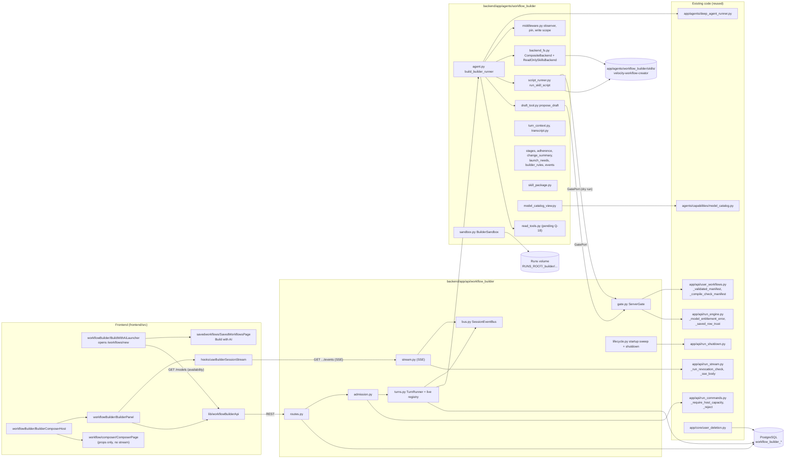
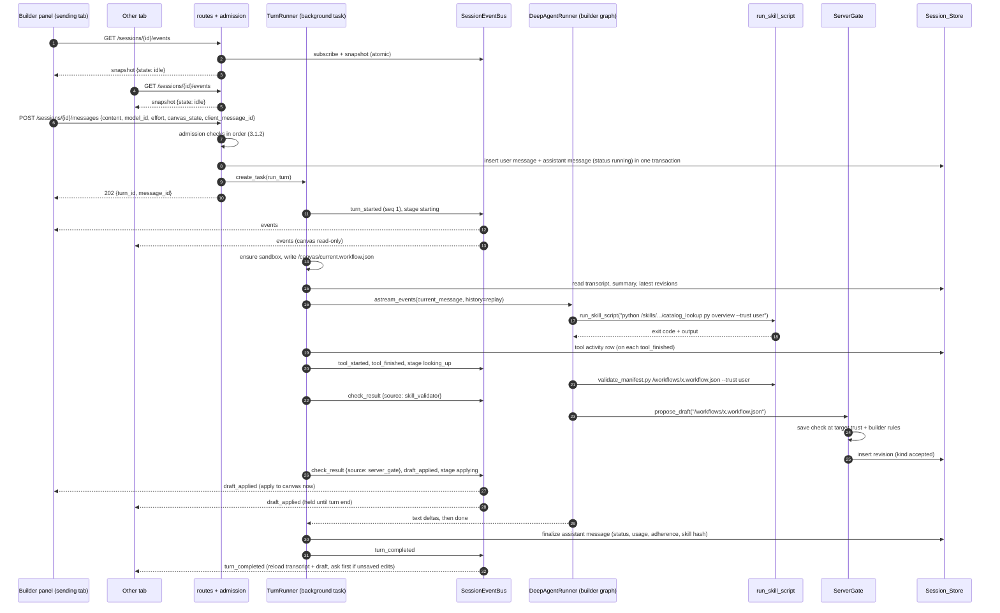
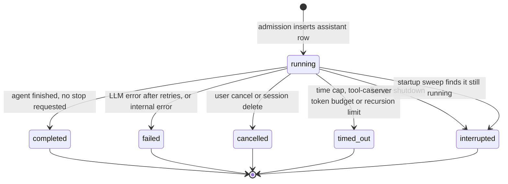
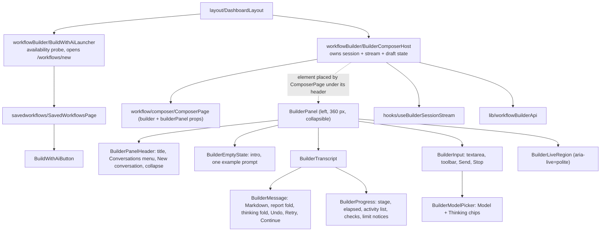
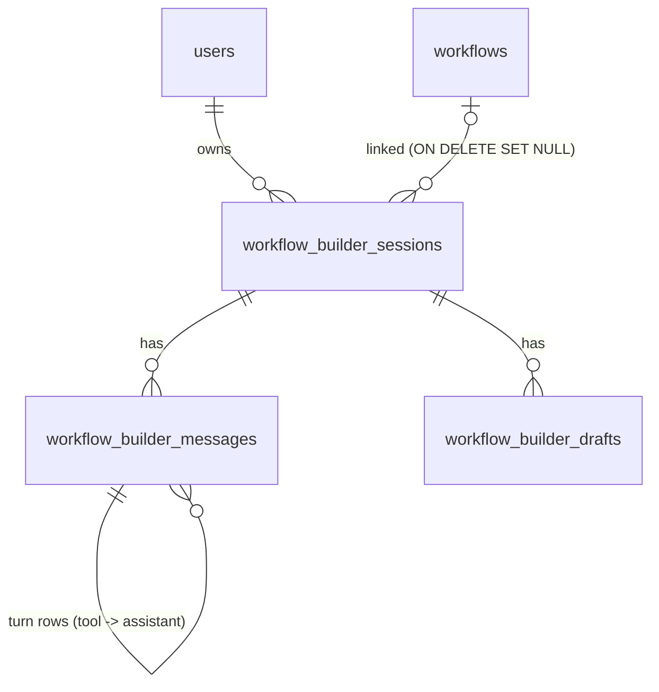

# Design Document: AI Workflow Builder

## Overview

Users build and edit workflows on `/workflows/new` and `/workflows/{id}/edit` by chatting with a dedicated deep agent, the Builder_Agent. The agent follows the unmodified `velocity-workflow-creator` skill, reads its guides through a read-only `/skills/` route, runs its scripts through an allow-listed subprocess tool, and hands a manifest to the server with `propose_draft`. The server checks every draft with the same code Save uses, plus the builder rules, before any tab sees it. Progress reaches every open tab over one SSE stream per session. Commands go up over REST.

This design satisfies `.kiro/specs/ai-workflow-builder/requirements.md` (cited as "Req N.M") and treats the v0.4 draft at `specs/023-ai-workflow-builder/requirements.md` (cited as FR-, S-, Q-, R- and "draft §") as binding background. A bare § number refers to a section of this document. Where the design has to pick something the requirements leave open, it says **Design proposal (pending G-NN / Q-NN)**, gives the reason and the alternative, and lists the pick in "Decisions the design proposes" at the end. Nothing marked that way is a decision until you confirm it.

### 1.1 What the design does, in one paragraph per layer

- **Frontend.** A left-side chat panel lives in a new feature folder outside `components/workflow`; `ComposerPage` only places the panel element under its header (amended 2026-11-10: the earlier popup is gone, see §3.10.2). A session-stream hook reads SSE with `fetch` and a `ReadableStream` reader. A host component passes drafts, the running-turn flag and a canvas-state getter to `ComposerPage` as props. `ComposerPage` gains one explicit apply-draft path keyed on the draft revision, which replaces the run-once seeding for builder drafts.
- **API layer** (`backend/app/api/workflow_builder/`). Thin routes, the send-message admission sequence, the session event stream, the in-process fan-out bus, the live-turn registry and Turn_Runner, the Server_Gate adapter (which reuses `_validated_manifest` and `_compile_check_manifest`), the startup sweep and the shutdown step.
- **Agent layer** (`backend/app/agents/workflow_builder/`). The builder agent factory over `DeepAgentRunner`, the composite file backend with a read-only skills route, the observer middleware (call ids, write scope, limits, stage input), `run_skill_script`, `propose_draft`, the read-tool port, and pure modules for stages, adherence, change summary, launch needs, builder rules, transcript replay and the skill package hash.
- **Persistence.** Three new tables in one additive migration (`0051`), a per-session sandbox on the runs volume, and builder rows added to account deletion.
- **Kernel.** No change. The ExecutionEngine is not touched (SC-001, INV-1).

### 1.2 Code facts found while designing

These were checked in the code on 2026-11-05. Some change how a requirement has to be met. None changes a requirement.

| # | Fact | Where | Effect on the design |
|---|---|---|---|
| D-01 | `FilesystemMiddleware` evicts the **last** `HumanMessage` to `/conversation_history/<uuid>.md` when it exceeds `NUM_CHARS_PER_TOKEN * 50000` = 200,000 characters, and shows the model a truncated stub. `DeepAgentRunner._astream_events_once` sends exactly one `HumanMessage`. | `deepagents/middleware/filesystem.py` `_check_eviction_needed`; `deep_agent_runner.py` | A 250,000-token replay (Req 25.3) inside one message would be evicted. The replay goes in as prior messages through a new optional `history` argument (§2.4). |
| D-02 | `read_file` truncates any single read at 80,000 characters (`NUM_CHARS_PER_TOKEN * tool_token_limit_before_evict`, default 20,000 tokens). `docs/catalog.md` is 86,124 bytes. | `filesystem.py` `_truncate`; file sizes | `docs/catalog.md` can never be read whole in one call. SKILL.md already says not to read it and to ask `catalog_lookup.py` instead. The adherence record only tracks the four mandatory files, which are 17,852 to 20,141 bytes each. |
| D-03 | Any tool result longer than 80,000 characters is written to `/large_tool_results/<tool_call_id>` and replaced by a stub. | `filesystem.py` `_intercept_large_tool_result` | The script runner keeps its whole tool result, header included, at or under 80,000 characters (§3.4.6). |
| D-04 | deepagents middleware writes `/large_tool_results/` and `/conversation_history/` straight to the default backend, not through the agent's tools. | `filesystem.py`, `summarization.py` | Those folders land in the session sandbox. The `/workflows/`-only write rule applies to the agent's own tool calls (Req 27.3). |
| D-05 | `DeepAgentRunner` emits `tool_call` and `tool_result` events with the tool name and args but no call id. `awrap_tool_call` middleware sees `request.tool_call["id"]`. | `deep_agent_runner.py` `_astream_events_once` | Tool activity comes from a builder middleware, which can pair `tool_started` and `tool_finished` by call id (Req 38.9). |
| D-06 | User-supplied middleware is appended after deepagents' summarization middleware, so its `wrap_model_call` sees the request after summarization changed it. | `deepagents/graph.py` lines 711–747 | A pinning middleware can restore the turn's message after in-turn summarization (Req 28.3). |
| D-07 | `DeepAgentRunner.__init__` builds its backend only from `run_sandbox` (`ValidatingFilesystemBackend(root_dir=..., virtual_mode=True)`), and already accepts `checkpointer=None`. With `skills_sources` set it excludes `task` and `execute`. | `deep_agent_runner.py` | Stateless turns need no runner change. A composite backend and extra middleware need two optional keyword arguments (§2.4). |
| D-08 | Next.js 16.3.4: `window.history.replaceState` syncs with `usePathname` and `useSearchParams`. `DashboardLayout` mounts `ComposerPage` with `key={savedComposition?.id ?? "new"}`, and the `/workflows/{id}/edit` cold-mount effect in `app/[...view]/page.tsx` fetches the row and sets `savedComposition`. | `node_modules/next/dist/docs/01-app/01-getting-started/04-linking-and-navigating.md`; `DashboardLayout.tsx` ~3338; `page.tsx` ~4100 | Changing the URL after the first save (Req 3.8) would remount the composer and lose the session state. A path-keyed shallow-navigation guard is needed (§3.10.6). |
| D-09 | `manifestStepsToGateSelections` copies `model.model` and not `model.effort`. | `store/api/userWorkflows.ts` ~880 | R-12 is real. The fix is one line (§3.10.7). |
| D-10 | Composer Save sends `agent_ids: pipelineAgents.map((a) => a.id)` (bare instance ids) and `agentToManifestStep` writes composer defaults such as `tools.exec: false` and `gates: []`. `export_manifest.py --save-payload` sends `compiled_root_ids` (`custom-agent:<instance_id>`). | `ComposerPage.tsx` `handleSave`; `userWorkflows.ts` ~340; `export_manifest.py` | FR-09.7 equivalence needs a stated canonical form and a `compiledRootIds` helper (§3.10.8). |
| D-11 | No feature-flag mechanism and no request rate limiter exist in the backend. | `app/core/config.py`, `app/api/` | The design adds no feature flag (the builder is always on) and counts stored messages for the rate limit. |
| D-12 | Account deletion goes through `app/core/user_deletion.py::delete_user_dependents`, called from `api/admin.py::delete_user`. | `user_deletion.py` | Builder tables join that function (Req 31.7). |
| D-13 | `build_model` already sends `thinking.display` from `Reasoning.display`: `"summarized"` for Sonnet 5.5 and Haiku 5.5. Opus 4.6 is `budget` mode with no display field. | `model_factory.py` ~290–335; `model_catalog.py` | Req 5.3 needs no new code. G-28's "where is support recorded" is `Reasoning.display`. |
| D-14 | `ModelEntry` is a frozen dataclass whose fields all lack defaults. `ModelCatalogEntry` in `api/capabilities.py` projects fields one by one. No `asdict(ModelEntry)` exists. | `model_catalog.py`; `capabilities.py` | New builder flags go last with defaults and cannot leak into existing responses (Req 41.5, 41.7). |
| D-15 | The Alembic head is `0050` (`uv run alembic heads` prints `0050 (head)`). | `backend/alembic/versions/0050_run_manifest_json.py` | The new migration is `0051`. |
| D-16 | `_compile_check_manifest(manifest, source_label, trust)` raises `HTTPException(422)` with the compiler's message in `detail`. `_model_entitlement_error(tier, manifest=...)` returns `(422, msg)` for an unknown model and `(403, reason)` for an unentitled one. | `user_workflows.py`; `run_engine.py` | The gate wraps both and turns their messages into tool-result errors. |
| D-17 | `_require_host_capacity(current_user)` and `_reject(code, error, ...)` live in `run_commands.py`. The frontend's `ApiError` constructor notifies `ServiceBusyProvider` for any 503 `host_capacity_exhausted`. | `run_commands.py` ~2797; `frontend/src/lib/api.ts` ~179 | The builder reuses both. The busy modal appears with no new frontend code, as long as the builder client throws `ApiError`. |
| D-18 | `SkillsMiddleware` truncates descriptions at 1,024 characters. The skill's description is 1,097 characters. | `deepagents/middleware/skills.py` line 147 | Confirms S-06. The system prompt restates the cut sentence (Req 19.5). |

## Architecture

### 2.1 Component view



### 2.2 Where each module lives

| Module | Path | Responsibility |
|---|---|---|
| Router package | `backend/app/api/workflow_builder/__init__.py` | Exports `router`. Registered in `app/main.py` next to `user_workflows_router`. |
| Routes | `.../workflow_builder/routes.py` | Thin handlers: validate, delegate, shape the response. |
| Schemas | `.../workflow_builder/schemas.py` | Pydantic request and response models (§3.2). |
| Admission | `.../workflow_builder/admission.py` | The ordered send-message checks (§3.1.2). |
| Stream | `.../workflow_builder/stream.py` | `GET /sessions/{id}/events`, snapshot, keep-alive, revocation (§3.3). |
| Bus | `.../workflow_builder/bus.py` | In-process fan-out per session (§3.3.5). |
| Turns | `.../workflow_builder/turns.py` | `TurnRunner`, `LiveTurn`, `_LIVE_TURNS`, `_TURN_TASKS`, cancel, caps (§3.1). |
| Gate | `.../workflow_builder/gate.py` | `ServerGate` adapter that implements `GatePort` (§3.5). |
| Store | `.../workflow_builder/store.py` | Session_Store repository. Every query filters on `user_id` (§4). |
| Lifecycle | `.../workflow_builder/lifecycle.py` | `builder_startup()` and `stop_builder_turns()` (§3.1.6). |
| Agent package | `backend/app/agents/workflow_builder/__init__.py` | Imports nothing, so `python -m app.agents.workflow_builder.skill_package` stays light for the image build. |
| Agent factory | `.../agents/workflow_builder/agent.py` | `build_builder_runner(turn_inputs) -> DeepAgentRunner`. |
| Prompts | `.../agents/workflow_builder/prompts/system_prompt.v1.md`, `transcript_summary.v1.md` | Versioned prompt files (§3.6.1). |
| File backend | `.../agents/workflow_builder/backend_fs.py` | `ReadOnlySkillsBackend`, `build_builder_backend()` (§3.6.4). |
| Middleware | `.../agents/workflow_builder/middleware.py` | `BuilderToolObserverMiddleware`, `PinnedTurnMessageMiddleware` (§3.6.5). |
| Script runner | `.../agents/workflow_builder/script_runner.py`, `script_policy.py` | Parsing, policy data, subprocess execution (§3.4). |
| Draft tool | `.../agents/workflow_builder/draft_tool.py` | `propose_draft` (§3.5.2). |
| Read tools | `.../agents/workflow_builder/read_tools.py` | `BuilderReadPort` and placeholder tools, pending Q-18 (§3.7). |
| Pure logic | `.../agents/workflow_builder/{stages,adherence,change_summary,launch_needs,builder_rules,canonical,events}.py` | No I/O. The main targets of unit and property tests. |
| Turn input | `.../agents/workflow_builder/{turn_context,transcript}.py` | Turn_Context text, replay selection, summary prompt (§3.6.2, §3.6.3). |
| Sandbox | `.../agents/workflow_builder/sandbox.py` | `BuilderSandbox` paths, rebuild, temp folders, delete (§4.5). |
| Skill package | `.../agents/workflow_builder/skill_package.py` | Fixed skill path, skill hash and line counts from disk. Standard library only (§3.8). |
| Model view | `.../agents/workflow_builder/model_catalog_view.py` | Chat_List and Step_List over `ModelCatalog`, startup check (§3.9). |
| ORM | `backend/app/models/workflow_builder.py` | Three models (§4). |
| Migration | `backend/alembic/versions/0051_workflow_builder.py` | Additive, `down_revision = "0050"`. |
| Skill folder | `backend/app/agents/workflow_builder/skills/velocity-workflow-creator/` | The only copy of the Skill, edited in place (§3.8). |
| CI check | `backend/tools/ci/builder_skill_checks.py` | `--selftest`, `--step-models` (§3.8.3). |
| Frontend feature | `frontend/src/components/workflowBuilder/` | Panel, empty state, transcript, progress, picker, history menu, live region, reducer, follow-scroll hook. |
| Frontend hook | `frontend/src/hooks/useBuilderSessionStream.ts` | SSE reader for one session. |
| Frontend API | `frontend/src/lib/workflowBuilderApi.ts` | REST client built on `authedFetch`, throws `ApiError`. |

### 2.3 Boundaries and invariants

- **SC-001 and INV-1.** The builder runs outside the ExecutionEngine. No file under `backend/agents/execution_engine/` changes. No `if pipeline_type ==` branch is added anywhere (Req 18.5, 18.6, 48.1). The banned-pattern tests keep passing unchanged.
- **Ports and adapters (draft §8.6).** The agent layer never imports `app.api`. `propose_draft` and the `--compiler` dry run depend on a `GatePort` protocol defined in `app/agents/workflow_builder/ports.py`. The API layer supplies the adapter, `ServerGate`, which calls `_validated_manifest` and therefore `_compile_check_manifest`. That keeps the engine import where it already is, inside `_compile_check_manifest`'s lazy import (Req 48.6).
- **Import-linter.** The existing contracts stay green: nothing new under `agents.workflows`, `agents.capabilities` (other than plain dataclass fields), or `agents.runtime` imports `app` or the kernel, and no shipped module imports `tools`. The CI tool `tools.ci.builder_skill_checks` may import the standard-library-only `app.agents.workflow_builder.skill_package`. That direction (tools to app) is not forbidden.
- **INV-12.** One model list. The builder flags are fields on the existing `ModelEntry` rows. The chat-models endpoint reuses the `ModelCatalogEntry` projection (Req 41.6, 41.14, 48.4).
- **INV-13.** The agent is built through `DeepAgentRunner` over the real `deepagents` library (Req 18.1, 48.2).
- **LOCK-B.** SSE down, REST up, no WebSocket (Req 48.3). The SSE event names avoid the five retired WS tokens checked by `test_sse_cutover_banned_patterns.py`.
- **INV-3.** The only shared-code change is additive keyword arguments on `DeepAgentRunner` with defaults that reproduce today's graph and input exactly (§2.4). The characterization goldens must stay byte- and event-identical (Req 48.8, 49.13).
- **Composer stays stream-free.** `ComposerPage` gets drafts and the running-turn flag as props. The stream hook lives in `frontend/src/hooks/`, and the panel in `frontend/src/components/workflowBuilder/` (Req 40.10, 48.9, 48.10).
- **One process.** Live turn state stays in process, like `_PIPELINE_QUEUES`. Everything that must survive a restart is stored: turn status, tool activity, revisions and unproposed work (Req 48.16).

### 2.4 The additive `DeepAgentRunner` change

Three optional parameters. Every existing caller passes none of them, so the graph, the middleware list and the input messages are the same objects in the same order as today.

```python
class DeepAgentRunner:
    def __init__(
        self,
        system_prompt: str,
        tools: list,
        *,
        # ... every existing parameter, unchanged ...
        backend: "BackendProtocol | None" = None,          # NEW
        extra_middleware: "Sequence[AgentMiddleware]" = (), # NEW
    ) -> None:
        if backend is not None and run_sandbox is not None:
            raise ValueError("pass run_sandbox or backend, not both")
        ...
        # existing: backend = ValidatingFilesystemBackend(...) when run_sandbox is given
        graph_backend = backend if backend is not None else <existing value>
        ...
        _middleware = [<existing four>, <existing path guard when attached>, *extra_middleware]
        self._graph = create_deep_agent(..., middleware=_middleware, backend=graph_backend, ...)

    async def astream_events(
        self, user_message: "str | list", *, history: "Sequence[BaseMessage] | None" = None  # NEW
    ) -> AsyncGenerator[dict[str, Any], None]: ...

    async def _astream_events_once(
        self, user_message: "str | list", *, history: "Sequence[BaseMessage] | None" = None  # NEW
    ):
        messages = [*(history or ()), HumanMessage(content=user_message)]
        async for event in self._graph.astream_events({"messages": messages}, config=self.config, version="v2"):
            ...  # body unchanged
```

- `history=None` gives `[HumanMessage(content=user_message)]`, the current input.
- `extra_middleware=()` leaves `_middleware` unchanged. Builder middleware go last, after the reserved-path guard, so the tool filter still runs first.
- `backend=None` leaves the current branch unchanged. The builder passes `run_sandbox=None` and its composite backend, so the reserved-path guard (keyed on `run_sandbox`) does not attach. The builder's own write-scope check replaces it.
- The builder passes `checkpointer=None`, `interrupt_on=None` and `skills_sources=["/skills/"]`. That last argument already excludes `task` and `execute` (D-07, Req 28.2).
- New unit tests: `tests/unit/app/agents/test_deep_agent_runner_additive.py` asserts that a runner built without the new arguments produces the same middleware class list and the same first-call messages as before, and that passing both `backend` and `run_sandbox` raises. The INV-3 golden run is the acceptance gate.

## Components and Interfaces

### 3.1 Turn lifecycle

#### 3.1.1 From POST to `turn_completed`



#### 3.1.2 Send-message check order

**Design proposal (pending G-05).** The checks run in this order. The first failure answers the request. Nothing is stored and no event is sent for a refused request, so a refused request never counts toward any limit.

| # | Check | Refusal | Why here |
|---|---|---|---|
| 1 | Authentication (`get_current_principal`) | 401 (existing dependency) | Before anything else. |
| 2 | (removed) | none | The builder has no feature flag. The number stays so the other checks keep theirs. |
| 3 | Custom entitlement: `can_run_pipeline(effective_tier(user, principal), "custom")` | 403 `custom_entitlement_required` | Answers before any session lookup, so it reveals nothing about session ids (G-07). |
| 4 | Builder readiness (skill package verified, startup sweep done) | 503 `builder_unavailable`, `recoverable: false` | A broken deployment refuses all builder work. |
| 5 | Body schema (Pydantic): `content` length in code points, not whitespace-only; `client_message_id` shape; `canvas_state` is an object | 422 | FastAPI resolves the body after the dependencies in 1–4. |
| 6 | Session lookup by `id` and `user_id` | 404 `session_not_found` | IDOR rule (Req 2.7). |
| 7 | Duplicate `client_message_id` in this session | 202 with the original `turn_id` and `message_id`, `replayed: true` | Before the running check, so a retried POST of the turn that is running gets its own ids, not a 409 (Req 21.10). |
| 8 | Running turn in this session (stored state) | 409 `turn_running` | Req 21.7, 21.8. |
| 9 | `model_id` on the entitled Chat_List; GPT excluded | 422 `model_not_allowed` or 403 `model_not_entitled` | **Design proposal (pending G-06):** keep the existing `_model_entitlement_error` split (unknown is 422, unentitled is 403) so the two surfaces answer alike. |
| 10 | `effort` in the model's `reasoning.levels`; `null` only when the model has no levels | 422 `effort_not_allowed` | Req 26.3. |
| 11 | `canvas_state` structure (§3.2.3) and size: compact UTF-8 JSON at most 524,288 bytes | 422 `canvas_state_invalid` or 413 `canvas_state_too_large` | **Design proposal (pending G-23):** 512 KB means 524,288 bytes of `json.dumps(..., separators=(",", ":"), ensure_ascii=False).encode()`. |
| 12 | Turns in this session `< 100` | 409 `session_turn_limit` | Counts assistant messages of every status except `failed` turns that were later retried (G-23). |
| 13 | Messages per user in the last 60 s `< 5` (rolling window over stored user messages) | 429 `rate_limited`, `Retry-After` = seconds until the oldest of the five leaves the window | Stored rows only, so refused requests do not count. |
| 14 | Running turns for this user `< 2` | 429 `too_many_running_turns`, `Retry-After: 15` | Req 47.10. |
| 15 | Capacity gate: `_require_host_capacity(current_user)` | 503 `host_capacity_exhausted`, `recoverable: true`, `Retry-After` | Last, so the busy modal only appears for a message that will succeed when sent again (Req 29.1–29.4). Admins are exempt inside the existing function. |
| 16 | Insert user message and running assistant message in one transaction; start the task | 202 | A partial unique index makes a second running turn impossible even in a race (§4.2). An `IntegrityError` maps to 409 `turn_running`. |

Steps 6 to 16 run under a per-user `asyncio.Lock` held in `admission.py`. In one process this makes the per-user counts in 12–14 exact. The partial unique index is the restart-safe guard for the per-session rule.

#### 3.1.3 Turn state machine



`LiveTurn` holds one `stop_reason` that is set once. The first stop signal wins, then the task is cancelled. Later signals are ignored.

| Stop signal | `stop_reason` | Stored status | Unproposed revision stored |
|---|---|---|---|
| none, graph ended | `null` | `completed` | **Design proposal (pending G-12):** yes, when the outcome is `unfinished` (see the gate row) |
| 900 s cap (`BUILDER_TURN_TIMEOUT_SECONDS`) | `time` | `timed_out` | yes (Req 23.18) |
| 61st tool call | `tool_calls` | `timed_out` | yes |
| token budget (when set after the Spike) | `tokens` | `timed_out` | yes |
| LangGraph recursion limit | `recursion` | `timed_out` | yes |
| second `propose_draft` rejection | `gate_rejections` | `completed`, outcome `unfinished` | yes (pending G-12) |
| user cancel | `cancelled` | `cancelled` | yes |
| session delete | `deleted` | not stored (rows are removed) | no |
| shutdown | `shutdown` | `interrupted` | yes |
| startup sweep | `restart` | `interrupted` | yes, from file times (§3.1.6) |
| LLM failure or internal error | `error` | `failed` | yes |

**Design proposal (pending G-04).** The tool-call cap, a token budget and the recursion limit end the turn as `timed_out` with a `stop_reason`. All three are the same user situation as the time cap: the turn ran out of a budget, the work is kept, and Continue picks it up (J9). The panel words the notice by `stop_reason`, for example "This turn stopped at the tool-call limit. The work so far is kept." The alternative, a new status such as `limited`, would change the fixed status set in Req 21.9. The recursion limit is `AGENT_RECURSION_LIMIT = 2500` graph steps, which the 60-call cap reaches long before. It is detected from the runner's `error` event text ("Recursion limit"), and kept for safety.

**Design proposal (pending G-12).** After the second rejection the turn ends `completed` with outcome `unfinished`, the reply explains which checks failed, and the agent's last manifest is stored as an unproposed revision so "continue" can pick it up. FR-24.8 lists only `timed_out`, `interrupted`, `cancelled` and `failed`, so storing it here is an extension that needs your approval. The alternative is to store nothing and let "continue" start from the canvas.

#### 3.1.4 Turn runner

```python
@dataclass
class LiveTurn:
    session_id: str
    turn_id: str                 # == assistant message id
    user_message_id: str
    user_id: str
    model_id: str
    effort: str | None
    started_at: float            # monotonic, set after admission (Req 28.5)
    seq: int = 0                 # last event seq for this turn
    stage: Stage = Stage.STARTING
    activity: list[ToolActivity] = field(default_factory=list)
    checks: list[CheckResult] = field(default_factory=list)
    tool_calls: int = 0
    gate_rejections: int = 0
    accepted_revision: int | None = None
    changed_workflow_files: dict[str, float] = field(default_factory=dict)
    usage: TokenUsage = field(default_factory=TokenUsage.zero)
    stop_reason: StopReason | None = None
    stopping: bool = False
    task: asyncio.Task | None = None

    def stop(self, reason: StopReason) -> None:
        if self.stop_reason is None:
            self.stop_reason = reason
            self.stopping = True
            if self.task is not None:
                self.task.cancel()
```

```python
async def run_turn(turn: LiveTurn, inputs: TurnRequest) -> None:
    status: TurnStatus = "failed"
    cap = loop.call_later(settings.BUILDER_TURN_TIMEOUT_SECONDS, turn.stop, "time")
    warn = loop.call_later(0.8 * settings.BUILDER_TURN_TIMEOUT_SECONDS, emit_limit_warning, turn, "time")
    try:
        await publish(turn, TurnStarted(...)); await set_stage(turn, Stage.STARTING)
        sandbox = await ensure_sandbox(turn)              # rebuild from DB if missing (Req 20.12)
        await write_canvas_file(sandbox, inputs.canvas_state)
        agent_input = await build_agent_input(turn, inputs)   # replay, summary, Turn_Context (3.6)
        runner = build_builder_runner(turn, agent_input, sandbox)
        async for ev in runner.astream_events(agent_input.current, history=agent_input.history):
            await on_runner_event(turn, ev)              # thinking, text, usage, error
        status = turn.status_from_stop() or ("failed" if turn.fatal_error else "completed")
    except asyncio.CancelledError:
        status = turn.status_from_stop() or "cancelled"
    finally:
        cap.cancel(); warn.cancel()
        await asyncio.shield(finalize_turn(turn, status))  # store, unproposed revision, turn_completed
```

- `on_runner_event` ignores the runner's own `tool_call` and `tool_result` events (D-05). Tool activity comes from `BuilderToolObserverMiddleware`, which calls back into the turn for `tool_started`, `tool_finished`, `check_result` and stage changes.
- `usage` events are summed into `turn.usage`. When a token budget is configured, crossing 80 % sends `limit_warning {kind: tokens}` and crossing 100 % calls `turn.stop("tokens")`.
- An `error` event sets `turn.fatal_error` with `map_exception(...)`'s code. If its text contains "Recursion limit", the turn stops with `recursion`.
- `finalize_turn` runs the blocking database writes in `asyncio.to_thread`, so a shutdown that cancels the task still persists the row while the loop is alive.
- The turn task is registered in `_TURN_TASKS` (a set) and `_LIVE_TURNS[session_id]`. Both entries are removed in `finalize_turn` after `turn_completed` is published.

#### 3.1.5 Cancel

`POST /sessions/{id}/turns/{turn_id}/cancel` looks up the session by owner, then the live turn. If it is running, it calls `turn.stop("cancelled")` and returns 202 `{state: "cancelling"}`. The task's `CancelledError` reaches whichever await is active:

- a model call: the graph stream closes;
- `run_skill_script`: the tool's `finally` kills the subprocess (`proc.kill()`, then `await proc.wait()`) and removes the call's temp folder (Req 30.2, 31.6);
- a gate check in `asyncio.to_thread`: the thread finishes on its own and its result is discarded, because `propose_draft` checks `turn.stopping` before it stores a revision or publishes `draft_applied` (Req 30.4).

**Design proposal (pending G-35).** A cancel for a turn that is not running returns 200 `{state: "not_running"}`, so a double click or a late cancel from another tab is harmless. A draft accepted before the cancel stays: `turn_completed` carries `status: cancelled` and `outcome: draft`. The time bound for stopping is the next await point. Measured script calls take 0.46 to 1.1 s (S-17), and a model stream closes at once.

#### 3.1.6 Time cap, shutdown and startup

- **Time cap.** `BUILDER_TURN_TIMEOUT_SECONDS` defaults to 900 and is counted from the moment the task starts after admission (Req 28.5). `limit_warning {kind: time, used: 720, limit: 900}` goes out at 80 % (Req 28.6). The same 80 % point also adds a notice to the agent's next tool result (Req 28.9, §3.6.5). The Spike replaces the value through the setting (Req 28.11).
- **Shutdown.** **Design proposal (pending G-17).** A new first step in `shutdown_run_infrastructure()`, before the Concierge drain, calls `stop_builder_turns(reason="shutdown")`. It sets `stop_reason = "shutdown"` on every live turn, cancels the tasks, waits up to `BUILDER_SHUTDOWN_PERSIST_SECONDS = 2.0` for their `finalize_turn` to store `interrupted`, then puts a `None` sentinel on every builder stream queue so the streams close. It runs first because uvicorn allows only 5 s (`--timeout-graceful-shutdown 5`). Script subprocesses die through the cancellation path above. A stopping turn cannot emit a draft (`turn.stopping`). Anything not stored in time is caught by the startup sweep.
- **Startup.** `builder_startup()` runs in the `lifespan` before "Backend ready", after the database is reachable:
  1. Verify the skill package (§3.8.5) and the builder model catalog (§3.9.3). A bad catalog raises and stops the process (Req 41.8). A missing or mismatched skill package marks the builder unavailable and logs an ERROR, and the app keeps serving everything else (G-21).
  2. Sweep: `UPDATE workflow_builder_messages SET status='interrupted', stop_reason='restart', ended_at=now() WHERE role='assistant' AND status='running'`. For each swept turn, the newest `*.workflow.json` under the session's `/workflows/` with a modification time at or after the turn's `started_at` is stored as an unproposed revision (Req 22.2–22.5).
  3. No turn is restarted and no model is called (Req 22.5).

  The lifespan finishes before uvicorn accepts connections, so no message or stream is served before the sweep ends (G-17). If the sweep itself fails, the builder is marked unavailable for this process, because a row left `running` would block that session with 409s.

### 3.2 REST API

All routes sit under `/api/workflow-builder` and depend on `require_builder_access`, a dependency that runs checks 1 to 4 of §3.1.2 and returns `(user, principal, tier)`.

#### 3.2.1 Endpoints

| Method and path | Purpose | Success | Notes |
|---|---|---|---|
| `GET /models` | Chat_List for this user, default model, default efforts | 200 `BuilderModelsResponse` | Also the frontend's availability probe (§3.10.2). |
| `POST /sessions` | Create a session (create or edit mode) | 201 `SessionDetail` | Edit mode checks ownership of `workflow_id` and stores revision 0 (Req 20.13–20.15). |
| `GET /sessions?cursor=&limit=` | List own sessions, newest activity first | 200 `SessionPage` | Keyset pagination on `(updated_at, id)`. Default 20, maximum 50. |
| `GET /sessions/{id}` | Metadata, transcript, latest draft, newer unproposed revision, running-turn snapshot, linked-row change note | 200 `SessionDetail` | Req 12.6. |
| `DELETE /sessions/{id}` | Cancel any running turn, delete rows and sandbox, notify streams | 204 | Req 31.2–31.4. |
| `POST /sessions/{id}/messages` | Send a message | 202 `TurnAccepted` | §3.1.2. |
| `POST /sessions/{id}/turns/{turn_id}/retry` | Retry a failed turn without a second user message | 202 `TurnAccepted` | G-01, below. |
| `POST /sessions/{id}/turns/{turn_id}/cancel` | Cancel the running turn | 202 or 200 | §3.1.5. |
| `POST /sessions/{id}/undo` | Restore the canvas state that started the latest AI change | 200 `DraftRevisionOut` | §3.2.4. |
| `POST /sessions/{id}/link` | Link to a saved workflow the user owns | 200 `SessionSummary` | Req 2.9, 2.10. |
| `GET /sessions/{id}/events` | Session_Stream (SSE) | 200 `text/event-stream` | §3.3. |

**Design proposal (pending G-01): Retry.** Retry does not resend the message. `POST .../turns/{turn_id}/retry` accepts only the latest turn of the session when it ended `failed`. It runs checks 8 to 16 of §3.1.2 and creates a new running assistant message whose `reply_to_message_id` is the same user message. The transcript shows the user message once, and the failed reply stays as a collapsed "failed, retried" line. Replay uses only the newest reply to each user message. This keeps `client_message_id` idempotency strict: a repeated id never starts a turn. The alternative, resending the text with a new `client_message_id` and hiding the earlier copy, would store the message twice.

**Design proposal (pending G-24).** Titles are made without a model call: the first line of the first message, whitespace collapsed, cut at 60 characters with an ellipsis. The panel's empty state lists the 5 most recent sessions (the popup did before 2026-11-10), and the full list is in the panel's Conversations menu. "Row changed since the latest draft" compares the canonical hash (§3.10.8) of the saved row's manifest with the hash stored on the session at its latest draft or save.

**Design proposal (pending G-07).** A link or edit-session request naming a workflow the user does not own, or one that does not exist, returns 404 `workflow_not_found`, following the IDOR rule. Entitlement (403) is checked before any lookup, so it always wins over an unknown session or workflow.

#### 3.2.2 Schemas

```python
TurnStatus = Literal["running", "completed", "failed", "cancelled", "timed_out", "interrupted"]
StopReason = Literal["time", "tool_calls", "tokens", "recursion", "gate_rejections",
                     "cancelled", "deleted", "shutdown", "restart", "error"]
Outcome = Literal["draft", "reply", "unfinished"]
RevisionKind = Literal["seed", "accepted", "undo", "unproposed"]
TargetTrust = Literal["user", "db"]

class CreateSessionRequest(BaseModel):
    mode: Literal["create", "edit"]
    workflow_id: str | None = None            # required when mode == "edit"
    model_id: str
    effort: str | None = None

class SendMessageRequest(BaseModel):
    content: str                              # 1..BUILDER_MAX_MESSAGE_CHARS code points, not whitespace-only
    model_id: str
    effort: str | None
    canvas_state: dict[str, Any]
    client_message_id: str = Field(pattern=r"^[A-Za-z0-9_-]{8,64}$")

class TurnAccepted(BaseModel):
    turn_id: str
    message_id: str
    replayed: bool = False

class ToolActivityOut(BaseModel):
    call_id: str
    tool: str
    kind: Literal["read", "write", "script", "lookup", "propose"]
    label: str
    status: Literal["running", "ok", "error", "refused", "timed_out"]
    duration_ms: int | None
    command: str | None                       # script calls only
    exit_code: int | None                     # script calls only
    summary: str | None

class CheckResultOut(BaseModel):
    source: Literal["skill_validator", "platform_dry_run", "server_gate"]
    verdict: Literal["valid", "invalid", "unknown"]
    errors: int
    warnings: int
    attempt: int | None
    attempts_left: int | None

class ChangeSummary(BaseModel):
    added: list[str]; removed: list[str]; reordered: bool
    gates_changed: list[str]; validators_changed: list[str]
    models_changed: list[str]; prompts_changed: int

class LaunchNeed(BaseModel):
    kind: Literal["uploads", "design", "connector", "source_run"]
    detail: str | None = None                 # e.g. connector server name

class DraftRevisionOut(BaseModel):
    revision: int
    kind: RevisionKind
    manifest: dict[str, Any]
    target_trust: TargetTrust | None
    change_summary: ChangeSummary | None
    launch_needs: list[LaunchNeed]
    source_turn_id: str | None
    created_at: datetime

class TranscriptMessage(BaseModel):
    id: str
    seq: int
    role: Literal["user", "assistant"]
    turn_id: str
    reply_to_message_id: str | None
    status: TurnStatus | Literal["accepted"]
    outcome: Outcome | None
    stop_reason: StopReason | None
    content: str
    thinking: str | None
    model_id: str
    effort: str | None
    skill_hash: str | None
    skill_updated: bool                       # skill_hash differs from the previous assistant message
    error: ErrorOut | None
    revision: int | None                      # accepted revision of this turn
    activity: list[ToolActivityOut]           # assistant only
    activity_summary: ActivitySummary | None  # "14 actions, 2 checks, 1 min 40 s"
    created_at: datetime
    ended_at: datetime | None

class RunningTurnSnapshot(BaseModel):
    turn_id: str; message_id: str
    stage: Stage; label: str
    started_at: datetime
    through_seq: int
    activity: list[ToolActivityOut]
    checks: list[CheckResultOut]

class SessionSummary(BaseModel):
    id: str; title: str; mode: Literal["create", "edit"]
    workflow_id: str | None; model_id: str; effort: str | None
    running: bool; created_at: datetime; updated_at: datetime

class SessionDetail(SessionSummary):
    target_trust: TargetTrust
    skill_hash: str
    messages: list[TranscriptMessage]
    latest_draft: DraftRevisionOut | None
    latest_unproposed: DraftRevisionOut | None   # only when newer than latest_draft
    running_turn: RunningTurnSnapshot | None
    linked_row_changed: bool

class SessionPage(BaseModel):
    items: list[SessionSummary]
    next_cursor: str | None

class UndoRequest(BaseModel):
    expected_revision: int

class LinkRequest(BaseModel):
    workflow_id: str

class BuilderModelsResponse(BaseModel):
    models: list[ModelCatalogEntry]           # app.api.capabilities.ModelCatalogEntry, unchanged
    default_model_id: str
    default_efforts: dict[str, str | None]    # Reasoning.default_effort per model id
```

`ErrorOut` is `{code: str, message: str, retryable: bool}`. Error responses use the existing `_reject` shape from `run_commands.py`: `{"detail": {"error", "code", "recoverable", ...}}`. Validation errors go through the existing `RequestValidationError` handler in `app/main.py`, which never echoes the rejected value.

**Design proposal (pending G-27).** `default_efforts` is the extra data the picker needs. The frontend preselects the model's `default_effort` when it opens and after `modelChangePatch` returns an empty effort. A model whose `reasoning_levels` is empty sends `effort: null`. The alternative is an additive `default_effort` field on `ModelCatalogEntry`, which would change the `/api/capabilities` contract snapshot. If the stored model is no longer offered, the picker falls back to the default model and shows one line saying so. If the model list fails to load, the panel shows an error state with a Retry and disables Send.

#### 3.2.3 `canvas_state` structure check

`canvas_state` is untrusted (Req 21.11). The check is structural only:

- a JSON object with a `steps` key holding a list (it may be empty on a new canvas);
- every step a JSON object; nesting depth at most 32; no string longer than 200,000 characters;
- the size cap from check 11.

It does not run the compiler. The canvas may hold work in progress that the user has not finished.

#### 3.2.4 Undo

`POST /sessions/{id}/undo {expected_revision}`:

1. 409 `turn_running` while a turn runs.
2. The latest revision must be `expected_revision`, of kind `accepted`, produced by the latest assistant message that changed the canvas. Otherwise 409 `undo_stale` (G-16).
3. Insert a revision of kind `undo` whose manifest is the `canvas_state` stored on the user message that started that turn (Req 8.4, 8.5).
4. Publish `draft_restored` (below) and return the revision.

The confirmation for manual edits (Req 8.6, 8.7) happens in the panel before the request, so a declined prompt sends nothing.

**Design proposal (pending G-16).** Other tabs learn of an undo through a new event, `draft_restored {revision, manifest}`. Req 38 does not list it, so it needs your approval. They treat it like a draft that arrives at the end of a turn: load it, asking first when they have unsaved edits. After an undo, the Undo control disappears, because the latest revision is no longer that turn's accepted draft. The alternative is no event, with other tabs picking up the change on their next reload.

### 3.3 Session_Stream

#### 3.3.1 Endpoint

`GET /api/workflow-builder/sessions/{id}/events` follows `run_stream.stream_run_events`:

- Dependencies: `get_current_user_with_payload` and `bearer_scheme` (to capture the raw credential for re-checks), plus `require_builder_access`.
- Owner lookup by `id` and `user_id` in request scope. Missing or foreign is 404 (Req 2.7). The generator then uses its own short sessions, never the request session (the BUG-004 lesson in `run_stream.py`).
- Response: `EventSourceResponse(gen, ping=settings.SSE_KEEPALIVE_PING_SECONDS, headers={"X-Accel-Buffering": "no", "Cache-Control": "no-cache"})` (Req 40.1, 40.2).
- Frames use the existing envelope: one `data:` line holding `_sse_body(type, payload)`, that is `{"type": ..., "data": {...}}`. The frontend parses it with the existing `parseSseBlock`. Frames carry no `id:` line, because reconnection re-snapshots instead of replaying (§3.3.4).

#### 3.3.2 Event models

Every event model lives in `app/agents/workflow_builder/events.py`. The wire `data` is `model_dump(mode="json", exclude={"type"})`.

```python
class EventBase(BaseModel):
    model_config = ConfigDict(extra="forbid")
    ts: datetime

class TurnScoped(EventBase):
    turn_id: str
    seq: int                       # strictly increasing within the turn, starts at 1

class ActivityLine(BaseModel):     # same fields as ToolActivityOut
    ...

class Snapshot(EventBase):
    type: Literal["snapshot"] = "snapshot"
    state: Literal["idle", "running"]
    running_turn: RunningTurnSnapshot | None
    latest_message_id: str | None
    latest_revision: int | None
    latest_unproposed_revision: int | None

class TurnStarted(TurnScoped):
    type: Literal["turn_started"] = "turn_started"
    message_id: str
    model_id: str
    effort: str | None
    skill_hash: str

class StageChanged(TurnScoped):
    type: Literal["stage"] = "stage"
    stage: Stage
    label: str

class Thinking(TurnScoped):
    type: Literal["thinking"] = "thinking"
    text: str

class ToolStarted(TurnScoped):
    type: Literal["tool_started"] = "tool_started"
    call_id: str
    tool: str
    kind: Literal["read", "write", "script", "lookup", "propose"]
    label: str
    command: str | None            # script calls only, after secret-free normalisation

class ToolFinished(TurnScoped):
    type: Literal["tool_finished"] = "tool_finished"
    call_id: str
    status: Literal["ok", "error", "refused", "timed_out"]
    duration_ms: int
    summary: str                   # at most 280 characters

class CheckResultEvent(TurnScoped):
    type: Literal["check_result"] = "check_result"
    source: Literal["skill_validator", "platform_dry_run", "server_gate"]
    verdict: Literal["valid", "invalid", "unknown"]
    errors: int
    warnings: int
    attempt: int | None
    attempts_left: int | None

class DraftApplied(TurnScoped):
    type: Literal["draft_applied"] = "draft_applied"
    revision: int
    target_trust: TargetTrust
    change_summary: ChangeSummary
    launch_needs: list[LaunchNeed]
    manifest: dict[str, Any]

class Text(TurnScoped):
    type: Literal["text"] = "text"
    text: str

class LimitWarning(TurnScoped):
    type: Literal["limit_warning"] = "limit_warning"
    kind: Literal["time", "tool_calls", "tokens"]
    used: int
    limit: int

class TurnCompleted(TurnScoped):
    type: Literal["turn_completed"] = "turn_completed"
    status: Literal["completed", "failed", "cancelled", "timed_out", "interrupted"]
    outcome: Outcome
    stop_reason: StopReason | None
    message_id: str
    revision: int | None
    usage: TokenUsageOut

class ErrorEvent(EventBase):
    type: Literal["error"] = "error"
    turn_id: str | None
    seq: int | None
    code: str
    message: str                   # generic; never a stack trace, SQL text or path
    retryable: bool

class DraftRestored(EventBase):    # pending G-16
    type: Literal["draft_restored"] = "draft_restored"
    revision: int
    manifest: dict[str, Any]

class SessionDeleted(EventBase):
    type: Literal["session_deleted"] = "session_deleted"

class SessionRevoked(EventBase):   # the existing run-stream event name and shape
    type: Literal["session_revoked"] = "session_revoked"
    session_id: str
    reason: str

BuilderEvent = Annotated[
    Snapshot | TurnStarted | StageChanged | Thinking | ToolStarted | ToolFinished
    | CheckResultEvent | DraftApplied | Text | LimitWarning | TurnCompleted
    | ErrorEvent | DraftRestored | SessionDeleted | SessionRevoked,
    Field(discriminator="type"),
]
```

- Req 38.2: `ts` on every event; `turn_id` and `seq` on every turn-scoped event. `ErrorEvent` carries them when the error belongs to a turn.
- Req 38.16, 38.17: `ToolStarted.command` is the only raw argument on the wire. Summaries are built by the observer middleware from a fixed template per tool, never from raw output. The contract test (Req 49.6) snapshots `BuilderEvent`'s JSON schema.

#### 3.3.3 Stages

`stages.derive_stage(signal, turn_view) -> Stage | None` is a pure function. `StageChanged` is published only when the result differs from `turn.stage`.

| Signal | Stage | Label |
|---|---|---|
| turn accepted | `starting` | Starting |
| thinking delta while no tool call is running | `thinking` | Thinking |
| `read_file` path under `/skills/` | `reading` | Reading the workflow guide |
| `run_skill_script` for `catalog_lookup.py`, or any read tool from §3.7 | `looking_up` | Looking up agents, models and examples |
| `write_file` or `edit_file` on a path ending `.workflow.json` | `writing` | Writing the workflow |
| `run_skill_script` for `validate_manifest.py` (including the validator part of `--compiler`), `selftest.py`, `refresh_catalog.py --check`, `schema_sync.py --check` | `checking` | Checking the workflow |
| `propose_draft` starts, or the dry-run part of `--compiler` starts | `platform_check` | Checking with the platform |
| the gate accepts a `propose_draft` draft | `applying` | Updating the canvas |
| text delta while no tool call is running | `responding` | Writing the reply |

Other tools (`ls`, `glob`, `grep`, `write_todos`, `export_manifest.py`, help calls) do not change the stage. "Text after the last tool call" is approximated as "text while no tool call is running". If another tool call follows, the stage changes again (Req 39.10).

#### 3.3.4 Snapshot and live events (G-14)

Run streams replay a durable event log past a `Last-Event-ID` cursor and then send `stream_attached {live, replayed_through_seq}`. Builder streams cannot do that, because text and thinking deltas are not stored (Q-28). **Design proposal (pending G-14):**

1. On connect, `SessionEventBus.subscribe(session_id)` registers the client queue and builds the `Snapshot` in one synchronous block with no `await` in between. Because the event loop runs one task at a time, no event can be published between capturing the snapshot and registering the queue.
2. The snapshot's `running_turn.through_seq` is the `seq` of the last event already reflected in it. Activity comes from the in-process `LiveTurn.activity`, which is a superset of the stored tool rows (Req 40.6).
3. The client keeps `(turn_id, last_seq)` and drops any turn-scoped event whose `turn_id` matches and whose `seq <= last_seq`. Step 1 should make this rule a no-op, but it keeps the client correct if the server ever changes.
4. A tab that joins while a turn runs (`origin: "rejoined"` in §3.10.4) shows the stage, elapsed time, activity and checks, and "Still working". It does not render `text` or `thinking` deltas, because they would start mid-sentence. When `turn_completed` arrives it loads the stored final message (Req 17.9, G-28).
5. Reconnect: exponential backoff from 1 s, capped at 30 s, no give-up while the panel is mounted, the same policy as `useRunStream.ts`. Every reconnect gets a fresh snapshot. The hook stops reconnecting on 404 (session gone), on `session_deleted` and on `session_revoked`.

**Design proposal (pending G-15).** On `session_revoked` the hook calls the existing `expireSession()` from `lib/api.ts`, the same path a 401 takes through `authedFetch`. The revoked caller's running turn keeps going on the server and its result is stored. It belongs to the user, and cancelling it would lose paid-for work. On `session_deleted` the panel shows "This conversation was deleted in another tab" with a "New conversation" action, and the composer keeps its current canvas as unsaved work.

#### 3.3.5 Fan-out

`bus.py` mirrors the run fan-out's eviction policy but keeps its own registry, so builder sessions never touch `_PIPELINE_QUEUES`, `_SUBSCRIBERS` or the pump generations in `run_engine.py`.

```python
class SessionEventBus:
    _subs: dict[str, list[asyncio.Queue]]        # session_id -> client queues

    def subscribe(self, session_id: str, snapshot_fn: Callable[[], Snapshot]) -> tuple[asyncio.Queue, Snapshot]: ...
    def unsubscribe(self, session_id: str, q: asyncio.Queue) -> None: ...
    def publish(self, session_id: str, event: BuilderEvent) -> None: ...   # put_nowait; full queue -> evict
    def close_session(self, session_id: str, final: BuilderEvent | None) -> None: ...  # session_deleted, then None
    def close_all(self) -> None: ...                                     # shutdown
```

- Queues use `maxsize = settings.SSE_SUBSCRIBER_QUEUE_MAXSIZE` (1000). A full queue evicts the subscriber: it is removed and gets a `None`, so its client reconnects and re-snapshots. Nothing is dropped silently (the H-09 rule in `run_engine.py`).
- `publish` is synchronous and non-blocking. The Turn_Runner assigns `seq` before calling it, so all subscribers see the same order (Req 40.5).

#### 3.3.6 Revocation

The generator waits on its queue with `asyncio.wait_for(q.get(), timeout=settings.SSE_REVOCATION_CHECK_INTERVAL_SECONDS)`. It calls `run_stream._run_revocation_check(token=..., user_id=..., run_id=session_id)` after every `SSE_REVOCATION_CHECK_EVERY_N_EVENTS` events and on every timeout, so an idle stream between turns is still checked every 30 s (Req 40.7). The `run_id` argument is only a log label there. A failed or timed-out check returns a reason (it fails closed), and the stream sends `session_revoked` and closes (Req 40.8).

### 3.4 Script_Runner (`run_skill_script`)

#### 3.4.1 Tool signature

```python
@tool
async def run_skill_script(command: str) -> str:
    """Run one velocity-workflow-creator script, written exactly as the skill writes it,
    for example: python /skills/velocity-workflow-creator/scripts/catalog_lookup.py overview --trust user
    Returns the exit code and the combined output."""
```

The tool is a closure built per turn by `build_script_tool(ctx: ScriptContext)`. `ScriptContext` carries the sandbox, the skill root, the gate port, the turn's event callbacks and the semaphore. The model cannot name another session's sandbox, because the sandbox is not a parameter.

#### 3.4.2 Parsing

`parse_command(command: str) -> ParsedCommand | Refusal` (pure):

1. **Tokenise without a shell.** A small tokenizer splits on unquoted whitespace and removes matching single or double quotes. Backslash is a normal character, so Windows paths such as `.kiro\skills\velocity-workflow-creator\scripts\catalog_lookup.py` survive. (`shlex.split(posix=True)` would eat the backslashes.)
2. **Refuse shell syntax.** Any unquoted `&&`, `||`, `;`, `|`, `&`, `<`, `>`, a backtick, `$(` or a newline is refused before any subprocess starts (Req 34.3). **Design proposal (pending G-18):** the same characters inside quotes are literal argument text, for example `catalog_lookup.py search "a|b"`. No shell ever sees the arguments, so there is nothing to inject into. The alternative is to refuse them anywhere in the string, which would block some legitimate search words.
3. **Launcher.** Accept and drop one leading launcher: `python`, `python3`, `python3.N`, `py -3`, `py -3.N`, `uv run python` (Req 34.4). A command with no launcher is accepted too, since the runner always uses its own interpreter. Any other first token that is not a script path is refused with the hint "start the command with python". `python -c`, `python -m` and any other interpreter option are refused (Req 34.3).
4. **Script.** The next token must map (§3.4.3) to `<skill root>/scripts/<name>` with `<name>` in the policy. Anything else is refused with the list of allowed scripts (Req 35.11).
5. **Arguments.** The rest is checked against that script's rule (§3.4.4). Unknown options are refused by name, which makes the policy fail closed.

#### 3.4.3 Path mapping

`map_path(raw: str, slot: PathSlot, roots: Roots) -> Path | Refusal` (pure apart from the final `resolve()`):

1. Replace `\` with `/`.
2. If the path starts with one of `/skills/velocity-workflow-creator/`, `<skill>/`, `.kiro/skills/velocity-workflow-creator/`, `./.kiro/skills/velocity-workflow-creator/` or `../.kiro/skills/velocity-workflow-creator/`, the rest is relative to the deployed skill folder (Req 34.6).
3. Otherwise a path starting with `/` is relative to the sandbox root, and a relative path is relative to the sandbox root too, which is the subprocess's working directory (Req 34.7).
4. Normalise `.` and `..` with `posixpath.normpath` on the relative part, join, `resolve()`, and require `is_relative_to(root)` for the root that slot allows. This is the same containment test `RunSandbox` uses, and it holds for symlinks because it runs after `resolve()` (Req 34.8).

Slots come from the policy, not from guessing which arguments look like paths:

| Slot kind | Allowed root | Used by |
|---|---|---|
| `script` | `<skill>/scripts/` | argument 0 of every call |
| `sandbox_read` | sandbox, excluding `/skills/` | `validate_manifest.py` manifest, `export_manifest.py` manifest |
| `export_write` | sandbox `/exports/` | `export_manifest.py --yaml`, `--save-payload`, `--run-payload` |
| `ignored` | none (value discarded) | `validate_manifest.py --compiler <dir>` |

**Design proposal (pending G-02).** `export_manifest.py` may write only under `/exports/` in the sandbox. FR-33.4 allows outputs anywhere in the sandbox, and SR-08 allows writes only under `/workflows/` and the call's temp folder. Keeping exports out of `/workflows/` means the unproposed-revision rule (the newest changed file under `/workflows/`) and the `writing` stage only ever see manifests. The export output is never used by the product (FR-09). The alternative is to allow `/workflows/` and filter the unproposed-revision candidates by the `.workflow.json` suffix.

#### 3.4.4 The allow-list as data

`script_policy.py` holds one `ScriptRule` per script. The rules are keyed by skill id, so another builder skill would add its own table (Q-47).

```python
@dataclass(frozen=True)
class OptionSpec:
    takes_value: bool
    slot: PathSlotKind | None = None          # None: plain value, not a path

@dataclass(frozen=True)
class ScriptRule:
    script: str
    subcommands: Mapping[str, Mapping[str, OptionSpec]] | None   # catalog_lookup only
    options: Mapping[str, OptionSpec]
    positional_slots: tuple[PathSlotKind | None, ...]
    required_any: frozenset[str] = frozenset()   # e.g. {"--check"}
    refused: Mapping[str, str] = MappingProxyType({})  # option -> reason and alternative
    intercept: Literal["compiler_dry_run"] | None = None

POLICY: Mapping[str, Mapping[str, ScriptRule]] = {"velocity-workflow-creator": {...}}
```

| Script | Allowed | Refused, with the reason returned |
|---|---|---|
| `catalog_lookup.py` | `overview [--trust V]`, `models [--eu]`, `icons`, `kind KIND [--trust V]`, `agents [--all]`, `agent ID`, `skills [WORDS...]`, `workflows`, `mcp`, `trust LEVEL`, `field [PATH] [--full]`, `search WORDS...`, `example [ID] [STEP]` | `--catalog`, `--schema`: "The script always reads the skill's own catalog and schema." |
| `validate_manifest.py` | `MANIFEST` (`sandbox_read`), `--trust V`, `--summary`, `--json`, `--strict`, `--quiet-info`, `--compiler DIR` (intercepted) | `--catalog`, `--schema` (same reason) |
| `selftest.py` | no arguments | `--compiler`: "CI runs the compiler self-test." `--catalog`: as above |
| `refresh_catalog.py` | `--check` only | `--source`, `--api`, `--render`, `--token`, `--out-json`, `--out-md`, `--schema`, `--no-schema`: "The catalog is refreshed in CI. Use catalog_lookup.py to read it." A call without `--check` gets the same answer. |
| `schema_sync.py` | `--check` only | the default write mode, `--catalog`, `--schema`: "The schema never changes at run time. Use --check." |
| `export_manifest.py` | `MANIFEST` (`sandbox_read`), exactly one of `--yaml OUT`, `--save-payload OUT`, `--run-payload OUT` (`export_write`), `--message TEXT`, `--name TEXT` | outputs outside `/exports/`: "Write exports under /exports/. The canvas saves and runs the workflow." |
| any of the above | `-h`, `--help` alone or after a subcommand | |
| anything else | | "Only these scripts can run: ..." |

**Design proposal (pending G-18).** `selftest.py` takes no options (its only options are both refused). `export_manifest.py` takes exactly the options above. `refresh_catalog.py --check` refuses its path options as well, so the check always reads the skill's own three files.

#### 3.4.5 Execution

```python
async def execute(parsed: ParsedCommand, ctx: ScriptContext) -> ScriptResult:
    async with ctx.semaphore:                                   # BUILDER_MAX_CONCURRENT_SCRIPTS = 8
        tmp = ctx.sandbox.call_temp_dir(ctx.call_id)            # <sandbox>/.tmp/<call_id>/
        try:
            proc = await asyncio.create_subprocess_exec(
                sys.executable, "-B", "-s", "-X", "utf8", str(parsed.script), *parsed.args,
                cwd=ctx.sandbox.root, env=script_env(tmp),
                stdin=asyncio.subprocess.DEVNULL,
                stdout=asyncio.subprocess.PIPE, stderr=asyncio.subprocess.STDOUT,
            )
            output = await read_capped(proc.stdout, cap=ctx.output_budget,
                                       timeout=settings.BUILDER_SCRIPT_TIMEOUT_SECONDS)
            code = await proc.wait()
        except (asyncio.TimeoutError, asyncio.CancelledError):
            proc.kill(); await proc.wait(); raise_or_mark_timeout(...)
        finally:
            shutil.rmtree(tmp, ignore_errors=True)               # Req 31.6
```

- **Interpreter.** `sys.executable` is the backend's own Python 3.13 with `jsonschema` and PyYAML already installed (S-02). `-B` stops bytecode writing even if the environment were wrong. `-s` drops the user site directory. `-X utf8` matches `PYTHONIOENCODING=utf-8` on Windows. `-P` (safe path) is deliberately not used: `catalog_lookup.py` imports `refresh_catalog` and `validate_manifest` from its own folder (S-03).
- **Environment: an allow-list, not a scrub.** **Design proposal.** `script_env(tmp)` builds a new mapping from nothing: `PATH` (the interpreter's folder and the OS defaults), `SYSTEMROOT` and `PATHEXT` on Windows (Python cannot start without `SYSTEMROOT`), `PYTHONDONTWRITEBYTECODE=1`, `PYTHONIOENCODING=utf-8`, `PYTHONUTF8=1`, `PYTHONNOUSERSITE=1`, `TMP`, `TEMP` and `TMPDIR` set to `tmp`, `HOME` and `USERPROFILE` set to `tmp`, and `LANG=C.UTF-8`. Nothing else crosses: no `DATABASE_URL`, no `AWS_*`, no Cognito or signing keys, no `VELOCITY_API_TOKEN` (Req 36.3, 36.4). A scrub list fails open when someone adds a new secret variable. An allow-list fails closed. The security test enumerates the server's own environment and asserts none of its variables except the allow-listed names reach the child.
- **Working directory.** The sandbox root, so relative paths in the skill's commands resolve inside it.
- **Timeout.** `BUILDER_SCRIPT_TIMEOUT_SECONDS = 30`, counted from process start (Req 36.5). On expiry the process is killed and the call ends with `tool_finished {status: timed_out}` (Req 36.8).
- **Concurrency.** A module-level `asyncio.Semaphore(8)` per process, which is per host because each environment runs one process (Req 36.6). **Design proposal (pending G-18):** a 9th call waits for a slot. Measured calls take about half a second, and the wait is bounded by the turn cap and by cancel.
- **Event loop.** `asyncio.create_subprocess_exec` never blocks the loop. On Windows it needs the Proactor loop, which `app/main.py` already sets. Scripts never run in the API process (Req 36.12).
- **Errors from the runner itself** (a missing interpreter, `OSError` starting the process) end the call with `status: error` and a generic summary.

#### 3.4.6 Output, cap and verdict

- stdout and stderr are merged into one pipe, which keeps the terminal order the skill expects (Req 36.9).
- `read_capped` keeps the first 60,000 characters and a rolling tail of the last 15,000. When the output is longer it returns `head + "\n[... N characters cut ...]\n" + tail` (Req 36.7). **Design proposal (pending G-18):** head and tail rather than head only, because `validate_manifest.py` prints its verdict on the last line.
- The verdict is parsed from the **uncut** tail before the cut is applied: the last non-empty line matching `^(VALID|INVALID): (\d+) error\(s\), (\d+) warning\(s\)`, or the `valid`, `errors` and `warnings` fields when `--json` was passed. No match gives `verdict: unknown` (G-18).
- The tool result is:

  ```text
  $ <the command as given>
  exit code: <n>
  <output>
  ```

  `ctx.output_budget = 80000 - len(header) - len(cut note)`, so the whole tool result stays at or under 80,000 characters and deepagents never evicts it to `/large_tool_results/` (D-03, Req 36.5).
- `tool_finished.status`: `ok` for exit code 0 or 1 from `validate_manifest.py` (an `INVALID` verdict is a successful check that found problems and is reported through `check_result`), `ok` for exit 0 from other scripts, `error` for any other non-zero exit, `timed_out` on timeout, `refused` for a policy refusal. **Design proposal (pending G-18).** A call stopped by cancel, the turn cap or a shutdown is stored as `timed_out` if the turn cap stopped it and `error` otherwise, with the summary "stopped with the turn".
- Every finished call is stored as a tool row with the command, exit code, duration and truncated output (Req 36.13, §4.3).

#### 3.4.7 The `--compiler` dry run

When `validate_manifest.py` is called with `--compiler DIR`:

1. `DIR` is discarded and the validator runs without `--compiler` in the subprocess (Req 36.1).
2. A `check_result {source: skill_validator}` is emitted from its verdict.
3. The stage changes to `platform_check`, and `ctx.gate.dry_run(manifest_path, requested_trust)` runs in the server. `requested_trust` is the call's `--trust` value: `user` and `db` are honoured, while `file` and `builtin` are answered with "Only user or db trust applies to Composer workflows" and an `unknown` verdict.
4. The dry-run result is appended after a `--- platform check (dry run, trust <t>) ---` line, and `check_result {source: platform_dry_run}` is emitted.
5. The exit code is 0 only when both the validator and the dry run pass (Req 36.1). A dry run never stores a revision, never sends `draft_applied` and never counts as a rejection (Req 36.2).

### 3.5 Server_Gate and `propose_draft`

#### 3.5.1 Gate port and adapter

```python
class GatePort(Protocol):                     # app/agents/workflow_builder/ports.py
    async def check(self, manifest: dict, *, requested_trust: TargetTrust) -> GateResult: ...
    async def dry_run(self, manifest_path: Path, *, requested_trust: TargetTrust) -> GateResult: ...

@dataclass(frozen=True)
class GateIssue:
    rule: str                 # "save_check" | "agent_allow_list" | "model_entitlement" | "step_model" | "effort" | "forbidden_feature"
    path: str                 # e.g. "steps[2].tools.exec"
    message: str

@dataclass(frozen=True)
class GateResult:
    accepted: bool
    trust: TargetTrust | None
    issues: tuple[GateIssue, ...]
```

`ServerGate` in `app/api/workflow_builder/gate.py` is built per turn with the user's effective tier:

```python
class ServerGate:
    def __init__(self, *, tier: str, max_trust: TargetTrust, step_models: StepModelView, label: str): ...

    async def check(self, manifest, *, requested_trust):
        return await asyncio.to_thread(self._check_sync, manifest, requested_trust)

    def _check_sync(self, manifest, requested_trust) -> GateResult:
        issues = list(builder_rules.check(manifest, step_models=self.step_models))   # pure
        err = _model_entitlement_error(self.tier, manifest=manifest)
        if err:
            issues.append(GateIssue("model_entitlement", "", err[1]))
        if issues:
            return GateResult(False, None, tuple(issues))
        return self._trust_check(manifest, requested_trust)
```

`_trust_check` decides the trust. **Design proposal (pending G-13):**

1. Run `_validated_manifest(manifest, label, trust="user")`. If it passes, the draft's trust is `user`, whatever the agent asked for. Least privilege: a draft that runs at `user` never gets `db`.
2. If it fails at `user` and the agent asked for `db`, and `max_trust` is `db` (it is `_saved_row_trust(tier)`, and every builder user has the custom entitlement, Q-33), run it again at `db`. If that passes, the draft's trust is `db`.
3. If it fails at `user` and the agent asked for `user`, reject with the `user` errors. When the manifest would compile at `db`, add one line: "This compiles at db trust. If a requirement needs it, call propose_draft again with target_trust='db' and say which requirement." The agent then has to name the requirement, which Q-46 asks for.
4. `HTTPException(422)` from `_validated_manifest` becomes `GateIssue("save_check", "", detail)`. The detail is the compiler's message and holds no user prompt text (the function logs shape only).

The trust reaches the gate as an argument of `propose_draft` (§3.5.2) and is stored on the revision and returned in `draft_applied` (Req 7.11). The Turn_Context states the default and the rule (Req 37.4). The alternative, the server inferring `db` whenever `user` fails, would grant `db` without a stated reason.

`_validated_manifest` is the same function save calls, so a draft that passes the gate passes Save (Req 23.3, 48.5). No validator beyond the save check and the builder rules is added (Req 23.8).

#### 3.5.2 `propose_draft`

```python
@tool
async def propose_draft(path: str, target_trust: Literal["user", "db"] = "user",
                        trust_reason: str | None = None) -> str:
    """Hand the manifest at `path` (a file under /workflows/) to the canvas.
    The server checks it the way Save does. Use target_trust='db' only when a stated
    requirement needs a db-only feature, and give that requirement in trust_reason."""
```

Order of work:

1. If `turn.stopping`, return "This turn is stopping. Nothing was applied." and store nothing (Req 30.4).
2. If the turn already has an accepted draft, return "This turn already updated the canvas. Make further changes in the next message." Not counted as a rejection. **Design proposal (pending G-11).** This keeps "at most one draft per turn" (Req 7.1).
3. Map `path` with the `sandbox_read` slot, restricted further to `/workflows/*.workflow.json`. A path outside, a missing file, invalid JSON or a non-object: return the reason and do not count it as a rejection (pending G-11). These are tool-use mistakes, not gate verdicts.
4. Stage `platform_check`, then `await gate.check(manifest, requested_trust=target_trust)`.
5. Rejected: increment `turn.gate_rejections`, emit `check_result {source: server_gate, verdict: invalid, attempt, attempts_left}`, return the issues as a numbered list (Req 23.10). On the second rejection the tool calls `turn.stop("gate_rejections")` after returning, and the turn ends with the explanation (Req 23.12).
6. Accepted: check `turn.stopping` again (the gate ran in a thread), compute the change summary and launch needs, insert the revision (kind `accepted`, next number, trust), set `turn.accepted_revision`, emit `check_result {source: server_gate, verdict: valid}`, stage `applying`, then `draft_applied` (Req 23.13, 23.14, 23.17). Return "Applied as revision N. The canvas now shows it."

#### 3.5.3 Builder rules and the single feature list

`builder_rules.py` (pure) holds the one definition of the features a draft must not use. The Server_Gate and the Turn_Context both read it (Req 23.6, 37.7).

```python
@dataclass(frozen=True)
class ForbiddenFeature:
    id: str
    label: str                        # shown in the Turn_Context
    reason: str                       # shown in a rejection
    find: Callable[[dict], list[str]] # returns manifest paths where it occurs

FORBIDDEN_FEATURES: tuple[ForbiddenFeature, ...] = (
    ForbiddenFeature("exec_grant", "the exec tool grant",
        "The Composer cannot run workflows that execute commands.", find_step_flag("tools", "exec")),
    ForbiddenFeature("network_grant", "the network tool grant",
        "Network egress is off for every Composer workflow.", find_step_flag("tools", "network")),
    ForbiddenFeature("secrets_grant", "a secrets grant",
        "A Composer launch cannot supply secrets.", find_step_nonempty("tools", "secrets")),
    ForbiddenFeature("mcp_filesystem", "the filesystem MCP server",
        "It needs a secrets grant and the security gate, which a Composer launch cannot supply.", find_mcp_server("filesystem")),
    ForbiddenFeature("mcp_postgres", "the postgres MCP server",
        "It needs a secrets grant and the security gate, which a Composer launch cannot supply.", find_mcp_server("postgres")),
    ForbiddenFeature("previous_run", "the previous_run context provider",
        "A Composer launch has no source run to read.", find_context_provider("previous_run")),
)
```

- The step walkers visit every step and every nested `subagents.steps`, using the same nesting the compiler accepts (`_MAX_SUBAGENTS_DEPTH`). `find_mcp_server(name)` matches `tools.mcp` entries of the form `name.<tool>`. `find_context_provider` reads the top-level `context_providers` list. These field names come from the skill's schema (`schema/workflow-manifest.schema.json`, `tools.exec`, `tools.network`, `tools.secrets`, `tools.mcp`, `context_providers`).
- Adding an entry needs your approval (Req 23.7). A unit test pins the list to these six ids.
- The other rules: every step's `agent` is `custom-agent` or in `allowed_custom_agent_ids("custom")` (the agent-id allow-list); every `model.model` and every `model.fallback[]` id is on the user's Step_List; every `model.effort` is in that model's `reasoning.levels` (Req 41.11, 41.12). A step-model issue names the allowed ids (Req 41.12).
- **Assumption to confirm.** The user's own library agents are reused by copying their prompt and skills into a `custom-agent` step, which is how the Composer reuses them today (`e2e/tests/custom-agent-reuse.spec.ts`). If a manifest can reference a user agent by id instead, the allow-list needs that form too. This ties to Q-18.

#### 3.5.4 Change summary and launch needs

`change_summary.summarize(baseline: dict, draft: dict) -> ChangeSummary` (pure). Steps are keyed by `instance_id` for `custom-agent` steps and by `agent` otherwise, with nested steps keyed by their path. `added` and `removed` are set differences of those keys. `reordered` is true when the common keys appear in a different relative order. `gates_changed`, `validators_changed` and `models_changed` list the keys of common steps whose `gates`, `validators` or `model` differ after canonicalisation (§3.10.8). `prompts_changed` counts common steps whose `prompt` text differs.

**Design proposal (pending G-08).** The baseline is the turn's `canvas_state` (empty for a first draft, so every step reads as added). That is what the user sees change on screen, including their own manual edits. The alternative is the previous accepted revision, which would report the user's manual edits as AI changes.

`launch_needs.derive(manifest) -> list[LaunchNeed]` (pure):

| Manifest signal | Need |
|---|---|
| `context_providers` contains `uploaded_files`, or a step's `tools.tool_sets` contains `file_extract` | `uploads` |
| `context_providers` contains `opendesign` | `design` (a template or design system) |
| a step's `tools.mcp` entry `server.tool`, or a step's `tools.integrations` entry | `connector` with the server name, one per server |
| top-level `seed_files.from_run` is non-empty | `source_run` |

`previous_run` is forbidden, so it never produces a need.

#### 3.5.5 Unproposed revisions

`finalize_turn` stores an unproposed revision when the turn ended without an accepted draft and its stop reason is in the table in §3.1.3. The candidate is the most recently changed `/workflows/*.workflow.json`:

- live turns: `turn.changed_workflow_files`, filled by the observer middleware on every successful `write_file` or `edit_file`;
- swept turns: file modification times at or after the stored `started_at`.

The file must parse as a JSON object with a `steps` list. Its revision gets the next number, kind `unproposed`, and `source_file` set to the virtual path. The canvas never shows it (Req 7.6). The next Turn_Context names it when its number is above the last accepted draft's (Req 37.3).

### 3.6 Builder agent

#### 3.6.1 System prompt

- File: `backend/app/agents/workflow_builder/prompts/system_prompt.v1.md`. `agent.py` reads it once at import into `SYSTEM_PROMPT` and computes `SYSTEM_PROMPT_SHA256`. Each assistant message stores `prompt_version = "v1:<first 12 hex of the hash>"`. A new version is a new file and a one-line constant change, so old messages stay traceable (Req 19.1).
- Content is exactly the six parts of FR-20.3 (Req 19.2–19.9):
  1. Product context: a chat panel beside a canvas; the user saves and runs from the canvas; no file is handed to the user.
  2. Scripts: pass each command line to `run_skill_script`; `<skill>` is `/skills/velocity-workflow-creator`; the platform check is `validate_manifest.py <file> --compiler backend`.
  3. Re-activation: follow the skill from step 1 on every message that creates or changes a workflow (the sentence cut at 1,024 characters, D-18).
  4. Read rule: read each skill file you need in full with one `read_file` call and `limit=1000`. **Design proposal.** 1,000 lines covers every Markdown file in the skill (the longest, `docs/catalog.md`, is 757 lines per G-38). The prompt also repeats SKILL.md's own warning: do not read `docs/catalog.md`, the schema, `references/catalog.json` or an example file whole, because a read over 80,000 characters arrives cut (D-02). Use `catalog_lookup.py`.
  5. Delivery: write the manifest under `/workflows/`, then call `propose_draft`. Replace the skill's "Run it" section with "Save the workflow from the canvas, then use Run once", and keep the list of what a launch needs.
  6. Builder rules: step models come from the Step_List in the Turn_Context; never use the features listed there; the trust rule (default `user`; `db` only for a stated requirement, passed to `propose_draft`).
- The prompt never contains user messages, tool results, library descriptions or `canvas_state` (Req 42.2). Those reach the model only as messages or files.
- The `.dockerignore` gets a re-include for `app/agents/workflow_builder/prompts/*.md` (§3.8.4), and the image build checks the file exists.

#### 3.6.2 Turn_Context

`turn_context.render(ctx: TurnContextInputs) -> str` (pure) produces one block at the start of the final human message, before the user's text:

```text
<turn_context>
mode: edit
canvas_file: /canvas/current.workflow.json (6 steps)
canvas_changed_since_last_draft: yes
unfinished_work: /workflows/contract-review.workflow.json (revision 7, from a turn that timed out). Continue from it if the user asks to continue.
target_trust: user by default. This user may use db. Use db only when a stated requirement needs a db-only feature: pass target_trust="db" and the requirement to propose_draft.
product: the workflow is saved from the Composer canvas and run with Run once. Premium models: allowed.
step_models: eu.anthropic.claude-haiku-5-5 (cheap), eu.anthropic.claude-sonnet-5-5 (standard), eu.anthropic.claude-opus-4-6-v1 (premium)
forbidden_features:
- the exec tool grant: The Composer cannot run workflows that execute commands.
- ...
clarifying_turns_without_draft: 1 of 2. After 2, produce a draft from the recommended defaults and list the unanswered questions as risks.
limits: 900 s and 60 tool calls for this turn; propose_draft may be rejected at most 2 times.
skill: /skills/velocity-workflow-creator. Run its scripts with run_skill_script. Reply in English.
</turn_context>
<user_message>
...the user's text, verbatim...
</user_message>
```

- `canvas_changed_since_last_draft` compares the canonical hashes (§3.10.8) of `canvas_state` and the latest seed, accepted or undo revision. It reads "no draft yet" when there is none (Req 37.2).
- `unfinished_work` appears only when the latest unproposed revision's number is above the latest accepted one (Req 37.3). The server writes that revision back to its `source_file` if the sandbox was rebuilt (Req 20.12).
- `step_models` lists the Step_List after entitlement filtering (Req 37.6). `forbidden_features` is rendered from `FORBIDDEN_FEATURES` (Req 37.7).
- `clarifying_turns_without_draft`: **Design proposal (pending G-09, G-10).** The count is the number of turns that ended `completed` with outcome `reply` before the session's first `accepted` revision. A seed (revision 0 of an edit session) and an undo do not end the count; only an accepted draft does. Turns that ended `timed_out`, `interrupted`, `cancelled` or `failed` do not count, because the user did not get a finished set of questions from them. The count is stored on the session row and updated in `finalize_turn` (Req 16.3, 37.8).
- `limits` reads the live settings (Req 37.9).

#### 3.6.3 Transcript replay and summary

**Token counting.** `langchain_core.messages.utils.count_tokens_approximately`, the counter deepagents' summarization already uses, so the replay budget and the in-turn summarization agree about size. **Design proposal (pending G-22).**

**Budget.** `budget = floor(BUILDER_REPLAY_BUDGET_FRACTION * ModelEntry.context_window)` for the model chosen for this message: 250,000 tokens on Sonnet 5.5 and Haiku 5.5, 50,000 on Opus 4.6 (Req 25.3, 25.4, 47.12). It is recomputed at the start of every turn.

**Selection** (`transcript.select(turns, budget, keep_verbatim=4)`, pure):

```text
turns    = completed exchanges before the current message, oldest first:
           (user message, newest assistant reply to it); tool rows and thinking excluded
must     = the last min(4, len(turns)) exchanges                  # always verbatim (Req 25.6)
selected = must; used = tokens(must)
for t in reversed(turns[:-4]):                                   # newest older exchange first
    if used + tokens(t) + summary_tokens > budget: break
    selected.insert(0, t); used += tokens(t)
omitted  = turns before selected[0]                               # always a prefix
```

- The summary counts inside the budget (pending G-22). The four newest exchanges are kept even when they alone pass the budget.
- The current message is not one of the four. It is the current turn.
- Exchanges whose assistant reply ended `failed` with no text get the reply "(no reply: the turn failed)". Every exchange then alternates user then assistant, which Bedrock Converse expects.
- When a later turn uses a model with a bigger window, selection runs from scratch, so exchanges that were summarised before can come back verbatim. The summary is used only when `omitted` is non-empty (pending G-22).

**Summary** (Req 25.7–25.10):

- If `omitted` is non-empty and the stored summary does not cover through the last omitted message's `seq`, the Turn_Runner writes a new one before building the input. The input is the previous summary plus the omitted messages after `summary_through_seq`, so the call stays bounded.
- The call uses the model chosen for the message, through `build_model(model_id, effort=None).ainvoke`, with the prompt file `prompts/transcript_summary.v1.md`. The output must contain four headings: `Answers to questions`, `Requirements and constraints`, `Workflow Brief`, `Decisions`. If a heading is missing, the call is retried once. If it is still missing, no summary is stored, the turn replays only what fits and a WARNING is logged.
- The summary text and `summary_through_seq` are stored on the session row. Its token usage is added to the turn's assistant message under `usage.summary` and counts toward the session (Req 24.4, 25.10).

**Input shape.** `history` is the selected exchanges as `HumanMessage` and `AIMessage` pairs. When a summary is used, it is prepended to the oldest selected user message as a `<summary_of_earlier_turns>` block, so no synthetic assistant text is needed. The final message passed as `user_message` is the Turn_Context plus the user's text. It stays far below the 200,000-character eviction threshold (D-01): at most 12,000 characters of user text and a few thousand of context. The canvas itself is a file, not message text.

#### 3.6.4 deepagents configuration

`build_builder_runner(turn, agent_input, sandbox) -> DeepAgentRunner`:

```python
backend = build_builder_backend(sandbox_root=sandbox.root, skills_root=SKILLS_ROOT,
                                skill_ids=(BUILDER_SKILL_ID,))
runner = DeepAgentRunner(
    system_prompt=SYSTEM_PROMPT,
    tools=[run_skill_script, propose_draft, *read_tools],
    model=turn.model_id, effort=turn.effort,
    backend=backend,                          # new parameter (§2.4)
    checkpointer=None, interrupt_on=None,     # stateless turns (Q-55)
    thread_id=f"builder:{turn.session_id}",   # trace id (Req 20.3)
    skills_sources=["/skills/"],              # SkillsMiddleware; also excludes task + execute
    extra_middleware=[PinnedTurnMessageMiddleware(turn), BuilderToolObserverMiddleware(turn, ...)],
)
```

`build_builder_backend` returns:

```python
CompositeBackend(
    default=ValidatingFilesystemBackend(root_dir=str(sandbox_root), virtual_mode=True),
    routes={"/skills/": ReadOnlySkillsBackend(root_dir=str(skills_root), virtual_mode=True,
                                              visible=frozenset(skill_ids))},
)
```

- The default backend is the existing JSON-validating backend, so an invalid manifest write is refused at once with a precise message.
- `ReadOnlySkillsBackend(FilesystemBackend)` overrides `write`, `awrite`, `edit`, `aedit`, `upload_files` and `aupload_files` to return an error result: "The skill is read-only. Write your manifest under /workflows/." (Req 20.6, 20.7). It also filters `ls`, `glob` and `grep` results to the folders in `visible`, so any entry under the skills root other than the skill folder never shows. `SkillsMiddleware` scans `/skills/`, finds `velocity-workflow-creator/SKILL.md` and shows the model its name, description and path (§6 item 2 of the draft).
- Nothing from the skill is copied into the sandbox (Req 20.8).
- `skills_sources` set means `DeepAgentRunner` excludes `task` and `execute` (D-07). `write_todos`, `ls`, `read_file`, `write_file`, `edit_file`, `glob` and `grep` stay bound (Req 27.1, 27.2, 27.9).
- In-turn summarization stays on with deepagents' defaults (Req 28.3). `PinnedTurnMessageMiddleware` keeps the user's message and the Turn_Context verbatim (§3.6.5).
- Recursion limit: `settings.AGENT_RECURSION_LIMIT` through the runner's existing config (Req 28.4).
- Thinking display comes from the model entry through `build_model` (D-13, Req 5.3).

#### 3.6.5 Middleware

`BuilderToolObserverMiddleware(AgentMiddleware)` implements `awrap_tool_call(request, handler)`:

1. `call_id = request.tool_call["id"]`, `name`, `args`. Increment `turn.tool_calls`. On call 61 return a refusal ToolMessage and call `turn.stop("tool_calls")` (Req 47.8). At call 48 (80 %) emit `limit_warning {kind: tool_calls}`.
2. **Write scope.** For `write_file` and `edit_file`, normalise the path. If it is not under `/workflows/`, return the refusal "Write only under /workflows/." without calling the handler (Req 27.3). A path under `/skills/` gets the read-only message (Req 20.7).
3. Emit `tool_started` with the kind and label from a fixed table: `read_file` gives "Read <file name>"; `run_skill_script` gives "Looked up the catalog", "Checked the workflow" and so on, by script and subcommand; `propose_draft` gives "Sent the workflow to the platform check". Update the stage.
4. `result = await handler(request)`.
5. Emit `tool_finished` with the status and a templated summary. Store the tool row through `asyncio.to_thread` (Req 24.5). Record successful `/workflows/*.workflow.json` writes in `turn.changed_workflow_files`.
6. **Limit notice to the agent** (Req 28.9). When the turn has passed 80 % of its time or tool calls and the notice has not been given, append to the ToolMessage content: "[builder] About 3 minutes and 12 tool calls are left in this turn. Finish checking and call propose_draft." The notice is given once per limit kind.
7. A refusal still emits a `tool_started` and `tool_finished {status: refused}` pair, so the pairing holds (Req 38.9).

Script calls are labelled and paired here as well. The script tool itself emits only `check_result`.

`PinnedTurnMessageMiddleware(AgentMiddleware)` implements `awrap_model_call(request, handler)`. The turn's final human message is created with `id = f"turn:{turn_id}"`. If summarization has removed that id from `request.messages`, the middleware re-inserts the original message right after any leading summary message before calling the handler. It changes the request only, never the stored state, so it applies to every later model call of the turn.

#### 3.6.6 Adherence record

`adherence.record(events, skill_pkg) -> AdherenceRecord` (pure), stored on the assistant message as JSON (Req 28.10):

```python
@dataclass(frozen=True)
class AdherenceRecord:
    manifest_turn: bool                     # the turn wrote a *.workflow.json
    mandatory_read: dict[str, bool]         # SKILL.md, docs/problem-decomposition.md,
                                            # docs/quick-reference.md, docs/prompt-writing.md
    overview_ran: bool                      # catalog_lookup.py overview, exit 0
    example_ran: bool                       # catalog_lookup.py example ID STEP, exit 0
    validator_ran: bool
    last_validator_verdict: Literal["valid", "invalid", "unknown"] | None
```

A mandatory file counts as read in full when the union of the line ranges `[offset, offset + limit)` of its `read_file` calls in this turn covers every line. The line counts come from the skill package (§3.8.2). Paged reads therefore count, which matters for R-09.

#### 3.6.7 Skill list as data

The skill id is `BUILDER_SKILL_ID` in `script_policy.py`. The read-only `/skills/` route exposes that one folder, and the script policy tables apply to it (Q-47, Req 18.4). The id was a setting (`BUILDER_SKILL_IDS`) until 2026-11-10. It moved to code: a second skill needs a reviewed change anyway, namely a new folder under `app/agents/workflow_builder/skills/`, a policy table if it has scripts, and the skill id and system prompt. The system prompt is specific to `velocity-workflow-creator`, so a second skill would also need its prompt text. That is content, not code.

### 3.7 Read tools (pending Q-18)

You will supply the tool list. Until then the design fixes the port and uses placeholder names.

```python
class BuilderReadPort(Protocol):              # app/agents/workflow_builder/read_tools.py
    def my_agents(self, user_id: str) -> list[AgentFact]: ...            # SR-07
    def my_skills(self, user_id: str) -> list[SkillFact]: ...            # SR-07
    def my_workflow_names(self, user_id: str) -> list[str]: ...          # SR-07, unique names
    def my_connectors(self, user_id: str) -> list[ConnectorFact]: ...    # SR-07
    def handoff_targets(self, tier: str) -> list[WorkflowFact]: ...      # SR-07
    def builder_models(self, tier: str) -> BuilderModelView: ...         # SR-09
```

| Placeholder tool | Reads | Bound |
|---|---|---|
| `list_my_agents` | the user's `user_agents` rows (name, prompt summary, skills) | 50 rows, 280-character summaries |
| `list_my_skills` | the user's skills under `USER_SKILLS_ROOT` plus the global catalog ids | 100 entries |
| `list_my_workflow_names` | `workflows` rows with `source="user"` and `user_id` = caller | names only |
| `list_my_connectors` | configured MCP credentials (server names only, never secrets) | names only |
| `list_handoff_targets` | workflows the tier may run (`can_run_pipeline`) | ids and display names |
| `get_builder_models` | the Step_List and Chat_List for the tier (§3.9) | ids, labels, cost classes, levels |

Every tool is a closure over the caller's `user_id` and tier, like the Concierge's read tools. The model has no way to name another user (Req 27.7, 27.8). The tools return JSON text with fixed fields and never raw ORM rows. Each call is a `lookup` kind and moves the stage to `looking_up` (Req 39.5). The final names, fields and bounds follow your Q-18 list.

### 3.8 The skill folder

#### 3.8.1 Layout

```text
backend/app/agents/workflow_builder/skills/
  velocity-workflow-creator/           # the Skill_Folder: the only copy, edited in place
    SKILL.md  docs/  examples/  references/  schema/  scripts/
```

The skill is part of `app/`, so the image gets it through `COPY app/`. It sits beside `prompts/`, the other Builder file the app reads at run time, and `skill_package.py` finds it from its own location. There is no second copy and no lock file. `backend/skills/`, `backend/tools/` and `backend/agents/` are not used, for the reasons in Req 32.2.

#### 3.8.2 Skill hash (G-20)

**Design proposal (pending G-20).** The image has no git index and Windows checkouts may hold CRLF in `.md` and `.json` files. The hash is therefore defined over content, the same way git defines a blob:

```text
for each file under the Skill_Folder (relative POSIX path, sorted; __pycache__ and bytecode skipped):
    data = file bytes with CRLF replaced by LF          # every file in the skill is text
    blob = sha1(b"blob " + str(len(data)).encode() + b"\0" + data).hexdigest()
    line = f"{path}\0{blob}\n"
skill_hash = "sha256:" + sha256("".join(lines).encode()).hexdigest()
```

- `skill_package.read_skill_facts()` computes the hash and each file's line count (`lines`, used by the adherence record) from disk. It runs when a session is created and when a turn starts, so the stored hash always matches the files the turn reads.
- For text files the blob equals `git hash-object` of the committed (LF) content, so the hash is the same on a Windows checkout and in the Linux image.
- Properties: the same files give the same hash on any OS and in any enumeration order; any content change, added, removed or renamed file changes it (Req 32.9).
- The chat shows "The builder was updated before this reply." when the hash changes between turns (Req 20.10).
- The alternative, hashing raw bytes, would give a different hash on a CRLF checkout of the same commit.
- Decided 2026-11-10: no `SKILLS.lock.json`. The earlier design stored these hashes in a lock file that a sync command wrote. The files already hold that information, so the lock only added a second copy to keep in step.

#### 3.8.3 CI checks

`backend/tools/ci/builder_skill_checks.py`, run from `backend/` with `uv run python -m tools.ci.builder_skill_checks <mode>`:

| Mode | What it does | Fails when |
|---|---|---|
| `--selftest` | Runs `selftest.py` in the Skill_Folder, plain and with `--compiler .` from `backend/`, under `PYTHONDONTWRITEBYTECODE=1`. Then checks `git status --porcelain` of the Skill_Folder shows no new file (Req 33.1, 33.4). | a failed run or a changed file |
| `--step-models` | Checks every `ModelEntry` with `builder_step=True` is among the model ids of the skill's `references/catalog.json` (Req 33.8, 41.4). | a missing id |

Removed on 2026-11-10: `--sync`, `--check`, `--drift` and `--deps` (Req 32.3, 32.4, 32.12, 33.2 to 33.7). There is one copy, so nothing needs comparing. `selftest.py` already checks that `catalog.md` and the schema agree with `catalog.json`, so the rebuild comparison and the Q-61 decision are no longer needed.

Wiring: a step in `.github/workflows/ci.yml` (backend static checks) runs both modes and `builder_pattern_fixtures --check` (Req 49.8, 49.10). It follows the job's evaluator and finalizer split.

#### 3.8.4 Image, ignore files and lint

- `backend/Dockerfile` needs no line of its own for the skill, because `COPY app/` brings it in. The build checks the files the Builder cannot run without:

  ```dockerfile
  RUN for f in SKILL.md docs/problem-decomposition.md docs/quick-reference.md \
          docs/prompt-writing.md scripts/validate_manifest.py; do \
          test -f "/app/app/agents/workflow_builder/skills/velocity-workflow-creator/$f" \
              || exit 1; \
      done \
      && test -f /app/app/agents/workflow_builder/prompts/system_prompt.v1.md
  ```

  The build fails rather than a user's turn (Req 32.6). The runtime check is in §3.8.5.
- `backend/.dockerignore`, below the `*.md` line and above the final secrets block:

  ```text
  !app/agents/workflow_builder/skills/**
  !app/agents/workflow_builder/prompts/*.md
  ```

  Whether BuildKit's `*.md` pattern reaches nested files is not something to rely on either way. The re-includes and the build-time check make the result the same in both cases (Req 32.5).
- Lint and analysis exclusions (Req 32.7): `backend/pyproject.toml` excludes the folder from ruff, coverage, vulture and bandit; `backend/pyrightconfig.json` excludes it; `ci/backend-static-checks.json` runs compileall with `-x` for it, so CI writes no `__pycache__` into it. The app never imports these scripts, and their own `selftest.py` covers them.
- `/app/skills` is a volume and the skill is not under it, so the baked skill is visible.

#### 3.8.5 Fixed path and startup check (G-21)

**Design proposal (pending G-21), resolved 2026-11-10.**

- The path is fixed in code. `skill_package.SKILLS_ROOT` is `Path(__file__).resolve().parent / "skills"`, and `SKILL_DIR` adds the skill id `BUILDER_SKILL_ID` from `script_policy.py`. No environment variable or setting names the folder. The former `BUILDER_SKILLS_ROOT` and `BUILDER_SKILL_IDS` settings were removed. An old value left in an env file is ignored, because settings allow extra keys.
- At startup, `lifecycle._verify_skill_package()` checks that every mandatory file exists: `SKILL.md`, the three guides the system prompt names (`problem-decomposition.md`, `quick-reference.md`, `prompt-writing.md`), and the scripts the script policy allows. A missing file logs one ERROR.
- If a file is missing, the builder is unavailable: builder routes return 503 `builder_unavailable`, the frontend hides the controls, and the rest of the app boots and serves normally. A missing skill is a deployment data problem, and it should not take down runs.
- The builder model catalog check (§3.9.3) is the opposite case. The flags are code, so a bad catalog stops the process at startup (Req 41.8).
- Script runner spelling (Req 34.6): `_skill_prefixes` in `script_runner.py` maps `/skills/velocity-workflow-creator/`, `<skill>/` and the repository path `app/agents/workflow_builder/skills/velocity-workflow-creator/` (with `./`, `backend/` or `./backend/` in front) to the Skill_Folder, so a command copied from the skill's docs runs. The `.kiro/skills/...` spellings were dropped on 2026-11-10. A refused script path names the `/skills/...` form in its hint.

### 3.9 Builder model catalog

#### 3.9.1 `ModelEntry` fields

Three fields are appended to the frozen dataclass, with defaults, after `reasoning`:

```python
@dataclass(frozen=True)
class ModelEntry:
    ...
    reasoning: Reasoning
    builder_chat: bool = False          # on the builder's Chat_List
    builder_step: bool = False          # on the builder's Step_List
    builder_default_chat: bool = False  # the one default chat model
```

| Entry | `builder_chat` | `builder_step` | `builder_default_chat` |
|---|---|---|---|
| `eu.anthropic.claude-sonnet-5-5` | True | True | True |
| `eu.anthropic.claude-opus-4-6-v1` | True (pending Q-59) | True | False |
| `eu.anthropic.claude-haiku-5-5` | False until the Spike passes (Q-56, Q-60) | True | False |
| every other entry, including `global.openai.*` | False | False | False |

No existing constructor changes, because the fields are keyword fields with defaults at the end (D-14). If Q-59 settles on option (b), Opus 4.6's `builder_chat` stays False until the Spike, which is a one-field change.

#### 3.9.2 View

`model_catalog_view.py`:

```python
@dataclass(frozen=True)
class BuilderModelView:
    chat: tuple[ModelEntry, ...]
    step: tuple[ModelEntry, ...]
    default_chat_id: str

def builder_models(tier: str) -> BuilderModelView:
    allowed = TIER_MODEL_COST_CLASSES.get(tier, TIER_MODEL_COST_CLASSES["basic"])
    entries = ModelCatalog().list()
    chat = tuple(e for e in entries if e.builder_chat and e.cost_class in allowed)
    step = tuple(e for e in entries if e.builder_step and e.cost_class in allowed)
    return BuilderModelView(chat, step, _default_id(entries))
```

- Both lists are filtered by `TIER_MODEL_COST_CLASSES` (Req 41.13). The same view feeds `GET /models`, `get_builder_models` and the Turn_Context's `step_models`.
- Labels, levels, cost class and context window come from the entry (Req 41.6). The view holds no effort data (Req 41.10).
- `GET /models` maps `chat` through the same projection `api/capabilities.py` uses for `ModelCatalogEntry` (a small shared function `project_model_entry(m)` is extracted there so both call sites stay identical) and returns `default_efforts` from `m.reasoning.default_effort` (Req 41.14).
- The default shown to a user is their Settings model preference when it is on their filtered Chat_List, otherwise Sonnet 5.5 (Req 6.8). If the default itself is not in the filtered list (a tier without `standard`), the first entry of the filtered list is used and the panel says the default is not available on the plan.

#### 3.9.3 Startup check

`assert_builder_catalog_valid(entries)` runs in `builder_startup()` and raises `RuntimeError` when there is not exactly one `builder_default_chat`, when that entry lacks `builder_chat`, or when any id containing `.openai.` has a builder flag (Req 41.8, 41.9, 45.1). The same function is called by a unit test, so CI catches it before deploy.

#### 3.9.4 Keeping the flags out of other readers

- `ModelCatalogEntry` lists its fields explicitly and `capabilities.py` builds it field by field, so the flags never appear in `/api/capabilities` or the Settings model lists (Req 41.7). A unit test asserts `ModelCatalogEntry.model_fields` has no `builder_` key.
- `refresh_catalog.py` copies a fixed set of `ModelEntry` fields (around line 450, S-14 note). Rebuilding `catalog.json` from source and diffing it would show any leak as a difference in the models section. That comparison was removed from CI on 2026-11-10.

### 3.10 Frontend

#### 3.10.1 Component tree



- `BuilderComposerHost` replaces the direct `<ComposerPage>` element in `DashboardLayout` for `mainView === "composer"`. It renders `ComposerPage` with every existing prop unchanged plus two new optional props: `builder` (the binding) and `builderPanel` (the panel element the host renders). When the builder is unavailable it renders exactly what `DashboardLayout` renders today.
- The transcript reuses the run chat's pieces from `components/chat/`: `AssistantMark` beside each reply and the user-bubble classes in `chatStyles.ts`, so both chats look the same (amended 2026-11-10).
- Everything new lives in `frontend/src/components/workflowBuilder/`, `frontend/src/hooks/useBuilderSessionStream.ts` and `frontend/src/lib/workflowBuilderApi.ts`. Nothing in `components/workflow` opens a stream (Req 48.9, 48.10).

#### 3.10.2 Access and entry points

- Visibility (Req 1.1, 1.2, 2.1–2.3): `canRunPipeline(tier, "custom")` from `lib/entitlements.ts` first. Only when that is true does the host call `GET /api/workflow-builder/models` once per page load. A 200 shows the controls. A 403 or 503 hides them. There is no second, frontend-only flag to drift from the server's.
- `SavedWorkflowsPage` gets an optional `onBuildWithAi` prop rendered next to the "New workflow" button. `ComposerPage` renders an AI button in its header when `builder.aiButtonVisible`. Clicking it calls `builder.onAiButton()`, which toggles the panel: it opens on the URL's session when the URL has `?ai=`, and otherwise on the empty state, beside whatever the canvas shows; a second click collapses it (Req 1.3, 1.5). The button carries `aria-expanded` and, while the panel is open, `aria-controls` (Req 14.7). It never opens a new canvas, so a saved or half-built workflow stays where it is.
- Saved Workflows entry (Req 1.4), amended 2026-11-10: `BuildWithAiLauncher` keeps only the availability probe. A click calls `markNewConversationPending()` and then the same navigation as "New workflow" (`/workflows/new`); nothing is created. That navigation can mount the host twice (once before the URL changes, once after the page remounts), so the host clears the hand-off flag only once it stands on a builder route.
- First message from the empty state (Req 1.6–1.10, 1.12): the message moves from the box into the transcript at once with "Sending", and Send and New conversation stay disabled until that message's send settles (one click, one session). Then `POST /sessions` (edit mode when the route is `/workflows/{id}/edit`, so the open workflow stays on the canvas), a shallow URL update to add `?ai=<id>`, the stream opens, and on the first `snapshot` the host sends the text once with the model and effort chosen at send time and a fresh `client_message_id`. If session creation fails, the text goes back into the box with an inline error. If the stream closes for good before the snapshot, the text goes back into the box. If the user opens another conversation while the session is being created, the new session is not adopted. **Design proposal (pending G-25).** Clicking an example prompt fills the box and does not send.

#### 3.10.3 Session-stream hook

```ts
export interface UseBuilderSessionStreamConfig {
  sessionId: string | null;
  enabled: boolean;
  onEvent: (event: BuilderStreamEvent) => void;
}
export interface UseBuilderSessionStreamReturn {
  phase: "connecting" | "open" | "reconnecting" | "closed_not_found" | "closed_deleted" | "closed_revoked";
  reconnect: () => void;
}
```

- `fetch(url, { headers: { Accept: "text/event-stream", Authorization: \`Bearer ${getToken()}\` }, signal })`, a `ReadableStream` reader and `TextDecoder`, blocks split on blank lines and parsed with the existing `parseSseBlock` (Req 40.9). No `Last-Event-ID` is sent.
- Reconnect with backoff 1 s doubling to 30 s, and silent token refresh before expiry, reusing `refreshOnce` and `getTokenExpiryMs` from `lib/api.ts` the way `useRunStream.ts` does.
- Stops on a 404 response, `session_deleted` or `session_revoked`. `session_revoked` calls `expireSession()` (§3.3.4).
- Mounted by the host while the panel is mounted, collapsed or not (Req 17.12, 17.13, 3.2).

#### 3.10.4 State model

The host keeps a reducer, `builderReducer(state, action)`, in `workflowBuilder/builderReducer.ts`. It is pure, which makes it the fast-check target.

```ts
type SessionLoad =
  | { kind: "none" }
  | { kind: "loading"; sessionId: string }
  | { kind: "not_found"; sessionId: string }
  | { kind: "ready"; session: SessionDetail };

type TurnView =
  | { kind: "idle" }
  | { kind: "sending"; clientMessageId: string; text: string }
  | {
      kind: "running";
      turnId: string;
      origin: "this_tab" | "other_tab" | "rejoined";
      stage: Stage; label: string; startedAt: number;
      lastSeq: number;
      activity: ActivityLine[]; checks: CheckLine[]; warnings: LimitWarningView[];
      text: string; thinking: string;           // filled only when origin === "this_tab"
      pendingDraft: DraftApplied | null;        // held when origin !== "this_tab"
    }
  | { kind: "ended"; turnId: string; status: EndStatus; outcome: Outcome; stopReason: StopReason | null };

type CanvasDraft =
  | { kind: "none" }
  | { kind: "applied"; revision: number; manifest: WorkflowManifest; targetTrust: "user" | "db"; fingerprint: string };

type Notice =
  | { kind: "none" }
  | { kind: "reply_in_progress_elsewhere" }          // 409 on send
  | { kind: "deleted_elsewhere" }
  | { kind: "linked_row_changed" }
  | { kind: "model_unavailable"; fallbackModelId: string };

interface BuilderState { load: SessionLoad; turn: TurnView; draft: CanvasDraft; notice: Notice; panelOpen: boolean }
```

Rules the reducer enforces:

- `turn_started` from the stream moves `idle` or `sending` to `running`. Origin is `this_tab` when its `turn_id` is in the tab's own accepted ids, `rejoined` when it came from a snapshot, and `other_tab` otherwise.
- A turn-scoped event with `seq <= lastSeq` for the same `turn_id` is ignored (§3.3.4).
- `text` and `thinking` are appended only for `this_tab`.
- `draft_applied`: **Design proposal (pending G-03).** In the sending tab it applies at once (Req 7.2). In other tabs it is held in `pendingDraft` and applied at `turn_completed`, after the unsaved-work prompt when that tab has unsaved edits (Req 17.11, R-27). Applying at once everywhere would discard a second tab's earlier manual edits without asking, because the sending tab's `canvas_state` never included them. The 300 ms render target (Req 7.2, 43.2) is therefore measured in the sending tab.
- `turn_completed` moves `running` to `ended` and triggers a `GET /sessions/{id}` to load the stored final message.

#### 3.10.5 Panel behaviour

- Layout (Req 3.1–3.5), amended 2026-11-10: at `min-width: 1280px` the panel is a flex column of `w-[360px]` (the run chat lane's width) under the Composer header, left of the canvas, with the config rail on the right; the header keeps the full width. `ComposerPage` puts the `builderPanel` element in a row below its header, outside the body's `inert` wrapper, so Stop works while a turn runs. Below 1280 px the panel is a fixed overlay with a backdrop and focus trap that leaves the canvas width alone. The canvas gets the window width minus 360 px and the 344 px rail: 576 px at 1280 px. Opening the panel sets the composer's view to Canvas and moves focus to the message box (Req 14.8). Simple view stays available and renders the same state.
- Look (Req 14.6), amended 2026-11-10: the panel uses the run chat lane's tokens: `surface-warm` panel, `line-divider` borders, a one-row header the height of the config rail's, the shared user bubble and assistant mark, the three-dot working indicator, cards for activity and "What changed", and the lane's message bar (white, `--radius-menu`, grows to 132 px) with the Model and Thinking chips in its toolbar. The transcript follows new content while the reader is within 120 px of the end, the same gate as `ChatPanel` (Req 4.11).
- Input (Req 4.2–4.7): a `textarea`. Enter sends and Shift+Enter inserts a newline (Enter while composing with an IME does nothing). Send is disabled when the text is empty or whitespace-only, when it is longer than 12,000 code points (`Array.from(text).length`, the same count the server uses, G-23), or while `turn.kind` is `sending` or `running`. A counter appears past 11,000.
- Markdown (Req 4.8, 4.9): `react-markdown` with `remark-gfm` and no `rehype-raw`, the pattern `components/chat/ResultCard.tsx` uses. Raw HTML in a reply renders as text. No `dangerouslySetInnerHTML`.
- Report fold (Req 15.1–15.3): **Design proposal (pending G-30).** A reply is treated as the skill's report when its first line starts with "Context loaded this turn" (SKILL.md step 11 requires that line). The panel shows the text up to the first `## ` heading as the summary and folds the rest into a "Full report" section, collapsed by default. Tables sit in a horizontally scrolling wrapper. "Open in reading view" opens the message in a wide dialog. The rule against export and bearer-token instructions lives in the system prompt. The panel does not filter text, because filtering could silently change what the agent said.
- Progress (Req 17.1–17.8): the in-progress message shows "Checking the workflow · 1 min 12 s" (elapsed from `startedAt`, ticking each second), the activity list, check lines and limit notices. Each activity line can expand to show the summary and, for scripts, the command. At turn end the list collapses to "14 actions, 2 checks, 1 min 40 s". Stored messages render the same collapsed line from `activity_summary`.
- Errors (Req 13.1–13.10): `failed` shows the error message and Retry (calls the retry endpoint). `timed_out` and `interrupted` show the notice worded by `stop_reason` and a Continue button that sends "continue" as a normal message. A 409 on send shows "A reply is being written" and keeps the text. A 503 `host_capacity_exhausted` throws `ApiError`, the existing `ServiceBusyProvider` shows its modal, and the text stays in the input. A 401 goes through `authedFetch`. A 404 on the session shows a not-found state with "New conversation".
- Undo (Req 8.3–8.7): shown only on the latest assistant message whose turn has `revision` equal to the session's latest revision and kind `accepted`. If the canvas fingerprint differs from the draft's fingerprint, a confirm dialog asks before discarding the edits. Declining sends nothing.
- New conversation (Req 11.1–11.5): checks the composer's unsaved state through `builder.isDirty()`. On `/workflows/{id}/edit` it navigates to `/workflows/new`. **Design proposal (pending G-26).** The new session is created on the first message, not on the click, so an abandoned click leaves no empty session. The control is disabled while a turn runs. The model and effort carry over.
- History (Req 12.1–12.9): the header menu lists sessions from `GET /sessions` (first page, then "Show more"). Opening one sets `?ai=`, loads the transcript, and applies the latest draft, or the saved row when the session is linked (the route already loads it). `linked_row_changed` shows one line. Delete asks for confirmation.
- Skill updates (Req 20.10): a message with `skill_updated: true` gets one line above it: "The builder was updated before this reply."

#### 3.10.6 URLs

| Moment | URL | How |
|---|---|---|
| "Build with AI" on `/workflows` | `/workflows/new` (no session yet) | the "New workflow" navigation (`router.push`), with the panel hand-off flag set |
| first message from the empty panel on `/workflows/new` | `/workflows/new?ai=<id>` | shallow `replaceState` |
| first message from the empty panel on `/workflows/{id}/edit` | `/workflows/{id}/edit?ai=<id>` | shallow `replaceState` |
| first save on `/workflows/new` | `/workflows/{savedId}/edit?ai=<id>` | shallow `replaceState` with the guard below |
| "Save as new" from a non-custom row | `/workflows/{newId}/edit?ai=<id>` | same |
| reopen a session from history | the route for its linked row, or `/workflows/new`, plus `?ai=<id>` | `router.push` |

D-08 shows that a plain `replaceState` to `/workflows/{id}/edit` would fire the edit cold-mount fetch and remount the composer. `lib/shallowNavGuard.ts` gains a path-keyed pair, `markShallowNavTo(path)` and `consumeShallowNavTo(path)`, next to the existing counter. The host calls `markShallowNavTo(target)` right before `replaceState`. The `/workflows/{id}/edit` cold-mount effect in `app/[...view]/page.tsx` returns early when `consumeShallowNavTo(currentPath)` is true. `savedComposition` therefore stays `null`, `DashboardLayout`'s `key` stays `"new"`, and `ComposerPage` keeps its state. `expectedUserWorkflowId` then equals the id the composer just saved, so the ISS-923 Save hold (`seedUnresolved`) stays released. Opening or reloading such a URL from outside takes the normal path and restores the canvas from the saved row and the transcript from the session (Req 3.9, 12.4). Implementation must read `node_modules/next/dist/docs` for `useSearchParams` (Suspense requirements) per `frontend/AGENTS.md`.

#### 3.10.7 `ComposerPage` integration

New optional prop:

```ts
export interface ComposerBuilderBinding {
  /** Latest draft for this canvas. Applied once per revision change. */
  draft: { revision: number; manifest: WorkflowManifest; targetTrust: "user" | "db" } | null;
  /** True from turn_started (or a running snapshot) until turn_completed, in every tab. */
  turnRunning: boolean;
  aiButtonVisible: boolean;
  onAiButton: () => void;
  /** The composer registers a getter; the host calls it to build canvas_state and fingerprints. */
  registerCanvasApi: (api: { getManifest: () => WorkflowManifest; isDirty: () => boolean }) => void;
  onSaved: (saved: { id: string; baseIsCustom: boolean }) => void;
}
```

Changes inside `ComposerPage.tsx` (R-02):

1. **Apply-draft path.** A `useEffect` keyed on `builder?.draft?.revision` with a ref holding the last applied revision. On a new revision it sets `pipelineAgents` from `manifestStepsToAgents(steps, libraryLookup)`, **replaces** `selections` with `manifestStepsToGateSelections(steps)` (a draft is a full replacement), sets `capabilities` from `manifest.capabilities ?? {}`, sets `runConfig` from `runConfigFromManifest(manifest)`, stores the manifest in a new `draftSource` state, and stores `draftTrust`. None of the three existing one-shot seeding refs (`resyncedAgentsFromLibrary`, `seededFromManifest`, `resyncedGatesFromManifest`) is touched, so the non-builder paths behave as today. When the library is still empty the agents are rebuilt once it loads, through the same lookup.
2. **Passthrough source.** Save uses `buildWorkflowManifest(pipelineAgents, capabilities, selections, runConfig, draftSource ?? initialManifest)`, and `needsFullManifestOnSave(...)` also returns true when `draftSource` is set (Req 7.4).
3. **Unsaved work.** A `draftDirty` flag is set when a draft is applied and cleared by a successful save. The report becomes `onUnsavedChange?.(unsavedSnapshot !== unsavedBaseline.current || draftDirty)`. Applying a draft never resets `unsavedBaseline` (Req 7.5, 7.8).
4. **Read-only during a turn.** The canvas area, the rails and the agent library sit inside a wrapper with `inert={builder?.turnRunning}`, which blocks pointer and keyboard input and removes focus (React 19 supports `inert`). Save and Run once also get `disabled` (Req 9.3, 9.4). A small banner says "The builder is updating this workflow."
5. **Run once at `db` trust.** `disabled` also when `draftTrust === "db"` and the composer is dirty, with the note "An unsaved canvas runs at user trust. Save the workflow to run it at the trust it needs." (Req 7.12).
6. **Save.** After a successful save, `builder.onSaved({id, baseIsCustom})`. When the linked row's base is not `custom`, the host passes a flag that turns Save into "Save as new" (POST), so the original row is untouched (Req 10.10, 10.11). **Design proposal (pending G-34).** "Save as new" pre-fills the name as "<name> (AI)" and, on a 409, adds " 2", " 3" and so on in the modal before the user confirms.
7. **Header button.** The AI button renders next to Save when `builder.aiButtonVisible`.

Effort fix in `store/api/userWorkflows.ts` (Req 7.9, R-12), inside `manifestStepsToGateSelections`:

```ts
const policy = (step as { model?: { model?: string; effort?: string } }).model;
if (policy?.model) entry.model = policy.model;
if (policy?.effort) entry.effort = policy.effort;
```

This also fixes the effort display for every reopened saved workflow, which is the R-12 bug. The Vitest case in Req 49.9 applies a draft with an effort, checks the rail, changes the model and checks that `modelChangePatch` keeps or clears the effort.

#### 3.10.8 Canonical form and the Save payload (G-34)

FR-09.7 asks that saving an unedited draft gives a payload equivalent to `export_manifest.py --save-payload` (Req 10.9, 49.8). Two differences exist today (D-10). **Design proposal (pending G-34):**

- `compiledRootIds(manifest)` is added to `userWorkflows.ts`, a direct port of `export_manifest.compiled_root_ids`: `custom-agent:<instance_id>` for custom steps, the agent id otherwise. Save uses it for `agent_ids` when the composer has a `draftSource`. Other saves keep their current `agent_ids`.
- **Canonical form.** Both sides normalise before comparing, with one function per language that must agree (`canonical.py` and `canonicalManifest.ts`), pinned by a shared fixture test:
  1. remove keys whose value equals the composer default the canvas writes: `tools.exec: false`, `tools.read_files: true`, `tools.write_files: true`, `gates: []`, and `depends_on` when it equals the sequential order the canvas derives;
  2. drop `null` values;
  3. serialise with sorted keys and compact separators, UTF-8, no ASCII escaping.

  `agent_ids` order counts, because it is the step order. The list in step 1 is the starting point. The per-pattern round-trip tests (Testing Strategy) will show any other default the canvas adds, and each one is either added to the list with a reason or fixed in the mapping. The alternative, changing `agentToManifestStep` to stop writing defaults it did not author, would change every Composer save and is out of scope.
- The same canonical hash drives `canvas_changed_since_last_draft` (§3.6.2), Undo's manual-edit check and "row changed since the latest draft".

#### 3.10.9 Accessibility and tokens

- Every control is a native `button`, `textarea` or `select` with a visible focus ring from the existing token classes (Req 14.1). Icon-only header buttons have `aria-label`s. The overlay panel traps focus while open; both modes move focus to the message box on open and return it to the AI button on close (Req 14.8).
- `BuilderLiveRegion` is one `aria-live="polite"` element. It announces stage labels, "Workflow updated on the canvas" on `draft_applied`, and "Reply finished", "Turn stopped" or "Turn failed" at turn end. Streamed text never goes into it (Req 14.2–14.5). **Design proposal (pending G-29).** Stage announcements are throttled to at most one every 3 seconds, and the latest stage wins, because a turn can make up to 60 tool calls.
- The Model and Thinking selects have `<label>` elements (Req 6.1). The Model label is visually hidden in the chip because the model's name says what the control is; the Thinking label stays visible.
- Colours and spacing use the existing tokens and classes in `frontend/src/styles/globals.css` and the patterns already used in the composer (`bg-surface-card`, `border-line-control`, `text-ink-700`, `bg-brand`). No hex literals (Req 14.6).

## Data Models

### 4.1 Overview



All three tables use `String` UUID primary keys, `user_id` with a foreign key to `users.id` as the authorisation key, and `owner_id` and `workspace_id` as `String NOT NULL`. **Design proposal (pending G-37).** Both are stamped with `current_user.id`, the convention `user_workflows.py` documents for its inserts ("`user_id = owner_id = workspace_id = current_user.id`"). Queries filter on `user_id`, never on `owner_id` (Req 24.6, 24.7, the backend API steering rule).

### 4.2 `workflow_builder_sessions`

| Column | Type | Notes |
|---|---|---|
| `id` | `String` PK | uuid4 |
| `user_id` | `String` FK `users.id`, not null, indexed | authorisation key |
| `owner_id`, `workspace_id` | `String` not null | = `user_id` |
| `title` | `String(80)` not null | from the first message (§3.2.1) |
| `mode` | `String` not null | `create` or `edit` |
| `workflow_id` | `String` FK `workflows.id` `ON DELETE SET NULL`, nullable | Req 20.16. Deleting the saved workflow unlinks without code. |
| `linked_manifest_hash` | `String` nullable | canonical hash at the latest draft or save |
| `model_id`, `effort` | `String`, `String` nullable | last choice (Req 26.5) |
| `target_trust` | `String` not null, default `user` | latest accepted draft's trust |
| `skill_hash` | `String` not null | at creation (Req 20.1) |
| `next_seq` | `Integer` not null, default 1 | message ordering counter |
| `turn_count` | `Integer` not null, default 0 | Req 47.2 |
| `clarify_turns_without_draft` | `Integer` not null, default 0 | §3.6.2 |
| `first_accepted_revision` | `Integer` nullable | ends the clarify count |
| `summary_text` | `Text` nullable | Transcript_Summary |
| `summary_through_seq` | `Integer` nullable | last message seq it covers |
| `created_at`, `updated_at` | `DateTime(timezone=True)` not null | `updated_at` moves on every message; list sort key |

Indexes: `ix_wb_sessions_user_updated (user_id, updated_at DESC, id)` for keyset pagination.

### 4.3 `workflow_builder_messages`

One table holds user messages, assistant messages (one per turn) and tool activity rows, so tool activity can be stored per call as it finishes without a fourth table (Q-14).

| Column | Type | Notes |
|---|---|---|
| `id` | `String` PK | uuid4. For an assistant row this is the `turn_id`. |
| `session_id` | `String` FK `workflow_builder_sessions.id`, not null | |
| `user_id`, `owner_id`, `workspace_id` | `String` not null | |
| `seq` | `Integer` not null | per session, from `next_seq`; tool rows get seqs too |
| `role` | `String` not null | `user`, `assistant` or `tool` |
| `turn_id` | `String` not null | the assistant row's id; on a user row, the first turn it started |
| `reply_to_message_id` | `String` nullable | assistant rows: the user message answered (retry reuses it) |
| `status` | `String` not null | user: `accepted`; assistant: `running`, `completed`, `failed`, `cancelled`, `timed_out`, `interrupted`; tool: `ok`, `error`, `refused`, `timed_out` |
| `outcome`, `stop_reason`, `error_code` | `String` nullable | assistant rows |
| `content` | `Text` not null, default `""` | user text, assistant text so far, or truncated tool result |
| `thinking` | `Text` nullable | shown, so stored (Req 5.4) |
| `canvas_state` | `JSON` nullable | user rows: the canvas sent with the message (Undo source, Req 8.4) |
| `client_message_id` | `String` nullable | user rows |
| `model_id`, `effort`, `skill_hash`, `prompt_version` | `String` nullable | Req 24.3 |
| `usage` | `JSON` nullable | `{input, output, cache_read, cache_write, summary: {...}}` |
| `adherence` | `JSON` nullable | assistant rows (§3.6.6) |
| `tool` | `JSON` nullable | tool rows: `{call_id, tool, kind, label, command, exit_code, duration_ms, summary}` |
| `revision` | `Integer` nullable | assistant rows: accepted revision of the turn |
| `started_at`, `ended_at`, `created_at` | `DateTime(timezone=True)` | |

Constraints and indexes:

- `uq_wb_messages_session_seq (session_id, seq)`.
- `uq_wb_messages_client_id (session_id, client_message_id)` where `client_message_id IS NOT NULL` (Req 21.10).
- `uq_wb_messages_one_running (session_id)` **partial unique** where `role = 'assistant' AND status = 'running'`. This is the stored-state guard behind Req 21.8 and Property 13.
- `ix_wb_messages_user_role_created (user_id, role, created_at)` for the rate limit and running-turn count.
- `ix_wb_messages_turn (turn_id)` for loading a turn's tool rows.

**Design proposal (pending G-19).** A stored tool result keeps at most 4,000 characters (head 3,000 and tail 1,000 with a cut note), and a `tool_finished.summary` at most 280. The model sees the full capped output in the turn. The stored copy is for the activity list and debugging.

### 4.4 `workflow_builder_drafts`

| Column | Type | Notes |
|---|---|---|
| `id` | `String` PK | |
| `session_id` | `String` FK, not null | |
| `user_id`, `owner_id`, `workspace_id` | `String` not null | |
| `revision` | `Integer` not null | per session; `0` is an edit session's seed |
| `kind` | `String` not null | `seed`, `accepted`, `undo`, `unproposed` (Req 24.2) |
| `manifest` | `JSON` not null | full manifest |
| `target_trust` | `String` nullable | accepted drafts |
| `change_summary`, `launch_needs` | `JSON` nullable | accepted drafts |
| `source_turn_id` | `String` nullable | the turn that produced it |
| `source_file` | `String` nullable | unproposed: virtual sandbox path |
| `undo_of_revision` | `Integer` nullable | undo rows |
| `manifest_hash` | `String` not null | canonical hash (§3.10.8) |
| `created_at` | `DateTime(timezone=True)` not null | |

Constraint `uq_wb_drafts_session_revision (session_id, revision)`. Revision numbers come from `max(revision) + 1` inside the inserting transaction, which the unique constraint protects.

### 4.5 Sandbox on disk

```text
<BUILDER_SANDBOX_ROOT>/<user segment>/<session id>/
  canvas/current.workflow.json     # written by the server at the start of each turn
  workflows/*.workflow.json        # the agent's manifests (the only agent-writable folder)
  exports/                         # export_manifest.py outputs (G-02)
  large_tool_results/              # deepagents eviction (D-03, D-04)
  conversation_history/            # deepagents summarization offload (D-04)
  .tmp/<call id>/                  # one script call's temp folder, removed when the call ends
```

- `BUILDER_SANDBOX_ROOT = ""` resolves to `<RUNS_ROOT>/_builder`, so sandboxes live on the persistent runs volume in production (`/app/runs`, EBS). The user segment uses `app.agents.sandbox._safe_segment`, and the root is checked with `is_relative_to` like `RunSandbox`. No git repository is created (Req 20.5).
- No sweep of `RUNS_ROOT` exists in the repository today. If one is added, it must skip `_builder/` (Q-41). The design states that rule in the setting's comment.
- **Rebuild** (Req 20.12): when the folder is missing at turn start, the Turn_Runner recreates it and writes the latest seed, accepted or undo revision to `workflows/<manifest id or "draft">.workflow.json`, and the latest unproposed revision back to its `source_file`.
- **Delete** (Req 31.2): `shutil.rmtree` after the database rows are committed as deleted. A failure is logged and retried once, and never undoes the row deletion.

### 4.6 Migration `0051_workflow_builder`

- `revision = "0051"`, `down_revision = "0050"`. It creates the three tables, their indexes, the partial unique index (`postgresql_where=...`) and the foreign keys. It does not alter or drop anything existing (Req 24.8, 48.7).
- `downgrade()` drops the three tables in reverse order. This is only for local use; deployments only go forward.
- After the change, `uv run alembic heads` from `backend/` must print exactly `0051 (head)`. `tests/integration/db/test_migration_0051_db.py` upgrades a Postgres testcontainer from `0050` and asserts the tables, the partial index and the single head.

### 4.7 Account deletion

`delete_user_dependents(db, user_id)` gains, before the `workflows` delete: `workflow_builder_messages`, then `workflow_builder_drafts`, then `workflow_builder_sessions`, filtered by `user_id`, each counted in the audit dictionary. After the caller's commit, `admin.delete_user` removes `<BUILDER_SANDBOX_ROOT>/<user segment>/` (Req 31.7). Any running turns for that user are stopped with reason `deleted` first.

### 4.8 Settings added to `app/core/config.py`

| Setting | Default | Notes |
|---|---|---|
| `BUILDER_SANDBOX_ROOT` | `""` | §4.5 |
| `BUILDER_TURN_TIMEOUT_SECONDS` | `900` | replaced after the Spike (Req 28.11) |
| `BUILDER_LIMIT_WARNING_FRACTION` | `0.8` | |
| `BUILDER_MAX_TOOL_CALLS_PER_TURN` | `60` | placeholder (Q-51) |
| `BUILDER_MAX_GATE_REJECTIONS_PER_TURN` | `2` | placeholder (Q-24) |
| `BUILDER_MAX_MESSAGE_CHARS` | `12000` | placeholder (Q-24), code points |
| `BUILDER_MAX_TURNS_PER_SESSION` | `100` | placeholder (Q-24) |
| `BUILDER_MESSAGES_PER_MINUTE` | `5` | placeholder (Q-24), rolling 60 s |
| `BUILDER_MAX_RUNNING_TURNS_PER_USER` | `2` | placeholder (Q-51) |
| `BUILDER_MAX_CANVAS_STATE_BYTES` | `524288` | placeholder (Q-51) |
| `BUILDER_TOKEN_BUDGET_PER_TURN`, `_PER_SESSION`, `_PER_USER_DAY` | `None` | unenforced until the Spike sets them (Req 47.9) |
| `BUILDER_REPLAY_BUDGET_FRACTION` | `0.25` | proposed (Req 47.12) |
| `BUILDER_REPLAY_VERBATIM_TURNS` | `4` | proposed (Req 47.13) |
| `BUILDER_CLARIFY_TURNS_BEFORE_DRAFT` | `2` | decided (Q-22) |
| `BUILDER_SCRIPT_TIMEOUT_SECONDS` | `30` | placeholder (Q-51) |
| `BUILDER_SCRIPT_OUTPUT_CAP_CHARS` | `80000` | placeholder (Q-51), whole tool result |
| `BUILDER_MAX_CONCURRENT_SCRIPTS` | `8` | proposed |
| `BUILDER_SHUTDOWN_PERSIST_SECONDS` | `2.0` | §3.1.6 |

## Correctness Properties

*A property is a characteristic or behavior that should hold true across all valid executions of a system-essentially, a formal statement about what the system should do. Properties serve as the bridge between human-readable specifications and machine-verifiable correctness guarantees.*

This feature suits property-based testing where the code is pure or can run against fakes: command parsing and path mapping, the script policy, output handling, hashing, the builder rules, replay selection, stage derivation, the turn state machine, admission, event shapes and the frontend's mapping and reducer logic. It does not fit the UI layout, the deployment wiring, the live model's behaviour or the Spike. Those get example, integration and smoke tests (see Testing Strategy).

The prework analysis produced more candidate properties than are listed here. Reflection merged the ones that test the same function from different angles: the tokenizer round trip and the launcher and prefix equivalences became one parsing property; the output cap, the verdict parser and the `--compiler` exit code became one; the fan-out order and the snapshot equivalence became one "every client sees the same turn" property; the transcript projection, the clarify counter, the skill-update flag, the latest-revision selection and the title became one session-projection property; the system-prompt isolation joined the event and log hygiene property. Example-level checks (fixed catalog contents, single interactions) stay out of this list.

The backend properties (1 to 30) are tested with hypothesis. The frontend properties (31 to 40) are tested with fast-check.

### Property 1: Script commands cannot escape

*For any* command string, `run_skill_script` either refuses it without starting a subprocess and returns a reason, or starts exactly one subprocess whose script is one of the six allowed scripts, whose subcommand and options are allowed by that script's rule, and whose every path argument resolves inside the sandbox (`/exports/` for write slots) or, for the script itself, inside the skill's `scripts/` folder. Unquoted shell operators, `python -c`, unknown options, refused modes and `..`, absolute or symlinked escapes are always refused.

**Validates: Requirements 34.2, 34.3, 34.7, 34.8, 35.1, 35.2, 35.3, 35.4, 35.5, 35.6, 35.7, 35.8, 35.9, 35.10, 35.11, 35.12, 27.9, 49.3**

### Property 2: Parsing is shell-free and independent of the form used

*For any* list of argument tokens, quoting and joining them and then tokenising gives back the same tokens, backslashes included. *For any* allowed command, adding any accepted launcher (`python`, `python3`, `python3.N`, `py -3`, `py -3.N`, `uv run python`) or writing the skill path in any accepted prefix form with either slash style produces the same parsed command.

**Validates: Requirements 34.2, 34.4, 34.6**

### Property 3: The output cap keeps the verdict, and the exit code reflects both checks

*For any* script output, the tool result is at most 80,000 characters; it equals the uncut output when that fits; otherwise it contains the cut note, the head and the tail. *For any* error count, warning count and validity, rendering the validator's last line (or its `--json` report) and parsing it gives the same triple, also when the output was cut. *For any* validator exit code and dry-run result, a `--compiler` call exits 0 if and only if both passed.

**Validates: Requirements 36.1, 36.5, 36.7, 36.9, 36.11, 47.14**

### Property 4: The script environment is an allow-list

*For any* parent process environment, the environment given to a script subprocess contains only allow-listed variable names, always contains `PYTHONDONTWRITEBYTECODE=1`, `PYTHONIOENCODING=utf-8` and `TMP`, `TEMP` and `TMPDIR` pointing at the call's temp folder, and contains no value taken from any other parent variable.

**Validates: Requirements 36.3, 36.4**

### Property 5: Script calls are bounded and clean up after themselves

*For any* set of concurrent script calls with any mix of outcomes (exit 0, non-zero exit, timeout, cancel, refusal), at most 8 subprocesses run at the same time, and after every call ends its temp folder no longer exists.

**Validates: Requirements 31.6, 36.6, 47.15, 20.11**

### Property 6: Skill copy integrity

*For any* set of skill files, the skill hash is the same whatever order the files are listed in and whether text files use CRLF or LF, and it changes when any file's content changes or a file is added, removed or renamed. `verify` fails if and only if a locked file is missing or differs. The copy comparison fails if and only if the two trees differ in a relative path or a blob. After `--sync`, the copy's file set and contents equal the source's and the source is unchanged.

**Validates: Requirements 32.3, 32.4, 32.6, 32.9**

### Property 7: Catalog drift comparison is exact

*For any* pair of catalog documents, the drift comparison reports exactly the entries that differ once `generated_at`, `source` and `warnings` are ignored, and reports nothing when only those keys differ.

**Validates: Requirements 33.2, 33.6**

### Property 8: Builder rules are sound and complete

*For any* manifest, including nested `subagents.steps` up to the compiler's depth limit, the builder rules reject it if and only if it contains a forbidden feature, a step agent outside the allow-list, a step model outside the user's Step_List or an effort outside that model's levels. Every rejection names each violation with its manifest path and, for step models, the allowed ids. Instruction-like text placed in any string field of the manifest does not change the verdict.

**Validates: Requirements 23.4, 23.5, 23.8, 41.11, 41.12, 42.3**

### Property 9: The draft's trust is the least that works

*For any* combination of "compiles at user", "compiles at db", requested trust and the user's maximum trust, an accepted draft's trust is `user` whenever it compiles at `user`; it is `db` only when it fails at `user`, compiles at `db`, `db` was requested and the user may use `db`; every other case is a rejection.

**Validates: Requirements 7.11, 37.4**

### Property 10: Change summary and launch needs are exact

*For any* manifest, the change summary from that manifest to itself is empty. *For any* pair of manifests, `added` and `removed` are exactly the differences of their step keys and `reordered` is true if and only if the common keys appear in a different relative order. *For any* manifest, the launch needs are exactly those its declared providers, tool sets, MCP and integration entries and `seed_files` call for, and adding such a declaration never removes a need.

**Validates: Requirements 7.7, 7.13, 23.17**

### Property 11: Replay selection invariants

*For any* stored transcript (including tool rows, thinking and retried turns) and any model context window, the replay contains no tool calls, tool results or thinking; it is a suffix of the exchanges in chronological order; it always contains the latest min(4, n) exchanges; apart from those, its tokens plus the summary's stay within 25 % of the window; the omitted exchanges form a prefix; a summary is used if and only if that prefix is non-empty; a new summary is required if and only if the stored one does not reach the last omitted message.

**Validates: Requirements 25.2, 25.3, 25.4, 25.5, 25.6, 25.8, 25.9, 47.12, 47.13**

### Property 12: The turn's message survives summarisation

*For any* list of model-request messages, after `PinnedTurnMessageMiddleware`'s transform the turn's pinned message appears exactly once, and when it was already present the list is unchanged.

**Validates: Requirements 28.3**

### Property 13: Stage derivation follows the table

*For any* sequence of tool, thinking, text and gate signals, the derived stage after each signal equals the stage table's mapping (or stays the same for signals the table does not name), and a `stage` event is emitted if and only if the stage changed.

**Validates: Requirements 39.2, 39.3, 39.4, 39.5, 39.6, 39.7, 39.8, 39.9, 39.10**

### Property 14: Turn event streams are well formed

*For any* scripted turn (any mix of tool calls, refusals, validator runs, dry runs, `propose_draft` accepts and rejects, and stop signals at any point), the published events have strictly increasing `seq` starting at 1; every `tool_started` has exactly one `tool_finished` with the same `call_id`; each validator run, dry run and gate check yields exactly one `check_result`; there is at most one `draft_applied`, only after an accepted check and never after a stop was requested; dry runs never count as rejections; the second rejection ends the turn; and `turn_completed` is the last event.

**Validates: Requirements 7.1, 23.10, 23.11, 23.12, 30.4, 36.2, 36.10, 38.2, 38.9, 38.10, 38.14, 42.1, 47.3**

### Property 15: A turn ends with exactly one status

*For any* sequence of stop signals (time cap, tool-call cap, token budget, recursion, gate rejections, cancel, delete, shutdown) arriving at any point, together with normal completion or failure, the turn stores exactly one terminal status, the first stop signal decides it, and an unproposed revision is stored if and only if the ending is one of those in §3.1.3, no draft was accepted and a `/workflows/*.workflow.json` file changed, in which case it is the most recently changed one.

**Validates: Requirements 21.9, 22.1, 22.3, 23.18, 30.3, 30.5, 48.16**

### Property 16: Limits warn once and stop at the cap

*For any* number of tool calls and any sequence of token-usage events, `limit_warning` for each kind is sent exactly once when 80 % is first reached, the agent's limit notice is appended exactly once per kind, the 61st tool call is refused and stops the turn, and a configured token budget stops the turn when it is reached.

**Validates: Requirements 28.4, 28.7, 28.8, 28.9, 47.8**

### Property 17: Admission stores only accepted messages

*For any* sequence of send requests (valid, invalid, duplicate `client_message_id`, concurrent, over the turn, rate or running-turn limits, or refused by the capacity gate) against an in-memory store with the same interface as the real one, the stored user messages are exactly the accepted ones; a refused request stores nothing and publishes nothing; a duplicate returns the original ids and stores nothing; a session never has two running turns; a user never has more than two; and no user has more than five accepted messages in any 60-second window.

**Validates: Requirements 2.5, 21.7, 21.10, 26.2, 29.1, 29.2, 29.3, 47.2, 47.6, 47.10**

### Property 18: Message and canvas validation

*For any* string, the server accepts it as message content if and only if it is not whitespace-only and has at most 12,000 code points. *For any* JSON value, the server accepts it as `canvas_state` if and only if it is an object with a `steps` list of objects, within the depth and string limits, and at most 524,288 bytes as compact UTF-8 JSON.

**Validates: Requirements 4.7, 21.11, 21.12, 47.1, 47.11**

### Property 19: Model and effort checks follow the filtered catalog

*For any* tier, model id and effort, a message is accepted if and only if the model is on that tier's filtered Chat_List and the effort is one of its levels (or `null` when it has none). *For any* tier, both lists contain only entries whose cost class the tier allows, and never a GPT entry.

**Validates: Requirements 26.1, 26.3, 41.13, 45.1**

### Property 20: Catalog flags are valid or startup fails

*For any* assignment of builder flags to catalog entries, `assert_builder_catalog_valid` raises if and only if there is not exactly one default chat model, the default is not on the Chat_List, or a GPT entry carries any builder flag.

**Validates: Requirements 41.8, 41.9**

### Property 21: Writes stay in `/workflows/` and the skill stays read-only

*For any* path and write or edit operation, the builder allows it if and only if the normalised path is under `/workflows/`; *for any* write, edit or upload under `/skills/`, the operation is refused, the refusal is returned as the tool result, and the skill's files keep the same hash.

**Validates: Requirements 18.8, 20.7, 27.2, 27.3**

### Property 22: Events round-trip through JSON

*For any* instance of any `BuilderEvent` type, serialising it to the wire envelope and parsing it back gives an equal instance.

**Validates: Requirements 38.3, 38.4, 38.5, 38.6, 38.7, 38.8, 38.11, 38.12, 38.13, 38.14**

### Property 23: User content stays out of the prompt, events and logs

*For any* user message, canvas state, tool argument, tool result and exception text carrying unique marker strings (file contents, paths, SQL text, environment values), the system prompt equals the versioned file; no event carries a marker except a script's command line and `draft_applied`'s manifest; no `error` event or HTTP error carries a stack trace, SQL text or file path; and no log record contains a marker from a message or prompt.

**Validates: Requirements 17.4, 38.15, 38.16, 38.17, 42.2, 42.4, 42.5**

### Property 24: Every client sees the same turn

*For any* number of subscribers and any sequence of turn events, every subscriber that is not evicted receives the same events in the same order. *For any* point at which a client connects during a turn, the snapshot plus the later events, after the `seq` dedupe rule, give the same stage, activity and check state as receiving the whole stream from the start.

**Validates: Requirements 13.3, 17.9, 17.10, 40.4, 40.5, 40.6**

### Property 25: Revocation is checked on cadence

*For any* timeline of events and idle periods on an open stream, a revocation check runs after every fifth event and no more than 30 seconds after the previous check, and a failed check is followed by `session_revoked` and the end of the stream.

**Validates: Requirements 40.7, 40.8**

### Property 26: Session projections

*For any* set of stored message, tool and revision rows (including retries), the transcript shows each user message once with only its newest reply; `skill_updated` is true on an assistant message if and only if its skill hash differs from the previous assistant message's; the clarify count equals the completed reply-only turns before the first accepted revision; `latest_unproposed` is returned if and only if its revision is above the latest seed, accepted or undo revision; revision numbers are unique and increasing per session; and the title is non-empty, single-line and at most 60 characters plus an ellipsis.

**Validates: Requirements 12.2, 12.6, 13.1, 16.3, 20.10, 23.13, 37.3, 47.7**

### Property 27: Pagination is complete and ordered

*For any* set of sessions and page size, walking the list page by page with the returned cursors yields every session of the caller exactly once, newest activity first, and no other user's session.

**Validates: Requirements 2.8, 12.1, 31.1**

### Property 28: Adherence is derived from what was read and run

*For any* sequence of `read_file` calls and script calls in a turn, a mandatory file is marked read in full if and only if the union of the requested line ranges covers its line count, and `overview_ran`, `example_ran` and the last validator verdict match the calls that succeeded.

**Validates: Requirements 28.10**

### Property 29: Success metrics match their definitions

*For any* generated set of sessions, turns, gate checks and saves, the three success metrics equal a direct reference computation of their definitions.

**Validates: Requirements 44.6**

### Property 30: The canonical manifest form is stable

*For any* manifest, normalising twice gives the same result as normalising once, key order does not change the canonical hash, and two manifests that differ only in the documented composer defaults have the same hash.

**Validates: Requirements 10.9, 37.2**


### Property 31: Render-and-save round trip

*For any* accepted draft built from the allowed patterns (`patterns.md` §1–18 and §21) and generated variations of them, including unknown step and top-level keys, applying it to the composer and building the Save payload without edits gives the same base, the same `agent_ids` as `compiledRootIds` and a manifest whose canonical form equals the draft's.

**Validates: Requirements 7.3, 7.4, 10.9, 49.8**

### Property 32: Effort survives hydration

*For any* manifest step with a model policy, `manifestStepsToGateSelections` followed by `agentToManifestStep` keeps both the model and the effort.

**Validates: Requirements 7.9**

### Property 33: Applying drafts replaces state and keeps it unsaved

*For any* sequence of drafts applied to a mounted composer, the composer's steps, selections, capabilities and passthrough source equal the last draft's, and the unsaved-work report stays true until a save succeeds.

**Validates: Requirements 7.5, 7.8, 23.16**

### Property 34: The panel reducer is consistent

*For any* sequence of stream events and local actions, the in-progress text and thinking equal the concatenation of their deltas for a sending-tab turn and stay empty for a rejoined turn; events with a `seq` at or below the last applied one change nothing; the activity list has one line per `call_id` with its latest status; and the canvas draft changes only through `draft_applied`, `draft_restored` or a session load.

**Validates: Requirements 5.1, 5.2, 7.10, 17.2, 17.9**

### Property 35: Undo is offered on the right message only

*For any* transcript and revision list, Undo is offered on at most one message, and on exactly the latest assistant message whose accepted revision is the session's latest revision.

**Validates: Requirements 8.3**

### Property 36: Assistant Markdown never creates HTML elements

*For any* assistant text that mixes Markdown with raw HTML, script tags, event-handler attributes and `javascript:` links, the rendered message contains no element created from that raw HTML and no `javascript:` link target.

**Validates: Requirements 4.8**

### Property 37: Picker selection

*For any* list of chat models, stored choice and Settings preference, the thinking options are the selected model's levels labelled by `effortLabel` (none when it has no levels); a model change keeps the effort only when the new model accepts it and otherwise uses the model's default effort; and the preselected model is the stored one if offered, else the preference if offered, else the default model.

**Validates: Requirements 6.3, 6.4, 6.6, 6.8**

### Property 38: Send is allowed exactly when the server would accept

*For any* input text and turn state, Send is enabled if and only if no turn is sending or running, the text is not whitespace-only, and it has at most 12,000 code points by the same count the server uses.

**Validates: Requirements 4.5, 4.6**

### Property 39: The live region announces only what it should

*For any* timed sequence of stage changes, draft applications, text deltas and turn ends, the live region announces only stage labels, the applied-draft line and the turn-end line, never streamed text, at most one stage label every 3 seconds, and always the latest stage when it does.

**Validates: Requirements 14.2, 14.5**

### Property 40: Report folding loses nothing

*For any* reply text, folding it into a summary and a full report and joining the parts gives back the original text, and text that does not start with the report marker is not folded.

**Validates: Requirements 15.1**

## Error Handling

| Condition | Detected by | Response | What the user sees | Stored |
|---|---|---|---|---|
| No custom entitlement | `require_builder_access` | 403 `custom_entitlement_required` | controls hidden | nothing |
| Skill package missing or mismatched | `builder_startup` verify | 503 `builder_unavailable` on every builder route; ERROR log once | controls hidden | nothing |
| Bad builder model flags | `assert_builder_catalog_valid` at startup | process fails to start | deployment fails health check | nothing |
| Startup sweep failed | `builder_startup` | builder marked unavailable for this process; ERROR log | controls hidden | nothing |
| Session missing or foreign | store lookup | 404 `session_not_found`, also on the stream | not-found state with "New conversation" | nothing |
| Body invalid (length, whitespace, ids) | Pydantic | 422 (existing handler, no value echo) | inline error, text kept | nothing |
| `canvas_state` invalid or too large | admission | 422 `canvas_state_invalid` or 413 `canvas_state_too_large` | "The canvas is too large to send. Remove steps or save first." | nothing |
| Model not allowed or not entitled | admission | 422 `model_not_allowed` or 403 `model_not_entitled` | picker resets to the default with a note | nothing |
| Effort not allowed | admission | 422 `effort_not_allowed` | picker resets the effort | nothing |
| Turn already running | admission or the partial unique index | 409 `turn_running` | "A reply is being written" | nothing |
| 100 turns reached | admission | 409 `session_turn_limit` | "This conversation is full. Start a new one." | nothing |
| Rate limit | admission | 429 `rate_limited`, `Retry-After` | "Wait a moment before sending again" | nothing |
| Two turns already running for the user | admission | 429 `too_many_running_turns` | "You have two replies in progress" | nothing |
| Host busy | `_require_host_capacity` | 503 `host_capacity_exhausted`, `Retry-After` | existing busy modal, text kept | nothing |
| LLM throttle before output | `DeepAgentRunner` retry wrapper | same-model retry with backoff | nothing extra | as normal |
| LLM failure after output or after retries | runner `error` event, `map_exception` | turn `failed`, `error` event with generic message and `retryable` | error line with Retry | assistant row `failed`, unproposed revision if a file changed |
| Recursion limit | runner `error` text | turn `timed_out`, `stop_reason: recursion` | stop notice with Continue | as timed out |
| 900 s cap | turn timer | turn `timed_out`, `stop_reason: time` | stop notice with Continue | partial text, unproposed revision |
| Tool-call cap | observer middleware | 61st call refused, turn `timed_out` | stop notice with Continue | same |
| Token budget (once set) | usage summing | turn `timed_out`, `stop_reason: tokens` | stop notice with Continue | same |
| Second gate rejection | `propose_draft` | turn `completed`, outcome `unfinished` | reply explaining the failed checks; canvas unchanged | unproposed revision (pending G-12) |
| `propose_draft` path invalid or file not JSON | `propose_draft` | tool result with the reason; not a rejection | activity line `error` | tool row |
| Script refused | `parse_command` or policy | tool result with reason and alternative; no subprocess | activity line `refused` | tool row |
| Script timeout | runner timer | process killed; `timed_out` result | activity line `timed_out` | tool row |
| Script crash or non-zero exit | exit code | exit code and output in the result | activity line `error` | tool row |
| Write outside `/workflows/` or into `/skills/` | middleware, `ReadOnlySkillsBackend` | refusal as tool result | activity line `refused` | tool row |
| Invalid JSON write | `ValidatingFilesystemBackend` | write refused with the parse position | activity line `error` | tool row |
| User cancel | cancel endpoint | `stop("cancelled")`, subprocess killed | "Stopped" | assistant row `cancelled`, unproposed revision |
| Session deleted mid-turn | delete endpoint | `stop("deleted")`, rows and sandbox removed, `session_deleted` | other tabs: "deleted in another tab" | nothing kept |
| Shutdown | `stop_builder_turns` | turns `interrupted` within 2 s; streams closed | after restart: stop notice with Continue | assistant row `interrupted`, unproposed revision |
| Process killed without shutdown | startup sweep | rows marked `interrupted`, unproposed revision from file times | stop notice with Continue | as interrupted |
| Sandbox missing at turn start | `ensure_sandbox` | rebuilt from the database | nothing | files rewritten |
| Stream subscriber too slow | bus eviction | queue closed; client reconnects and re-snapshots | brief "Reconnecting" | nothing |
| Stream credential revoked | revocation check | `session_revoked`, stream closed | session-expiry flow (`expireSession`) | turn continues and is stored |
| Summary generation fails | summary heading check | one retry, then no summary; WARNING log | nothing | turn proceeds with what fits |
| Undo stale or during a turn | undo endpoint | 409 `undo_stale` or `turn_running` | Undo control refreshes | nothing |
| Save 422 or 409 | existing save endpoints | existing save UI | existing errors; the user can ask the chat to fix them | nothing new |
| Unexpected exception in a handler | FastAPI | 500 with a generic body | generic error | nothing new; ERROR log without message text |

Logs carry the session id, turn id and message ids, never message text, prompts, tool output or `canvas_state` (Req 42.4, 44.2). Turn and script metrics go through OpenTelemetry like the rest of the app (Req 44.3–44.5).

## Testing Strategy

Tests follow the workspace layout: the folder sets the single suite marker through `tests/conftest.py`, unit tests mirror the package path, names follow `test_<function>_<outcome>_when_<condition>`, PostgreSQL comes from testcontainers in CI, the LLM is always a scripted fake in automated suites, and SQLite is never used. Before claiming the structure works, run `uv run pytest --collect-only -q` from `backend/` and show the result.

### Property tests

- Backend: `hypothesis` (already pinned at 6.122.3, `[tool.hypothesis] max_examples = 100`). Each property in Correctness Properties is one test with `@settings(max_examples=100)` or more, under `tests/property/app/agents/workflow_builder/` or `tests/property/app/api/workflow_builder/` mirroring the module, for example `tests/property/app/agents/workflow_builder/test_script_runner_properties.py`.
- Frontend: `fast-check` with `numRuns: 100` or more, colocated as `*.property.test.ts` next to the module (for example `workflowBuilder/builderReducer.property.test.ts`, `store/api/userWorkflows.builderRoundtrip.property.test.ts`).
- Each test carries a comment tag in this form:

  ```text
  # Feature: ai-workflow-builder, Property 1: Script commands cannot escape
  ```

- Fakes live in `tests/fakes/`: `FakeChatModel` (scripted tool calls and text, a `BaseChatModel` instance the runner uses verbatim), `FakeProcessFactory` (records starts and outcomes for Properties 1, 3 and 5), `InMemoryBuilderStore` (same interface as `store.py`, for Property 17), `FakeGate` (for Properties 9 and 14). Builders live in `tests/factories/` (`BuilderSessionFactory`, `ManifestFactory` with pattern fragments).
- Generators of note: command strings mixing allowed and forbidden tokens, quotes, backslashes, `..` segments, unicode and operators (Property 1); nested manifests with features inserted at random depth (Property 8); transcripts with retries, tool rows and long messages for Opus- and Sonnet-sized windows (Property 11); interleavings of connect time with an event stream (Property 24).

### Unit tests (zero real I/O)

| Area | Location | Focus |
|---|---|---|
| Runner change | `tests/unit/app/agents/test_deep_agent_runner_additive.py` | default arguments give the same middleware classes and first-call messages; `backend` plus `run_sandbox` raises; `history` order |
| Builder modules | `tests/unit/app/agents/workflow_builder/test_<module>.py` | script policy rows, refusal texts, stage labels, adherence, change summary, launch needs, Turn_Context rendering, prompt file content (Req 19.3–19.9), read-only backend, middleware write scope, sandbox paths (with `tmp_path`), skill root resolution (Req 32.8), lock parsing |
| API modules | `tests/unit/app/api/workflow_builder/test_<module>.py` | admission order with mocked dependencies, gate wrapping of `HTTPException(422)`, schemas, finalize per status, shutdown step ordering |
| Catalog | `tests/unit/agents/capabilities/test_model_catalog_builder_flags.py` | pinned flags (Req 41.2–41.5), no `builder_` field on `ModelCatalogEntry`, GPT has no flag |
| CI tool | `tests/unit/tools/ci/test_builder_skill_checks.py` | `--step-models` cases and the mode registry (sync, drift and deps tests removed 2026-11-10) |
| Frontend | colocated `*.test.tsx` with Vitest and React Testing Library, queries by role, label or text | panel, empty state, first-message hold (one session per send), follow-scroll, picker, transcript, progress, other-tab prompts, Undo confirm, report fold, live region, AI button, read-only canvas with the panel outside it, Run once note, Save as new, the R-12 effort case (Req 49.9) |

### Integration tests (real PostgreSQL, LLM faked)

| Test | Location | Covers |
|---|---|---|
| Migration | `tests/integration/db/test_migration_0051_db.py` | upgrade from 0050, columns, partial unique index, one head (Req 24.1, 24.6, 24.8) |
| Store | `tests/integration/repositories/test_workflow_builder_store_db.py` | owner filters, `client_message_id` uniqueness, running-turn index under concurrent inserts (Req 21.8), revision numbering, `ON DELETE SET NULL` link (Req 20.16), account deletion (Req 31.7) |
| Sessions API | `tests/integration/api/test_workflow_builder_sessions_api.py` | create (both modes, seed revision 0, non-custom seeding), list, get, delete, link, undo, retry, cancel |
| Turn flow | `tests/integration/api/test_workflow_builder_turns_api.py` | 202 then stream events with `FakeChatModel`; 409 on a second turn; stream drop while the turn completes; time-out with an unproposed revision (short cap via settings); tool rows stored mid-turn; startup sweep and shutdown |
| Stream | `tests/integration/api/test_workflow_builder_stream_api.py` | snapshot first, two clients see the same events, stays open between turns, `session_deleted`, headers and keep-alive configuration |
| Gate | `tests/integration/api/test_workflow_builder_gate_api.py` | the real `_validated_manifest` on valid and invalid manifests at `user` and `db`, and the same verdict as `POST /api/user-workflows` for the same manifest (Req 23.3) |
| Script runner | `tests/integration/agents/workflow_builder/test_script_runner_subprocess.py` (the repository's existing `tests/integration/agents/` folder) | the real six scripts run against a sandbox in `tmp_path` and a copy of the skill; no `__pycache__` written; the scrubbed environment seen by a child; timeout with a sleeping stub; cancel kills the process; output cap; `git status --porcelain` of both skill folders unchanged (Req 18.3, 32.11, 34.5, 35.5) |

### Contract, security and end-to-end

- **Contract** (`tests/contract/`): the OpenAPI snapshot updated with the new routes, and a JSON-schema snapshot of `BuilderEvent` (Req 49.6). A schema test that `BuilderModelsResponse.models` items are `ModelCatalogEntry` (Req 41.14).
- **Security** (`tests/security/`): every builder route refuses unauthenticated and unentitled callers without side effects (Req 2.4, 2.5); IDOR returns 404 on every session-scoped route, the stream included (Req 2.7); refused scripts, modes and path escapes; no server environment variable outside the allow-list reaches a child (a child prints `os.environ`); writes under `/skills/` refused; `canvas_state` content reaches the agent only as the canvas file; revoking the token closes the stream with `session_revoked` (Req 49.7). The existing `test_route_contract.py` keeps the new routes off the public allow-list.
- **Playwright** (`frontend/e2e/tests/ts-z4.workflow-builder.spec.ts`, `mocked` project): create from `/workflows`, see progress, the draft renders, save, URL moves to the edit route without a remount; a turn that times out and is continued; the busy modal on 503; the panel overlay below 1024 px (Req 49.11).
- **Performance** (`tests/performance/`, opt-in): event delivery under 1 s from publish to client with the fake model (Req 43.3). Time to first model event (Req 43.1) is measured in the Spike against the live model.

### Checks that are not tests

- CI runs `tools.ci.builder_skill_checks --selftest` and `--step-models`, plus `builder_pattern_fixtures --check` (Req 33, 49.10).
- INV-3: `uv run pytest tests/agents/test_characterization_*.py` with `SNAPSHOT_UPDATE` unset, then `git status --porcelain tests/agents/characterization/golden/` must print nothing (Req 49.13). The `DeepAgentRunner` change must pass this before anything else lands.
- SC-001: the banned-pattern tests and the two `grep` checks in the invariants steering stay at zero.
- Static: `uv run ruff check`, `uv run pyright`, `uv run lint-imports` from `backend/`; `npm run lint`, `npm run test`, `npm run build`, `npm run e2e` from `frontend/`, each single-pass (Req 49.14).
- Image: the Dockerfile `verify` step and prompt check fail the build on a missing file (Req 32.6).
- Spike (Req 46): operator-run with the real model once Q-59 and Q-60 are settled. It records duration, tokens, cost, tool calls, gate rejections and adherence per request and model, and its decisions replace the placeholder settings in §4.8.

## Risks the design mitigates

| Risk | How the design handles it |
|---|---|
| R-02 composer seeds once | an explicit apply-draft path keyed on the revision, separate from the one-shot seeding refs (§3.10.7), with Property 33 |
| R-05 prompt injection | the gate reads only the manifest and applies the builder rules whatever the messages say (Property 8); read-only skills; allow-listed runner; no data-changing tools |
| R-09 partial reads | the read rule with `limit=1000`, and adherence counting the union of read ranges (Property 28) |
| R-10 truncated description | the system prompt restates the sentence (§3.6.1) |
| R-11 scripts in the API process | subprocess only, with an allow-listed environment (§3.4.5) |
| R-12 effort shown as unset | the one-line hydration fix and Property 32 |
| R-13 catalog drift | the gate is the authority; `selftest.py` checks that `catalog.md` and the schema match `catalog.json`; the rebuild comparison was removed 2026-11-10 |
| R-14, R-24 per-turn cost and the Opus window | replay budget from the chosen model, history passed as separate messages to avoid eviction (D-01), the pinned turn message, and the Spike's measurements |
| R-16 environment leaks | allow-list environment and a security test that prints the child's environment |
| R-17 `exec` saved silently as false | `exec_grant` in the forbidden list |
| R-18 model list mismatch | `--step-models` CI check and named ids in gate errors |
| R-19 copy missing from the image | `.dockerignore` re-includes, ruff exclude and a build-time `verify` |
| R-20 `__pycache__` in the skill | `-B` plus `PYTHONDONTWRITEBYTECODE=1`, checked by `git status` in integration |
| R-22 idle proxies | the existing 15 s ping on the builder stream |
| R-23 restarts end turns | shutdown persists `interrupted` first, and the startup sweep catches the rest |
| R-25 detail lost in summaries | the four always-verbatim exchanges and the four required summary headings |
| R-27 other tabs lose edits | other tabs hold the draft until turn end and ask first (G-03) |
| New: URL change remounts the composer (D-08) | the path-keyed shallow-navigation guard (§3.10.6) |
| New: large tool results evicted to files (D-03) | the whole script result stays at or under 80,000 characters |

R-04 (storage grows) stays open by design, because nothing expires (Q-41). Sandboxes hold manifests and deepagents' offload folders. User messages store `canvas_state` up to 512 KB each for Undo, which is the largest growth term. The storage report in Req 44.7 makes it visible.

## Decisions the design proposes

Confirmed on 2026-11-06 as implemented, except #34 (Q-18) and #35 (Q-59), which wait on their open questions. The recorded answers are in `requirements.md`, section "Decisions Recorded". Each row names the open item it answered.

| # | Proposal | Pending | Alternative |
|---|---|---|---|
| 1 | Retry is its own endpoint and reuses the user message; `client_message_id` stays strictly idempotent | G-01 | resend the text with a new id and hide the earlier copy |
| 2 | `export_manifest.py` writes only under `/exports/` | G-02 | allow `/workflows/` and filter candidates by suffix |
| 3 | The sending tab applies a draft on `draft_applied`; other tabs apply it at turn end after an unsaved-work prompt | G-03 | apply everywhere at once |
| 4 | Tool-call cap, token budget and recursion limit end the turn `timed_out` with a `stop_reason` | G-04 | a new status |
| 5 | The send-message check order in §3.1.2; refusals store and count nothing; capacity is checked last | G-05 | capacity first, as FR-22.2 words it |
| 6 | Unknown chat model is 422, unentitled is 403 | G-06 | one code for both |
| 7 | Unowned workflow on link or edit is 404; entitlement is checked first | G-07 | 403 |
| 8 | The change summary's baseline is the turn's `canvas_state` | G-08 | the previous accepted revision |
| 9 | Only accepted drafts end the clarify count; only `completed` reply turns count | G-09, G-10 | count seeds or other statuses |
| 10 | A second `propose_draft` in a turn, or a bad path or file, is answered without counting as a rejection | G-11 | count them |
| 11 | After the second rejection the turn ends `completed`, outcome `unfinished`, and stores an unproposed revision | G-12 | store nothing |
| 12 | `propose_draft` takes `target_trust` and `trust_reason`; the server keeps the least trust that compiles | G-13 | the server infers `db` whenever `user` fails |
| 13 | Snapshot plus per-turn `seq` with an atomic subscribe; reconnect re-snapshots; joined tabs skip text deltas | G-14, G-28 | a durable event log with `Last-Event-ID` replay |
| 14 | `session_revoked` goes to `expireSession()`; the revoked user's turn keeps running | G-15 | cancel the turn |
| 15 | A `draft_restored` event tells other tabs about an undo | G-16 | no event |
| 16 | Shutdown persists builder turns first with a 2 s budget; the sweep runs in the lifespan before serving | G-17 | rely on the sweep only |
| 17 | Script runner details: quoted operators are literal; no-launcher commands accepted; slot-based path detection; a 9th call waits; head-and-tail truncation with the verdict parsed first; allow-list environment; validator exit 1 is `ok`; stop statuses as in §3.4.6 | G-18 | refuse operators anywhere; refuse or queue differently; head-only cut; scrub list |
| 18 | Stored tool results keep 4,000 characters; summaries 280 | G-19 | another size |
| 19 | Skill hash over git-style blob hashes of LF-normalised content, computed from the Skill_Folder's files on disk; no lock file (revised 2026-11-10) | G-20 | raw-byte hashing; a stored lock file |
| 20 | The skill path is fixed in code with no setting; a missing mandatory file disables only the builder; a bad catalog stops the process (revised 2026-11-10) | G-21 | a `BUILDER_SKILLS_ROOT` setting; stop the process for both |
| 21 | Replay tokens counted with `count_tokens_approximately`; the summary counts inside the budget; the current message is not one of the four; selection reruns per turn | G-22 | other counting or ordering |
| 22 | Code-point counts on both sides; whitespace-only is empty; 512 KB = 524,288 bytes; rolling 60 s window; retried failed turns do not count toward 100 | G-23 | other definitions |
| 23 | Sort by last activity, page size 20 (max 50), popup shows 5 (amended 2026-11-10: the empty panel shows 5; amended 2026-11-17: the empty panel shows none, and the header menu lists only the open workflow's sessions via `GET /sessions?workflow_id=`); titles without a model call; row change by canonical hash | G-24 | sort by creation; a model-written title |
| 24 | Example prompts fill the box; popup errors keep the text (amended 2026-11-10: the popup is gone; the empty panel's examples fill its box, and a failed create puts the text back in it) | G-25 | send on click |
| 25 | New conversation creates the session on the first message; disabled during a turn; model carries over | G-26 | create on click |
| 26 | `default_efforts` in the models response; `null` effort for models without levels; fallbacks for unavailable models | G-27 | add `default_effort` to `ModelCatalogEntry` |
| 27 | Stage announcements throttled to one per 3 s | G-29 | announce every change |
| 28 | The report is recognised by its "Context loaded this turn" first line; no reply filtering | G-30 | a marker added by the system prompt; output filtering |
| 29 | "Save as new" pre-fills "<name> (AI)" and suffixes on 409; `compiledRootIds` for builder saves; the canonical form in §3.10.8 | G-34 | other naming; change the composer's defaults for every save |
| 30 | A cancel with no running turn returns 200 `not_running`; a draft accepted before a cancel stays | G-35 | 409 |
| 31 | `owner_id` and `workspace_id` are stamped with the user id; user messages have status `accepted` | G-37 | a separate workspace concept |
| 32 | The read rule uses `limit=1000` and tells the agent not to read `docs/catalog.md` whole | G-38 | a limit computed from the lock at startup |
| 33 | Removed 2026-11-10: the drift check no longer exists, so Q-61 no longer applies | Q-61 | keep a drift warning |
| 34 | Read tools as in §3.7 with placeholder names | Q-18 | your list |
| 35 | Opus 4.6 stays on the Chat_List as Q-56 decided, one flag away from option (b) | Q-59 | hold it back until the Spike |
| 36 | Builder sandboxes under `RUNS_ROOT/_builder`, excluded from any future sweep | Q-41 | a separate volume |

## Gaps to raise before tasks

- **Q-18** fixes the read tools. Until then §3.7 is an interface with placeholders.
- **Q-59 and Q-60** must be settled before the Spike. They do not block implementation.
- **Q-61** no longer applies: the drift check was removed on 2026-11-10.
- **Assumption to confirm:** user library agents enter a draft as `custom-agent` steps, so the agent allow-list needs no user-agent form (§3.5.3).
- **Requirement wording to confirm:** FR-22.2 says "run the capacity check first, then store". Proposal 5 keeps "before storing" but places capacity after the cheap validation checks. If you want capacity strictly first, only the table order in §3.1.2 changes.

If any of these answers changes a requirement, I can return to the requirements document before tasks are written.

## References

- deepagents 0.6.7 source in the backend virtual environment: `deepagents/backends/composite.py` (`CompositeBackend` routing), `deepagents/middleware/filesystem.py` (`DEFAULT_READ_LIMIT = 100`, eviction thresholds), `deepagents/middleware/summarization.py` (offload paths and default trigger), `deepagents/middleware/skills.py` (`MAX_SKILL_DESCRIPTION_LENGTH = 1024`), `deepagents/graph.py` (middleware order).
- Next.js 16.3.4 local docs: `frontend/node_modules/next/dist/docs/01-app/01-getting-started/04-linking-and-navigating.md`, "Native History API" (history calls sync with `usePathname` and `useSearchParams`).
- Repository code cited inline by path.
