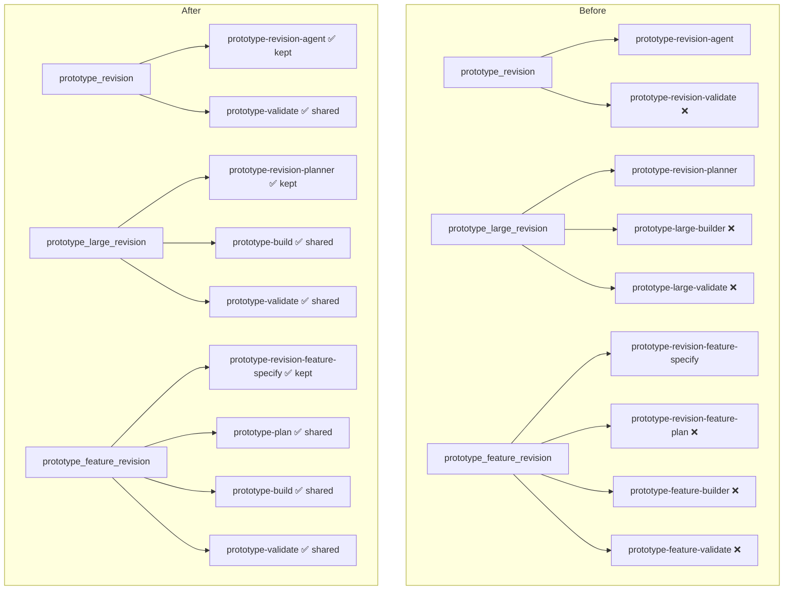
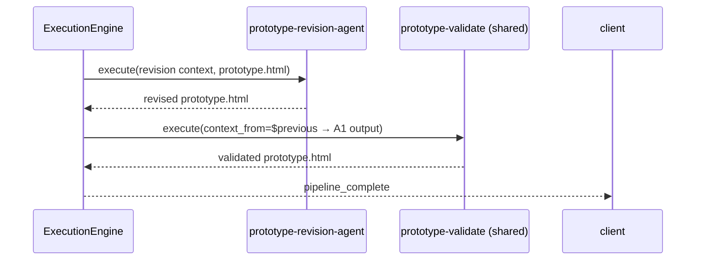
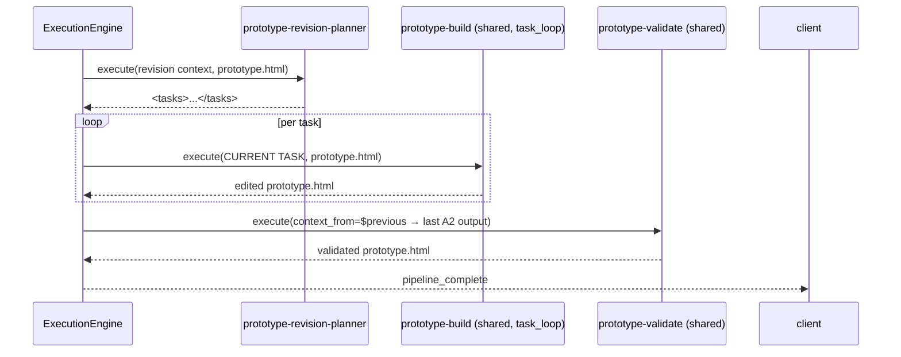
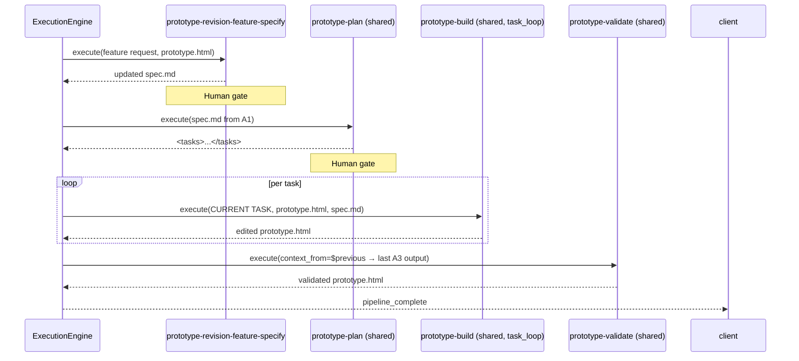

# Design Document: revision-pipeline-agent-reuse

## Overview

Three revision pipeline variants (`prototype_revision`, `prototype_large_revision`, `prototype_feature_revision`) each carry their own dedicated builder, validator, and planner AGENT.md files that duplicate the logic already present in `prototype-build`, `prototype-validate`, and `prototype-plan` from the main `prototype` pipeline. The duplication means bug-fixes and prompt improvements in the shared agents never propagate to revision runs.

This feature eliminates the duplicate agents through **manifest-only changes**: updating three `workflow.yaml` files to reference shared agents and updating the shared agents' AGENT.md `pipeline_type` fields so the loader discovers them as members of the revision pipeline rosters. Six duplicate agent directories are then deleted. No engine code is touched (SC-001), and the five characterization golden snapshots remain byte/event-identical (INV-3).

The central tension is loader discovery: `list_agent_ids(pipeline_type)` matches each agent's `pipeline_type` field exactly. The shared agents currently declare `pipeline_type: prototype`, so they only appear in `PIPELINE_AGENTS["prototype"]`. Making them discoverable in revision rosters requires updating their `pipeline_type` declarations. The design chooses to extend the schema to support a **list of pipeline types** — the cleanest approach that avoids collisions and maintains the single-source-of-truth principle.

## Architecture



## Components and Interfaces

### Component 1: Loader (`agents/loader.py`)

**Purpose**: Scans `agents/prompts/*/AGENT.md` and builds `AgentSpec` objects. Populates `PIPELINE_AGENTS` by calling `list_agent_ids(pt)` for every `pt` in `SUPPORTED_PIPELINE_TYPES`.

**Current interface**:

```python
@dataclass
class AgentSpec:
    pipeline_type: str  # single string — CURRENT
    ...

def list_agent_ids(pipeline_type: str) -> list[str]:
    """Matches spec.pipeline_type == pipeline_type (exact string equality)."""
```

**After change**:

```python
@dataclass
class AgentSpec:
    pipeline_type: str | list[str]  # single string OR list of strings
    ...

def list_agent_ids(pipeline_type: str) -> list[str]:
    """Matches when pipeline_type is in spec.pipeline_type (list) 
    or equals spec.pipeline_type (string)."""
```

The `_build_spec` function in `loader.py` currently calls `_require_nonempty_str` for `pipeline_type`. This must be extended to also accept a non-empty list of non-empty strings. The string equality check in `list_agent_ids` becomes a membership check: `pipeline_type in spec.pipeline_type` when the field is a list, `pipeline_type == spec.pipeline_type` when it is a string.

**Responsibilities**:
- Parse `pipeline_type` as either a string or list of strings
- Validate each string element is non-empty
- Match agents to pipelines using membership (list case) or equality (string case)
- Preserve existing duplicate-order detection scoped per pipeline bucket
- Populate `SUPPORTED_PIPELINE_TYPES` from both workflow dirs and all declared pipeline_type values (including each element of list values)

### Component 2: Registry (`agents/registry.py`)

**Purpose**: Derives `PIPELINE_AGENTS` from `list_agent_ids()` calls at import time. Provides `allowed_custom_agent_ids()` for security allow-listing.

**No code changes required.** `_discover_pipeline_agents()` iterates `SUPPORTED_PIPELINE_TYPES` and calls `list_agent_ids(pt)` — the loader's updated matching logic handles everything transparently. `allowed_custom_agent_ids("prototype_revision")` already returns `set(PIPELINE_AGENTS.get("prototype_revision", []))` for any `*_revision` pipeline; once shared agents appear in `PIPELINE_AGENTS["prototype_revision"]`, they are automatically in the allow-set.

### Component 3: Workflow Manifests (`agents/workflows/*/workflow.yaml`)

**Purpose**: Declares which agents run in each pipeline, in what order, with what configuration.

The `steps[].agent` field is the **execution source of truth**. The engine's `WorkflowCompiler` resolves step agents by looking up the agent ID directly from disk — not from `PIPELINE_AGENTS`. Changing a `steps[].agent` reference immediately changes execution even before `pipeline_type` fields are updated.

After the change, the three revision manifests reference shared agents. The `task_source.source_step` field in `task_loop` steps ensures the correct upstream agent's output feeds the builder even when the upstream agent differs from `prototype-plan`.

### Component 4: Shared Agent AGENT.md Files

**Purpose**: Declares agent metadata including `pipeline_type`, `consumes`, `context_from`, and `order`.

Three shared agents need `pipeline_type` updated from `"prototype"` to a list:

| Agent | Current | After |
|-------|---------|-------|
| `prototype-validate` | `pipeline_type: prototype` | `pipeline_type: [prototype, prototype_revision, prototype_large_revision, prototype_feature_revision]` |
| `prototype-build` | `pipeline_type: prototype` | `pipeline_type: [prototype, prototype_large_revision, prototype_feature_revision]` |
| `prototype-plan` | `pipeline_type: prototype` | `pipeline_type: [prototype, prototype_feature_revision]` |

The `consumes` field in each agent must list all upstream agent IDs across all pipelines it participates in. The `context_from: [$previous]` field does the actual data routing at runtime — it means "use whatever ran immediately before me in this pipeline's execution sequence". `consumes` is metadata for the WorkflowResolver's compile-time reference validation.

### Component 5: Duplicate Agent Directories (to delete)

Six agent directories whose content is superseded by shared agents:

| Directory | Superseded by | Pipeline |
|-----------|--------------|---------|
| `agents/prompts/prototype-revision-validate/` | `prototype-validate` | `prototype_revision` |
| `agents/prompts/prototype-large-builder/` | `prototype-build` | `prototype_large_revision` |
| `agents/prompts/prototype-large-validate/` | `prototype-validate` | `prototype_large_revision` |
| `agents/prompts/prototype-revision-feature-plan/` | `prototype-plan` | `prototype_feature_revision` |
| `agents/prompts/prototype-feature-builder/` | `prototype-build` | `prototype_feature_revision` |
| `agents/prompts/prototype-feature-validate/` | `prototype-validate` | `prototype_feature_revision` |

## Data Models

### AGENT.md Frontmatter Schema Extension

**Current schema** (`pipeline_type` is a single string):

```yaml
pipeline_type: prototype   # str — required, non-empty
```

**Extended schema** (`pipeline_type` may be a list):

```yaml
pipeline_type:             # str | list[str] — required, non-empty
  - prototype
  - prototype_revision
  - prototype_large_revision
  - prototype_feature_revision
```

**Validation rules**:
- If a string: existing non-empty validation applies unchanged
- If a list: must be non-empty, each element must be a non-empty string
- No other types are accepted; `pipeline_type: 1` or `pipeline_type: null` still raises `AgentSpecError`
- The `order` field's duplicate-detection is scoped per pipeline bucket (the join between an agent and a pipeline), not per agent file — a single AGENT.md may declare `order: 5` and appear in three pipelines without collision, because `list_agent_ids("prototype_revision")` builds its own order-deduplication set independently from `list_agent_ids("prototype")`

### `consumes` Field Updates

`consumes` must enumerate ALL upstream agents that can precede a shared agent across all participating pipelines. The WorkflowResolver validates `consumes` references against the compiled workflow at compile time. Since `context_from: [$previous]` drives actual data routing, `consumes` is purely a compile-time contract declaration.

**`prototype-validate` consumes** (after):
```yaml
consumes:
  - prototype-build         # prototype pipeline (unchanged)
  - prototype-revision-agent  # prototype_revision pipeline
  - prototype-large-builder   # TRANSITIONAL: remove after prototype-large-builder is deleted
  - prototype-build           # prototype_large_revision (reuses prototype-build)
  - prototype-feature-builder # TRANSITIONAL: remove after prototype-feature-builder is deleted
  - prototype-build           # prototype_feature_revision (reuses prototype-build)
```

Simplified (de-duplicated — `prototype-build` already covers large and feature revisions post-cleanup):
```yaml
consumes:
  - prototype-build
  - prototype-revision-agent
```

**`prototype-build` consumes** (after):
```yaml
consumes:
  - prototype-plan              # prototype and prototype_feature_revision
  - prototype-revision-planner  # prototype_large_revision
```

**`prototype-plan` consumes** (after):
```yaml
consumes:
  - prototype-specify             # prototype pipeline
  - prototype-revision-feature-specify  # prototype_feature_revision
```

## Sequence Diagrams

### `prototype_revision` — After Change



### `prototype_large_revision` — After Change



### `prototype_feature_revision` — After Change



## Algorithmic Pseudocode

### Updated `list_agent_ids` Matching Logic

```pascal
PROCEDURE list_agent_ids(pipeline_type: String) -> List[String]
  matching := []

  FOR each agent_dir IN prompts_dir DO
    spec := load_agent_spec(agent_dir.name)

    IF spec.template = true THEN
      CONTINUE  // template agents never join rosters
    END IF

    // Extended matching: string OR list membership
    IF spec.pipeline_type IS String THEN
      matches := (spec.pipeline_type = pipeline_type)
    ELSE  // spec.pipeline_type IS List
      matches := (pipeline_type IN spec.pipeline_type)
    END IF

    IF matches THEN
      matching.append(spec)
    END IF
  END FOR

  // Duplicate order detection scoped to THIS pipeline bucket
  order_map := {}
  FOR each spec IN matching DO
    IF spec.order IN order_map THEN
      RAISE AgentSpecError("Duplicate order={} within pipeline_type='{}'")
    END IF
    order_map[spec.order] := spec.id
  END FOR

  matching.sort(key = lambda s: s.order)
  RETURN [s.id for s in matching]
END PROCEDURE
```

**Preconditions:**
- `pipeline_type` is a non-empty string
- `_PROMPTS_DIR` exists and contains agent directories

**Postconditions:**
- Returns list sorted by `order` ascending, no duplicates
- Raises `AgentSpecError` if two agents in the same pipeline bucket share an `order` value
- An agent with `pipeline_type: [prototype, prototype_revision]` appears in BOTH `list_agent_ids("prototype")` and `list_agent_ids("prototype_revision")`

**Loop invariant:** For each spec added to `matching`, all previously checked specs in `matching` have distinct `order` values within this pipeline bucket.

### Updated `_build_spec` `pipeline_type` Parsing

```pascal
PROCEDURE parse_pipeline_type(raw_value, file_path) -> String | List[String]
  IF raw_value IS String THEN
    IF raw_value.strip() = "" THEN
      RAISE AgentSpecError("pipeline_type must be non-empty")
    END IF
    RETURN raw_value
  ELSE IF raw_value IS List THEN
    IF len(raw_value) = 0 THEN
      RAISE AgentSpecError("pipeline_type list must be non-empty")
    END IF
    FOR each item IN raw_value DO
      IF item IS NOT String OR item.strip() = "" THEN
        RAISE AgentSpecError("each pipeline_type element must be a non-empty string")
      END IF
    END FOR
    RETURN raw_value
  ELSE
    RAISE AgentSpecError("pipeline_type must be a string or list of strings")
  END IF
END PROCEDURE
```

**Preconditions:** `raw_value` is the raw YAML-parsed value of `pipeline_type`

**Postconditions:**
- Returns the value unmodified if valid
- Raises `AgentSpecError` with a descriptive message for any invalid shape

### Updated `iter_agent_specs` for `SUPPORTED_PIPELINE_TYPES`

```pascal
PROCEDURE _discover_supported_pipeline_types() -> FrozenSet[String]
  types := {}

  // (a) authored workflow manifests
  FOR each dir IN workflows_dir DO
    IF (dir / "workflow.yaml").exists() THEN
      types.add(dir.name)
    END IF
  END FOR

  // (b) pipeline_type declared by any loadable AGENT.md
  FOR each spec IN iter_agent_specs() DO
    IF spec.pipeline_type IS String THEN
      types.add(spec.pipeline_type)
    ELSE  // IS List
      FOR each pt IN spec.pipeline_type DO
        types.add(pt)
      END FOR
    END IF
  END FOR

  RETURN frozenset(types)
END PROCEDURE
```

## Order Field Scoping — Why There Are No Collisions

The `order` field is validated for uniqueness **within a single pipeline_type bucket** by `list_agent_ids`. When `prototype-validate` declares `pipeline_type: [prototype, prototype_revision, ...]`, it participates in multiple buckets simultaneously. The `order` deduplication check runs independently per bucket:

- `list_agent_ids("prototype")` builds its own `order_map` from the `prototype` members → `prototype-validate` has `order: 5` there, no collision with anything
- `list_agent_ids("prototype_revision")` builds its own `order_map` from the `prototype_revision` members → `prototype-validate` has `order: 5` there, `prototype-revision-agent` has `order: 1`, no collision

The only way a collision occurs is if two agents **both declare the same pipeline_type AND the same order value**. Since we are **removing** the duplicate agents (not keeping them alongside the shared agents), there is no overlap.

**Critical: deletion precedes roster membership.** The duplicate agents must be removed **before** the shared agents' `pipeline_type` lists are updated and the registry rescans. At runtime, both happen atomically as a deployment; in development, the safe migration order is:

1. Update `workflow.yaml` files (execution path changes, registry not yet updated)
2. Update shared agent AGENT.md `pipeline_type` lists (roster membership updates)
3. Delete duplicate agent directories (clean-up, no functional effect if step 1+2 done)

## What Gets Deleted vs. Retained

### Retained (revision-specific prompt content)

| Agent ID | Pipeline | Reason to Retain |
|----------|----------|-----------------|
| `prototype-revision-agent` | `prototype_revision` | Single-agent revision specialist with targeted `edit_file`-first workflow and `write_todos` planning; fundamentally different prompt from `prototype-build` (which is a task-loop builder, not a single-shot editor) |
| `prototype-revision-planner` | `prototype_large_revision` | Revision-specific task decomposer that reads an existing prototype and produces targeted diff tasks; `prototype-plan` decomposes a spec into fresh build tasks — semantically different |
| `prototype-revision-feature-specify` | `prototype_feature_revision` | Feature specification writer that reads the existing prototype and appends a feature spec; unique to the revision context |

### Deleted (content duplicated from shared agents)

| Agent ID | Shared Replacement | Functional Difference |
|----------|-------------------|----------------------|
| `prototype-revision-validate` | `prototype-validate` | **No difference.** Both run the same P0/P1 checklist: empty pages, DS token compliance, router correctness, placeholder text. The revision validate reads `design.md` first — `prototype-validate` also reads it (via `injects: [template, design_system]`). Minor wording difference in output sentence is inconsequential. |
| `prototype-large-builder` | `prototype-build` | **No difference.** Both execute one `task_loop` task per call, read `design.md` + `prototype.html`, use `edit_file` for surgical changes, and call `report_task_complete`. The revision builder had `tools: prototype_emit_only` (same as shared). |
| `prototype-large-validate` | `prototype-validate` | **No difference.** Identical checklist, same tool (`workspace`). |
| `prototype-revision-feature-plan` | `prototype-plan` | **No difference.** Both produce `<tasks>...</tasks>` with `## Task N:` headers. The revision planner reads `prototype.html` + `spec.md`; `prototype-plan` receives spec via context injection. Both output the same format consumed by `task_loop`. |
| `prototype-feature-builder` | `prototype-build` | **No difference.** Same task-loop execution. The feature builder reads `spec.md` first — `prototype-build` does too (step 1 in its prompt). |
| `prototype-feature-validate` | `prototype-validate` | **No difference.** Identical P0/P1 checklist. |

## `consumes` / `context_from` Update Strategy

### `context_from: [$previous]` — the actual runtime routing

`context_from: [$previous]` is already present on `prototype-validate` and `prototype-build`. It instructs the engine to inject the immediately-preceding step's output artifact as context — regardless of what that agent was. This is the key insight: **no `context_from` changes are needed** for execution to work correctly.

When `prototype-validate` runs as step[1] in `prototype_revision`, `$previous` resolves to `prototype-revision-agent`'s output. When it runs as step[2] in `prototype_large_revision`, `$previous` resolves to the last `prototype-build` task loop output. The agent receives the right prototype regardless.

### `consumes` — compile-time contract, not runtime routing

`consumes` is validated by `WorkflowResolver.validate_consumes()` at compile time. If a step's `consumes` lists an agent ID that is not present as a step in the compiled workflow, the resolver raises a compile error (Requirement 7.6).

The cleanest approach after full cleanup:

**`prototype-validate` `consumes` after deletion:**
```yaml
consumes:
  - prototype-build         # prototype, prototype_large_revision, prototype_feature_revision
  - prototype-revision-agent  # prototype_revision
```

This works because `prototype-revision-agent` IS a step in `prototype_revision`'s compiled workflow, and `prototype-build` IS a step in all three other pipelines where `prototype-validate` participates.

**`prototype-build` `consumes` after:**
```yaml
consumes:
  - prototype-plan              # prototype, prototype_feature_revision
  - prototype-revision-planner  # prototype_large_revision
```

**`prototype-plan` `consumes` after:**
```yaml
consumes:
  - prototype-specify                   # prototype
  - prototype-revision-feature-specify  # prototype_feature_revision
```

### `task_source.source_step` — explicit data wiring for task_loop

For `task_loop` steps, `context_from: [$previous]` handles the prototype HTML, but the task list itself is sourced from `task_source.source_step`. This must explicitly name the correct upstream agent:

- `prototype_large_revision` step[1] (`prototype-build`): `source_step: prototype-revision-planner`
- `prototype_feature_revision` step[2] (`prototype-build`): `source_step: prototype-plan`

The `spec_step` field provides the spec context for the builder:
- `prototype_feature_revision` step[2] (`prototype-build`): `spec_step: prototype-revision-feature-specify`

## Full Manifest Diffs

### `prototype_revision/workflow.yaml` — After

```yaml
steps:
- agent: prototype-revision-agent
  tools: {read_files: true, write_files: true}
  strategy: single_shot
  gates:
  - validation
  validators:
  - html_static
  - html_render
  require_render: true
  post_step: revision_validation
- agent: prototype-validate           # ← WAS: prototype-revision-validate
  tools: {read_files: true, write_files: true}
  strategy: single_shot
  gates: []
```

### `prototype_large_revision/workflow.yaml` — After

```yaml
steps:
- agent: prototype-revision-planner
  tools: {read_files: true, write_files: true}
  strategy: single_shot
  gates: []

- agent: prototype-build              # ← WAS: prototype-large-builder
  tools: {read_files: true, write_files: true}
  strategy: task_loop
  gates: []
  task_source:
    kind: parsed
    parser: heading_tasks
    target: tasks.md
    source_step: prototype-revision-planner
  validators:
  - html_static
  - html_render
  require_render: false
  post_step: revision_validation
  compaction: html_skeleton

- agent: prototype-validate           # ← WAS: prototype-large-validate
  tools: {read_files: true, write_files: true}
  strategy: single_shot
  gates: []
```

### `prototype_feature_revision/workflow.yaml` — After

```yaml
steps:
- agent: prototype-revision-feature-specify
  tools: {read_files: true, write_files: true}
  strategy: single_shot
  gates:
  - human

- agent: prototype-plan               # ← WAS: prototype-revision-feature-plan
  tools: {read_files: true, write_files: true}
  strategy: single_shot
  gates:
  - human

- agent: prototype-build              # ← WAS: prototype-feature-builder
  tools: {read_files: true, write_files: true}
  strategy: task_loop
  gates: []
  task_source:
    kind: parsed
    parser: heading_tasks
    target: tasks.md
    source_step: prototype-plan       # ← WAS: prototype-revision-feature-plan
    spec_step: prototype-revision-feature-specify
  validators:
  - html_static
  - html_render
  require_render: true
  post_step: revision_validation
  compaction: html_skeleton

- agent: prototype-validate           # ← WAS: prototype-feature-validate
  tools: {read_files: true, write_files: true}
  strategy: single_shot
  gates: []
```

## Manifest Parity Constraints

### `test_manifest_parity.py` — `_RUN_REVISION_DISPATCHED` and injects

`prototype_revision` is in `_RUN_REVISION_DISPATCHED`, which enforces that NO step in that pipeline declares a `template` or `design_system` inject (because run-revision dispatch passes `od_context=None`). `prototype-validate` currently declares `injects: [template, design_system]`. This is a **blocker**.

**Resolution**: `prototype-validate` MUST have `injects` stripped for the `prototype_revision` context. Two approaches:

**Option A (recommended):** Remove `injects: [template, design_system]` from `prototype-validate`'s AGENT.md entirely. The agent already reads the active design system from the context injected by `context_from: [$previous]` — the AGENT.md prompt explicitly says "How to read the ACTIVE DESIGN SYSTEM: It's in your system prompt under `=== ACTIVE DESIGN SYSTEM ===`". The `injects` field causes the engine to inject template/DS context at step-dispatch time; for validation, the prototype itself carries the DS tokens. Removing `injects` from `prototype-validate` is safe because validation reads `prototype.html` (which already has the DS tokens baked in) and `design.md` (injected via `context_from: [$previous]` compaction chain), not a fresh template injection.

**Option B:** Create a thin manifest-level step override for revision pipelines that strips the `injects`. This requires a schema extension and is more complex than Option A.

**Decision: Option A.** The `injects` field on `prototype-validate` is a belt-and-suspenders holdover — the agent works correctly without it because it reads DS tokens from the already-built HTML and the `design.md` that compaction writes into context. Removing it from the AGENT.md frontmatter satisfies the parity test without any schema work.

Similarly, `prototype-build` declares `injects: [template, design_system, craft]`. For the `*_revision` pipelines in `_RUN_REVISION_DISPATCHED`, this would also fail the parity test. However, `prototype_large_revision` and `prototype_feature_revision` are NOT in `_RUN_REVISION_DISPATCHED` (only `prototype_revision`, `ppt_revision`, `user_stories_revision`, `custom_revision`, and `app_builder_revision` are). So `prototype-build` injects are fine for `prototype_large_revision` and `prototype_feature_revision`.

The only inject conflict is `prototype-validate` in `prototype_revision`. The fix is removing `injects` from `prototype-validate`.

### `test_manifest_coverage.py` — count stays 18

The number of manifest-backed pipeline directories does NOT change. No `workflow.yaml` is added or removed; only the contents of three existing manifests are edited. The count check `len(_MANIFEST_BACKED_IDS) == 18` is unaffected.

### `test_manifest_parity.py` — `test_run_revision_revision_agents_declare_no_template_injects`

After removing `injects` from `prototype-validate`, this test passes for `prototype_revision`. The shared agents in `prototype_large_revision` and `prototype_feature_revision` are not in `_RUN_REVISION_DISPATCHED`, so their injects are not checked by this test.

### `test_manifest_parity.py` — `test_planner_run_everywhere`

`prototype_large_revision` and `prototype_feature_revision` currently declare `planner: skip`. This is correct — they are revision pipelines. The `_PLANNER_SKIP_IDS` set is not modified by this feature.

## Frontend Tab Correctness

### Steps Tab (Requirement 10)

The Steps tab reads from the `pipeline_start` event's `agents_total` field and the run's step events. After the change:

- `prototype_revision` steps tab: shows `prototype-revision-agent` + `prototype-validate` (2 cards)
- `prototype_large_revision` steps tab: shows `prototype-revision-planner` + `prototype-build` + `prototype-validate` (3 cards)
- `prototype_feature_revision` steps tab: shows `prototype-revision-feature-specify` + `prototype-plan` + `prototype-build` + `prototype-validate` (4 cards)

**No frontend code changes required** — the steps tab renders agent cards from the run events emitted by the engine. The engine derives the step sequence from the compiled manifest, which now references the shared agents. Agent display names and icons come from the respective AGENT.md files.

### Versions, Files, and Audit Tabs (Requirement 11)

The deliverable strategy remains `single_file` with `name: prototype.html` in all three revision manifests. No change required for the Versions tab.

The Files tab and Audit tab are driven by workspace file listings and run event streams respectively — both are pipeline-agnostic and require no changes.

### `deriveDeliverableFilename` (Requirement 11.3)

The frontend utility that maps `workflowType` to a deliverable filename. Searching the codebase shows no implementation found at the expected path — this may be an inline derivation in a component. The correct behavior is to return `prototype.html` for all three revision pipeline types. If this function exists, it must map:
- `prototype_revision` → `prototype.html` (already correct per existing behavior)
- `prototype_large_revision` → `prototype.html` (must be verified/added)
- `prototype_feature_revision` → `prototype.html` (must be verified/added)

### `renderType` in `PreviewPanel` (Requirement 11.6)

The `renderType` mapping determines how the preview panel renders the deliverable. It must map `prototype_large_revision` and `prototype_feature_revision` to `prototype` (same iframe rendering as `prototype_revision`). The feature description states `DashboardLayout.tsx` already handles these types; `renderType` should be verified during implementation.

## Testing Strategy

### INV-3 — Characterization Goldens Must Stay Byte/Event-Identical

The five characterization golden tests:
1. `test_characterization_prototype.py` — `prototype` pipeline
2. `test_characterization_prototype_revision.py` — `prototype_revision` pipeline  
3. `test_characterization_ppt.py` — `ppt` pipeline
4. `test_characterization_app_builder.py` — `app_builder` pipeline
5. (one more, likely `user_stories`)

**Impact analysis:**
- `prototype` golden: the main prototype `workflow.yaml` is NOT touched. `prototype-build` and `prototype-validate` still declare `pipeline_type: prototype` (it's the first element of the updated list). No behavior change. Golden stays identical. ✅
- `prototype_revision` golden: `_drive("prototype_revision")` compiles the `prototype_revision` manifest. The manifest now references `prototype-validate` instead of `prototype-revision-validate`. The `_scripted_model` scripted model returns deterministic outputs. The golden must be **regenerated once** after the change. ⚠️ However, since the prompt body of `prototype-validate` and `prototype-revision-validate` are functionally equivalent (same P0/P1 checklist), the output should match the previous golden IF the scripted model doesn't depend on agent ID. The scripted model in `_scripted_model.py` maps prompts to outputs by pattern-matching on prompt content, not agent ID — so the output should be identical if `injects` removal doesn't change the injected context shape.
- `ppt`, `app_builder`, other goldens: these pipelines are untouched. Goldens stay identical. ✅

**Key INV-3 constraint**: if removing `injects: [template, design_system]` from `prototype-validate` changes what context is prepended to the agent's prompt during the `prototype_revision` characterization test run, the golden will differ. The test must be run with `SNAPSHOT_UPDATE=1` if the golden diverges, and the new golden committed.

### SC-001 / `test_banned_patterns.py`

`test_inv1_no_kernel_workflow_name_branch()` scans `agents/execution_engine/` for `if pipeline_type ==`. This feature makes zero engine edits. ✅

### `test_registry_capabilities.py` — drift guard

`_KNOWN` contains `(kind, name)` capability pairs. This feature adds no new capability kinds or names. The `pipeline_type` list extension is a loader schema change, not a capability registration. The drift guard count is **unchanged**. ✅

### `test_manifest_coverage.py` — count stays 18

No workflow.yaml files are added or removed. Count unchanged. ✅

### `test_registry.py` — ordering tests

After the change, `list_agent_ids("prototype_revision")` returns `["prototype-revision-agent", "prototype-validate"]` (orders 1 and 5). `list_agent_ids("prototype_large_revision")` returns `["prototype-revision-planner", "prototype-build", "prototype-validate"]` (orders 1, 4, 5). The ordering test verifies strict ascending order — 1 < 5 ✅, 1 < 4 < 5 ✅.

### New Tests to Write

1. **`test_loader.py` additions**: Test that `pipeline_type` list values load correctly; test that `list_agent_ids` returns an agent for each element in its `pipeline_type` list; test that duplicate order within a pipeline bucket still raises `AgentSpecError` even when using list syntax.

2. **`test_registry.py` additions**: Test that `PIPELINE_AGENTS["prototype_revision"]` contains `["prototype-revision-agent", "prototype-validate"]` after the change; same for the other two revision pipelines.

3. **`test_manifest_parity.py` additions**: Verify that no agent in `prototype_revision` steps declares `template` or `design_system` injects (this test already runs over all `_RUN_REVISION_DISPATCHED` pipelines — adding `prototype_revision` to the loop is already covered; ensuring `prototype-validate` has no injects is the fix, not a new test).

4. **`test_compiled_plan_runs.py`**: The existing `_every_step_agent_loads` test verifies that every step's agent can be loaded from disk. After deletion of the 6 duplicate directories, the compiled revision workflows reference only valid agents that exist under `agents/prompts/`. This test will catch any broken reference.

## Error Handling

### Scenario 1: Shared agent deleted from `prototype-validate/`

**Condition**: The `prototype-validate` directory is missing.  
**Response**: `WorkflowCompiler.compile("prototype_revision")` calls `load_agent_spec("prototype-validate")`, which raises `FileNotFoundError`. The compiler propagates this as a compile error, preventing the pipeline from starting.  
**Recovery**: Restore the directory from version control.

### Scenario 2: `pipeline_type` list contains a typo

**Condition**: `prototype-validate/AGENT.md` declares `pipeline_type: [prototype, prototype_revisoin]` (typo).  
**Response**: The loader creates a new SUPPORTED_PIPELINE_TYPE entry `"prototype_revisoin"` with one member. `PIPELINE_AGENTS["prototype_revision"]` does NOT include `prototype-validate`. The compiled `prototype_revision` plan references `prototype-validate` via the manifest, but the registry roster does not match the plan steps — `test_manifest_coverage.py::test_all_load_compile` fails with "manifest step order has drifted from registry membership".  
**Recovery**: Fix the typo in AGENT.md.

### Scenario 3: `consumes` references a deleted agent

**Condition**: `prototype-validate` still lists `prototype-revision-validate` in `consumes` after that directory is deleted.  
**Response**: `WorkflowResolver.validate_consumes()` at compile time looks up `prototype-revision-validate` as a step in the `prototype_revision` compiled workflow — it's not present, raises a compile error naming the broken reference (Requirement 12.6).  
**Recovery**: Remove the stale `consumes` entry.

### Scenario 4: Order collision after partial migration

**Condition**: Both `prototype-validate` (order 5, `pipeline_type: [prototype, prototype_revision]`) and `prototype-revision-validate` (order 2, `pipeline_type: prototype_revision`) are on disk simultaneously during migration.  
**Response**: `list_agent_ids("prototype_revision")` builds an order map; both agents are in the bucket but at different orders (5 and 2) — NO collision. However, having both on disk means `PIPELINE_AGENTS["prototype_revision"]` lists both, which will fail `test_all_load_compile` (manifest step order won't match registry order).  
**Recovery**: Delete `prototype-revision-validate` to complete the migration.

## Performance Considerations

The loader `list_agent_ids` already scans all agent directories once per process startup (results are cached via `_SPEC_CACHE`). Extending `pipeline_type` to a list adds one membership check per agent per pipeline scan — O(1) per check since we compare against a short list. No measurable impact on startup time.

`PIPELINE_AGENTS` is populated once at import time. The extended list support adds minimal overhead compared to the existing directory scan.

## Security Considerations

`allowed_custom_agent_ids("prototype_revision")` returns `set(PIPELINE_AGENTS.get("prototype_revision", []))`. After the change, this set will include `prototype-validate`. This is correct and intended: `prototype-validate` is a legitimate step in the `prototype_revision` pipeline and should be in the allow-set.

No cross-pipeline agent injection risk: the `*_revision` branch in `allowed_custom_agent_ids` returns only the agents in that specific revision pipeline — not the full `prototype` pool. Adding `prototype-validate` to `PIPELINE_AGENTS["prototype_revision"]` does not expose `prototype-specify` or `prototype-analyze` to revision runs.

## Dependencies

### Changed Files

| File | Change |
|------|--------|
| `backend/agents/loader.py` | Extend `pipeline_type` field to accept `str | list[str]`; update `list_agent_ids` matching; update `_build_spec` parsing; update `_discover_supported_pipeline_types` |
| `backend/agents/prompts/prototype-validate/AGENT.md` | Update `pipeline_type` to list; update `consumes`; **remove `injects`** |
| `backend/agents/prompts/prototype-build/AGENT.md` | Update `pipeline_type` to list; update `consumes` |
| `backend/agents/prompts/prototype-plan/AGENT.md` | Update `pipeline_type` to list; update `consumes` |
| `backend/agents/workflows/prototype_revision/workflow.yaml` | `steps[1].agent: prototype-validate` |
| `backend/agents/workflows/prototype_large_revision/workflow.yaml` | `steps[1].agent: prototype-build`; `steps[2].agent: prototype-validate` |
| `backend/agents/workflows/prototype_feature_revision/workflow.yaml` | `steps[1].agent: prototype-plan`; `steps[2].agent: prototype-build`; `steps[3].agent: prototype-validate`; update `task_source` |

### Deleted Files (after validation)

| Directory |
|-----------|
| `backend/agents/prompts/prototype-revision-validate/` |
| `backend/agents/prompts/prototype-large-builder/` |
| `backend/agents/prompts/prototype-large-validate/` |
| `backend/agents/prompts/prototype-revision-feature-plan/` |
| `backend/agents/prompts/prototype-feature-builder/` |
| `backend/agents/prompts/prototype-feature-validate/` |

### Test Files Requiring Update

| File | Change |
|------|--------|
| `backend/tests/agents/test_loader.py` | Add tests for list `pipeline_type` parsing and matching |
| `backend/tests/agents/test_registry.py` | Add assertions for revised `PIPELINE_AGENTS` contents |
| `backend/tests/agents/characterization/golden/prototype_revision.*` | Regenerate if `injects` removal changes context shape |

### Test Files That Must Pass Unchanged

| File | Reason |
|------|--------|
| `test_banned_patterns.py` | No engine edits; SC-001 stays clean |
| `test_registry_capabilities.py` | No new capability registrations; drift count unchanged |
| `test_manifest_coverage.py` | 18 manifests unchanged |
| `test_manifest_parity.py` | After `injects` removal from `prototype-validate`, all parity assertions pass |
| `test_characterization_prototype.py` | `prototype` workflow.yaml untouched |
| `test_characterization_ppt.py` | `ppt` pipeline untouched |
| `test_characterization_app_builder.py` | `app_builder` pipeline untouched |

## Correctness Properties

The following properties must hold after implementation:

### Property 1: Roster completeness

For every revision pipeline `pt ∈ {prototype_revision, prototype_large_revision, prototype_feature_revision}`, `PIPELINE_AGENTS[pt]` contains exactly the agents referenced in `workflow.yaml` steps for that pipeline, in manifest order.

**Validates: Requirements 6.2, 6.3**

### Property 2: No prototype pipeline regression

`PIPELINE_AGENTS["prototype"]` equals `["prototype-specify", "prototype-plan", "prototype-analyze", "prototype-build", "prototype-validate"]` — the identical ordered list as before this change.

**Validates: Requirements 9.1, 9.4**

### Property 3: Order uniqueness

For every `pt` in `SUPPORTED_PIPELINE_TYPES`, no two agents in `PIPELINE_AGENTS[pt]` share the same `order` value. Formally: `∀ pt. len(set(spec.order for spec in get_pipeline_agents(pt))) == len(get_pipeline_agents(pt))`.

**Validates: Requirements 6.4, 6.5**

### Property 4: SC-001 compliance

`grep -rn "if pipeline_type ==" agents/execution_engine/` returns zero matches. `grep -rn "prototype_large_revision\|prototype_feature_revision\|prototype_revision" agents/execution_engine/` returns zero matches.

**Validates: Requirements 8.1, 8.2, 8.3, 8.4, 8.5**

### Property 5: INV-3 golden stability

`pytest tests/agents/test_characterization_*.py` (with `SNAPSHOT_UPDATE` unset) passes. `git status --porcelain tests/agents/characterization/golden/` is empty after running the tests.

**Validates: Requirements 9.2, 9.3**

### Property 6: Deleted agent inaccessibility

For each deleted agent directory `d`, `load_agent_spec(d)` raises `FileNotFoundError`. No compiled workflow step references a deleted agent ID.

**Validates: Requirements 12.1, 12.6**

### Property 7: Pipeline compilation succeeds

For every `pt ∈ {prototype_revision, prototype_large_revision, prototype_feature_revision}`, `WorkflowCompiler().compile(load_manifest(pt), CapabilityRegistry())` succeeds and the compiled step list equals `PIPELINE_AGENTS[pt]`.

**Validates: Requirements 1.1, 1.3, 2.1, 2.3, 3.1, 4.1, 4.3, 5.1**

### Property 8: Manifest parity — no run-revision injects

For every `pt ∈ _RUN_REVISION_DISPATCHED`, no step agent in `PIPELINE_AGENTS[pt]` declares `template` or `design_system` in its `injects` field. With `injects` removed from `prototype-validate`, this holds for `prototype_revision`.

**Validates: Requirements 1.2, 9.5**

### Property 9: context_from preserves data flow

For every shared agent with `context_from: [$previous]`, the artifact delivered to that agent at runtime is the output of the immediately preceding step in the same run, regardless of which pipeline is executing.

**Validates: Requirements 1.4, 2.4, 3.2, 4.4, 5.1, 7.1, 7.2, 7.3, 14.1**

### Property 10: No engine literal pipeline names

The `agents/execution_engine/` directory contains no string literals of the form `"prototype_revision"`, `"prototype_large_revision"`, or `"prototype_feature_revision"` in executable code.

**Validates: Requirements 8.1, 8.2, 8.3, 8.4**
