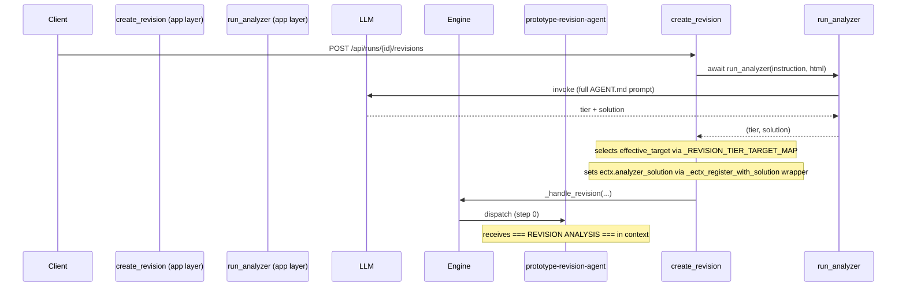
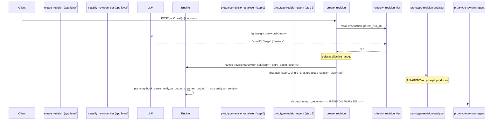
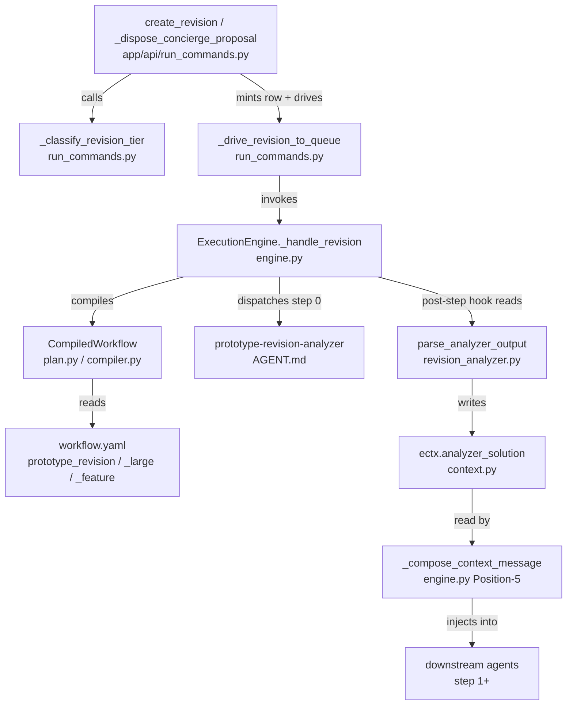

# Design Document — Revision Pipeline Refactor

## Overview

This refactor promotes the `prototype-revision-analyzer` agent from a hidden,
pre-pipeline call in the app layer into the **first declared step** of all three
prototype revision workflow manifests (`prototype_revision`,
`prototype_large_revision`, `prototype_feature_revision`). It simultaneously
strips the parallel `run_analyzer` invocation from the app layer so the analyzer
executes exactly once — driven by the engine's normal manifest dispatch — and
wires up a declaration-driven post-step hook inside the engine that extracts the
`## Solution Plan` from the analyzer's output and stores it on
`ectx.analyzer_solution`, making it available to every subsequent step via the
existing Position-5 injection seam.

The design must satisfy SC-001 / INV-1: no workflow name or agent-id literal may
appear in the engine kernel. The solution achieves this through a new
manifest-level boolean field, `produces_solution_plan: true`, that acts as a
declaration flag on the step — the same pattern as `compaction: html_skeleton`
and `post_step: revision_validation`. The engine fires the extraction when the
field is set, regardless of which agent or workflow is involved.

---

## Architecture

### Before: Dual-Path Analyzer Execution



**Problems with the before state:**
- The analyzer runs twice if both paths are active (it was always intended as a
  pre-step, but the engine never knew about it).
- `extra_agent_count=1` compensates for the invisible pre-pipeline step — a
  brittle manual counter sync.
- The `_ectx_register_with_solution` wrapper is a layering violation: app-layer
  code reaches into the kernel's `ExecutionContext` via a register callback.
- The analyzer's SSE events (`agent_start`, `agent_complete`) are synthesised
  outside the engine, using a hand-rolled shape that may diverge from the
  engine's own event shapes over time.
- SC-001 / INV-1 are technically respected (no name branch in the kernel), but
  the architecture is not symmetrical — the analyzer is a first-class manifest
  step conceptually but a second-class pre-pipeline call structurally.

### After: Single-Path Manifest-Driven Execution



**Key improvements:**
- One LLM call for classification (lightweight), one for the full analysis
  (inside the engine, with proper SSE event lifecycle).
- `extra_agent_count=0` — the analyzer is counted by the manifest roster.
- No app-layer intervention in `ectx`: the engine populates `analyzer_solution`
  as a post-step side-effect triggered by a manifest-declared flag.
- SC-001 / INV-1 fully preserved: the engine branches on
  `current_step.produces_solution_plan` (a boolean data flag), never on an
  agent id or pipeline name.

---

## Components and Interfaces

### Component Map



### Interface Changes

| Interface | Before | After |
|---|---|---|
| `create_revision` | calls `run_analyzer`, passes `analyzer_solution` kwarg | calls `_classify_revision_tier`, passes `analyzer_solution=""` |
| `_dispose_concierge_proposal` | calls `run_analyzer` for prototype revisions | calls `_classify_revision_tier` |
| `_drive_revision_to_queue` | accepts `analyzer_solution: str = ""`, wraps register | `analyzer_solution` removed or always `""`; wrapper removed |
| `_mint_revision_row` | called with `extra_agent_count=1` for prototype | called with `extra_agent_count=0` always |
| `Step` (plan.py) | no `produces_solution_plan` field | adds `produces_solution_plan: bool = False` |
| `_ALLOWED_STEP_KEYS` (compiler.py) | no `produces_solution_plan` key | adds `"produces_solution_plan"` |
| `WorkflowCompiler._compile_step` | no handling for flag | reads and carries `produces_solution_plan` |
| Engine post-step logic | no post-step extraction | checks `current_step.produces_solution_plan`, calls `parse_analyzer_output` |
| `prototype_revision/workflow.yaml` | starts at `prototype-revision-agent` | step 0 is `prototype-revision-analyzer` with `produces_solution_plan: true` |
| `prototype_large_revision/workflow.yaml` | starts at `prototype-revision-planner` | step 0 is `prototype-revision-analyzer` with `produces_solution_plan: true` |
| `prototype_feature_revision/workflow.yaml` | starts at `prototype-revision-feature-specify` | step 0 is `prototype-revision-analyzer` with `produces_solution_plan: true` |
| `parse_analyzer_output` (revision_analyzer.py) | returns `(tier, solution)` tuple | returns only `solution: str` (plain string, no tier); tier parsing logic removed |
| `prototype-revision-analyzer AGENT.md` | outputs `## Tier` + `## Solution Plan` | outputs only `## Solution Plan`; tier analysis steps removed |
| `run_analyzer` (revision_analyzer.py) | active code path | deprecated dead code (file kept, function marked deprecated) |

---

## Data Models

### `Step` — new field (`plan.py`)

```python
@dataclass
class Step:
    # ... existing fields unchanged ...

    # ── Analyzer solution-plan extraction flag (revision-pipeline-refactor) ───
    # When True, the engine extracts the ## Solution Plan section from this step's
    # streamed output after it completes and stores it on ectx.analyzer_solution.
    # Declaration-driven (INV-1 / SC-001): the engine branches on this boolean, never
    # on the agent id or pipeline name. Default False → DORMANT on all existing steps
    # → INV-3 byte/event-identical on the 5 characterization goldens.
    produces_solution_plan: bool = False
```

The field follows the same convention as `require_render` (a `bool | None`
knob added for a specific capability) but defaults to `False` (not `None`)
because the consumers do a simple truthiness check rather than a three-way
`None`/`True`/`False` policy.

### `parse_analyzer_output` — simplified signature (`revision_analyzer.py`)

```python
def parse_analyzer_output(raw: str) -> str:
    """Extract the ## Solution Plan body from the analyzer's raw output.
    Returns the solution body string, or "" if the section is absent (logs WARNING).
    Tier parsing logic (_VALID_TIERS, _DEFAULT_TIER, ## Tier section extraction) is removed.
    """
```

The function no longer returns a `(tier, solution)` tuple. It returns only the
solution string directly. The `_VALID_TIERS` and `_DEFAULT_TIER` constants and
all `## Tier` section extraction code are removed. The WARNING branch for an
absent `## Solution Plan` section is kept (returns `""`), consistent with
Requirement 9.6.

### `_ALLOWED_STEP_KEYS` addition (`compiler.py`)

```python
_ALLOWED_STEP_KEYS: frozenset[str] = frozenset(
    {
        # ... existing keys ...
        "produces_solution_plan",   # ← new: post-step solution extraction flag
    }
)
```

### Workflow YAML step shape

```yaml
- agent: prototype-revision-analyzer
  strategy: single_shot
  gates: []
  produces_solution_plan: true
```

---

## Correctness Properties

*A property is a characteristic or behavior that should hold true across all
valid executions of a system — essentially, a formal statement about what the
system should do. Properties serve as the bridge between human-readable
specifications and machine-verifiable correctness guarantees.*

### Property 1: Tier routing is a pure function of the tier string

*For any* string returned by `_classify_revision_tier` that is in
`{"small", "large", "feature"}`, the `effective_target` selected by
`create_revision` SHALL equal `_REVISION_TIER_TARGET_MAP[tier]`.

**Validates: Requirements 1.1, 1.3, 1.4, 1.5**

### Property 2: Unknown tier falls back to `large`

*For any* string returned by `_classify_revision_tier` that is NOT in
`{"small", "large", "feature"}`, the `effective_target` SHALL equal
`_REVISION_TIER_TARGET_MAP["large"]` (i.e. `"prototype_large_output"`).

**Validates: Requirements 1.6, 7.4**

### Property 3: `parse_analyzer_output` round-trip preserves solution plan

*For any* non-empty string body `S`, if a Markdown document is constructed as
`"## Solution Plan\n" + S`, then `parse_analyzer_output(document)` SHALL equal
`S` verbatim (the body is round-tripped without modification).

**Validates: Requirements 4.1, 4.5, 9.3, 9.4**

### Property 4: `_compose_context_message` injection is gated on `ectx.analyzer_solution` truthiness

*For any* non-empty string assigned to `ectx.analyzer_solution`, the output of
`_compose_context_message(ectx, ...)` SHALL contain the substring
`"=== REVISION ANALYSIS ==="`. Conversely, *for any* `ExecutionContext` where
`ectx.analyzer_solution == ""`, the output SHALL NOT contain that substring.

**Validates: Requirements 4.2, 7.3, 8.3**

### Property 5: AGENT.md output contract contains no `## Tier` section

The analyzer's output SHALL NOT contain a `## Tier` section. The engine hook
SHALL store the full `## Solution Plan` body directly on `ectx.analyzer_solution`
without any tier filtering or tuple unpacking.

**Validates: Requirements 9.1, 9.2, 9.5**

### Reflection: Redundancy check

- Properties 1 and 2 are complementary (not redundant): Property 1 covers the
  happy path for all three valid tiers; Property 2 covers the unrecognised-tier
  fallback. Together they exhaustively cover the routing table.
- Property 3 (parse round-trip) and Property 4 (injection gating) address
  orthogonal concerns and cannot be collapsed.
- Property 5 (AGENT.md output contract) is non-redundant with Properties 3 and 4:
  it asserts the absence of `## Tier` in the output contract and the engine hook's
  direct string storage, which are distinct from the round-trip and injection concerns.
- Criteria 2.1–2.3, 3.1–3.5, and 8.1–8.4 are configuration/smoke checks that
  do not benefit from property-based testing (no meaningful input variation).

---

## Error Handling

### Classification failure (`_classify_revision_tier`)

`_classify_revision_tier` already has a two-level fallback chain:
- Unrecognised LLM output → `"large"` (log WARNING).
- Exception from the LLM call → `"small"` (log WARNING).

After the refactor, `create_revision` calls only this function (not
`run_analyzer`). The fallback semantics are **unchanged**.

### Analyzer step failure inside the engine

If `prototype-revision-analyzer` fails during the manifest-driven execution
(the engine's standard `agent_error` path fires):

1. The engine emits an `agent_error` event.
2. `ectx.analyzer_solution` is never set (it stays `""`).
3. The `produces_solution_plan` post-step hook is guarded in a `try/except` —
   a parse failure or empty output writes `""` and logs a WARNING; it never
   aborts the run or re-raises.
4. Downstream agents receive no `=== REVISION ANALYSIS ===` block.
5. Pipeline execution continues with the standard error handling semantics
   (`failed_invocations` set, degraded outcome if applicable).

This satisfies Requirement 7.2 and is consistent with the existing engine error
model.

### Missing `## Solution Plan` section

`parse_analyzer_output` handles this: it logs a WARNING and returns `""`. The
engine stores the empty string, leaving `ectx.analyzer_solution` falsy, and the
injection seam stays dormant. Satisfies Requirements 4.4 and 9.6.

### `_ectx_register_with_solution` wrapper removal

After the refactor `analyzer_solution` is always `""` at the app layer. The
`_ectx_register_with_solution` wrapper in `_drive_revision_to_queue` becomes
dead code and is removed. `live_ectx_register` is wired back to
`register_live_ectx` directly. This does not affect `ExecutionContext` —
`analyzer_solution` already defaults to `""` (field is additive, INV-3 safe).

---

## Exact YAML Changes

### `backend/agents/workflows/prototype_revision/workflow.yaml`

```yaml
id: prototype_revision
# ... (all header fields unchanged) ...
steps:
# Step 0: Analyze the revision and produce a solution plan
- agent: prototype-revision-analyzer
  strategy: single_shot
  gates: []
  produces_solution_plan: true

# Step 1: Apply the revision (was step 0)
- agent: prototype-revision-agent
  tools: {read_files: true, write_files: true}
  strategy: single_shot
  gates:
  - validation
  validators:
  - html_static
  - html_render
  require_render: true
  post_step: revision_validation

# Step 2: Final validation (was step 1)
- agent: prototype-validate
  tools: {read_files: true, write_files: true}
  strategy: single_shot
  gates: []
```

### `backend/agents/workflows/prototype_large_revision/workflow.yaml`

```yaml
id: prototype_large_revision
# ... (all header fields unchanged) ...
steps:
# Step 0: Analyze the revision and produce a solution plan
- agent: prototype-revision-analyzer
  strategy: single_shot
  gates: []
  produces_solution_plan: true

# Step 1: Break the revision into discrete tasks (was step 0)
- agent: prototype-revision-planner
  tools: {read_files: true, write_files: true}
  strategy: single_shot
  gates: []

# Step 2: Execute each task in isolation (was step 1)
- agent: prototype-build
  tools: {read_files: true, write_files: true}
  strategy: task_loop
  gates: []
  task_source:
    kind: parsed
    parser: heading_tasks
    target: tasks.md
    source_step: prototype-revision-planner
  validators:
  - html_static
  - html_render
  require_render: false
  post_step: revision_validation
  compaction: html_skeleton

# Step 3: Final validation (was step 2)
- agent: prototype-validate
  tools: {read_files: true, write_files: true}
  strategy: single_shot
  gates: []
```

### `backend/agents/workflows/prototype_feature_revision/workflow.yaml`

```yaml
id: prototype_feature_revision
# ... (all header fields unchanged) ...
steps:
# Step 0: Analyze the revision and produce a solution plan
- agent: prototype-revision-analyzer
  strategy: single_shot
  gates: []
  produces_solution_plan: true

# Step 1: Define the new feature spec (was step 0)
- agent: prototype-revision-feature-specify
  tools: {read_files: true, write_files: true}
  strategy: single_shot
  gates:
  - human

# Step 2: Plan the implementation (was step 1)
- agent: prototype-plan
  tools: {read_files: true, write_files: true}
  strategy: single_shot
  gates:
  - human

# Step 3: Build the feature (was step 2)
- agent: prototype-build
  tools: {read_files: true, write_files: true}
  strategy: task_loop
  gates: []
  task_source:
    kind: parsed
    parser: heading_tasks
    target: tasks.md
    source_step: prototype-plan
    spec_step: prototype-revision-feature-specify
  validators:
  - html_static
  - html_render
  require_render: true
  post_step: revision_validation
  compaction: html_skeleton

# Step 4: Final validation (was step 3)
- agent: prototype-validate
  tools: {read_files: true, write_files: true}
  strategy: single_shot
  gates: []
```

---

## `produces_solution_plan` Flag — Compiler and Engine Changes

### Compiler changes (`compiler.py`)

**Step 1 — Add key to allow-list:**

```python
_ALLOWED_STEP_KEYS: frozenset[str] = frozenset(
    {
        # ... existing keys ...
        "produces_solution_plan",   # post-step solution-plan extraction flag
    }
)
```

**Step 2 — Carry the flag in `_compile_step` / `_expand_step`:**

In `_compile_step` (the internal helper that builds a `Step` from a raw dict),
read and forward the boolean:

```python
produces_solution_plan = bool(raw.get("produces_solution_plan", False))
# ...
return Step(
    # ... existing fields ...
    produces_solution_plan=produces_solution_plan,
)
```

No registry validation is required — the flag is a plain boolean, not a
capability reference. No trust check is needed (the flag causes the engine to
read its own `last_streamed` output; it grants no external access, so
`user_allowed=True` for future untrusted manifests if the flag is ever exposed
there, but for now only file/builtin manifests need it).

### Engine changes (`engine.py`)

The extraction hook fires in the single location where a `single_shot` step
completes — after `_run_agent` returns the step's streamed output. The engine
already sets `ectx.current_step` for the duration of each step (08-08 / CR-01)
and clears it after, so the post-step site reads it directly.

**Location in `_execute_impl`:** after the per-step `_run_agent` call returns
(or after the `single_shot` strategy's `_run_agent` call returns within
`_dispatch_step`), check the completed step's flag:

```python
# -- Post-step: extract solution plan if declared (revision-pipeline-refactor) --
# Declaration-driven hook (INV-1/SC-001): branches on the Step's boolean flag,
# never on agent id or pipeline name. Default False → DORMANT on all existing
# steps → INV-3 byte/event-identical on the 5 characterization goldens.
if getattr(ectx.current_step, "produces_solution_plan", False):
    try:
        from app.agents.revision_analyzer import parse_analyzer_output  # noqa: PLC0415
        _raw = ectx.last_streamed or ""
        ectx.analyzer_solution = parse_analyzer_output(_raw)
        logger.debug("produces_solution_plan hook: solution_len=%d (run=%s)", len(ectx.analyzer_solution), ectx.run_id)
    except Exception as _psp_exc:  # noqa: BLE001
        logger.warning(
            "produces_solution_plan hook failed (%s) — ectx.analyzer_solution stays ''",
            _psp_exc,
        )
        ectx.analyzer_solution = ""
```

**Why `last_streamed`?**  
The engine already sets `ectx.last_streamed` to the final agent's streamed text
just before the deliverable resolver runs (07-05). The same mechanism applies to
the analyzer step: after `_run_agent` returns for the `prototype-revision-analyzer`
step, `ectx.last_streamed` holds the raw Markdown output. The hook reads it there.

**INV-3 safety:**  
The hook is guarded by `getattr(..., False)` so any existing step (all of which
have no `produces_solution_plan` field on their `Step` object or have it `False`)
is completely unaffected. The 5 characterization golden runs do not include
revision pipelines, so the goldens are byte/event-identical.

---

## App-Layer Changes (`run_commands.py`)

### `create_revision`

**Before:**

```python
if body.target_artifact_type == "prototype_output":
    from app.agents.revision_analyzer import run_analyzer
    existing_html = _extract_existing_artifact(body.instruction) or ""
    # ... fallback to parent DB output ...
    tier, analyzer_solution = await run_analyzer(
        instruction=body.instruction,
        existing_html=existing_html,
        event_queue=event_queue,
        parent_run_id=run_id,
        model_id=getattr(current_user, "preferred_model", None),
    )
    effective_target = _REVISION_TIER_TARGET_MAP.get(tier, "prototype_output")
```

**After:**

```python
effective_target = body.target_artifact_type
if body.target_artifact_type == "prototype_output":
    tier = await _classify_revision_tier(
        body.instruction,
        run_id,
        model_id=getattr(current_user, "preferred_model", None),
    )
    effective_target = _REVISION_TIER_TARGET_MAP.get(tier, "prototype_output")
    logger.info(
        "▶ prototype revision tier selected: %r → pipeline=%s (run=%s)",
        tier,
        f"{effective_target.removesuffix('_output')}_revision",
        run_id,
    )
```

The pre-generated `child_run_id` / `cancel_event` / `event_queue` allocation for
the `run_analyzer` events is no longer needed before `_mint_revision_row`.
`child_run_id` is now generated after the (synchronous-to-conceptualise)
`_classify_revision_tier` call, exactly as for non-prototype revision types.

**`_mint_revision_row` call — `extra_agent_count`:**

```python
_mint_revision_row(
    db,
    user=current_user,
    parent_run_id=run_id,
    target_artifact_type=effective_target,
    instruction=body.instruction,
    pipeline_run_id=child_run_id,
    extra_agent_count=0,   # ← was 1 for prototype_output; now 0 everywhere
)
```

**`_drive_revision_to_queue` call — `analyzer_solution` removed:**

```python
task = asyncio.create_task(
    _drive_revision_to_queue(
        workflow_run_id=child_run_id,
        parent_run_id=run_id,
        target_artifact_type=effective_target,
        instruction=body.instruction,
        user=current_user,
        cancel_event=cancel_event,
        event_queue=event_queue,
        # analyzer_solution kwarg removed
    )
)
```

### `_dispose_concierge_proposal`

The `revision` branch currently calls `run_analyzer` for `target == "prototype_output"`.

**Before (inside the `channel == "revision"` branch):**

```python
_analyzer_solution = ""
if target == "prototype_output":
    from app.agents.revision_analyzer import run_analyzer
    # ... fetch _existing_html from DB ...
    _child_run_id_pre = str(_uuid.uuid4())
    _cancel_event_pre = asyncio.Event()
    _CANCEL_EVENTS[_child_run_id_pre] = _cancel_event_pre
    _event_queue_pre = _get_or_create_queue(_child_run_id_pre)
    _tier, _analyzer_solution = await run_analyzer(
        instruction=instruction,
        existing_html=_existing_html,
        event_queue=_event_queue_pre,
        parent_run_id=run_id,
        model_id=getattr(current_user, "preferred_model", None),
    )
    target = _REVISION_TIER_TARGET_MAP.get(_tier, "prototype_output")
else:
    _child_run_id_pre = None
    ...
```

**After:**

```python
if target == "prototype_output":
    _tier = await _classify_revision_tier(
        instruction,
        run_id,
        model_id=getattr(current_user, "preferred_model", None),
    )
    target = _REVISION_TIER_TARGET_MAP.get(_tier, "prototype_output")
    logger.info(
        "▶ prototype revision tier selected (concierge path): %r → pipeline=%s (run=%s)",
        _tier,
        f"{target.removesuffix('_output')}_revision",
        run_id,
    )

child_run_id = str(_uuid.uuid4())
cancel_event = asyncio.Event()
_CANCEL_EVENTS[child_run_id] = cancel_event
event_queue = _get_or_create_queue(child_run_id)
```

The pre-generated `_child_run_id_pre` pattern (needed because `run_analyzer`
events had to land on the queue before the DB row was minted) is eliminated.

**`_mint_revision_row` call:**

```python
_mint_revision_row(
    rdb, user=current_user, parent_run_id=run_id,
    target_artifact_type=target, instruction=instruction,
    pipeline_run_id=child_run_id,
    extra_agent_count=0,   # ← was conditional 1; now 0 always
)
```

**`_drive_revision_to_queue` call:**

```python
task = asyncio.create_task(
    _drive_revision_to_queue(
        workflow_run_id=child_run_id,
        parent_run_id=run_id,
        target_artifact_type=target,
        instruction=instruction,
        user=current_user,
        cancel_event=cancel_event,
        event_queue=event_queue,
        # analyzer_solution kwarg removed
    )
)
```

### `_drive_revision_to_queue`

The `analyzer_solution: str = ""` parameter and the `_ectx_register_with_solution`
wrapper block are removed. `live_ectx_register` reverts to the plain
`register_live_ectx` unconditionally:

```python
async def _drive_revision_to_queue(
    *,
    workflow_run_id: str,
    parent_run_id: str,
    target_artifact_type: str,
    instruction: str,
    user: User,
    cancel_event: asyncio.Event,
    event_queue: asyncio.Queue,
    # analyzer_solution parameter removed
) -> None:
    ...
    # live_ectx_register is always the plain function — the analyzer_solution
    # wrapper is removed because the engine now populates ectx.analyzer_solution
    # via the produces_solution_plan post-step hook after the analyzer step runs.
    await get_execution_engine()._handle_revision(
        ...
        live_ectx_register=register_live_ectx,   # plain, no wrapper
        live_ectx_unregister=unregister_live_ectx,
    )
```

### `revision_analyzer.py` — `run_analyzer` deprecation

`parse_analyzer_output` is a pure function that the engine now imports directly.
`run_analyzer` becomes dead code after the refactor. The file is retained (no
import breakage) but `run_analyzer` is annotated as deprecated:

```python
# DEPRECATED (revision-pipeline-refactor): run_analyzer is dead code.
# The engine now drives prototype-revision-analyzer as a manifest step and calls
# parse_analyzer_output directly after the step completes. This function can be
# removed in a follow-up cleanup once callers are confirmed gone.
async def run_analyzer(...) -> tuple[str, str]:
    ...
```

---

## AGENT.md Prompt Simplification

The `prototype-revision-analyzer` AGENT.md at
`backend/agents/prompts/prototype-revision-analyzer/AGENT.md` is updated to
remove all tier classification instructions, reflecting its new role as a pure
solution-plan producer (Requirement 9.1).

### Removed from the prompt

- **Step 2** — "Reason step-by-step" tier analysis questions (scope, affected
  components, new pages/routes, coordination).
- **Step 3** — "Select the tier" section and the tier decision table
  (`small | large | feature` criteria with positive/negative examples, the
  highest-tier-wins rule, the uniform multi-element exception).
- **`## Tier` output section** from the output contract example.
- All tier example outputs (`## Tier\nsmall`, `## Tier\nlarge`,
  `## Tier\nfeature` blocks from the example outputs section).

### Kept in the prompt

- **Step 1** — "Read the context" (unchanged): describes the two inputs
  `=== REVISION INSTRUCTION ===` and `=== CURRENT PROTOTYPE HTML ===`.
- **Step 4 → renumbered Step 2** — "Write the solution plan" instructions
  (naming element IDs, route paths, function names, CSS classes; minimum one
  sentence per changed component; self-contained for the downstream agent).
- **Output contract** — updated to describe a single-section Markdown output
  with only `## Solution Plan`.
- **Solution plan examples** — kept but stripped of the `## Tier` prefix block.

### Updated output contract

```
## Solution Plan
[detailed multi-sentence description of what changes are needed, naming exact element ids, function names, route paths, and CSS classes]
```

The `## Tier` section is no longer part of the output contract. Callers
(`parse_analyzer_output`) expect only the `## Solution Plan` section.
Tier classification is handled exclusively by `_classify_revision_tier` in the
app layer before the engine dispatches the pipeline (Requirement 1.2).

---

## SC-001 / INV-1 Compliance

| Check | Mechanism | Result |
|---|---|---|
| No `pipeline_type` branch in engine kernel | Engine reads `current_step.produces_solution_plan` (a boolean) — not the pipeline name | ✅ PASS |
| No `spec.id` literal in engine kernel | Engine does not check `spec.id == "prototype-revision-analyzer"` | ✅ PASS |
| SC-001 grep check | `grep -rn "if pipeline_type ==" agents/execution_engine/` | 0 matches |
| INV-1 grep check | `grep -rn 'spec\.id ==' agents/execution_engine/` | 0 matches |
| Tier routing stays in app layer | `_classify_revision_tier` and `_REVISION_TIER_TARGET_MAP` remain in `run_commands.py` | ✅ PASS |
| Injection gated on data, not identity | `_compose_context_message` Position-5 checks `ectx.analyzer_solution` truthiness — unchanged | ✅ PASS |

The `produces_solution_plan` approach is isomorphic to the `compaction:
html_skeleton` step field already in production: it is a declared data attribute
on the step, and the engine reads it as a flag to activate a post-processing
behaviour. No name string is compared at runtime.

---

## Testing Strategy

### Unit tests (property-based)

**Framework:** `hypothesis` for property tests, `pytest` for examples.

**`tests/unit/test_tier_routing.py`** — Properties 1 and 2:

```python
from hypothesis import given, strategies as st
from hypothesis import settings as hsettings

VALID_TIERS = {"small", "large", "feature"}
TIER_MAP = {"small": "prototype_output", "large": "prototype_large_output",
            "feature": "prototype_feature_output"}

@given(tier=st.sampled_from(sorted(VALID_TIERS)))
@hsettings(max_examples=100)
def test_property1_tier_routing_is_pure_function_of_tier(tier):
    """Property 1: for any valid tier, routing maps to the correct target."""
    assert TIER_MAP[tier] == TIER_MAP.get(tier)  # validates table parity

@given(tier=st.text().filter(lambda s: s not in VALID_TIERS))
@hsettings(max_examples=100)
def test_property2_unknown_tier_falls_back_to_large(tier):
    """Property 2: for any unrecognised tier string, fallback is prototype_large_output."""
    result = TIER_MAP.get(tier, TIER_MAP["large"])
    assert result == "prototype_large_output"
    # Feature: revision-pipeline-refactor, Property 2: Unknown tier falls back to large
```

**`tests/unit/test_parse_analyzer_output.py`** — Property 3:

```python
from hypothesis import given, strategies as st, settings as hsettings
from app.agents.revision_analyzer import parse_analyzer_output

@given(solution_body=st.text(min_size=1))
@hsettings(max_examples=100)
def test_property3_solution_plan_round_trip(solution_body):
    """Property 3: parse_analyzer_output preserves the ## Solution Plan body verbatim."""
    raw = f"## Solution Plan\n{solution_body}"
    solution = parse_analyzer_output(raw)
    assert solution == solution_body
    # Feature: revision-pipeline-refactor, Property 3: parse_analyzer_output round-trip
```

**`tests/unit/test_compose_context.py`** — Property 4:

```python
from hypothesis import given, strategies as st, settings as hsettings
from unittest.mock import MagicMock

@given(solution=st.text(min_size=1))
@hsettings(max_examples=100)
def test_property4_injection_fires_when_solution_nonempty(solution):
    """Property 4: non-empty ectx.analyzer_solution triggers REVISION ANALYSIS block."""
    ectx = MagicMock()
    ectx.analyzer_solution = solution
    # ... call _compose_context_message with mocked ectx ...
    result = _compose_context_message(ectx, ...)
    assert "=== REVISION ANALYSIS ===" in result
    # Feature: revision-pipeline-refactor, Property 4: injection gated on truthiness

def test_property4_no_injection_when_solution_empty():
    """Property 4 (inverse): empty analyzer_solution means no REVISION ANALYSIS block."""
    ectx = MagicMock()
    ectx.analyzer_solution = ""
    result = _compose_context_message(ectx, ...)
    assert "=== REVISION ANALYSIS ===" not in result
```

### Example and edge-case unit tests

**`tests/integration/test_revision_analyzer_integration.py`** — updated:

- Remove: tests that patch `run_analyzer` and assert it is called from
  `create_revision`.
- Add: tests that patch `_classify_revision_tier` and assert:
  - `run_analyzer` is NOT called.
  - `extra_agent_count=0` is passed to `_mint_revision_row`.
  - `analyzer_solution` kwarg is absent (or `""`) in `_drive_revision_to_queue`.
  - For tier `"small"`, `effective_target == "prototype_output"`.
  - For tier `"large"`, `effective_target == "prototype_large_output"`.
  - For tier `"feature"`, `effective_target == "prototype_feature_output"`.

**`tests/unit/test_concierge_proposal_channels.py`** — updated:

- Remove: patches of `run_analyzer` in the `revision` channel test.
- Add: patches of `_classify_revision_tier` verifying tier-to-target mapping and
  that `run_analyzer` is never called.

**`tests/unit/test_produces_solution_plan_hook.py`** — new:

- Test that when `current_step.produces_solution_plan is True` and `last_streamed`
  contains a valid `## Solution Plan` section, `ectx.analyzer_solution` is
  populated.
- Test that when `current_step.produces_solution_plan is False` (default), the
  hook does not fire and `ectx.analyzer_solution` stays `""`.
- Test that when the analyzer output is malformed (no section), `ectx.analyzer_solution`
  is `""` and no exception propagates.

**`tests/unit/test_step_compilation.py`** — new assertions:

- Assert `produces_solution_plan=True` compiles correctly from a manifest step dict.
- Assert `produces_solution_plan` is absent (defaults to `False`) on all non-annotated
  steps.
- Assert a step dict with `produces_solution_plan: "not_a_bool"` is coerced (or
  rejected — confirm the coercion policy in `_compile_step`).

### Characterization goldens (INV-3)

The three prototype revision golden files:

```
tests/agents/characterization/golden/prototype_revision.*
tests/agents/characterization/golden/prototype_large_revision.*
tests/agents/characterization/golden/prototype_feature_revision.*
```

must be regenerated with `SNAPSHOT_UPDATE=1` after the YAML changes are applied.
The new goldens will include `agent_start` / `agent_complete` events for
`prototype-revision-analyzer` as the first step, followed by the existing step
events. The `=== REVISION ANALYSIS ===` block will appear in the context of the
second step (the first downstream agent).

The 5 golden runs used for the core INV-3 gate (the non-revision pipelines) are
**unaffected** — they carry no `produces_solution_plan` step, so the hook is
dormant and the event streams are byte/event-identical.

### SC-001 / banned-pattern CI

The existing `test_banned_patterns.py` (11 tests) must stay green. No new
`pipeline_type` or `spec.id` literal is introduced in `engine.py`.

### Smoke tests (YAML configuration assertions)

A lightweight `tests/unit/test_revision_manifest_shapes.py` test suite parses
each of the three revision workflow YAMLs and asserts:

- `steps[0].agent == "prototype-revision-analyzer"` in all three.
- `steps[0].strategy == "single_shot"` in all three.
- `steps[0].gates == []` in all three.
- `steps[0].produces_solution_plan is True` in all three (via compiled Step).
- `deliverable.revises_existing is True` in all three.

This gives deterministic CI coverage of the configuration requirements
(2.1–2.3, 2.6, 5.4, 6.1) without needing a full engine run.
