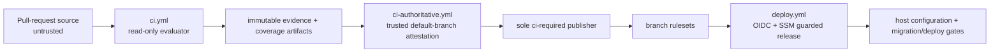

<!-- AUTO-GENERATED BELOW THIS LINE — regenerated by tools/knowledge/build_architecture.py -->

### Members (27 files across 1 modules)

**[MOD-backend](MOD-backend.md)**
- [backend/tools/ci/__init__.py](../../backend/tools/ci/__init__.py)
- [backend/tools/ci/aggregate_truth.py](../../backend/tools/ci/aggregate_truth.py)
- [backend/tools/ci/auxiliary_registry.py](../../backend/tools/ci/auxiliary_registry.py)
- [backend/tools/ci/change_scope.py](../../backend/tools/ci/change_scope.py)
- [backend/tools/ci/ci_gate.py](../../backend/tools/ci/ci_gate.py)
- [backend/tools/ci/concurrency_policy.py](../../backend/tools/ci/concurrency_policy.py)
- [backend/tools/ci/evaluation_identity.py](../../backend/tools/ci/evaluation_identity.py)
- [backend/tools/ci/evidence_aggregator.py](../../backend/tools/ci/evidence_aggregator.py)
- [backend/tools/ci/evidence_manifest.py](../../backend/tools/ci/evidence_manifest.py)
- [backend/tools/ci/execution_recorder.py](../../backend/tools/ci/execution_recorder.py)
- [backend/tools/ci/inventory.py](../../backend/tools/ci/inventory.py)
- [backend/tools/ci/inventory_cli.py](../../backend/tools/ci/inventory_cli.py)
- [backend/tools/ci/manifest_validation.py](../../backend/tools/ci/manifest_validation.py)
- [backend/tools/ci/offline_guards.py](../../backend/tools/ci/offline_guards.py)
- [backend/tools/ci/pin_authority.py](../../backend/tools/ci/pin_authority.py)
- [backend/tools/ci/pin_contracts.py](../../backend/tools/ci/pin_contracts.py)
- [backend/tools/ci/record_parser.py](../../backend/tools/ci/record_parser.py)
- [backend/tools/ci/report_merger.py](../../backend/tools/ci/report_merger.py)
- [backend/tools/ci/report_merger_cli.py](../../backend/tools/ci/report_merger_cli.py)
- [backend/tools/ci/report_parsers.py](../../backend/tools/ci/report_parsers.py)
- [backend/tools/ci/run_checks.py](../../backend/tools/ci/run_checks.py)
- [backend/tools/ci/scan_accepts.py](../../backend/tools/ci/scan_accepts.py)
- [backend/tools/ci/scanner_parsers.py](../../backend/tools/ci/scanner_parsers.py)
- [backend/tools/ci/scanner_policy.py](../../backend/tools/ci/scanner_policy.py)
- [backend/tools/ci/scanner_verdict.py](../../backend/tools/ci/scanner_verdict.py)
- [backend/tools/ci/scope_guard.py](../../backend/tools/ci/scope_guard.py)
- [backend/tools/ci/signal_registry.py](../../backend/tools/ci/signal_registry.py)

### Imported by, from outside this domain (0)
- (none)

### Imports, from outside this domain (1)
- [backend/tools/__init__.py](../../backend/tools/__init__.py)

### External
pytest, requests, yaml
<!-- /AUTO-GENERATED -->

## Purpose

This domain governs how repository changes become evidence, how that evidence becomes a trusted
pull-request status, and how an approved revision becomes a guarded deployment. It is outside the
agent runtime: CI policy lives under `backend/tools/ci`, repository workflow/scripts, rulesets,
and infrastructure/deployment wiring—not under `backend/agents`.

The core security boundary is that an untrusted pull-request evaluator may collect evidence but
may not receive secrets or publish the required status. A workflow loaded from the trusted default
branch validates the evaluator identity and artifacts, performs secret-bearing analysis, and is
the sole publisher of `ci-required` for the exact current pull-request SHA.

## Shape

- `backend/tools/ci` normalizes tool output, identifies the evaluated revision, inventories
  required signals, validates evidence shape, and rejects missing/stale/non-success signals. Its
  relocation from `agents/ci` prevents CI policy from looking like runtime agent behavior.
- `ci.yml` is the unprivileged evaluator. It runs pinned checks and produces evidence for one
  exact SHA. It holds no secret of any kind and no write-scoped credential, and it
  owns every mandatory signal on every event type, so its manifest is the complete
  verdict.
- `ci-authoritative.yml` runs from trusted default-branch content on `workflow_run`. It reattests
  the source run and current head, treats fork checkout as scanner input rather than executable
  configuration, performs no analysis of its own, and alone writes `ci-required` —
  a fork-triggered `pull_request` token is read-only and cannot write a status.
- Composite actions and scripts provide checked tool installation, artifact/evidence validation,
  security scans, and cancellation-safe SSM invocation. Rulesets consume the required status;
  deployment uses a separately scoped OIDC identity and environment controls.
- Deployment configuration preserves secure ownership boundaries. Terraform remains the default
  source for infrastructure/pool values; the pipeline must not erase a Terraform-owned parameter
  merely because its environment variable is empty. Pre-migration validation runs before a new
  image can make an incompatible schema startup attempt.

## In practice

1. A pull request runs the evaluator against its own code with no secret-bearing execution path.
2. The evaluator emits versioned, SHA-bound evidence; malformed, missing, or mismatched evidence
   is a failure rather than a skipped signal.
3. The authoritative finalizer is loaded from the default branch, validates the source run and
   head SHA, then performs secret-bearing analysis with PR source treated as read-only data.
4. Only the finalizer publishes `ci-required`, and only for an open PR whose head still equals
   the attested SHA. A stale run does not write a misleading green status.
5. Deployment consumes the guarded outcome and uses narrow OIDC/SSM permissions. Runtime
   preflight gates occur before migrations/startup so a bad identity-data cutover leaves the
   healthy stack intact.

## Why this shape

**Evidence and authority must be separate.** A pull request must be able to prove its work
without gaining the credentials or status-writing privileges that decide whether it can merge.
Attesting the exact SHA twice prevents artifact substitution and stale-finalizer races.

**CI is policy, not agent behavior.** Keeping evaluators, parsers, and signal rules under
`tools/ci` maintains the runtime's import and threat boundaries; it also lets workflow contracts
and CI-specific tests evolve without adding agent capabilities.

**Deployment safeguards are layered, not a substitute for review.** Branch rules, evidence gates,
OIDC, SSM command cancellation, Terraform ownership, image scanning, and migration preflight
address different failure modes. Any explicitly temporary weakening of a deployment gate belongs
in a tracked issue rather than silently becoming normal policy.
