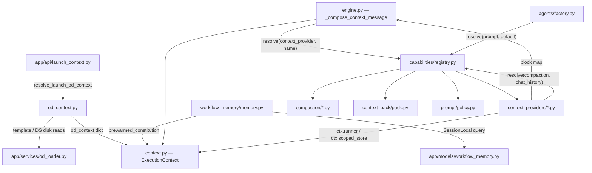
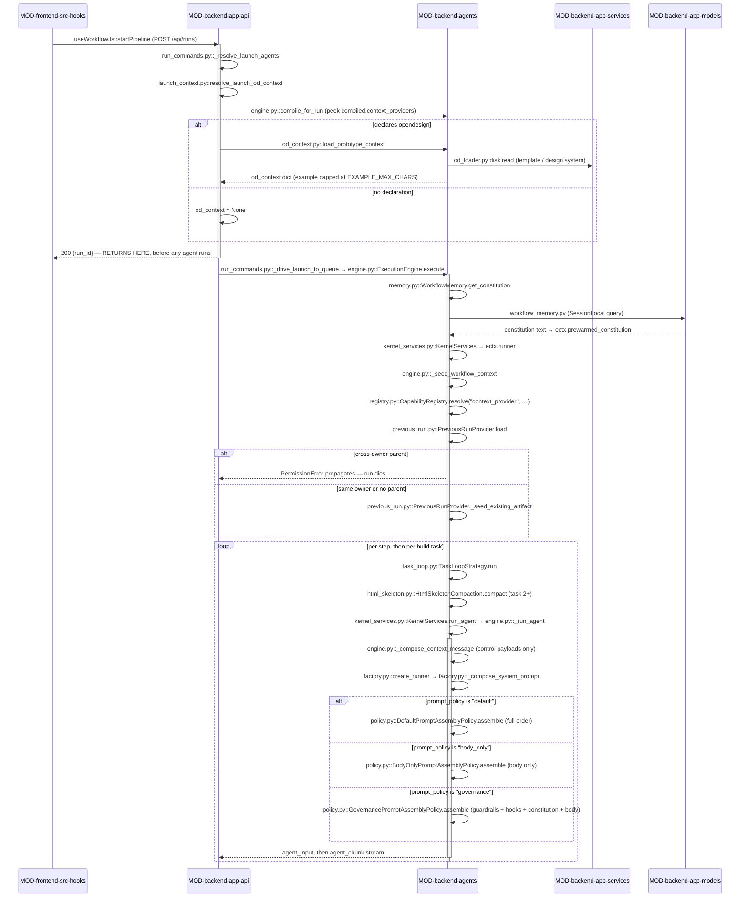

<!-- AUTO-GENERATED BELOW THIS LINE — regenerated by tools/knowledge/build_architecture.py -->

### Members (18 files across 1 modules)

**[MOD-backend-agents](MOD-backend-agents.md)**
- [backend/agents/capabilities/compaction/__init__.py](../../backend/agents/capabilities/compaction/__init__.py)
- [backend/agents/capabilities/compaction/chat_history.py](../../backend/agents/capabilities/compaction/chat_history.py)
- [backend/agents/capabilities/compaction/html_skeleton.py](../../backend/agents/capabilities/compaction/html_skeleton.py)
- [backend/agents/capabilities/context_pack/__init__.py](../../backend/agents/capabilities/context_pack/__init__.py)
- [backend/agents/capabilities/context_pack/pack.py](../../backend/agents/capabilities/context_pack/pack.py)
- [backend/agents/capabilities/context_providers/__init__.py](../../backend/agents/capabilities/context_providers/__init__.py)
- [backend/agents/capabilities/context_providers/chain_context.py](../../backend/agents/capabilities/context_providers/chain_context.py)
- [backend/agents/capabilities/context_providers/conversation.py](../../backend/agents/capabilities/context_providers/conversation.py)
- [backend/agents/capabilities/context_providers/opendesign.py](../../backend/agents/capabilities/context_providers/opendesign.py)
- [backend/agents/capabilities/context_providers/previous_run.py](../../backend/agents/capabilities/context_providers/previous_run.py)
- [backend/agents/capabilities/context_providers/repo.py](../../backend/agents/capabilities/context_providers/repo.py)
- [backend/agents/capabilities/context_providers/uploaded_files.py](../../backend/agents/capabilities/context_providers/uploaded_files.py)
- [backend/agents/capabilities/prompt/__init__.py](../../backend/agents/capabilities/prompt/__init__.py)
- [backend/agents/capabilities/prompt/policy.py](../../backend/agents/capabilities/prompt/policy.py)
- [backend/agents/execution_engine/context.py](../../backend/agents/execution_engine/context.py)
- [backend/agents/execution_engine/od_context.py](../../backend/agents/execution_engine/od_context.py)
- [backend/agents/workflow_memory/__init__.py](../../backend/agents/workflow_memory/__init__.py)
- [backend/agents/workflow_memory/memory.py](../../backend/agents/workflow_memory/memory.py)

### Imported by, from outside this domain (6)
- [backend/agents/execution_engine/engine.py](../../backend/agents/execution_engine/engine.py)
- [backend/agents/execution_engine/kernel_services.py](../../backend/agents/execution_engine/kernel_services.py)
- [backend/agents/execution_engine/ndjson_adapter.py](../../backend/agents/execution_engine/ndjson_adapter.py)
- [backend/app/api/launch_context.py](../../backend/app/api/launch_context.py)
- [backend/app/api/run_commands.py](../../backend/app/api/run_commands.py)
- [backend/app/api/settings.py](../../backend/app/api/settings.py)

### Imports, from outside this domain (11)
- [backend/agents/__init__.py](../../backend/agents/__init__.py)
- [backend/agents/artifacts/__init__.py](../../backend/agents/artifacts/__init__.py)
- [backend/agents/artifacts/graph.py](../../backend/agents/artifacts/graph.py)
- [backend/agents/capabilities/__init__.py](../../backend/agents/capabilities/__init__.py)
- [backend/agents/capabilities/registry.py](../../backend/agents/capabilities/registry.py)
- [backend/app/__init__.py](../../backend/app/__init__.py)
- [backend/app/models/__init__.py](../../backend/app/models/__init__.py)
- [backend/app/models/database.py](../../backend/app/models/database.py)
- [backend/app/models/workflow_memory.py](../../backend/app/models/workflow_memory.py)
- [backend/app/services/__init__.py](../../backend/app/services/__init__.py)
- [backend/app/services/od_loader.py](../../backend/app/services/od_loader.py)

### External
(none)
<!-- /AUTO-GENERATED -->

## Purpose

This domain owns the answer to one question: **when the kernel is about to invoke an
agent, what system prompt does that agent receive?** (The per-dispatch context message
is no longer the domain's responsibility — agents read their context directly from sandbox
files instead of receiving pasted world state.) It covers the system prompt assembly —
identity, guardrails, skills, hooks, constitution, body — selected by the `prompt_policy`
in `AGENT.md` frontmatter (`default`, `body_only`, or `governance`). It also covers the
per-dispatch control payloads: the user brief (delivered inline to the first agent or to a
conditional-gate retry recipient, and persisted to `.context/user-prompt.md` at run entry so any agent with `read_files` can read it), retry feedback, the REVISE directive, steering notes, validation errors, and the build-loop
CURRENT TASK marker. Without a dedicated assembly layer, every prompt category would have to
be an import or a branch inside [engine.py](../../backend/agents/execution_engine/engine.py) keyed on the
workflow being run, which is precisely the thing SC-001 forbids; the L12 per-pipeline
injection branches that used to live in the kernel were deleted in favour of what is
here.

It begins at the `ExecutionContext` ([context.py](../../backend/agents/execution_engine/context.py)) — the per-run carrier every piece of
context is threaded onto — and ends at the system prompt and control blocks handed to `KernelServices.run_agent`.
It deliberately excludes four neighbours. *Which* upstream outputs reach an agent is
the `produces`/`consumes` artifact contract, owned by DOMAIN-deliverables-and-artifacts;
this domain never reads or renders artifact content. *What* the agent reads from disk
(`.context/design/`, `.uploads/`, `.agents/NN-<agent>.md`, etc.) is owned by DOMAIN-sandboxing-and-file-access;
this domain only seeds the files at run entry via context providers, it does not manage their reads.
*When* an agent is dispatched at all, and the scratch fields (`build_task_number`, `current_task_block`)
that the build region reads, belong to DOMAIN-execution-kernel and
DOMAIN-execution-strategies. And the `(kind, name)` lookup itself is
DOMAIN-capability-registry — this domain is a set of registrants, not the registrar.
Ownership *checks* do run here (`assert_owns`, before any cross-run read), but the
scoping machinery they call is DOMAIN-auth-and-entitlements.

## Shape

**Nothing under `backend/agents/capabilities/` may import `app.*` or the execution
kernel — an import-linter contract in `pyproject.toml` ("agents.capabilities must not
import the execution kernel or the web layer") enforces it in CI. So every heavy read a
provider needs — design-system disk, DB rows, sandbox files, the parent run — arrives
through an object-typed handle stashed on `ExecutionContext` (`ctx.runner`,
`ctx.scoped_store`) and is reached by `getattr`, never by an import. Providers are invoked
once at run entry by `_seed_workflow_context` for their side effects (seeding `.context/`,
`.uploads/`, `.agents/` files), not in the per-dispatch context-composition path — the
per-dispatch loop now composes only control payloads (brief, retry feedback, steering
notes, current task block), never world state.** That single constraint explains the shape
of all thirteen capability files, and it is why the two members that *do* import `app.*`
live outside `capabilities/`.

- **The carrier.** [context.py](../../backend/agents/execution_engine/context.py) defines `ExecutionContext`, a plain mutable dataclass
  that imports only stdlib and `agents.artifacts.graph`. Every field a provider reads is
  declared here — `od_context`, `seed_files`, `is_revision_workflow`, `run_id`, `parent_run_id`,
  `deliverable`, the consume-once family (`redo_directive`, `spec_revision_context`,
  `spec_revision_prior_artifact`, `steering_notes`, `turn_images_once`) — and the handles
  (`runner`, `scoped_store`) are typed `object | None` specifically so the module stays import-pure.

- **The per-dispatch composer.** [engine._compose_context_message](../../backend/agents/execution_engine/engine.py) is the sole path.
  Phase Z (GAPS §0.3 step N+1) deleted the world-block injection loop entirely.
  It now composes only control payloads: the user brief (delivered to the first-dispatched
  agent or to a conditional-gate retry recipient), retry feedback (if a backward gate jump
  targeted this agent), the REVISE directive and spec-revision context (for specification
  editing runs), steering notes (asynchronous user guidance mid-run), validation errors
  (from the internal fix-loop), and the build-loop `=== CURRENT TASK ===` marker. Agents
  read all other context (design-system blocks, uploaded files, upstream outputs, planning
  analysis, prior-revision HTML, prototype skeleton) from files in the sandbox
  (`.context/design/`, `.uploads/`, `.agents/NN-<agent-id>.md`, `PLANNER.md`, etc.) per
  their own `## Sandbox Reading Guide` declared in their AGENT.md.

- **The run-entry composer.** [engine._seed_workflow_context](../../backend/agents/execution_engine/engine.py) calls each declared provider
  once at run entry to seed the files agents will read per-dispatch. This is now the
  PRIMARY means context reaches agents — [previous_run.py](../../backend/agents/capabilities/context_providers/previous_run.py) seeds the parent run's
  `spec.md`/`design.md`/`tasks.md` and the in-place-editable artifact into the sandbox;
  [opendesign.py](../../backend/agents/capabilities/context_providers/opendesign.py) (via [od_context.py](../../backend/agents/execution_engine/od_context.py) called at WS boundary) seeds `.context/design/`;
  [uploaded_files.py](../../backend/agents/capabilities/context_providers/uploaded_files.py) seeds `.uploads/` and its manifest; [chain_context.py](../../backend/agents/capabilities/context_providers/chain_context.py) seeds
  `.context/` from a source run's `.chain/` payload. The per-dispatch composer never
  calls providers — it only composes the control payloads that change per agent.

- **The providers** (invoked once at run entry by `_seed_workflow_context` for file seeding only, not
  in the per-dispatch loop): [previous_run.py](../../backend/agents/capabilities/context_providers/previous_run.py) (gated on
  `is_revision_workflow`; seeds parent run's `spec.md`/`design.md`/`tasks.md` and the
  in-place-editable artifact, returns `{}`), [opendesign.py](../../backend/agents/capabilities/context_providers/opendesign.py) (via [od_context.py](../../backend/agents/execution_engine/od_context.py) called
  at WS boundary; seeds `.context/design/` with design-system markdown blocks, template files (example.html, assets/template.html, references/*.md), and design-system component files (tokens.css, components.html);
  gated on manifest `context_providers` declaration), [uploaded_files.py](../../backend/agents/capabilities/context_providers/uploaded_files.py) (seeds `.uploads/`
  manifest + text sidecars; gated on presence of uploaded files), [conversation.py](../../backend/agents/capabilities/context_providers/conversation.py) (seeds chat history into the
  store or to files; gated on manifest declaration), and [chain_context.py](../../backend/agents/capabilities/context_providers/chain_context.py) (seeds
  `.context/` from a chained source run's `.chain/` payload; gated on `chain_source_run_id`). Each returns `{}` (empty block map) — their effect is file seeding, not text composition.

- **The launch-time opendesign eligibility signal.** [launch_context.py](../../backend/app/api/launch_context.py)
  carries the declared signal alone — a run opts into template/design-system context by declaring
  `opendesign` in its manifest's `context_providers` list (SC-001 / INV-13). The legacy
  eligibility check that excluded bases with a dedicated `od_` alias from their own declared
  capability was removed when the alias split collapsed (`agents.registry._OD_ALIAS_BASE` is empty);
  any pipeline declaring `opendesign` now receives it under its own declared name.

- **The bounding transforms.** [compaction/html_skeleton.py](../../backend/agents/capabilities/compaction/html_skeleton.py) reduces a growing
  `prototype.html` to a ~1–3k state map for build task 2+; [compaction/chat_history.py](../../backend/agents/capabilities/compaction/chat_history.py)
  keeps the `keep_recent` newest turns byte-verbatim and replaces the older tail with a
  marker; [context_pack/pack.py](../../backend/agents/capabilities/context_pack/pack.py) picks a target file plus up to `MAX_NEIGHBORS`
  selector-chosen neighbours via the pure `context_selector`. These are invoked by the task_loop
  strategy at run entry to keep the `.context/` footprint bounded; they are NOT called by
  the per-dispatch composer (which no longer calls any providers).

- **The user-prompt persistence.** [user_prompt.py::write_user_prompt_to_sandbox](../../backend/agents/execution_engine/user_prompt.py)
  writes the user message to `.context/user-prompt.md` before step 1, making it readable to any agent
  granted `read_files` — not just the first agent, which receives it inline. [user_prompt.py::strip_inline_attachments](../../backend/agents/execution_engine/user_prompt.py)
  removes the wizard's inlined `=== Attached: … ===` document blocks and replaces them with a `.uploads/` file listing
  when a step is granted the `file_extract` tool set (the files are already on disk; pasting them would let the first
  agent skip its own work). Both functions are called from [engine.py](../../backend/agents/execution_engine/engine.py) at run entry.

- **The system-prompt half (Seam 1 only).** [prompt/policy.py](../../backend/agents/capabilities/prompt/policy.py) holds three policies: `default`
  (`tool_availability → injects → guardrails → skills → hooks → constitution → prompt_body`),
  `body_only` (AGENT.md verbatim), and `governance` (guardrails → hooks → constitution → body).
  The `prompt_policy` field in `AGENT.md` frontmatter selects which policy applies; the
  compiler validates it at load time against the capability registry. `[agents/factory.py](../../backend/agents/factory.py)::_compose_system_prompt`
  builds a category→block mapping and delegates order and join to the resolved policy via the registry
  (08-05 / F1). The factory reads `ctx.prewarmed_constitution` by
  `getattr` so the sync factory avoids awaiting inside the running event loop (F4 / R12).
  **NOTE:** `prompt_policy` controls Seam 1 (system prompt) only. Seam 2 (the per-dispatch context
  message) no longer varies by policy at all — Phase Z deleted every policy-conditional
  world-block branch, so every agent gets the same control-payloads-only treatment regardless
  of which policy is named in its AGENT.md (GAPS §0.3 step N+1).

**Module crossings.** Only two members cross into `app.*`, and both do so outbound.
[od_context.py](../../backend/agents/execution_engine/od_context.py) imports `app.services.od_loader` and is called from
[app/api/launch_context.py](../../backend/app/api/launch_context.py) at the WS/NDJSON boundary — so template and design-system
bytes are read *before* `execute()` and travel inward as the plain `od_context` dict.
[workflow_memory/memory.py](../../backend/agents/workflow_memory/memory.py) imports `app.models.database` and is called from
[app/api/settings.py](../../backend/app/api/settings.py) for CRUD; the engine awaits `get_constitution` once at run entry
and stashes the result on `ectx.prewarmed_constitution` so the *synchronous* factory can
read it without awaiting inside a running loop. Every other crossing is inbound-only:
the kernel calls in, the domain never calls back out.

## In practice

### The path, by call

### Step by step

**Launch — the od_context is read before the kernel exists**

1. `useWorkflow.ts::startPipeline` hands a payload to
   `RunConnectionProvider.tsx::sendCommand`, which POSTs it to `/api/runs`.
2. [run_commands.py::launch_run](../../backend/app/api/run_commands.py) rejects an empty brief, then calls
   [run_commands.py::_resolve_launch_agents](../../backend/app/api/run_commands.py).
3. That delegates to [launch_context.py::resolve_launch_od_context](../../backend/app/api/launch_context.py), which
   alias-resolves the label and peeks [engine.py::compile_for_run](../../backend/agents/execution_engine/engine.py) for the manifest's
   declared `context_providers`.
4. If `opendesign` is declared, [od_context.py::load_prototype_context](../../backend/agents/execution_engine/od_context.py) (or `load_ppt_od_context`)
   reads the template and design system through [od_loader.py](../../backend/app/services/od_loader.py), capping
   `example.html` at `EXAMPLE_MAX_CHARS`. Otherwise `od_context` is `None`.
5. `launch_run` stamps the dict onto the `WorkflowRun` row as `od_context_json`
   and **returns `200 {run_id}` to the browser**. Nothing in this domain has yet
   composed a single prompt — the run is driven in the background.

**Run entry — the per-run carrier is filled once**

6. [run_commands.py::_drive_launch_to_queue](../../backend/app/api/run_commands.py) calls
   [engine.py::ExecutionEngine.execute](../../backend/agents/execution_engine/engine.py) with that `od_context`.
7. `execute` awaits [memory.py::WorkflowMemory.get_constitution](../../backend/agents/workflow_memory/memory.py) **once** and stashes
   the result on `ectx.prewarmed_constitution` (the sync factory cannot await later).
8. `execute` threads `compiled.context_providers` onto
   `ectx.compiled_context_providers` and constructs
   [kernel_services.py::KernelServices](../../backend/agents/execution_engine/kernel_services.py) as `ectx.runner` — the single handle every
   provider reaches the kernel through.
9. [engine.py::_seed_workflow_context](../../backend/agents/execution_engine/engine.py) resolves each declared provider by name and
   calls `load` once. [previous_run.py::PreviousRunProvider.load](../../backend/agents/capabilities/context_providers/previous_run.py) returns `{}` unless
   `ctx.is_revision_workflow`; when it fires it seeds the existing artifact, runs
   `assert_owns` on the parent, and writes the parent's `spec.md` / `design.md` /
   `tasks.md` into this run's sandbox.
9a. [user_prompt.py::write_user_prompt_to_sandbox](../../backend/agents/execution_engine/user_prompt.py) writes the user message to `.context/user-prompt.md`,
   making it readable to any agent with `read_files` permission. The first agent receives
   it inline as before; this file is the path for all downstream agents to read the same request.
9b. [engine.py](../../backend/agents/execution_engine/engine.py) checks whether any step in the compiled workflow is granted the `file_extract` tool set.
   If so, [user_prompt.py::strip_inline_attachments](../../backend/agents/execution_engine/user_prompt.py) removes the wizard's inlined `=== Attached: … ===` document blocks
   from the user message, replacing them with a `.uploads/` file listing, and rewrites `.context/user-prompt.md` with the stripped version.
   This prevents the first agent from bypassing its own extraction work when files are already on disk.

**Per dispatch — control payloads only**

10. The per-step loop resolves `step.strategy` and calls
    `task_loop.py::TaskLoopStrategy.run` (build) or the `single_shot` strategy.
11. From build task 2 on, `task_loop` pulls the prior HTML off the typed graph and
    runs it through [html_skeleton.py::HtmlSkeletonCompaction.compact](../../backend/agents/capabilities/compaction/html_skeleton.py), passing the
    result as the `skeleton` argument.
12. [kernel_services.py::KernelServices.run_agent](../../backend/agents/execution_engine/kernel_services.py) sets `build_task_number`,
    `build_task_total`, and `current_task_block` on the shared `ExecutionContext`,
    then calls [engine.py::_run_agent](../../backend/agents/execution_engine/engine.py).
13. [engine.py::_compose_context_message](../../backend/agents/execution_engine/engine.py) composes the context message from control payloads
    only (Phase Z / GAPS §0.3 step N+1 deleted every world-block injection). It builds:
    the original user request (delivered to first-dispatched agent or conditional-gate
    retry recipients), any retry feedback (if this agent was sent backward from a gate),
    the REVISE directive (for specification editing), steering notes (asynchronous user
    guidance), validation errors (from the fix-loop), and the `=== CURRENT TASK ===` block
    (build-loop step marker).
14. The engine NO LONGER calls context providers per-dispatch. Agents read all context
    material directly from sandbox files (seeded once at run entry by `_seed_workflow_context`):
    design-system and template blocks from `.context/design/`, uploaded files from `.uploads/`,
    upstream outputs and planning analysis from `.agents/NN-<agent-id>.md` and `PLANNER.md`,
    prior-revision artifacts from the in-place-editable deliverable file.
15. `factory.py::create_runner` builds the system prompt (Seam 1) from the agent's
    declared `prompt_policy` field. `factory.py::_compose_system_prompt` assembles a
    category→block mapping (tool availability, injects, guardrails, skills, hooks, the
    pre-warmed constitution, body) and hands ordering and joining to the resolved policy
    class via the registry.
16. The policy is resolved per-agent: `default` emits the full 7-block order,
    `body_only` emits AGENT.md verbatim, `governance` emits guardrails→hooks→constitution→body.
    See [policy.py::DefaultPromptAssemblyPolicy](../../backend/agents/capabilities/prompt/policy.py), [policy.py::BodyOnlyPromptAssemblyPolicy](../../backend/agents/capabilities/prompt/policy.py),
    [policy.py::GovernancePromptAssemblyPolicy](../../backend/agents/capabilities/prompt/policy.py) for policy details.
17. The engine yields `agent_input` carrying the composed `context_message` and the
    resolved `system_prompt`, then streams `agent_chunk` events into the queue the SSE
    reader is draining.

### What breaks if you get it wrong

- **Import a kernel or app symbol into a `capabilities/` module.** Loud: the
  import-linter contract "agents.capabilities must not import the execution kernel or
  the web layer" in `pyproject.toml` fails in CI. You do not have to worry about
  shipping this one.
- **Branch on a workflow name or pipeline_type inside a provider.** Also loud at import
  time (import-linter 4/0 blocks the capability import), but a bare `if spec.id ==` check
  inside a provider function is silent and breaks SC-001 for every agent the provider targets.
  Providers are resolved via the registry (name only; no workflow/agent literal), so keying
  any decision on workflow/agent identity silently violates INV-1. Use declarative gates
  (`is_revision_workflow`, `parent_run_id`, manifest `context_providers` list) instead.
- **Read `ctx.current_spec_injects` outside `_compose_input_blocks`'s local gate.** Silent
  and dangerous: the field is set once in the legacy per-dispatch provider loop (now deleted)
  and never reset, so a later agent inherits the previous agent's set. This is exactly the
  leak [engine.py::_compose_input_blocks](../../backend/agents/execution_engine/engine.py) documents and avoids by deriving its gate locally from
  `spec.injects ∪ ectx.current_step.injects`.
- **Swallow `PermissionError` in a provider at run entry.** Silent cross-run disclosure: the
  parent run's `spec.md` / `design.md` / `tasks.md` land in another owner's sandbox and the
  run looks healthy. `_seed_workflow_context` re-raises `PermissionError` deliberately
  (L16 ratchet); every other error at run entry degrades to `{}`. The per-dispatch context
  composer no longer calls providers, so this only applies at run entry now.
- **Add a second truncation of `example.html` in a provider.** Silent: real deck templates
  get clipped to whatever the second cap is and the model sees a torn document. This already
  happened once; the fix was the single cap at [od_context.py::get_example_html](../../backend/agents/execution_engine/od_context.py).
- **Reorder a policy's `order` tuple or emit `prompt_body` conditionally.** Loud on the five
  characterization snapshots, silent everywhere else — and the module says never to re-baseline
  them. Only one change per policy is allowed: the add-new-block-to-DEFAULT_ORDER kind (which
  exists as a dormant future; the snapshots still pass). Removing a block or re-ordering is a
  breaking change.
- **Forget that `prewarmed_constitution` is awaited at run entry.** Silent: the factory is
  synchronous, so a constitution fetched lazily under the running loop is dropped and every
  agent runs ungoverned with no error anywhere.
- **Let a provider raise on a bad read at run entry.** Loud but wrong: a broken chat log or
  a TTL-swept parent aborts the whole run. Every provider except the ownership-check path is
  written to degrade to `{}`.
- **Declare a `read_files: false` agent with no alternative context path.** Loud and
  intentional: an agent that cannot read `.agents/NN-<agent>.md` files receives upstream
  outputs pasted in the context message instead (the one surviving exception to the file-based
  model). No production manifest currently does this; it is a safety valve for hypothetical
  future agents that genuinely cannot read files.

### The other paths

**The revision path.** `ctx.is_revision_workflow` (from `compiled.deliverable.revises_existing`)
is the gate — not a stray `parent_run_id`. `PreviousRunProvider._seed_existing_artifact` pulls the
artifact out of the `=== EXISTING PROTOTYPE HTML ===` framing the frontend emits, writes it to the
sandbox under `deliverable.name`, replaces that block in `runner.user_message` with a one-line
`read_file` pointer, and stashes `revision_original_html` / `revision_instruction`. The document
itself is read from the deliverable file at task resolution time; it does NOT render via the context
message (agents read files, not pasted content). The revision instruction is a control payload still
delivered in the context message.

**The revision-analyzer path.** The manifest now designates its analyzer step with
`produces_solution_plan: true`, so step 0 produces the implementation blueprint and
[engine.py::_run_agent](../../backend/agents/execution_engine/engine.py)'s post-step hook (checking `getattr(step, "produces_solution_plan", False)`)
fires after that step completes, parsing the agent's streamed output and stashing it on
`ectx.analyzer_solution`. In `_compose_context_message`, downstream agents receive the
blueprint in a `=== REVISION ANALYSIS ===` block at Position 5 (after user guidance,
before position 6 and the build task block) if `analyzer_solution` is non-empty. Default
empty ⇒ DORMANT on every non-analyzer run ⇒ INV-3 byte-parity holds ([ADR-0022](../cards/20260823-ADR-0022.md)).
The tier classification that selects *which* analyzer variant to run remains lightweight
and happens before the revision run is minted — `_classify_revision_tier` is a fast LLM
call that selects the pipeline.

**The Concierge-to-analyzer path.** When a user submits a prototype revision from the
Concierge, the previous_run provider has seeded `revision_original_html` and
`revision_instruction` onto the context. The analyzer step (a no-tools agent that cannot
call `read_file`) receives the HTML directly in the context message as a control payload
when **all three conditions hold**: `ectx.revision_original_html` is non-empty,
`spec.tools` is empty, and `ectx.analyzer_solution` is empty (i.e., this *is* the
analyzer step, not a downstream agent consuming the analysis). This is the one surviving
exception to the file-only model — a no-tools agent cannot read `.agents/` files, so it
must receive content pasted. Default empty ⇒ DORMANT on every tool-using agent and every
non-revision run ⇒ INV-3 byte-parity holds.

**The redo path.** `_run_agent` publishes `redo_directive` and
`spec_revision_prior_artifact` onto the context immediately around the compose call and
restores them in a `finally`, so a compose-time exception cannot strand them on the
shared per-run context. Each redo re-run also gets a fresh checkpoint `thread_id`
suffix (`:redo{n}`, `:rev{n}`) — reusing the thread makes the model replay its rejected
turn and answer "it's already done".

**The steering path.** `steering_notes` arrive asynchronously from
`POST /api/runs/{id}/messages` and render as one `=== USER GUIDANCE ===` block at the
*next* dispatch — mid-generation injection is impossible. The read-and-clear happens
inside composition rather than in the caller, and sticky notes survive it while
one-shot notes do not.

**The resumed / fallback path.** [uploaded_files.py](../../backend/agents/capabilities/context_providers/uploaded_files.py) prefers the disk manifest under
`.uploads/`, but a wiped sandbox falls back to the durable `upload_text` rows via
`ctx.scoped_store`, picking the greatest-version row per location. Both routes flow
through the same `_compose`, so the block is byte-identical either way.

**The NDJSON path.** [ndjson_adapter.py::run_od_prototype_pipeline](../../backend/agents/execution_engine/ndjson_adapter.py) bypasses the launch
seam entirely: it calls [od_context.py::load_prototype_context](../../backend/agents/execution_engine/od_context.py) directly and flattens
the engine's `{type, data}` envelopes for the legacy REST prototype endpoint. Same
domain, different entry.

## Why this shape

**Why providers run at run entry, not per-dispatch.** Phase Z (GAPS §0.3 step N+1) deleted
the per-dispatch provider loop entirely because every agent finished the Q4 migration (Phase M)
to read context from files instead of receiving pasted blocks. Providers now seed files once at
run entry (`.context/design/`, `.uploads/`, `spec.md`/`design.md`/`tasks.md`, the editable
artifact); the per-dispatch composer never calls them. This **eliminates the per-agent choice**
of whether to paste world state, because pasting is gone entirely (except for the read_files:false
safety valve). SC-001 still holds — there is no workflow-name or agent-id branch in either the
provider set or the per-dispatch composer. The engine's positional first-agent check
(`index == 0`) exists in the same spirit — rewritten off an agent-id comparison so the banned-pattern
CI grep returns zero.

**Why the handles are `object | None`.** The import-linter contract above is the reason,
not style. Typing `scoped_store` as its concrete `agents.authz.ScopedStore` would drag
an `app.models` import into a module the kernel must be able to hold, so the field stays
untyped and callers use `getattr`. [uploaded_files.py](../../backend/agents/capabilities/context_providers/uploaded_files.py) goes further and *replicates* the
`.uploads/` literal rather than importing `app.agents.sandbox._UPLOADS_PREFIX`, with the
reason written at the constant.

**Why ownership denial is the one error that never degrades.** Every provider degrades
to `{}` on a bad read — a broken chat log or a TTL-swept parent must not fail a run. But
[previous_run.py](../../backend/agents/capabilities/context_providers/previous_run.py) and [repo.py](../../backend/agents/capabilities/context_providers/repo.py) re-raise `PermissionError` out of `load`, and both
`_seed_workflow_context` and the per-dispatch loop re-raise it in turn. An *unexpected*
store error during `assert_owns` fails closed (skip the seed) rather than open, because
the blast radius is cross-run disclosure. This is the L16 ratchet, and the comments name
test_parent_run_ownership.py as its gate.

**Why prompt_policy controls Seam 1 only, not Seam 2.** Phase Z deleted every `if not _is_migrated:`
branch from `_compose_context_message`, so **every agent now gets the same Seam 2 (context
message) treatment** regardless of its `prompt_policy` — only control payloads, no world blocks
(GAPS §0.3 step N+1). The policy still matters for Seam 1 (system prompt): `default` emits all
seven blocks, `body_only` emits AGENT.md alone, `governance` emits the three governed-agent blocks.
This two-seam split is intentional: agents pick their system-prompt flavor per their own needs
(governed vs ungoverned, injection-heavy vs minimal), but context composition is uniform — no
workflow/agent branch (INV-1), everyone reads files.

**Why the prompt order is frozen.** [policy.py](../../backend/agents/capabilities/prompt/policy.py) reproduces the factory's former inline
append order byte-for-byte, including always emitting `prompt_body` even when empty, so
the join boundary is unchanged. Five characterization snapshots gate it and the module
says never to re-baseline them. The same discipline explains [html_skeleton.py](../../backend/agents/capabilities/compaction/html_skeleton.py), a
verbatim lift whose algorithm must not be altered because the ≥50% reduction gate is
calibrated to its exact output, and the pervasive "DORMANT on golden runs" notes — a new
provider that returns `{}` when un-gated changes no existing run's bytes.

**Why `EXAMPLE_MAX_CHARS` lives in [od_context.py](../../backend/agents/execution_engine/od_context.py) and nowhere else.** A second clip in
the provider had silently re-truncated real deck templates to 8000 chars; the fix was one
authoritative cap at the read, with [opendesign.py](../../backend/agents/capabilities/context_providers/opendesign.py) injecting the runner-capped string
directly. The comment marks this INV-12 single-truncation.

**Why `analyzer_solution` is dormant when empty.** The analyzer step carries
`produces_solution_plan: true`, and [engine.py::_run_agent](../../backend/agents/execution_engine/engine.py)'s post-step hook fires after
it completes, parsing the agent's output into `ectx.analyzer_solution`. A non-analyzer
run leaves it as the default empty string. Downstream agents read the analysis from a file
(not a context-message block) when present; the context message mentions it only as
metadata. A dormant field changes no existing run's bytes ([ADR-0022](../cards/20260823-ADR-0022.md) /
INV-3). This additive seam is keyed on the generic field (a dataclass string) rather than
any `pipeline_type` or agent-id literal, so it is SC-001/INV-1 compliant.

**Why world-state is seeded as files, not pasted in context.** Phase Z's shift from Seam-2
pasting to file-based reading gives agents direct access to source material (design-system
markdown, template HTML, upstream artifacts in JSON/YAML, planning analysis) without copying
it into the context message. The benefits: (1) Agents read exactly what they need at their own
pace, no truncation by token caps; (2) Context message stays bounded (only control payloads —
brief, retry feedback, steering, task marker); (3) No per-agent choice of "paste or not" — the
engine composes the same control-only message for every agent, so SC-001 compliance is automatic
and no workflow-name branch can leak in; (4) Upstream artifacts flow through typed `produces`/`consumes`
contracts (ART-03), not untyped pasted text. The tradeoff: agents must have AGENT.md `##
Sandbox Reading Guide` sections that name the files they read — every agent is responsible for its
own file I/O, not delegated to a provider. Every manifested agent finished the Q4 migration.

**Why the user request is persisted to `.context/user-prompt.md` and attachments are conditionally stripped.** The
user brief is delivered inline to the first agent only (in the context message), but a multi-agent workflow often needs the same
request available to downstream agents — so `write_user_prompt_to_sandbox` writes it to the sandbox at run entry. When a step
is granted `file_extract`, it is expected to extract and process uploaded files itself; inlining those documents in the prompt lets
the first agent skip its declared job and do the whole workflow in one pass. `strip_inline_attachments` prevents this by replacing
the wizard's pasted `=== Attached: … ===` blocks (copies of the files) with a `.uploads/` file listing, keeping only the *names*
(the files already exist on disk, listed in `.uploads/manifest.json`). The stripped message is written back to `.context/user-prompt.md` so the
whole workflow sees the same clean brief, not a mutation mid-run.

**Not recorded.** The `compaction` kind has no formal Protocol port — that omission *is*
recorded ([chat_history.py](../../backend/agents/capabilities/compaction/chat_history.py) states the contract is satisfied structurally and no
`base.py` edit was made). But there is no recorded reason why `workflow_memory/` sits
outside `capabilities/` as a bare module rather than a registered capability, nor why
`context_pack` has a single `default` implementation while the sibling kinds are named.
Both read as "not yet needed", but nothing in the tree says so.
