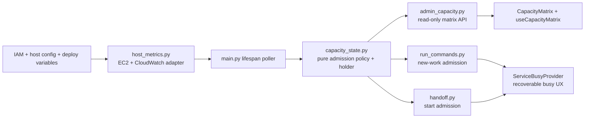

<!-- AUTO-GENERATED BELOW THIS LINE — regenerated by tools/knowledge/build_architecture.py -->

### Members (12 files across 9 modules)

**[MOD-backend-app](MOD-backend-app.md)**
- [backend/app/main.py](../../backend/app/main.py)

**[MOD-backend-app-api](MOD-backend-app-api.md)**
- [backend/app/api/admin_capacity.py](../../backend/app/api/admin_capacity.py)
- [backend/app/api/handoff.py](../../backend/app/api/handoff.py)
- [backend/app/api/run_commands.py](../../backend/app/api/run_commands.py)

**[MOD-backend-app-core](MOD-backend-app-core.md)**
- [backend/app/core/config.py](../../backend/app/core/config.py)

**[MOD-backend-app-services](MOD-backend-app-services.md)**
- [backend/app/services/capacity_state.py](../../backend/app/services/capacity_state.py)
- [backend/app/services/host_metrics.py](../../backend/app/services/host_metrics.py)

**[MOD-frontend-src-app](MOD-frontend-src-app.md)**
- [frontend/src/app/admin/page.tsx](../../frontend/src/app/admin/page.tsx)

**[MOD-frontend-src-components](MOD-frontend-src-components.md)**
- [frontend/src/components/admin/CapacityMatrix.tsx](../../frontend/src/components/admin/CapacityMatrix.tsx)

**[MOD-frontend-src-hooks](MOD-frontend-src-hooks.md)**
- [frontend/src/hooks/useCapacityMatrix.ts](../../frontend/src/hooks/useCapacityMatrix.ts)

**[MOD-frontend-src-lib](MOD-frontend-src-lib.md)**
- [frontend/src/lib/api.ts](../../frontend/src/lib/api.ts)

**[MOD-frontend-src-providers](MOD-frontend-src-providers.md)**
- [frontend/src/providers/ServiceBusyProvider.tsx](../../frontend/src/providers/ServiceBusyProvider.tsx)

### Imported by, from outside this domain (35)
- [backend/agents/execution_engine/clarify_engine.py](../../backend/agents/execution_engine/clarify_engine.py)
- [backend/agents/execution_engine/engine.py](../../backend/agents/execution_engine/engine.py)
- [backend/agents/execution_engine/kernel_services.py](../../backend/agents/execution_engine/kernel_services.py)
- [backend/agents/model_policy.py](../../backend/agents/model_policy.py)
- [backend/agents/planner/smart_planner.py](../../backend/agents/planner/smart_planner.py)
- [backend/app/agents/cached_invoke.py](../../backend/app/agents/cached_invoke.py)
- [backend/app/agents/checkpointer.py](../../backend/app/agents/checkpointer.py)
- [backend/app/agents/deep_agent_runner.py](../../backend/app/agents/deep_agent_runner.py)
- [backend/app/agents/handoff/coder.py](../../backend/app/agents/handoff/coder.py)
- [backend/app/agents/model_factory.py](../../backend/app/agents/model_factory.py)
- [backend/app/agents/playwright_session.py](../../backend/app/agents/playwright_session.py)
- [backend/app/agents/revision_analyzer.py](../../backend/app/agents/revision_analyzer.py)
- [backend/app/agents/runtime/local.py](../../backend/app/agents/runtime/local.py)
- [backend/app/agents/sandbox.py](../../backend/app/agents/sandbox.py)
- [backend/app/agents/validators/html_render.py](../../backend/app/agents/validators/html_render.py)
- [backend/app/api/analytics.py](../../backend/app/api/analytics.py)
- [backend/app/api/auth.py](../../backend/app/api/auth.py)
- [backend/app/api/file_extract.py](../../backend/app/api/file_extract.py)
- [backend/app/api/install.py](../../backend/app/api/install.py)
- [backend/app/api/mcp.py](../../backend/app/api/mcp.py)
- [backend/app/api/prototype_templates.py](../../backend/app/api/prototype_templates.py)
- [backend/app/api/run_figma_export.py](../../backend/app/api/run_figma_export.py)
- [backend/app/api/run_files.py](../../backend/app/api/run_files.py)
- [backend/app/api/run_shutdown.py](../../backend/app/api/run_shutdown.py)
- [backend/app/api/run_stream.py](../../backend/app/api/run_stream.py)
- …and 10 more

### Imports, from outside this domain (78)
- [backend/agents/__init__.py](../../backend/agents/__init__.py)
- [backend/agents/artifact_store/__init__.py](../../backend/agents/artifact_store/__init__.py)
- [backend/agents/artifact_store/store.py](../../backend/agents/artifact_store/store.py)
- [backend/agents/authz.py](../../backend/agents/authz.py)
- [backend/agents/capabilities/__init__.py](../../backend/agents/capabilities/__init__.py)
- [backend/agents/capabilities/context_providers/__init__.py](../../backend/agents/capabilities/context_providers/__init__.py)
- [backend/agents/capabilities/context_providers/previous_run.py](../../backend/agents/capabilities/context_providers/previous_run.py)
- [backend/agents/capabilities/deliverables/__init__.py](../../backend/agents/capabilities/deliverables/__init__.py)
- [backend/agents/capabilities/deliverables/_mimetype.py](../../backend/agents/capabilities/deliverables/_mimetype.py)
- [backend/agents/capabilities/registry.py](../../backend/agents/capabilities/registry.py)
- [backend/agents/capabilities/token_usage.py](../../backend/agents/capabilities/token_usage.py)
- [backend/agents/execution_engine/__init__.py](../../backend/agents/execution_engine/__init__.py)
- [backend/agents/execution_engine/engine.py](../../backend/agents/execution_engine/engine.py)
- [backend/agents/execution_engine/finalization.py](../../backend/agents/execution_engine/finalization.py)
- [backend/agents/execution_engine/overrides.py](../../backend/agents/execution_engine/overrides.py)
- [backend/agents/execution_engine/state_machine.py](../../backend/agents/execution_engine/state_machine.py)
- [backend/agents/loader.py](../../backend/agents/loader.py)
- [backend/agents/registry.py](../../backend/agents/registry.py)
- [backend/agents/workflows/__init__.py](../../backend/agents/workflows/__init__.py)
- [backend/agents/workflows/artifacts.py](../../backend/agents/workflows/artifacts.py)
- [backend/agents/workflows/compiler.py](../../backend/agents/workflows/compiler.py)
- [backend/agents/workflows/manifest.py](../../backend/agents/workflows/manifest.py)
- [backend/agents/workflows/plan.py](../../backend/agents/workflows/plan.py)
- [backend/app/__init__.py](../../backend/app/__init__.py)
- [backend/app/agents/__init__.py](../../backend/app/agents/__init__.py)
- …and 53 more

### External
boto3, botocore, fastapi, langchain_core, pydantic, pydantic_settings
<!-- /AUTO-GENERATED -->

## Purpose

This domain decides whether the current host has enough observed CPU and memory capacity to
admit *new expensive work*. It is deliberately advisory monitoring plus a narrow admission
boundary: only an enabled, known, engaged decision rejects a non-admin launch, resume, revision,
new Concierge task, or handoff start. It never blocks cancellation, gate/answer resolution,
steering, or SSE reconnect; it fails open when monitoring is blind or stale.

The domain is not a request-path AWS integration. A single application-lifespan poller obtains
CloudWatch/EC2 observations and advances the process-local snapshot/decision; routers and the
admin matrix only read that already-computed immutable state. That separation makes the policy
deterministic and prevents a metrics outage from becoming a user-facing dependency outage.

## Shape

- [capacity_state.py](../../backend/app/services/capacity_state.py) owns typed snapshots, a pure `evaluate_admission` function, and the
  process-local latest snapshot/decision holder. The policy applies stale-data fail-open,
  consecutive-breach confirmation, hysteresis, and a minimum engaged duration.
- [host_metrics.py](../../backend/app/services/host_metrics.py) is the AWS/IMDSv2/CloudWatch adapter. It resolves the serving instance
  from an override or deployment tags and degrades collection failure into unknown data instead
  of an exception that a request handler could surface.
- [main.py](../../backend/app/main.py) is the single writer: its lifespan poller offloads collection, advances the decision,
  and logs state transitions. There is no router-local poller and no AWS call in an admin request.
- [run_commands.py](../../backend/app/api/run_commands.py) and `handoff.py` make the same checked decision before starting expensive
  new work. An engaged, enabled, non-admin decision produces structured `503
  host_capacity_exhausted` plus `Retry-After`; an admin, disabled gate, or blind decision passes.
- The frontend shows the admin capacity matrix and turns typed capacity rejections from any client
  call into one global busy modal/countdown rather than endpoint-specific error UI.

## In practice

1. Deployment config and the instance role permit narrowly scoped metric discovery/reads.
2. The lifespan poller collects the latest readings and calls the pure policy with an explicit
   clock and previous decision.
3. Missing or stale CPU *and* memory readings produce a blind, allowing decision. A monitoring
   gap must never masquerade as sustained overload.
4. A fresh threshold breach must persist for the configured consecutive observations before the
   gate engages. Once engaged, the lower clear threshold and minimum hold period prevent UI and
   admission flapping.
5. A request that would mint or dispatch new expensive work reads the current decision. It does not
   poll or wait for AWS. Only an enabled, non-admin, non-blind engaged decision rejects it.
6. The admin endpoint reads the same state; the client renders observability without creating a
   privileged collection path.

## Why this shape

**Monitoring must not be a single point of failure.** Treating unknown data as saturation would
turn an IAM, CloudWatch, or network failure into an availability incident. Treating it as zero
would hide that uncertainty. The explicit blind state preserves both safety and availability:
operators can see the absence of data, while production work continues.

**Policy and collection are separate for testability and blast-radius control.** The pure decision
function takes readings, a prior decision, and a clock as inputs, so its fail-open and
anti-flap invariants are deterministic tests. The AWS adapter can evolve independently without
changing request admission semantics.

**The scope is process-local/self-instance today.** `fleet_worst` is represented as a possible
policy scope, but serving-instance behavior is the deployed default. Any move to multiple
instances must explicitly revisit process-local state and the scope/coordination contract rather
than silently treating one process's observations as fleet truth.
