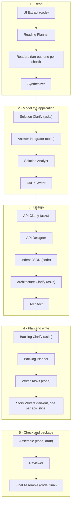

# Backlog workflow

The backlog workflow reads a product's documents (and its HTML prototype, when there is one) and turns them into an engineering backlog. That means features, epics and user stories with EARS requirements and Gherkin acceptance criteria. It also writes the documents an engineer builds from: architecture, API, data model, screens, UI/UX, and the order to build it all in.

- Manifest: [`workflow.yaml`](backend/agents/workflows/backlog/workflow.yaml) (id `backlog`, 20 steps)
- Spec: [`specs/021-backlog/spec.md`](specs/021-backlog/spec.md)
- Code steps: [`backlog_assemble.py`](backend/agents/capabilities/backlog_assemble.py), [`backlog_export.py`](backend/agents/capabilities/backlog_export.py), [`prototype_ui_extract.py`](backend/agents/capabilities/prototype_ui_extract.py)

## Inputs

- **Documents**, uploaded: `.pdf`, `.docx`, `.xlsx`, `.pptx`, `.txt`, `.md`, `.csv`, `.json`. They land in `.uploads/`.
- **A prototype**, optional. Either `prototype.html` chained from a finished `prototype_v2` run (it arrives as `.context/prototype.html`), or an `.html` file uploaded with the documents.

## The flow

The steps run one after another in this order. Only the two fan-out steps run several workers in parallel: the Readers (one per document shard) and the Story Writers (one per epic slice).

## How to read this document

Each step lists what it **does**, what it **consumes** and **produces**, and **why it is there**. There are two levels:

- **Mandatory.** Without it, later steps have no input, so the run halts or produces no backlog.
- **Required.** The run still finishes without it, but the backlog loses something an engineer needs. The entry names what is lost.

A model step declares `consumes` / `produces` in the manifest. A code step declares what it reads and writes on its capability (`@register(reads=, process=, writes=)`), which `/api/capabilities` serves to the UI.

## Conventions every step follows

- **Clarify before a stage.** Each stage that makes decisions has its own Clarify step right before it: Solution, API, Architecture, Backlog.
  - The Clarify step reads what its stage will be given, decides which decisions are already **settled** (a source or an earlier answer makes them) and which are **open**, and writes `.clarify/<stage>.json`.
  - It then asks the user every open question once, through `ask_user`. Answers are written to `clarify/answers.json`.
  - The stage reads its `.clarify/<stage>.json` first and takes each answer by question id. An unanswered question falls back to its recommended answer, marked "recommended, not confirmed by the user".
  - Fan-out workers and code steps never ask.
- **Evidenced or inferred.** Every item, story and decision is `evidenced` (a source shows it, with its reference) or `inferred` (the application needs it and nothing shows it, with a one-line reason). A reference is copied from the corpus, never made up.
- **One item per line.** A JSON work file puts each list item on its own line. `read_file` returns about 80,000 characters at most, so a file written on a single line gets cut off. Run `c4cbd381`'s single-line `endpoints.json` (88,561 characters) left seven endpoints unread.
- **The step file is a one-line report.** Every prompt names its own work files. The engine's "How to deliver" step file only carries a one-line summary.

---

## 1 · Read

### 1. UI Extract — `us-ui-extract` · code (`extract_prototype_ui`)

- **Does:** Opens the prototype in a headless browser. It records every screen with a screenshot, the design tokens (colours, type, spacing), the components and the navigation between screens. It also copies the prototype into `.uploads/` so the Readers read its pages like any other document.
- **Reads:** `.context/prototype.html`, `.uploads/`
- **Writes:** `build/ui/source.json`, `tokens.json`, `components.json`, `navigation.json`, `build/ui/components/`, `build/ui/screens/`, `.uploads/prototype.html`. Screenshots are kept out of the run history by `build/ui/.gitignore`.
- **Why — Required.** It is the only source of measured look and feel. Without it, `ui.md` / `ux.md` can only describe what the documents say, and the PDF carries no screenshots. With no prototype it writes only `source.json` saying why, and the run carries on from the documents alone. It is code: no model, no cost.

### 2. Reading Planner — `us-planner`

- **Does:** Runs `extract_text` over every upload, turning each document into pages (text with its images in reading order, `.extract/`). It then cuts the documents into **shards** (page ranges) and writes one reading task per shard, plus one roll-up task per multi-shard document.
- **Consumes:** the uploads (a run input, so not listed)
- **Produces:** `build/tasks.json`, `.extract/`
- **Why — Mandatory.** It is the only step that makes the uploads readable, and it gives the Readers their work. A long PDF read in one go loses detail; shards keep each Reader's pages small enough to read faithfully.

### 3. Readers — `us-readers` · fan-out (one worker per task)

- **Does:** Each worker reads its shard page by page, text and images alike (a screen in a PDF is often only a picture). It writes that document's synthesis: screens with every field, flows, rules, messages, data, integrations, NFRs, stories and gaps. A roll-up worker combines one document's shards.
- **Consumes:** `build/tasks.json`, `.extract/`, `.uploads/`
- **Produces:** `file-synthesis/<document>/…`
- **Why — Mandatory.** It is the only step that reads the source pages. Every later step works from what the Readers recorded, and a detail they miss is gone for good.

### 4. Synthesizer — `us-synth`

- **Does:** Reconciles every document's synthesis into one map of the product: screens, flows, rules, messages, data, integrations, NFRs and stories across documents. It lists every gap: something the corpus implies but never answers.
- **Consumes:** `build/tasks.json`, `file-synthesis/`
- **Produces:** `synthesis.md`, `validate.json` (the gaps)
- **Why — Mandatory.** The documents disagree, overlap and refer to each other, and this is the one step that sees all of them together. `validate.json` is what Solution Clarify asks from.

---

## 2 · Model the application

### 5. Solution Clarify — `us-gaps` · asks the user

- **Does:** Turns each open gap in `validate.json` into a question with options and a recommended answer, ranked by impact. It records the settled and the asked ones in `.clarify/solution.json` and asks the user once.
- **Consumes:** `validate.json`, `synthesis.md`
- **Produces:** `.clarify/solution.json`, `clarify/answers.json`
- **Why — Required.** Without it every gap stays open. The Solution Analyst then has to infer the answer, and the stories carry it as an open question an engineer must chase. One round of questions here saves many later.

### 6. Answer Integrator — `us-close` · code (`assemble_backlog` kind, `backlog_prep.integrate_answers`)

- **Does:** No model. Folds the user's answers into `synthesis.md` under `## Decisions from the user`, one line marked `[user gap-N]` per answer, takes each answered gap out of `## Open gaps`, and records in `validate.json` which gaps the answers closed. (A model did this with one edit per change: 146 calls, 8.7M tokens in run c4cbd381.)
- **Consumes:** `clarify/answers.json`, `validate.json`, `synthesis.md`
- **Produces:** `synthesis.md`, `validate.json` (updated)
- **Why — Required, paired with Solution Clarify.** The Solution Analyst reads `synthesis.md`, not the answers file. Without this step the answers exist, but the model is built without them.

### 7. Solution Analyst — `us-solution`

- **Does:** Builds the model of the **whole** application: everything a complete, production application needs, each item evidenced or inferred. It writes nine lists:
  - screens with every field, action and state;
  - features;
  - entities with typed attributes, keys, relationships and lifecycle;
  - integrations;
  - roles and permissions;
  - NFRs;
  - platform capabilities;
  - business rules;
  - a glossary.

  Platform always includes the four foundations every application needs before its first feature: **project setup, data foundation, delivery and test harness**.
- **Consumes:** `synthesis.md`, `file-synthesis/`, `.clarify/solution.json`
- **Produces:** `build/solution/{screens,features,entities,integrations,roles,nfrs,platform,rules,glossary}.json`, `solution.md`
- **Why — Mandatory.** Every item in these lists except the glossary is a **coverage item**. The Planner cuts epics from them, the Writers write stories for them, and the code checks that each one is covered. There is no backlog without a model.

### 8. UI/UX Writer — `us-uiux`

- **Does:** Writes `ui.md` (how the product looks: palette, typography, spacing, components and every screen with its screenshot) and `ux.md` (how it works: navigation, journeys, patterns, states and messages). It works from the measured prototype. It records what the prototype shows; it never redesigns.
- **Consumes:** `build/ui/source.json`, `tokens.json`, `components.json`, `navigation.json`, `build/solution/screens.json`, `build/solution/roles.json`
- **Produces:** `ui.md`, `ux.md`
- **Why — Required.** No later step depends on it, but a frontend engineer does. Without it the backlog says what each screen holds, not how it looks or behaves. Both files are PDF chapters.

---

## 3 · Design

### 9. API Clarify — `us-api-clarify` · asks the user

- **Does:** Finds the decisions the API Designer needs and cannot take from the sources. Who calls the API besides the application's own screens (partners, other systems, the public)? How do users and callers sign in? Is each inferred inbound integration part of this product? It records what is settled and asks the rest.
- **Consumes:** `build/solution/{entities,integrations,roles,platform,nfrs}.json`, `solution.md`, `clarify/answers.json`
- **Produces:** `.clarify/api.json`, `clarify/answers.json`
- **Why — Required.** Without it the API Designer uses the usual choices, marked inferred. The API is still complete, but its conventions are guesses.

### 10. API Designer — `us-api`

- **Does:** Designs the application's own API: every endpoint its screens, entities and integrations need, and every platform capability that is an API. Each endpoint has method, path, auth and roles, params, body, response, errors (with the messages copied) and rules.
- **Consumes:** `build/solution/{screens,entities,integrations,roles,rules,features,nfrs,platform}.json`, `solution.md`, `.clarify/api.json`, `clarify/answers.json`
- **Produces:** `build/solution/endpoints.json`
- **Why — Mandatory.** Endpoints are coverage items. Stories name the endpoints they build or call, the Architect places each one in a component, and the code renders `api.md` and `openapi.json` from them.

### 10b. Indent JSON — `us-json` · code (`assemble_backlog` kind)

- **Does:** No model. Re-indents every JSON file the run has written so far (2 spaces, same content).
- **Why — Required.** Models write JSON on one line whatever the prompt asks. `endpoints.json` was 88KB on one line in run c4cbd381, past read_file's ~80,000-character page, so the Architect and the Backlog Planner never read its tail. Indented, it pages by lines.

Every other backlog code step (Answer Integrator, Writer Tasks, Assemble, Final Assemble) re-indents the run's JSON the same way, so every JSON file in the finished run is indented.

### 11. Architecture Clarify — `us-architect-clarify` · asks the user

- **Does:** Finds the decisions the Architect needs:
  - technology the organisation requires or rules out;
  - where it runs;
  - scale;
  - availability and recovery;
  - how users sign in;
  - how it is built and shipped: the client technology for each kind of client, repository layout, CI/CD tool.

  It records what is settled and asks the rest. Every question offers "No preference — the Architect decides".
- **Consumes:** `synthesis.md`, `build/solution/{nfrs,platform,integrations,roles}.json`, `solution.md`, `clarify/answers.json`
- **Produces:** `.clarify/architect.json`, `clarify/answers.json`
- **Why — Required.** These choices shape the whole stack and are the organisation's to make. Without this step the Architect decides them as the simplest thing that meets the NFRs, marked inferred.

### 12. Architect — `us-architect`

- **Does:** Writes `architecture.md`. Its sections:
  - overview;
  - system context and containers (mermaid);
  - technology stack;
  - **development setup**: per container, its repository, how it runs locally, how it is built and packaged, lint;
  - data architecture, including migrations in foreign-key order and seed data;
  - key flows (sequence diagrams);
  - security: how users sign in, credential storage, token lifetime, lockout numbers, second factor;
  - integration architecture;
  - **deployment and environments**: pipeline stages, infrastructure as code, secrets, migrations on deploy, rollback;
  - observability, scalability, resilience and cross-cutting concerns;
  - **test strategy**: per layer, its tool, the pipeline stage that runs it, and its test data;
  - NFR traceability;
  - decisions, and risks.
- **Consumes:** `synthesis.md`, every `build/solution/*.json` including `endpoints.json`, `solution.md`, `.clarify/architect.json`, `clarify/answers.json`
- **Produces:** `architecture.md`
- **Why — Required.** The Backlog Planner takes the walking-skeleton flow and the Definitions of Ready and Done from it. The Story Writers build the foundation, identity and quality stories from it. Without it the backlog still assembles, but those stories and definitions lose their specifics: which tool, which environment, which numbers.

---

## 4 · Plan and write

### 13. Backlog Clarify — `us-backlog-clarify` · asks the user

- **Does:** Decides each feature's release: "First release" or "A later release". A release is settled only when a source or an answer names it in words (MVP, phase 1, v2, …). That a source shows a feature does not settle it. Every other feature becomes one question. The recommendation is first release for evidenced features and later release for inferred ones.
- **Consumes:** `build/solution/features.json`, `solution.md`, `clarify/answers.json`
- **Produces:** `.clarify/backlog.json`, `clarify/answers.json`
- **Why — Required.** Scope is the user's call. Without this step every feature defaults to the first release, and nothing separates what must ship from what can wait.

### 14. Backlog Planner — `us-backlog`

- **Does:** Turns the model into the backlog skeleton:
  - **Personas** come from the roles.
  - **Epics** by type, each with the coverage items it covers:
    - `functional`: one per job a user does;
    - `data`: one per entity group;
    - `integration`: one per integration;
    - `platform`: Project setup, Data foundation, Delivery, Test harness, Identity and access, Audit, Notifications, Administration, Search and reporting, Import/export and retention, Operations, Quality.
  - **The order.** Each epic gets `depends_on` by fixed rules:
    - foundation first;
    - data epics after Data foundation and the entities they reference;
    - integrations and platform after Project setup and their data;
    - a functional epic after the data, integrations and Identity it uses.

    It names the **walking skeleton**: the first key flow that isn't sign-in, plus Delivery and Test harness, so the first slice is built, tested and deployed. It sets each epic's priority: P0 for the skeleton and everything it needs, P1 for the rest of the first release, P2 for the later release. It writes the **Definition of Ready** and the **Definition of Done**, naming the architecture's tools and environments.
  - **The shape.** Epic → Story, or Feature → Epic → Story when there is more than one module or more than 8 epics.
  - **Slices.** Each slice is one writing task of at most 6 coverage items, with its own id prefix, so writers never collide.
- **Consumes:** `build/solution/{screens,features,entities,integrations,roles,nfrs,platform,rules,endpoints}.json`, `solution.md`, `architecture.md`, `.clarify/backlog.json`, `clarify/answers.json`
- **Produces:** `build/backlog-plan.json`, `build/story-tasks.json`, `backlog-plan.md`
- **Why — Mandatory.** The Story Writers' tasks come from `story-tasks.json`, and the build order is computed from `backlog-plan.json`. Only this step sees the whole model at once, which is why priority and dependencies are decided here and not by each writer.

### 15. Writer Tasks — `us-writer-tasks` · code (`assemble_backlog` kind, `backlog_prep.build_writer_tasks`)

- **Does:** No model. Copies `build/story-tasks.json` to `build/writer-tasks.json`, adding to every task's body the full model item for each id it covers, the endpoints and rules on those items, the personas, and the index of every endpoint id.
- **Reads:** `build/story-tasks.json`, `build/backlog-plan.json`, `build/solution/`
- **Writes:** `build/writer-tasks.json`
- **Why — Mandatory.** A writer given only item ids spent ~15 calls finding them (40.5M tokens in run c4cbd381). With the items in its task it reads nothing and writes once.

### 16. Story Writers — `us-write` · fan-out (one worker per slice)

- **Does:** Each worker writes every story for its slice into one file:
  - Connextra story: as a / I want / so that.
  - EARS requirements. Each has one "shall" and none of should/may/might/could/will/must; a validation is an `unwanted` requirement with its message copied.
  - Gherkin acceptance criteria, with Scenario Outlines carrying the real values and the boundary values.
  - The UI fields, data, API ids, integrations, business rules and NFRs it touches.
  - Dependencies, but only inside its slice.
  - Priority, never above its task's.
  - Points, provenance, sources, covered items and open questions.

  Platform and data writers read `architecture.md`. A foundation item gets one enabler per piece of work it names: one project per container, the migration tool and first migration, one pipeline per container, one test harness per test layer.
  Before its one write, a writer checks every story against the exact checks Assemble runs, so the Reviewer has little left to fix.
- **Consumes:** `build/writer-tasks.json` (its task), `architecture.md` (platform and data slices), `synthesis.md` (grep only, for a missing message)
- **Produces:** `stories/<slice>.json`
- **Why — Mandatory.** These are the stories. Fanning out one slice per writer keeps each writer's scope small enough to write every story in full, and lets 50+ slices run in parallel.

---

## 5 · Check and package

### 17. Assemble — `us-assemble` · code (`assemble_backlog`, draft mode)

- **Does:** No model; every check is code, so every total is computed, never typed.
  - Checks every story: the shape, EARS, Gherkin (every requirement tagged by a scenario and every scenario by a requirement), and API ids that exist. Quoted, copied messages are exempt from the modal-verb check.
  - Checks the hierarchy: every epic has stories and every story an epic.
  - Checks coverage: every coverage item has a story.
  - Checks the build order: unknown or self dependencies, cycles, a first-release epic depending on a later one, a story's dependency built after it, and a story above its epic's priority.
  - Computes **milestones, waves, each epic's priority, each story's order and ready flag, and the critical path**.
  - Renders every deliverable.
- **Reads:** `build/backlog-plan.json`, `build/story-tasks.json`, `stories/`, `build/solution/`, `build/review.json`, `architecture.md`, `solution.md`, `ui.md`, `ux.md`
- **Writes:** `backlog.md`, `backlog.csv`, `backlog.json`, `build/coverage.json`, `build-order.md`, `data-model.md`, `schema.json`, `api.md`, `openapi.json`, `integrations.md`, `screens.md`
- **Why — Mandatory.** One checker applies the same standards to every story, whichever writer wrote it; no fanned-out model can do that. `build/coverage.json` is the Reviewer's work list. In draft mode it never fails on coverage.

### 18. Reviewer — `us-review`

- **Does:** Fixes exactly the problems `build/coverage.json` lists, with the smallest edit each, and nothing else:
  - EARS and Gherkin errors;
  - unknown API ids;
  - bad dependencies and priorities;
  - `depends_on` errors in the plan.

  It then adds stories (`stories/review-<epic>.json`) for any uncovered item or empty epic, and records what it did in `build/review.json`.

  It never reads a whole story or model file: it greps the id, reads ~30 lines around it, and edits those lines, one story at a time. (Reading whole files one fix at a time grew its context to ~165k tokens per call: 29.9M tokens in run c4cbd381.)
- **Consumes:** `build/coverage.json`, `build/backlog-plan.json`, `stories/`, `build/solution/endpoints.json`
- **Produces:** `stories/` (edits and additions), `build/review.json`
- **Why — Mandatory for the finished deliverable.** `build/review.json` is what switches the next assemble to **final** mode. Only final mode enforces the coverage gate and packages `Backlog.pdf` and `Backlog.zip`.

### 19. Final Assemble — `us-final` · code (`assemble_backlog`, final mode)

- **Does:** Runs the same checks and renders again over the reviewed stories. It **fails the run** when evidenced coverage is below 85%, naming every uncovered item. Then it packages:
  - `Backlog.pdf`: a cover, contents, and chapters Solution → Architecture → Data model → API → Integrations → Screens → UI → UX → Build order → Backlog;
  - `Backlog.zip`: every deliverable.
- **Reads / Writes:** as Assemble, plus `Backlog.pdf`, `Backlog.zip` and `.gitignore`. The two packages are kept out of the run history because they are large binaries.
- **Why — Mandatory.** It is the deliverable. Without it the Reviewer's fixes are never re-checked and nothing is packaged.

---

## Summary

| # | Step | Kind | Model | Level |
|---|---|---|---|---|
| 1 | UI Extract | code | — | Required |
| 2 | Reading Planner | model | Sonnet 4.6 | Mandatory |
| 3 | Readers | model, fan-out | Sonnet 4.6 | Mandatory |
| 4 | Synthesizer | model | Sonnet 4.6 | Mandatory |
| 5 | Solution Clarify | model, asks | run default | Required |
| 6 | Answer Integrator | code | — | Required (with 5) |
| 7 | Solution Analyst | model | Sonnet 4.6 | Mandatory |
| 8 | UI/UX Writer | model | Sonnet 4.6 | Required |
| 9 | API Clarify | model, asks | run default | Required |
| 10 | API Designer | model | Sonnet 4.6 | Mandatory |
| 10b | Indent JSON | code | — | Required |
| 11 | Architecture Clarify | model, asks | run default | Required |
| 12 | Architect | model | Sonnet 4.6 | Required |
| 13 | Backlog Clarify | model, asks | run default | Required |
| 14 | Backlog Planner | model | Sonnet 4.6 | Mandatory |
| 15 | Writer Tasks | code | — | Mandatory |
| 16 | Story Writers | model, fan-out | Sonnet 4.6 | Mandatory |
| 17 | Assemble | code | — | Mandatory |
| 18 | Reviewer | model | Sonnet 4.6 | Mandatory (final deliverable) |
| 19 | Final Assemble | code | — | Mandatory |

"Run default" is the model chosen at launch; a step's own `model:` in the manifest overrides it.

## What an engineer reads

| File | What it answers |
|---|---|
| `build-order.md` | What do I build first, and what next? The epic graph, the critical path, then milestones, waves and each epic's stories in order, with a ready flag, plus the Definitions of Ready and Done. |
| `backlog.md` | Every feature, epic and story in full: requirements, acceptance criteria, UI fields, data, API, rules, NFRs. |
| `backlog.csv` | The same, for a Jira import. Adds Milestone, Order and Depends On columns. |
| `backlog.json` | Everything, machine-readable. Each story carries `milestone`, `wave`, `order` and `ready`; each epic its `priority`, `milestone` and `wave`. |
| `architecture.md` | How it is built, set up, secured, tested and deployed. |
| `api.md`, `openapi.json` | The API, for people and for tools (contract tests, client generation). |
| `data-model.md`, `schema.json` | The entities, their attributes and relationships, and a JSON Schema per entity. |
| `integrations.md`, `screens.md`, `ui.md`, `ux.md` | The external systems; every screen, its fields and navigation; how it looks; how it works. |
| `build/coverage.json` | What the checks found, including what is still open. |
| `Backlog.pdf`, `Backlog.zip` | All of it, packaged: to read, or to hand to an agent. |

## How the build order is made

The Planner declares the graph; the code computes everything else from it, so the order can never disagree with the backlog.

1. **Graph.** Each epic's `depends_on` (Planner) plus each story's `dependencies` inside its slice (Writers).
2. **Milestones.**
   - Milestone 1, the walking skeleton: the skeleton epics and everything they depend on, directly or through others.
   - Milestone 2, the first release: every other first-release epic.
   - Milestone 3, the later release: the rest.
3. **Waves.** Inside a milestone, an epic's wave is its dependency depth. Epics in one wave do not depend on each other and can be built side by side.
4. **Priority.** An epic's priority follows its milestone: P0, P1, P2. A story is never above its epic's priority.
5. **Order.** Stories are numbered milestone by milestone, wave by wave, epic by epic, and inside an epic after the stories they depend on.
6. **Ready.** A story is ready when it has no open question and no story error.
7. **Critical path.** The heaviest chain of epics by story points. It bounds how soon the whole backlog can finish.

Anything wrong in the graph is reported in `build/coverage.json` for the Reviewer and listed under Problems in `build-order.md`.

## Every kind of application

Nothing in the workflow assumes a web app. The Architect lists the application's containers: web front end, mobile app, desktop app, backend API, worker. Foundation and delivery work is then cut per container:

- **Web only:** one front-end project, hosting, a web pipeline.
- **Web + backend:** a front-end and a backend project, a database with migrations, two pipelines.
- **Mobile, or mobile + backend API:** a mobile project with its signed store build and distribution, plus the backend's project, database and pipeline when there is one. Integrations are their own epics.
- **Desktop:** a desktop project with its signed installer.
- **Backend API only:** no screens, so no UI/UX content and no functional flows through screens. The endpoints and platform epics carry the work.
- **No stored data:** no Data foundation epic, because data foundation exists only when there is an entity.
