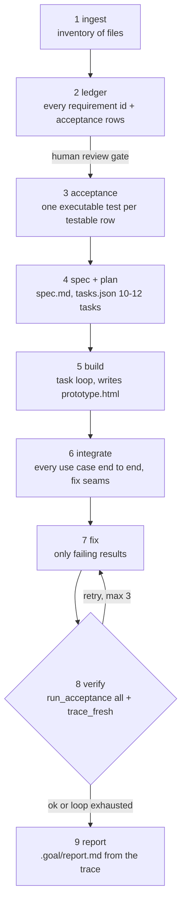

# Handoff: goal_v2 port to dev (`feat/goal-v2-dev`)

Written 2026-11-10 for an agent or engineer picking this up with no prior context.

## 1. TL;DR

- **goal_v2** ("Deliver from documents (Goal) · tested and traced") is a workflow that takes any set of
  documents plus a brief and delivers a working, tested single-page prototype (`prototype.html`). Every
  requirement keeps the client's own id, is reviewed by a person, gets an executable acceptance test
  before any code exists, and is proven by a test runner that writes the trace itself.
- It was built on `feat/unisys-usecases`, which sits on top of the **design-system work** (the
  "Velocity contract" templates/designs, `prototype_v3/v4`, `ppt_v3/v4`). That design-system work is
  **not** going to dev yet.
- This branch, **`feat/goal-v2-dev`**, is a port of **only the goal_v2 workflow and the engine changes it
  needs** onto the latest `origin/dev`, adapted to dev's own design system (OpenDesign templates and
  design systems). Pushed to origin. No PR opened yet.
- Driving use case: the Unisys **OMS Demo – Channel Simulator** (IATA NDC 24.1): a requirements PDF
  (92 requirement ids, 6 use cases, 11 acceptance bullets) plus 10 sample XML messages. Inputs live in
  the main checkout under `.unisys/` (not committed).

## 2. Where everything is

| Thing | Location |
|---|---|
| This branch | `feat/goal-v2-dev` (worktree `/Users/1000073772/Developer/Projects/VELOCITYAI-goal-dev`), base `origin/dev` @ `2541652a` |
| Original branch | `feat/unisys-usecases` (main checkout `/Users/1000073772/Developer/Projects/VELOCITYAI`), **uncommitted**, contains design-system work + goal_v1 + old goal_v2 |
| Spec / plans for goal workflow | main checkout `.design-system/specs/p27-goal-workflow/{spec.md,tasks.md,tasks-v2.md}` (not on this branch) |
| Run reports / screenshots | main checkout `.design-system/experiments/p27/{run1,run2,run3,rundev}/` |
| OMS inputs | main checkout `.unisys/` (PDF + 10 IB_*.xml) |

### Commits on this branch (on top of `origin/dev`)

```
515d7475 Fix CI static checks: ruff format and bandit B314
08a552a4 Frontend: launch goal_v2 and show paused runs
dae9f261 Add goal_v2 workflow: deliver from documents, tested and traced
26a3d267 Accept .xml, .yaml and .yml uploads
8571ba77 Add ledger_check, run_acceptance and page_outline tools
a474f19c Engine: self-healing runs, inline skills, write allow-lists and step fixes
```

Plus, after these: the build-task titles fix (Steps view) and this handoff file.

### Local stacks (dev machine)

| Stack | Code | Ports | DB | Notes |
|---|---|---|---|---|
| main | main checkout (`feat/unisys-usecases`) | `:8000` / `:3000` | `velocity-local-db` | runs the OLD goal_v2 (template-system version) |
| goal-v5 | `.claude/worktrees/goal-v5` | `:8001` / `:3001` | own | another session's work, do not touch |
| **goal-dev** | **this worktree** | **`:8002` / `:3002`** | `velocity-goaldev-db` (cloned from local at 09:33) | runs `RUNS_ROOT=/Users/1000073772/Developer/Configs/Velocity-Runs-goal-dev` |

The goal-dev backend uses main's `.venv` python (same `uv.lock`); `backend/.env` and
`frontend/node_modules` in the worktree are git-ignored symlinks to main's. The frontend is built with
`next build --webpack` and `NEXT_PUBLIC_API_URL=http://localhost:8002`.

### Runs in flight at hand-off

| Run | Stack | What | State at 11:25 |
|---|---|---|---|
| `8012aa52-98e7-4def-9eff-a36406625e8e` ("run 4") | `:8000` | OLD goal_v2, template system, top-nav + iberia | integrate step; resumed after a Bedrock connection drop |
| `9c453343-f8c7-4ed3-9e40-fc9aefa50928` ("dev run") | `:8002` | THIS branch, `web-prototype` template + `iberia-one-order` design system | build task ~3 of 12; resumed after the same drop |

**The user asked that neither backend be restarted until these runs finish.** Frontend-only rebuilds of
`:3002` are allowed.

## 3. What goal_v2 does



Key files written by the run (sandbox):

- `.goal/inventory.json`, `.goal/missing.json`: ingest.
- `.goal/ledger.json` (rows: id, text, source page, kind, acceptance, testable), `.goal/intent.json`: ledger.
- `.goal/acceptance/<id>.json`: tests in a fixed verb format (`goto_tab`, `load_file`, `click`, `fill`,
  `expect_text`, `expect_xml`, …), `.goal/fixtures/`: derived sample files.
- `spec.md`, `tasks.json`: spec.
- `prototype.html`: the ONLY deliverable file.
- `.goal/trace.json`: written ONLY by the `run_acceptance` tool (runner stamp, page sha256, pass counter).
- `.goal/report.md`: report.

Workflow definition: `backend/agents/workflows/goal_v2/workflow.yaml`.
Skills: `backend/skills/global/goal-v2-{ingest,ledger,acceptance,spec-plan,app-logic,integrate,fix,verify}`
and `velocity-ui-ux`.

## 4. Ported vs left behind

### Ported (on this branch)

| Area | Files |
|---|---|
| goal_v2 workflow + skills | `backend/agents/workflows/goal_v2/`, `backend/skills/global/goal-v2-*`, `velocity-ui-ux` |
| New tools | `backend/app/agents/tools/{ledger_tools,acceptance_tools}.py`, `backend/agents/capabilities/tools/{ledger,acceptance}.py`, registry + `permission_caps.py` |
| Engine | `engine.py`, `factory.py`, `compiler.py`, `plan.py`, `manifest.py`, `task_loop.py`, `kernel_services.py`, `state_machine.py`, `context.py`, `model_policy.py`, `prompt/policy.py`, `deep_agent_runner.py`, `run_commands.py`, `main.py` |
| Uploads | `.xml/.yaml/.yml` added to dev's allow-list (`run_files.py`, `uploadTypes.ts`) |
| Registration | `entitlements.py` (+ frontend `entitlements.ts`), CreationHub, LaunchWizard, sidebar, analytics, pipeline label, launch drafts, types |
| Paused-run UI | `RunChatLane`, `Badge`, `lib/pausedRun.ts`, `useWorkflow` (`run_paused`), page hydration |
| Activity trail fix | `ActivityTrail.tsx` (copied from `feat/goal-v5` commit `fcf4d1c7`; expect a conflict when goal-v5 merges) |

### Deliberately left behind (stay on `feat/unisys-usecases`)

- The 10 design-system commits (contract templates/designs, `prototype_v3/v4`, `ppt_v3/v4`, picker).
  They caused 33 of the 35 merge conflicts with dev.
- Contract runtime edits (`skills/velocity-templates/contract/{state.js,theme-init.js,behaviours.md}`).
- `CONTRACT_PIPELINES` registration in `od_loader.py`, `features.ts` switch.
- Skills `velocity-contract-build`, `velocity-look-select`, `velocity-html-app` (replaced on dev by
  `goal-v2-app-logic`, which builds plain HTML instead of contract markup).
- `goal_v1` and its skills.
- The old branch's "accept any upload except a deny-list" change: dev keeps its allow-list (+ xml/yaml/yml).

### How goal_v2 was adapted to dev's design system

- Look comes from the OpenDesign context: steps declare `injects: [design_system, template]`; the
  template seed (`assets/template.html`), `example.html` and the design-system body are injected into the
  spec and build prompts; files are staged under `.context/design/`.
- Build task 1 creates `prototype.html` from the template seed; later tasks edit it (may rewrite it whole
  when an edit is too large).
- Launch on dev like `prototype_v2`: template id + design-system id from `/api/prototype/templates` and
  `/api/prototype/design-systems`. The dev run uses `web-prototype` + `iberia-one-order`.

## 5. Engine changes in detail

### Opt-in (no effect unless a workflow declares the key)

| Key | What it does | Where |
|---|---|---|
| `resilience:` (workflow) | model-retry window (`retry_window_seconds`), stall watchdog (`stall_seconds`, `StepStalled`), per-step retry, `max_same_error`; a run that cannot proceed is **paused** (`WorkflowRun.error = "paused:<kind>: <reason>"`, event `run_paused`) instead of failed; a credentials pause starts a probe that auto-resumes | `engine.py` (`_pause_run`, `_stall_guarded`, `_dispatch_step_with_retry`), `deep_agent_runner.py`, `model_policy.py`, `state_machine.py`, `run_commands.py` (resume accepts paused, probe), `main.py` |
| `skills_inline` / `skills_select` (step) | inject skill BODIES into the step prompt (`skills` only stages files); `skills_select` picks ids from a sandbox JSON field (e.g. intent profile) | `compiler.py`, `plan.py`, `factory.py` (`_build_inline_skill_blocks`), `prompt/policy.py` (`inline_skills` slot in every policy order) |
| `fix.full_every` (task_loop step) | full render/click validation every Nth task and on the last; quick static check otherwise | `task_loop.py` (`_is_full_validation_task`, `_quick_static_check`), `kernel_services.static_check(audit=)` |
| `write_paths` (step) | fnmatch allow-list of sandbox paths the step's write tools may touch; anything else is refused by the path guard. Each writable custom-agent step must also allow its own answer file `<instance>-*.md` | `compiler.py`, `plan.py`, `factory.py`, `engine.py`, `deep_agent_runner.py` (`_ReservedPathGuardMiddleware`) |
| `brief_role: reference` (step) | the first step receives the user brief framed as background ("NOT your task") instead of `=== ORIGINAL USER REQUEST ===` | `compiler.py`, `plan.py`, `engine.py` (`_compose_context_message`) |

### Fixes that apply to every workflow

1. **Step-start message:** a later step with no control block gets `_STEP_START_BLOCK` instead of an empty
   message (agents used to stall with "What do you need?"). Characterization goldens updated for this
   only (`app_builder`, `ppt`, `prototype`, `prototype_revision`, `sample_subagents_parallel`).
2. **Review loops re-run:** only the first dispatch of a `(step, task)` may reuse a cached completion,
   so verify → fix loops really execute (they replayed the first answer before).
3. **Gate edits applied:** text edited at a human gate (`edited_content`) is written back to the step's
   `.agents/NN-*.md` so later steps see it (it was dropped before).
4. **SSO expiry:** "Error when retrieving token from sso: Token has expired" is classified as a credential
   error (`_CREDENTIAL_AGENT_ERROR`), so a resilient run pauses as `credentials` and auto-resumes.
5. **Build-task titles:** `task_loop_progress` events carry `task_plan` (number + title) for every plan
   format; the Steps view uses it (and falls back to the run's `tasks.json` for older backends).

## 6. The tools

- `ledger_check(mode)`: `harvest` (every source id captured), `coverage` (spec/tasks/tests cover every
  id), `trace`, `report`, `acceptance_schema` (test files valid), `trace_fresh` (trace written by the
  runner, full run, current page hash, page is `prototype.html`, every testable id present).
- `run_acceptance(ids)`: always tests `prototype.html`; headless Chromium, `file://`, network blocked,
  fresh page per case; **a case fails if the page navigates to another document** (stops redirect
  cheating); writes `.goal/trace.json`; `ids="all"` increments the pass counter, a subset merges.
  `check_xml` refuses XML with a DOCTYPE/ENTITY before parsing (bandit B314, `# nosec` with reason).
- `page_outline(page)`: screens, data-test names, app-script functions of a big page without its text.

## 7. Decisions and lessons from the runs (why things are the way they are)

| Run | Result | Lesson → fix |
|---|---|---|
| run 1 (goal_v1) | 1/6 use cases worked | double XML envelopes, namespaces; verify loop was replayed from cache → loop-revisit fix |
| run 2 (goal_v1) | 5/6 worked; ~55 rule checks mostly pass | fix step rewrote the trace → only the runner writes the trace (`run_acceptance`), `trace_fresh` |
| run 3 (old goal_v2) | runner said 100/100, but the app was in a side file `oms-channel-simulator.html`; fix step added a **redirect** from `prototype.html`; output used IATA **2019.2** namespaces instead of 24.1; paused on SSO expiry classified "poison" | runner locked to `prototype.html` + fails on navigation; builders forbidden other page files; tests must check sample namespaces; SSO expiry → credentials |
| run 4 / dev run | the **Ingest** step read the brief ("Build the simulator…") as its own task and wrote a whole app (`app/oms-channel-simulator.html`, `index.html`) | `write_paths` on every step (guard proved it: `write_paths WRITE DENIED … /app/oms-channel-simulator.html` at 10:04) + `brief_role: reference` for ingest + prompt rule |
| both | Bedrock "Connection was closed before we received a valid response" counted as "model rejected" → paused as `poison` after 3 tries | **open** (§9 item 2); manual resume works |

Reviewer decisions given at the ledger gate (binding for the OMS runs): derive an EvenExchange fixture
from the AddCol sample; one card-number field; auto-generated editable PaymentReference; always include
OrderVersionNumber; Copy with fallback; XSD info line = G25's test; no fonts/network; Void always shows
the refund section; UC2 blocks clearing all contacts; store nothing in the browser; namespaces exactly as
the 24.1 samples (`…/EASD/00/IATA_OffersAndOrdersMessage` as `ns2`, `…/IATA_OffersAndOrdersCommonTypes`
default); one deliverable file; functionality first. Full text: the gate payloads are in the run's
`.agents/02-custom-agent_ledger.md`.

## 8. Tests and CI

- Backend (worktree, using main's `.venv`): `python -m pytest -n 6 tests/unit tests/agents` →
  7,483 pass. Two failures are local-environment only: `test_knowledge_build_context_py39` (system
  `python3` lacks `yaml`) and `test_ci_remediation_exploration::…inventory_incomplete` (`uv run` in a
  worktree with no uv env).
- Frontend: `npx tsc --noEmit` clean; full `npx vitest run` passed (5,880) before the last two small
  changes; results/hooks suites pass after them (805).
- CI "Backend static checks" failed on the first push (ruff-format on 20 files, bandit B314); fixed in
  `515d7475`. Ruff must be the pinned `0.7.4`. Re-check CI on the next push.
- New test files: `test_write_paths.py`, `test_sso_expiry_is_credentials.py`, `test_resilience.py`,
  `test_empty_step_message.py`, `test_loop_revisit_and_gate_edit.py`, `test_skills_inline.py`,
  `test_task_loop_validation_cadence.py`, `tests/unit/tools/test_{acceptance,ledger}_tools.py`,
  `frontend/src/hooks/useWorkflow.runPaused.test.ts`.

## 9. Open items (in priority order)

1. **Build-task titles: done and pushed.** `task_loop.py` sends `task_plan`; `useWorkflow.ts` uses it;
   `AgentThinkingTab.tsx` falls back to reading the run's `tasks.json`; `TaskDetailPanel.tsx` says
   "In progress…" / "Not started yet". Verified live on `:3002` (screenshot
   `.design-system/experiments/p27/rundev/steps-build-task-titles.png` in the main checkout). The
   backend half reaches `:8002` only after its next restart (not allowed while the dev run is in flight).
2. **Classify a dropped Bedrock connection as transient** ("Connection was closed before we received a
   valid response", "endpoint URL") so the retry window absorbs it instead of pausing as `poison`.
   Proposed, not approved yet. Both runs paused on it (10:23, 10:52, 11:03) and needed a manual
   `POST /api/runs/{id}/resume`.
3. **Finish and verify the dev run** (`9c453343`): when it ends, check independently in real Chrome:
   app is in `prototype.html` (no side file, no redirect); all 6 use cases with the real samples; one
   well-formed XML per output; 24.1 namespaces; screenshots to the user.
4. **Decision pending from the user:** keep `brief_role` (option a, recommended) or revert to prompt-only
   (option b). It is in the code now.
5. **Template port (after 3 passes):** port our Iberia template/design (`top-nav` + `iberia` contract
   design) to dev's OpenDesign format as new ids (recommended: side by side, don't overwrite dev's
   `iberia`). Steps: tokens → OD variable names, DESIGN.md → OD section format, `design.css` rendered into
   `components.html`; template compiled from contract markup to plain HTML/CSS (`assets/template.html`,
   `example.html`, `SKILL.md` with `od:` frontmatter, `references/layouts.md`). ~2–3 h.
6. **Global-impact checks on dev after merge:** edit text at a review gate in an existing workflow and
   confirm the next step uses it; watch token cost of verify → fix loops; check paused runs render in
   lists/analytics.
7. Open the PR to `dev` when 1–3 are done.

## 10. Operating rules (from the user; follow them)

- Commit only when asked; no AI trailers in commit messages. Never touch `permissions.defaultMode`.
- Never `git checkout` / `restore` / `stash` in the main checkout.
- Never read or source `backend/.env`; never print tokens or credentials.
- Server restarts go through the peer Claude session **"OPS"** (SendMessage), never a subagent. Tell OPS
  exactly which stack; never restart a backend with a run in flight unless the user says so.
- Browser testing uses real Google Chrome (`channel: "chrome"`), never Playwright's bundled Chromium.
- No claude.ai links; outputs (reports, screenshots) go in the repo under `.design-system/…` in the main
  checkout.
- CLAUDE.md §1: answer first, wait for "go" before starting new work (follow-ups inside an approved task
  are fine).

## 11. How to drive a run (API)

1. Log in through the app UI (Playwright on `:3000` or `:3002`) and read the bearer token from
   `localStorage` into a private file (chmod 600) without printing it.
2. Stage files: `POST /api/runs/uploads/stage` (multipart `files`) → `stage_id`.
3. Launch: `POST /api/runs {message, pipeline_type: "goal_v2", staged_upload_ids: [stage_id],
   template_id, design_system_id}`.
4. Watch: `GET /api/runs/{id}/events?after=<seq>&limit=` (page by seq); the gate event is
   `review_gate_ready` with `gate_key`.
5. Approve the ledger gate: `POST /api/runs/{id}/gate {gate_key, action: "approve", approved: true,
   edited_content: <review + binding decisions>}`.
6. Paused run: `POST /api/runs/{id}/resume {}`. Cancel: `POST /api/runs/{id}/cancel`.
7. Files: `GET /api/runs/{id}/sandbox`, `/sandbox/file?path=…`; sandboxes are also on disk under
   `RUNS_ROOT/<user>/<run>/` (a git repo with one commit per step).

The session's helper scripts (`goal_launch.py`, `goal_watch.py`, `e2e4.cjs`) lived in a temporary
scratchpad; recreate them from the steps above if they are gone.
