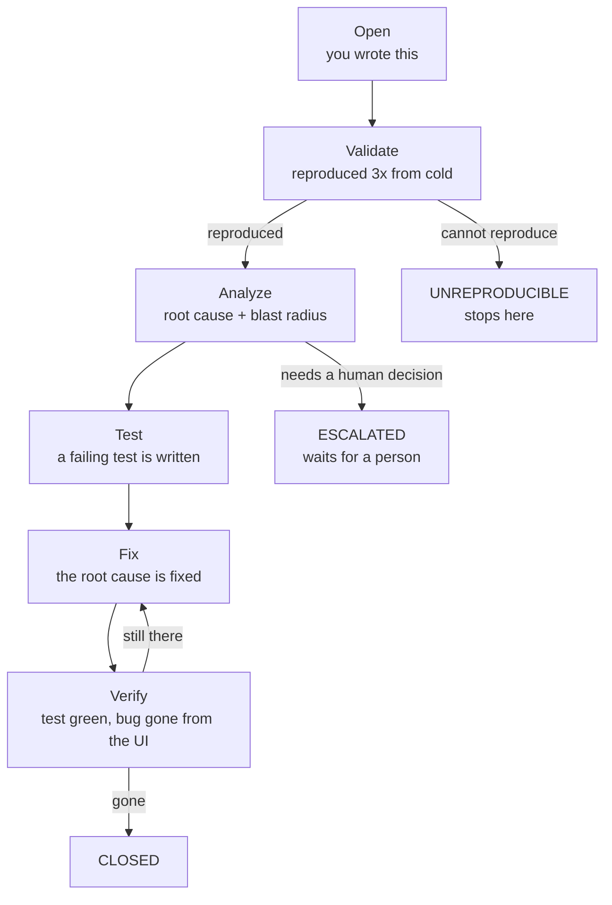

# How to log a bug

For anyone — or any agent — testing the Velocity app by hand.

A bug logged this way is picked up by an automated line that reproduces it, finds the root
cause, writes a failing test, fixes it and verifies the fix, with no further input from you.

**Your reproduction steps are the only human input that whole chain gets.** Everything else
in this guide is short. That part is not.

---

## Logging a bug is two edits

| File | What you add | Why |
|---|---|---|
| **`BUGS.md`** | one `##` section with the detail | what the line reads to understand the bug |
| **`LEDGER.md`** | one table row | what the line reads to decide what to work on |

Both, every time. A section with no ledger row is never picked up. A ledger row with no
section sends a worker looking for detail that isn't there.

**Append only.** Add to the bottom of each file, and never delete or rewrite an existing
entry. `BUGS.md` holds what reporters wrote and is left alone; `LEDGER.md` is where the line
updates the `Status` column as it works.

---

## Naming

```
QA-<YOUR INITIALS>-<NUMBER>
```

`QA-AK-001`, `QA-AK-002`, `QA-SR-001`, `QA-SR-002`.

Your initials keep two people numbering independently, so you never collide and never have to
check what someone else used. Numbers run in your own sequence from `001`.

The `QA-` prefix is required. Everything after it is yours.

---

## 1. The section in `BUGS.md`

````markdown
<a id="qa-ak-001"></a>

## QA-AK-001 — Files tab shows the scratch HTML, not the real deliverable

- **Page:** Run detail — Files tab
- **Route:** /runs/{id}/files
- **Severity:** High
- **Found by:** Ayesha
- **Found at:** 2026-09-16 14:30

### Reproduction

1. Sign in as `qa-admin@flowinqa.com`
2. Go to `/runs` and open any completed `ppt_v2` run
3. Click the **Files** tab

### Expected

The run's `.pptx` is listed as the deliverable.

### Actual

`tmp/preview.html` is listed as "Final output". The `.pptx` is not listed at all.

### Browser Signals

```
GET /api/runs/{id}/sandbox → 200, no file carries the deliverable flag
Console: clean
```
````

**Keep it to what you saw.** Route, Severity, Reproduction, Expected and Actual are what the
line needs; `Page`, `Found by`, `Found at`, `User` and `Browser Signals` are useful when you
have them.

**Do not try to diagnose it.** No root cause, no blast radius, no file names, no guesses about
which component is at fault — that is the analyzer's job, it does it with the source open, and
a wrong guess in the report sends it down the wrong path. Report what the screen did.

### The heading is the one thing that must be exact

```
## QA-AK-001 — Files tab shows the wrong deliverable
   ^^^         ^
   QA- prefix  em dash (—), one space either side
```

A hyphen instead of an em dash makes the section **invisible** to the line. There is no
error — the bug simply never gets worked on. Copy the line above and edit it.

---

## 2. The row in `LEDGER.md`

Add one row at the bottom of the Queue table:

```markdown
| QA-AK-001 | Open | High | /runs/{id}/files | Files tab shows the scratch HTML not the deliverable | — | — | 2026-09-16 |
```

| Column | What to put |
|---|---|
| `Bug` | the id, exactly as in the `BUGS.md` heading |
| `Status` | **`Open`** — always, for a new bug |
| `Sev` | `Critical` / `High` / `Medium` / `Low` |
| `Route` | the URL where it happens |
| `Title` | short. The full title is in `BUGS.md` |
| `Blocked by` | `—`, or another bug id if this one can't be fixed first |
| `Cards` | `—`. The line fills this in as it mints them |

Write the bug id in the first column as a link to its section, so the row is one click from
the detail:

```markdown
| [QA-AK-001](BUGS.md#qa-ak-001) | Open | High | /runs/{id}/files | ... |
```

The anchor is your bug id in lower case. `BUGS.md` carries a matching `<a id="qa-ak-001">`
line above each heading — copy the one above the example and change the id.
| `Updated` | today's date |

**Keep the cells short.** This table gets edited by machines one row at a time; long cells
are how a table gets broken.

### After you log it, never touch the Status column again

The line owns it from that point and uses it to track where the bug is. Editing it by hand
either re-runs work that is already finished or drops the bug off the queue entirely.

---

## Reproduction steps — the part that matters

A robot repeats your steps **three times, each from a cold start**: fresh browser, fresh
navigation, nothing left over from the last attempt. If it cannot reach your bug that way,
the bug is marked `UNREPRODUCIBLE` and nobody looks at it again.

Write the steps as if the reader has just opened a new browser and knows nothing.

**Good — reachable from nothing:**

```
1. Sign in as qa-admin@flowinqa.com
2. Go to /create/ppt_v2
3. Enter any brief and click Continue
4. On the template step, select "Investment Banking Pitch Book"
5. Continue stays disabled, with no reason shown
```

**Bad — depends on where you already were:**

```
1. Go back to the previous screen
2. Click Continue again
3. It breaks
```

Three rules:

- **Start from a URL**, never from "the screen you were on".
- **Name what you clicked**, using the label that's visible on screen.
- **Say what you expected and what happened.** The gap between them *is* the bug. Without
  both, a reader has to guess which half you think is wrong.

If it only happens sometimes, say so and say what you think triggers it — second visit, after
a reload, only on a run that has a revision. That is a finding, not a caveat.

---

## Which severity

| Level | Use it when |
|---|---|
| **Critical** | Data loss, a security hole, or the app is unusable for everyone |
| **High** | A main feature does not work, or silently does the wrong thing |
| **Medium** | Wrong or confusing behaviour, but there is a workaround |
| **Low** | Cosmetic, copy, layout, or an edge case nobody hits by accident |

**"Silently does the wrong thing" is High, not Medium.** A screen that shows wrong data with
no error is more dangerous than one that visibly fails, because people act on it.

Unsure? Take the higher one and say why in a sentence. Severity only sets the order things get
fixed in.

---

## Before you log

**Check `velocity.json` first.** It lists the app's known quirks — bare `/` always
redirects to `/login`, library tabs carry badge counts so exact-text clicks fail, and about
twenty more. **A documented quirk is known behaviour, not a bug.**

**If two problems look like one cause, log both anyway.** Deciding they share a root is the
analyzer's job, and it does that with the source open. Merging them yourself loses a symptom.

---

## What happens next



Each stage updates the `Status` in `LEDGER.md`. **Your section in `BUGS.md` is never
rewritten** — what the line works out (root cause, blast radius, the fix, how it was proven)
becomes knowledge cards, and their ids land in the `Cards` column of your ledger row.

So your entry stays exactly as you wrote it. The ledger row is where you watch it move, and
its `Cards` column is where the findings end up:

| Card | Written by | Holds |
|---|---|---|
| `ISS-…` | validator, then analyzer | the confirmed defect and its root cause — one for the root, more for any siblings it implies |
| `FIX-…` | fixer | what was changed and why |
| `BUG-…` | | a knowledge-base bug card, if one is minted |
| `ADR-…` | | a decision record, when a fix required one |

Each one is written as a clickable link to the card file, e.g.
`[FIX-516](.knowledge/cards/20260915-1420-FIX-516.md)`. The prefix tells you the type, which
is exactly why your report id starts with `QA-` and not `BUG-` — `BUG-` already belongs to the
knowledge cards, and 139 of them exist.

You never write these. The line does.

`QA-EX-001` in `BUGS.md` shows the shape: that is a complete entry, not a partial one.

---

## Dependencies

If a bug can't sensibly be fixed before another one, put that other bug's id in the
`Blocked by` column and mention it in your section.

Nothing enforces it automatically — the person running the line sequences them — but the
analyzer and fixer both read the full section and will see it.

---

## Test account

```
http://localhost:3000
qa-admin@flowinqa.com / flowin-e2e-pass
```

Other tiers exist (`qa-enterprise@`, `qa-pro@`, `qa-basic@flowinqa.com`, same password). Use
`qa-admin` unless the bug is specifically about a tier — switching account or theme changes
shared state that other people's testing depends on.

**Never grant a second admin on `/admin`.** It locks out every admin credential and needs a
database write to undo.

---

## The five things that go wrong

1. **A hyphen instead of an em dash** in the `BUGS.md` heading — the section becomes invisible.
2. **A section with no ledger row**, or a row with no section — neither gets worked on.
3. **Steps that start mid-journey** — "click Continue again" is not reachable from cold.
4. **No expected/actual** — the reader can't tell which half you think is wrong.
5. **Editing `Status` after logging** — it belongs to the automation now.
