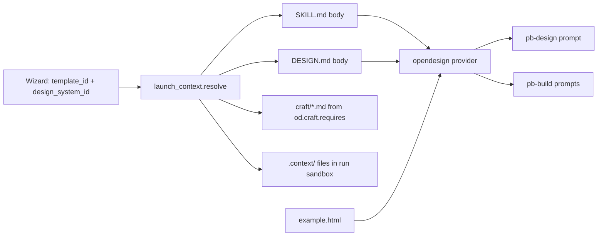

# TEMPLATE-DESIGN.md — how to author an OpenDesign prototype template

Hand this file to an agent together with a brief ("a template for X") and it has
everything it needs to add a new template that shows up in the prototype wizard
and combines correctly with any design system.

Source of truth for every rule below:
`backend/app/services/od_loader.py` (discovery), `backend/app/api/prototype_templates.py`
(wizard API), `backend/app/api/launch_context.py` + `backend/agents/execution_engine/od_context.py`
(launch), `backend/agents/capabilities/context_providers/opendesign.py` (prompt injection).

---

## 1. Where things live

```
skills/opendesign/
├── design-templates/<template-id>/   ← one folder per template (this doc)
├── design-systems/<ds-id>/DESIGN.md  ← one folder per design system (§5)
├── craft/<rule>.md                   ← shared quality rules a template can require (§4)
└── TEMPLATE-DESIGN.md                ← this file
```

The folder name IS the template id. Use lowercase kebab-case (`claims-workbench`),
unique across `design-templates/`. The loader only looks at direct sub-folders that
contain a `SKILL.md`; anything else is ignored.

## 2. Template folder layout

```
design-templates/<template-id>/
├── SKILL.md                 REQUIRED  frontmatter (catalog metadata) + body (instructions)
├── example.html             STRONGLY RECOMMENDED  wizard preview + visual reference for agents
├── thumbnail.jpg            OPTIONAL  gallery card image, generated from example.html (§7)
├── assets/template.html     OPTIONAL  starter HTML seed (legacy pipeline only, see §6)
└── references/*.md          OPTIONAL  layout library / checklist (legacy pipeline only, see §6)
```

| File | Who reads it | Limit |
|---|---|---|
| `SKILL.md` frontmatter | wizard gallery (`GET /api/prototype/templates`) | — |
| `SKILL.md` body | agents, as `ACTIVE TEMPLATE (SKILL.md): <id>` | none, keep it short |
| `example.html` | wizard preview (`/preview`), agents as `TEMPLATE EXAMPLE (example.html): <id>` | cut at 120,000 chars |
| `thumbnail.jpg` | wizard card (`/thumbnail`); falls back to a live iframe of example.html | 1280×720 |
| `assets/template.html` | legacy builders only | cut at 6,000 chars |
| `references/*.md` (not README) | legacy builders only | cut at 4,000 chars each |

## 3. SKILL.md

### 3.1 Frontmatter

YAML between `---` lines. Every field the loader reads:

```yaml
---
name: Claims Workbench                 # shown in the wizard; defaults to the humanized folder name
description: |                         # shown in the wizard card; block scalar is fine
  A desktop claims-handling workbench with a queue, a claim detail view with
  tabs, and a decision dialog. Use when the brief asks for an operations
  console, case management, or a review queue.
triggers:                              # phrases that suggest this template
  - "claims"
  - "case management"
  - "review queue"
od:
  mode: prototype                      # REQUIRED — only `prototype` appears in the prototype wizard
                                       # (`deck` / `slides` go to the presentation wizard;
                                       #  no mode = hidden everywhere)
  platform: desktop                    # desktop | mobile
  scenario: operations                 # picks the wizard category tab — use a value from §3.2
  preview:
    type: html
    entry: example.html
  design_system:
    requires: true                     # templates always combine with a design system
    sections: [color, typography, layout, components]
  craft:
    requires: [state-coverage, accessibility-baseline, laws-of-ux]   # names = files in craft/
  outputs:
    primary: index.html
  example_prompt: "Build a claims workbench for a motor insurer — queue, claim detail, approve/deny dialog."
  inputs:
    - "The kind of case being handled and who handles it"
    - "The 3–5 decisions a handler makes on a case"
---
```

Rules:
- `od.mode: prototype` is the switch that puts the template in the wizard. Get it wrong and the template is invisible.
- `craft.requires` names must match a file stem in `craft/` exactly (`accessibility-baseline`, `animation-discipline`, `anti-ai-slop`, `color`, `form-validation`, `laws-of-ux`, `rtl-and-bidi`, `state-coverage`, `typography`, `typography-hierarchy`, `typography-hierarchy-editorial`). Unknown names are silently dropped.
- `example_prompt` may sit under `od:` or at the top level.

### 3.2 Category (`od.scenario`)

The wizard's category tabs are computed in the frontend
(`frontend/src/components/workflow/prototype/TemplateGallery.tsx`, `getBucket`) from
`od.scenario`. Use one of these exact values:

| Tab | `scenario` values |
|---|---|
| Design | `design`, `personal`, `creator`, `education` |
| Marketing | `marketing`, `sale`, `sales` |
| Operations | `operations`, `operation`, `live`, `live-artifacts` |
| Engineering | `engineering`, `healthcare`, `video` |
| Product | `product`, `orbit` |
| Finance & HR | `finance`, `hr` |

Any other value (e.g. `saas-product`) lands in no tab — the template shows only
under **All**. A template with no `example.html` is hidden from the gallery entirely.
The **Custom** tab lists the user's own uploads (browser storage), never catalog folders.

### 3.3 Body

The body is injected verbatim into the prompt of every agent that declares the
`template` inject. In `prototype_v2` that is the Designer (`pb-design`) and every
Builder (`pb-build`). The Designer turns it into `design.md`'s `## Composition`
section; each Builder applies it to one screen.

Write the body as a **pattern description**, not a production workflow:

1. **What this template is** — one paragraph: the product shape, the platform, the density.
2. **Chrome** — what persists across screens (sidebar, top bar, breadcrumbs, footer) and what it holds.
3. **Screen patterns** — how each kind of screen is composed: a list page, a detail page, a form, a dashboard, a dialog, an empty state. Name regions and their order; give proportions ("queue 360px, detail fills the rest").
4. **Components** — the recurring pieces (KPI card, status pill, data table, tabs, stepper) and when to use each.
5. **Content voice** — realistic, domain-specific example values; never "Metric A" or lorem ipsum.
6. **Hard rules** — accent budget, what never appears, how states (loading / empty / error / disabled) look.

Do NOT put these in the body — the pipeline owns them and a template that says
otherwise makes the agents disagree with their own step prompt:
- output format instructions (`wrap in <artifact>`, "emit one file", "write index.html");
- step-by-step "copy the seed, then paste layouts" workflows;
- raw CSS, hex colours, font names (they come from the design system, §5);
- "single-screen" limits — the pipeline builds as many screens as the documents describe.

Keep it under ~150 lines. It is paid for on every Builder call.

## 4. Craft rules

`od.craft.requires` concatenates the named `craft/*.md` files into
`.context/design/craft.md` in the run sandbox. Today no `prototype_v2` agent
declares the `craft` inject, so these rules are written to disk but not put in any
prompt. Declare them anyway — they are the template's quality contract and will
be picked up when an agent opts in.

## 5. How a template combines with a design system

A template never carries its own colours or fonts. The user picks a template AND a
design system in the wizard; the launch builds one context from both.



What the agents actually receive, in order:

1. `ACTIVE DESIGN SYSTEM: <ds-id>` — this fixed line, then the whole DESIGN.md:
   `Apply these tokens to ALL colors, fonts, and spacing. Map to :root variables: --bg, --fg, --accent, --surface, --border, --muted.`
2. `ACTIVE TEMPLATE (SKILL.md): <template-id>` — the SKILL.md body.
3. `TEMPLATE EXAMPLE (example.html): <template-id>` — example.html, capped at 120,000 chars.

The contract that makes any template × any design system work:

- **example.html styles everything through CSS variables**, declared once in `:root`:
  `--bg`, `--fg`, `--accent`, `--surface`, `--border`, `--muted` at minimum
  (the six the design-system line maps to). Add `--success`, `--warning`, `--danger`,
  `--font-display`, `--font-body`, `--font-mono`, `--radius`, `--space-*` as needed.
  No hard-coded hex values or font names outside `:root`.
- The template decides **structure and density**; the design system decides **colour,
  type, spacing, radius, component voice**. If a choice would look wrong under a
  different design system, it belongs in the design system, not the template.
- A blank-canvas launch (no template) still loads the design system, so nothing the
  pipeline needs may depend on the template being present.

Design systems for reference: `design-systems/<ds-id>/DESIGN.md`, no frontmatter.
The wizard reads the name from the first `# ` heading and the category/blurb from
two blockquote lines right under it (`> Category: …` then `> one-line blurb`).
Sections are numbered `## 1. Visual Theme & Atmosphere` … `## 9. Anti-patterns`
(Color, Typography, Spacing & Grid, Layout & Composition, Components, Motion &
Interaction, Voice & Brand). `components.html` next to it is its preview.

## 6. example.html

- One self-contained HTML file: inline `<style>` and `<script>`, no external CSS/JS/font/image URLs (use CSS placeholders for images). Relative `./assets/...` links are served, but keep it self-contained.
- Show the template's real pattern: the chrome plus 3–6 representative screens (list, detail, form, dashboard, dialog), switchable with a small inline script. It is both the wizard preview and the Builders' visual reference — it should look like a finished product in its domain.
- Use the `:root` variable contract from §5 so the preview is re-themable.
- Stay well under 120,000 characters (aim for 30–60k). Everything past the cap is cut, and every Builder pays for it.
- Semantic, accessible markup: real `<button>`, `<label for>`, `<table>` with `<th>`, visible focus styles, 4.5:1 contrast with the default tokens.

`assets/template.html` and `references/*.md` are read only by the legacy builder
tool sets (`prototype`, `prototype_emit_only`). `prototype_v2` Builders only have
file read/write tools, so they never see them. Skip them for a new template unless
it must also serve the legacy prototype pipeline.

## 7. Thumbnail

Generate after example.html is final:

```bash
cd backend && python scripts/generate_template_thumbnails.py --only <template-id> --force
```

It screenshots example.html at 1280×720 into `thumbnail.jpg`. Without it the card
falls back to a live iframe — slower, but it works.

## 8. Checklist before handing back

- [ ] Folder `design-templates/<template-id>/`, kebab-case, id not already taken.
- [ ] `SKILL.md` frontmatter parses as YAML; `od.mode: prototype`; `name` and `description` set.
- [ ] `craft.requires` names all exist in `craft/`.
- [ ] Body is a pattern description (§3.3) with none of the forbidden items.
- [ ] `example.html` is self-contained, uses only `:root` variables for colour/type, under 120k chars, and opens cleanly in a browser.
- [ ] Re-themed check: swap the `:root` values for another design system's colours — nothing breaks or becomes unreadable.
- [ ] `thumbnail.jpg` generated.
- [ ] The backend caches the catalog for the process lifetime — it needs a restart before the template appears in `GET /api/prototype/templates` and the wizard.
