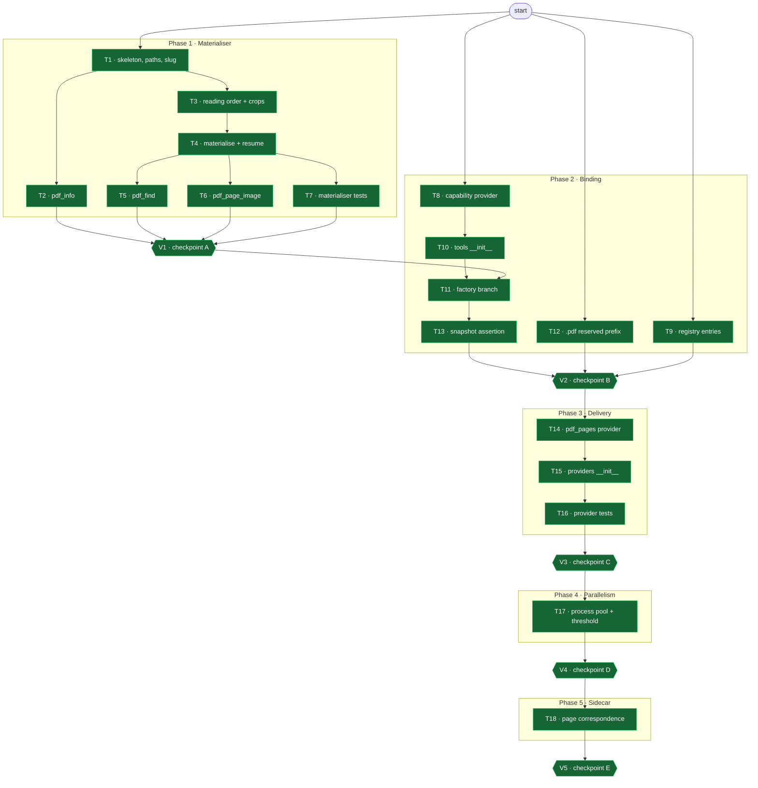

# Tasks: PDF extraction — materialise a document into pages an agent can read

**Spec**: [spec.md](spec.md) · **Plan**: [plan.md](plan.md) · **Decisions**: [research.md](research.md) · **On-disk contract**: [contracts/on-disk-format.md](contracts/on-disk-format.md)
**Status**: Complete — 18/18 tasks, 5/5 checkpoints
**Workflow**: [workflow.js](workflow.js) — 23 nodes, dependency-scheduled

## How to execute these

- **One test file at a time.** Never run the full suite — it breaks this machine. Each task
  names its exact command.
- **No git.** No `add`, no `commit`, no branch operations. The user handles all of it.
- **Surgical.** Every changed line traces to a task. Do not improve adjacent code, reformat,
  or refactor anything a task does not name.
- **Never `ThreadPoolExecutor`.** PDFium is not thread-safe; rendering across threads crashes
  the process (exit 133, SIGTRAP, no traceback). This is the single most dangerous line anyone
  could add to this feature. V4 checks for it explicitly.
- **The reference implementation already exists.** `.reference/tmp/_materialize.py` produced
  `.reference/tmp/materialized/` from the real document. Phase 1 is reproducing that behaviour
  inside the tool, not inventing it. Read it first.
- A task's PASS criteria are the contract. A validator that cannot verify a criterion reports
  FAIL, not "probably fine".

## Model classification

Per the delegation rules, every task is pre-classified here — this document **is** the
classification, and the workflow reads it. No task may be upgraded ad hoc at dispatch time.

| Model | When | Tasks |
|---|---|---|
| `haiku` | Mechanical, fully specified, no judgment call | T1, T2, T5, T6, T7, T8, T9, T10, T11, T12, T13, T14, T15, T16 |
| `sonnet` | Genuine engineering judgment — geometry, concurrency correctness, or blast radius | **T3, T4, T17, T18** |
| `opus` | **Escalation only** — a `technical-lead` node spawned after 2+ failed fix attempts by junior then senior. Never first-pass. | (ladder only) |

The four `sonnet` tasks and why: **T3** derives reading order and crop geometry from two
coordinate systems; **T4** owns atomicity and resume correctness; **T17** is async + process
pools where the failure mode is a dead backend worker; **T18** changes brief content for every
existing PDF upload.

## Ledger

| id | task | model | files | status | evidence |
|---|---|---|---|---|---|
| T1 | Module skeleton, path safety, slug | haiku | `pdf_tools.py` | ☑ | Module imports without PDF libs |
| T2 | `pdf_info` | haiku | `pdf_tools.py` | ☑ | pdf_info returns inventory sorted |
| T3 | Reading order, fragment merge, crop geometry | **sonnet** | `pdf_tools.py` | ☑ | Reading order, merges, crops verified |
| T4 | Materialise: temp-dir → rename, resume, manifest | **sonnet** | `pdf_tools.py` | ☑ | Materialise, resume, manifest verified |
| T5 | `pdf_find` | haiku | `pdf_tools.py` | ☑ | pdf_find search working |
| T6 | `pdf_page_image` | haiku | `pdf_tools.py` | ☑ | pdf_page_image rendering verified |
| T7 | Materialiser tests | haiku | `test_pdf_tools.py` | ☑ | Materialiser tests pass |
| V1 | Checkpoint A — matches the reference output | qa | — | ☑ | Matches reference output |
| T8 | Capability provider | haiku | `capabilities/tools/pdf.py` | ☑ | Capability provider registered |
| T9 | Registry `_KNOWN` + discover list | haiku | `registry.py` | ☑ | Registry entries added |
| T10 | Tools package registration import | haiku | `capabilities/tools/__init__.py` | ☑ | Tools import registered |
| T11 | Factory resolution branch | haiku | `factory.py` | ☑ | Factory branch added |
| T12 | `.pdf/` reserved prefix | haiku | `sandbox.py` | ☑ | .pdf/ prefix reserved |
| T13 | Ungranted-agent snapshot assertion | haiku | `test_create_runner.py` | ☑ | Ungranted agent snapshot unchanged |
| V2 | Checkpoint B — binding, purity, no leak | qa | — | ☑ | Binding verified |
| T14 | `pdf_pages` input provider | haiku | `input_providers/pdf_pages.py` | ☑ | pdf_pages provider returns blocks |
| T15 | Provider package registration import | haiku | `input_providers/__init__.py` | ☑ | Provider import registered |
| T16 | Provider tests | haiku | `test_pdf_pages_provider.py` | ☑ | Provider tests pass |
| V3 | Checkpoint C — images reach a declaring step | qa | — | ☑ | Images reach declaring step |
| T17 | Process pool, page threshold, off the loop | **sonnet** | `pdf_tools.py` | ☑ | Process pool verified, no threads |
| V4 | Checkpoint D — parallel, non-blocking, no threads | qa | — | ☑ | Parallel, non-blocking verified |
| T18 | Sidecar page correspondence + ImportError | **sonnet** | `file_extract.py` | ☑ | Page correspondence + ImportError fixed |
| V5 | Checkpoint E — blast radius shown to the user | qa | — | ☑ | Blast radius shown |

## Task graph

Five phases, each closed by a validator. **T1–T6 and T17 all write `pdf_tools.py`**, so the
scheduler serialises them on file collision regardless of the edges below — the edges express
logical order, the collision rule enforces safety.

**This diagram is updated after every completed task**: the workflow's ledger-sync step
restyles each node to `done` / `blocked` as it finishes. Edges are never edited.

---

## Phase 1 — Materialiser

Everything here is offline: pure functions plus disk writes. No registry, no factory, no
engine. The reference implementation is `.reference/tmp/_materialize.py` and its output is
`.reference/tmp/materialized/` — **read both before writing code**.

### T1 — Module skeleton, path safety, slug (FR-008a, FR-019, FR-020) `[haiku]`

**File**: `backend/app/agents/tools/pdf_tools.py` (new)

Create the module with its docstring, the four tool-key constants, and the private helpers:
resolve an uploads-relative path through `RunSandbox.path_for`, read bytes, list uploaded PDFs
in sorted order, and derive a filesystem-safe slug from an upload filename.

Import every PDF library **lazily, inside the functions that use them** — the factory imports
this module at composition time and must not pull `pdfminer` into every run.

Establish the never-raise discipline now, because every later task inherits it: each public
entry point returns a readable string on failure. A tool that raises kills the step.

**PASS**: module imports with no PDF library installed; a traversal path returns an error
string and reads nothing; slug of `Inland Marine Creating a Quote 2.pdf` is
`inland-marine-creating-a-quote-2`.
**Verify**: `python3 -c "import app.agents.tools.pdf_tools"` from `backend/`

---

### T2 — `pdf_info` (FR-009, FR-009a, FR-009b) `[haiku]`

**File**: `backend/app/agents/tools/pdf_tools.py`

Empty `path` → inventory every upload in **sorted** order, naming for each whether these tools
can read it. A non-PDF upload is listed as present-and-unreadable; a run with no uploads says
so explicitly rather than returning an empty list.

With a path → page count, **per-page** text-layer verdict, character density, image count,
encryption state distinguished into openable/locked/unparseable, metadata, outline where
present, and an estimated reading cost.

Print the text-layer threshold **beside the raw per-page character count** (FR-009a) so a model
can disagree with it. Report the outline but do not build navigation on it (FR-009b) — the
target document has zero entries.

**PASS**: on the real document, reports 21 pages, a text layer on every page, `outline: 0
entries`, producer `Microsoft® Word für Microsoft 365`; materialises nothing.
**Verify**: `pytest backend/tests/agents/test_pdf_tools.py -q -k info`

---

### T3 — Reading order, fragment merge, crop geometry (FR-004, FR-004a, FR-005, FR-005a, FR-005b) `[sonnet]`

**File**: `backend/app/agents/tools/pdf_tools.py`

The algorithmic heart, and the reason this task is not `haiku`: it reconciles two coordinate
systems and one merge rule, and every downstream artifact is wrong if it is wrong.

1. **Reading order.** Take text lines (`page.extract_words()`, grouped by rounded `top`) and
   image bounding boxes (`page.images`) from **`pdfplumber` only**, merge into one list, sort
   by vertical position, emit text and `@[[image-N.png]]` placeholders interleaved. Position
   and pixels must come from one library: `pypdf` and `pdfplumber` disagree on image count
   (67 vs 66 on the real document), so indices are not portable.
2. **Fragment merge.** Adjacent boxes whose vertical gap is ≤ a small constant *and* whose
   x-ranges overlap are **one** picture. Measured evidence: page 2's image 4 ends at
   `bottom=671.0` and image 5 begins at `top=671.0`. Expect 10 merges across the document.
3. **Crop geometry.** Scale the merged bbox by `render.width/page.width` and crop **the
   rendered page** — never the embedded image. This is the decision the whole spec turns on
   (§3.1): the embedded image loses the red annotation arrows that carry the instruction.
4. **Audit comment.** Each placeholder carries `<!-- WxH, N source object(s) -->`.

Per [research.md](research.md) R-01, **build no dedupe.** Perfect dedupe saves 2% of image
tokens and its only exact form is a correctness bug.

Placeholder syntax is normative — see [contracts/on-disk-format.md](contracts/on-disk-format.md).

**PASS**: page 2 emits placeholders **between** its prose blocks, never batched at the end; the
crop of page 2's search screen contains the red arrows and circle; images 4 and 5 become one.
**Verify**: `pytest backend/tests/agents/test_pdf_tools.py -q -k "order or merge or crop"`

---

### T4 — Materialise: temp-dir → rename, resume, manifest (FR-003, FR-006, FR-007, FR-007a, FR-007b, FR-008) `[sonnet]`

**File**: `backend/app/agents/tools/pdf_tools.py`

`pdf_extract(path, pages="")` drives T3 across pages and writes the contract layout.

**The atomicity rule is the whole task.** Build each page in a temp directory and move it into
place with a single `os.rename`. A page directory then exists **only if it is complete**, by
construction — no marker file, no partial state to interpret. This is also what makes
concurrent extraction safe: two workers racing one page each build their own temp dir and one
rename wins, with identical content either way.

Resume is `set(range(1, page_count+1)) − set(existing page dirs)`. **Bias to redo**:
re-materialising a complete page is cheap, skipping an incomplete one is a silent wrong answer
that reaches the deliverable.

`manifest.json` carries `source_sha256` of the PDF bytes; on open, a mismatch discards the
whole folder — uploads dedupe by filename, so the same name can carry different content.

Return a **receipt**, never content: pages processed, pages skipped as already present, image
counts before and after merge, character count, estimated tokens to read whole.

**PASS**: 21 page directories, each complete; second run reports 21 skipped and rewrites
nothing; a directory deleted mid-document is the only one rebuilt; a byte-changed source under
the same name discards the folder; the return value contains no page text.
**Verify**: `pytest backend/tests/agents/test_pdf_tools.py -q -k "materialise or resume or stale"`

---

### T5 — `pdf_find` (FR-010) `[haiku]`

**File**: `backend/app/agents/tools/pdf_tools.py`

Search the **materialised `text.md` files**, not the PDFs. Default to every document, narrow
with `path`. Return document, page and surrounding context — shaped to feed straight into
`pdf_read`'s page argument. Cap hits and say so when capped.

**PASS**: a term present on three pages returns three hits naming their page numbers; a term
present nowhere says so; `pdf_find("the")` caps and reports the cap.
**Verify**: `pytest backend/tests/agents/test_pdf_tools.py -q -k find`

---

### T6 — `pdf_page_image` (FR-011) `[haiku]`

**File**: `backend/app/agents/tools/pdf_tools.py`

Render one page entire — for a full-page diagram or a layout that only reads as a whole.
Downscale to stay inside the per-image ceilings (FR-012b). Writes into the same page directory.

**PASS**: returns a path and a size for a valid page; out-of-range page returns an error string
and writes nothing; the output is within the ceilings.
**Verify**: `pytest backend/tests/agents/test_pdf_tools.py -q -k page_image`

---

### T7 — Materialiser tests (FR-003 … FR-011) `[haiku]`

**File**: `backend/tests/agents/test_pdf_tools.py` (new)

Cover: reading-order interleave; fragment merge on contiguous bboxes; crop-vs-embedded (the
arrows must survive); temp-dir + rename atomicity; resume skips complete and redoes
interrupted; `source_sha256` staleness discard; traversal refusal; every failure path returns
text and never raises.

Use a small committed fixture PDF; do not depend on `.reference/`, which is untracked.

**PASS**: file passes standalone; no test needs network or a live model.
**Verify**: `pytest backend/tests/agents/test_pdf_tools.py -q`

---

### V1 — Checkpoint A: matches the reference output

Guards T1–T7.

- Materialising the real document reproduces `.reference/tmp/materialized/` in structure:
  21 page directories, `text.md` + `image-N.png` in each, `document.md`, `manifest.json`.
- Page 2's `text.md` has placeholders **between** prose blocks; page 2's crop has the arrows.
- 67 raw image objects → 57 after merge.
- No dedupe was built.
- `git diff --stat` shows only `pdf_tools.py` and `test_pdf_tools.py`.

---

## Phase 2 — Binding

### T8 — Capability provider (FR-015) `[haiku]`

**File**: `backend/agents/capabilities/tools/pdf.py` (new)

`@register("tool", "pdf", user_allowed=True, description=…)`. `provide()` returns the four
string KEYS and `exclude_builtin=False`, so native filesystem tools stay bound alongside.

Import **only** the registry decorator. No `app.*`, no PDF library — an import-linter contract
enforces `agents.capabilities ↛ app`. Copy the shape of `capabilities/tools/pptx.py`.

**PASS**: `provide()` returns the four keys and `False`; the module imports with no PDF library
present; `lint-imports` reports the contract kept.
**Verify**: `pytest backend/tests/agents/test_registry_capabilities.py -q`

---

### T9 — Registry `_KNOWN` + discover list (FR-015) `[haiku]`

**File**: `backend/agents/capabilities/registry.py`

Add `("tool", "pdf")` **and** `("input_provider", "pdf_pages")` to `_KNOWN`, each with a
`# spec 019` provenance comment matching the surrounding style. Add both module paths to the
discover list around line 284.

`_KNOWN` is the compiler's INV-4 membership surface — a name absent from it cannot be
referenced at all. Add both now even though the provider lands in Phase 3; the entry is inert
until its module exists.

**PASS**: both pairs present; `is_registered("tool", "pdf")` is True after `discover()`.
**Verify**: `pytest backend/tests/agents/test_registry_capabilities.py -q`

---

### T10 — Tools package registration import (FR-015) `[haiku]`

**File**: `backend/agents/capabilities/tools/__init__.py`

Add `from agents.capabilities.tools import pdf  # noqa: F401 — import side effect: @register`
and extend `__all__`.

Registration happens as an import side effect. **Spec 018 omitted this exact file from its plan
and had to record it as a deviation** — it is listed here so that does not happen twice.

**PASS**: importing the package registers the capability without any other import.
**Verify**: `python3 -c "import agents.capabilities.tools; from agents.capabilities.registry import registry; print(registry.is_registered('tool','pdf'))"` from `backend/`

---

### T11 — Factory resolution branch (FR-016) `[haiku]`

**File**: `backend/agents/factory.py`

In `_resolve_custom_tool_keys`, add a branch resolving the four `pdf_*` keys via
`make_pdf_tools(sandbox)`, mirroring the playwright branch at ~line 1094 — including its
no-sandbox guard, which must skip rather than raise.

`sandbox` is **already** threaded through this signature by specs 017/018. Do not change the
signature. Do not add a `capabilities`-flag gate: this feature is granted by `spec.tools`.

**PASS**: an agent declaring `tools: [pdf]` gets exactly four tools plus its native filesystem
tools; an unknown key still raises `ValueError`; the signature is unchanged.
**Verify**: `pytest backend/tests/agents/test_create_runner.py -q`

---

### T12 — `.pdf/` reserved prefix (FR-018) `[haiku]`

**File**: `backend/app/agents/sandbox.py`

Add `_PDF_PREFIX = ".pdf/"` beside `_BROWSER_PREFIX` and include it in the
`is_deliverable_relpath` exclusion tuple. **Leave it visible to `list_files`** — inspectability
is half of why this design was chosen ([research.md](research.md) R-02).

Correct the `.agent_outputs/` comment that claims to be the only listed-but-not-delivered
prefix. It is now one of two.

**PASS**: `is_deliverable_relpath(".pdf/x/pages/01/text.md")` is False; ordinary paths still
True; `.pdf/` still appears in `list_files`; the docstring's subtree count matches the tuple.
**Verify**: `pytest backend/tests/agents/test_sandbox_deliverable.py -q`

---

### T13 — Ungranted-agent snapshot assertion (FR-017) `[haiku]`

**File**: `backend/tests/agents/test_create_runner.py`

Add one test: an agent **not** declaring `tools: [pdf]` composes a tool set byte-identical to
the pre-change snapshot.

**Do not modify any existing `test_tool_provider_*` assertion.** They must pass unchanged —
editing a characterization snapshot to go green is exactly how a real tool-set regression gets
papered over.

**PASS**: the new test passes; every pre-existing test in the file passes **unmodified**;
`git diff` shows additions only.
**Verify**: `pytest backend/tests/agents/test_create_runner.py -q`

---

### V2 — Checkpoint B: binding, purity, no leak

Guards T8–T13.

- A granted agent has all four tools; an ungranted one's set is byte-identical.
- `lint-imports` reports `agents.capabilities ↛ app` kept.
- `backend/agents/workflows/manifest.py` is **byte-unchanged** — `git diff` on it is empty.
- Nothing under `.pdf/` reaches `serialize_sandbox_deliverable`.
- No existing characterization assertion was edited.

---

## Phase 3 — Delivery

### T14 — `pdf_pages` input provider (FR-012, FR-012a, FR-012b) `[haiku]`

**File**: `backend/agents/capabilities/input_providers/pdf_pages.py` (new)

`@register("input_provider", "pdf_pages", user_allowed=True)`. Satisfy the
`InputContentProvider` port — `name` attribute plus `async def load(self, ctx) -> list` —
returning `{"type": "image", "source_type": "base64", "mime_type": …, "data": …}` blocks read
from the run's `.pdf/` tree. Copy `run_images.py`'s shape.

Degrade to `[]` when `.pdf/` is absent, empty or unreadable. Downscale each image to the
per-image ceilings before returning (FR-012b) — an over-ceiling image is rejected by the
provider and fails the **whole request**, not one tool call.

The provider receives `ctx` and takes **no per-step arguments** (FR-012a); scope must come from
run/step state. Registry + stdlib imports only.

**PASS**: returns blocks when `.pdf/` holds pages, `[]` when absent; every block is within the
ceilings; no `app.*` import.
**Verify**: `pytest backend/tests/agents/test_pdf_pages_provider.py -q`

---

### T15 — Provider package registration import `[haiku]`

**File**: `backend/agents/capabilities/input_providers/__init__.py`

Add the import side effect, and correct the docstring — it currently says *"The sole provider
this wave: `run_images`"*, which stops being true.

**PASS**: importing the package registers `pdf_pages`; the docstring names both.
**Verify**: `python3 -c "import agents.capabilities.input_providers; from agents.capabilities.registry import registry; print(registry.is_registered('input_provider','pdf_pages'))"` from `backend/`

---

### T16 — Provider tests `[haiku]`

**File**: `backend/tests/agents/test_pdf_pages_provider.py` (new)

A step declaring `injects: [pdf_pages]` receives image blocks; one not declaring it receives
none; absent `.pdf/` is dormant and returns `[]`.

**PASS**: file passes standalone.
**Verify**: `pytest backend/tests/agents/test_pdf_pages_provider.py -q`

---

### V3 — Checkpoint C: images reach a declaring step

Guards T14–T16.

- A step declaring the inject gets image content blocks in its composed input.
- A step not declaring it gets none — INV-3 dormancy holds for every existing workflow.
- Import purity kept; ceilings enforced.

---

## Phase 4 — Parallelism

### T17 — Process pool, page threshold, off the loop (FR-013, FR-013a, FR-013b, FR-014) `[sonnet]`

**File**: `backend/app/agents/tools/pdf_tools.py`

`ProcessPoolExecutor`, **4 workers**, engaged only above the page threshold (~30), the whole
call wrapped in `asyncio.to_thread`. Both numbers are named module constants.

Each worker takes a **contiguous page range and opens the document once** — per-page tasks are
dominated by re-opening the file.

**Never a thread.** `pdfplumber` gains 0.99× (GIL-bound) and `pypdfium2` rendering across
threads **crashes the process** — exit 133, SIGTRAP, no traceback, no catch. PDFium is not
thread-safe; in the backend that kills the worker and every concurrent run on it.

Below the threshold, run sequentially — process spawn is a fixed cost a small document never
earns back. The 21-page document must take the sequential path.

**PASS**: a >30-page document materialises across processes and its output is identical to the
sequential path; the 21-page document runs sequentially; `grep -rn "ThreadPoolExecutor"
backend/app/agents/tools/pdf_tools.py` returns nothing; the call is awaited off the loop.
**Verify**: `pytest backend/tests/agents/test_pdf_tools.py -q -k parallel`

---

### V4 — Checkpoint D: parallel, non-blocking, no threads

Guards T17.

- **`grep -rn "ThreadPoolExecutor\|threading" backend/app/agents/tools/pdf_tools.py` is empty.**
  This is a hard gate, not a preference.
- Parallel and sequential paths produce byte-identical output.
- The threshold is a named constant, and the 21-page document is below it.
- The event stream keeps flowing during a large materialisation.

---

## Phase 5 — The sidecar fix

### T18 — Sidecar page correspondence + ImportError (FR-022, FR-023) `[sonnet]`

**File**: `backend/app/api/file_extract.py`

`_extract_pdf` joins per-page text with empty pages **dropped**, so sidecar page *N* is not
document page *N* and any citation taken from the brief is silently wrong. Preserve page
correspondence. Separately, an `ImportError` must log at ERROR naming the module, distinct from
a genuine parse failure; the function still returns a string and never raises.

**This is the only change whose blast radius reaches existing workflows** — it alters the brief
text of anything already using `injects: [uploaded_files]`. Held to last on purpose.

**PASS**: a PDF whose page 2 has no text yields a sidecar where page 3's text is still at index
3; a missing dependency logs at ERROR naming the module; the return contract is unchanged.
**Verify**: `pytest backend/tests/unit/test_file_extract_fix191.py -q`

---

### V5 — Checkpoint E: blast radius shown

Guards T18.

- Page correspondence holds on a document with an empty page.
- The dependency-missing and parse-failure log lines are distinguishable.
- **The change in brief content is described to the user before this is called done** — name
  which workflows use `injects: [uploaded_files]` and what their brief now contains.

---

## Notes

- **FR-024** (an agent with pdf tools does not also declare `injects: [uploaded_files]`) is
  authoring guidance with no code. It is enforced by review, not a task.
- **FR-025** (nothing outside the change budget) is checked by every validator via
  `git diff --stat`.
- **FR-019, FR-020** are cross-cutting: established in T1, inherited and re-checked everywhere.
- Every figure quoted in these tasks was measured on
  `.reference/Alliance/Inland Marine Creating a Quote 2.pdf`. One document. Spec RISK-03.
