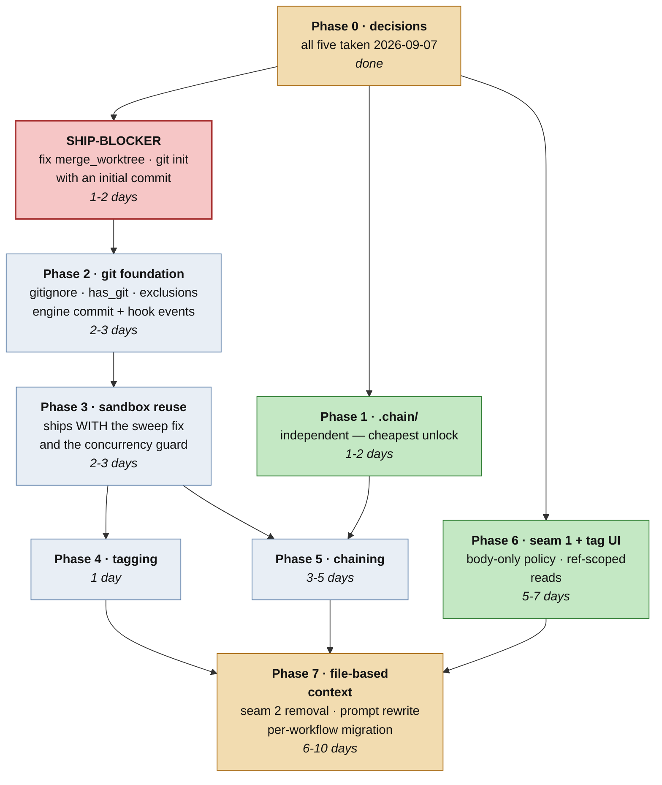

# Start here — spec 019

**What this is:** the front door to spec 019. What was analysed, what came out of it, what you need to
decide, and what to do first. Everything below is drawn from the four documents in this folder; nothing
here is new analysis.

**Status:** draft. Analysis complete, audited four times, **and all five decisions are now taken** —
see below. Ready for planning.

---

## In one page

You asked for nine things: revisions reusing one sandbox, git in that sandbox, the final agent tagging
`vN`, prompt changes to match, a version dropdown, a `.chain/` folder, chaining that carries it
forward, a prompt that tells the next pipeline about it, and the removal of engine-side prompt injection.

Seven are feasible. One is blocked on a question only you can answer. One is two requirements wearing
one coat and needs splitting.

The engineering is **smaller than the list suggests** — five of the mechanisms this needs already exist
and are proven in production. What is genuinely missing is narrow and specific.

The analysis also turned up something you did not ask for and should know about: **a live data-loss bug
in shipped code** that this feature would have exposed. It is now a prerequisite.

Roughly **20–35 days** — four to seven weeks. The decisions taken pushed this up rather than down: R5
resolved to the larger reading, and removing both prompt seams turns the agent-prompt work from a
near-zero edit into a real rewrite plus a per-workflow migration.

---

## What was analysed, and how

One agent per requirement point, as you asked — nine analyses, each sweeping all nine layers from the
frontend click to the LLM call. Each was then handed to an independent adversarial verifier that
re-opened the cited files, and the whole set went to a completeness critic.

Then three audit rounds over the resulting documents, each verifying against source rather than prose:

| round | lenses | findings | character |
|---|---|---|---|
| 1 | citations · coverage · consistency · missed surfaces · executability · design | 22 | mostly **document** defects |
| 2 | fix verification · sandbox key · git semantics · authz · tests · hostile read | 32 (3 critical) | mostly **product** defects |
| 3 | rev-3 verification · final consistency · what two rounds missed · sign-off | 9 | mostly loose ends |

**63 findings, four revisions.** The falling count is the useful signal: round 3's verification lens
returned zero findings and independently reproduced both git defects in its own throwaway repos.

Every load-bearing claim was re-checked by hand: all 12 named backend test files exist, all 7 frontend
files exist, and the two git defects were reproduced against real `git` and traced through
`merge_worktree` → `Git3WayMerge.merge` → `_merge_fragments`.

One claim was **withdrawn** during the audit: an early draft treated the public `/s/{token}` share route
as a new exposure surface. It serves only a DB column and never reads the sandbox.

---

## What we found

### The thing you did not ask about

**A fan-out step with two worktree workers silently discards every worker's output and reports success.**

`merge_worktree` does not commit between fragments. Fragment 2's merge is refused with
`MERGE_HEAD exists`; the conflict probe returns empty because the merge never ran; the code reads an
empty conflict list as "merged cleanly"; then `git merge --abort` destroys fragment 1's work too.
`Git3WayMerge` appends both branches to `applied` and the engine emits `merge_completed` over an
untouched tree.

```
frag 1 → merge ok, MERGE_HEAD set     → conflicts=[] → "applied"
frag 2 → REFUSED (MERGE_HEAD exists)  → probe empty  → conflicts=[] → "applied"
         └─ git merge --abort ───────────► destroys frag 1 as well
result: applied=[w1,w2], conflicts=0 — base tree untouched
```

It is dormant only because no artifact sandbox has ever had `has_git=True`, which is precisely what
requirement 2 asks for. `git init` with an unborn HEAD hits the same false-clean handler. Both are now
prerequisites (FR-034, FR-006), not follow-ups.

### The rest, in order of how much they change the shape of the work

**R9 is two requirements.** The system-prompt half is genuinely small — the block order is already a
registered capability, so "only the agent's own prompt" is a second policy plus one un-hardcoded line.
The context-message half is different: those ~15 blocks are the mechanism custom workflows *currently
use* to satisfy SC-001. Deleting them does not remove a violation; it removes the implementation. Ship
the first, triage the second.

**R9 as first written would have changed nothing.** No requirement moved any workflow onto the new
policy, so it would have shipped a mechanism nobody opts into — with every test green. Now FR-039.

**R5 may already exist.** `RunHeader` has a shipped "Version ▾" menu, and picking a version already
swaps the Workspace tab to that version's sandbox. Reading (a) is under a day; reading (b) is a week.

**There is no agent-callable git tool.** `permission_caps.py` sets `git=False` in both trust caps, with
a docstring saying git is off "because nothing binds them yet". So "agents commit" means either the
engine commits on their behalf, or a new capability project.

**`handoff` already means something else** — `/flowin-handoff` is a shipped IDE-to-browser feature that
already does real git commit, push and PR. During analysis an agent mis-attributed its test files to
this work. Consider `.chain/`.

**Three silent consequences of the shared sandbox** that must land with it, not after: the TTL sweeper
can delete a live revision's directory; the shipped version picker breaks the moment file routes are
re-keyed; and a Stop-button cancel leaves stray files that the next revision commits as its own.

**Two governance surprises.** A body-only prompt policy also drops the user's Constitution and every
behavioral hook, not just template injection. And `secret_scan` is bound to a `pre_commit` hook that
**fires nowhere** — so git history and the chain payload would both be permanent and unscanned.

---

## Decisions taken

All five answered on 2026-09-07. Recorded in `../spec.md` §2; the consequences are folded into the FRs.

| # | question | decision |
|---|---|---|
| **Q1** | the version picker that ships, or real git tags? | **real git tags** — the larger reading. FR-040 and FR-043 are now in scope, and the existing picker still has to survive the sandbox re-key |
| **Q2** | who runs git, engine or agent? | **engine**, committing at every step boundary gated on `has_git`; declared hooks bracket it (`pre_commit` / `post_commit`). Not a `post_step` — that field is singular and already taken on the revision workflows. No git tool is built |
| **Q3** | what goes in the folder, and the name? | **summary + final output + a copy of the logs**, in **`.chain/`** — renamed off `handoff`, which already names an unrelated shipped feature |
| **Q4** | which injection seam? | **both** — and context becomes files. Written out in full below |
| **Q5** | `has_git` scope? | **global default, on.** Every sandbox is a git repo from day one |

### Q4 is the one that changed the shape of the work

The decision: *"Seam 2 is polluting all agents without any reason. The user message needs to go into the
first agent only. Next agents will get what the previous agent produced, not in the context. All agents
should work now to read files."*

So the sandbox becomes the context channel. The system prompt is the agent's own `AGENT.md` and nothing
else; the brief reaches agent 1 only; every later agent reads what it needs off disk.

**It is more buildable than it sounds, because all four channels already exist and are already
populated.** `write_agent_output` already writes every agent's output to `.agents/{NN}-{agent_id}.md` on
the completion path. `.uploads/` already holds extracted text per uploaded file. After the sandbox
re-key, a revision's predecessor already wrote into the same directory. And `is_first_agent` already
lives in the exact function that has to change, where it already gates the chained-pipeline block.
Every agent already holds `read_file`, `ls`, `glob` and `grep`.

**What it costs** is the part to plan for: every built-in `AGENT.md` needs rewriting to say where things
are and how to find them — vagueness there just moves the problem — and each workflow migrates
individually, with seam 2's code deleted only once the last one is off the old policy.

### One consequence of Q5, stated once

`has_git` on globally means every fan-out step in every workflow moves onto git worktrees and 3-way
merge from the first run after deploy. There is no per-workflow flag left to stage it behind, so the
`merge_worktree` defect below stops being "fix before opting in" and becomes **fix before shipping**,
and backing it out is a code revert rather than deleting a manifest line.

## How to move forward



**Start with `.chain/`.** It depends on nothing, it is the smallest item, and both chaining
requirements are dead without it.

**Do not turn git on until the merge bug is fixed.** That is the one ordering constraint that is not
negotiable — flipping `has_git` first is how this ships as data loss.

**Two guards ship inside another item's PR, never after:** the TTL-sweep chain-awareness goes in with
the sandbox re-key, and the `.gitignore` goes in with `git init`. Deferring either converts a design
decision into a silent production bug.

### Effort

| | |
|---|---|
| Ship-blocker — merge fix + init commit | 1–2 days |
| Phases 1–4 — chain payload, git, reuse, tagging | 6–9 days |
| Phase 5 — chaining | 3–5 days |
| Phase 6 — seam 1 policy + tag dropdown and ref-scoped reads | 5–7 days |
| Phase 7 — seam 2 removal, prompt rewrite, per-workflow migration | 6–10 days |
| **Total** | **20–35 days ≈ 4–7 weeks** |

No longer excludes the context-message work — Q4 brought it in scope and Phase 7 is its estimate. The
agent-driven git-tool project is excluded and stays excluded: Q2 chose engine-driven.

---

## Areas — eight buckets, every FR in exactly one

The change set grouped the way the work will be assigned. Icons match the chips in `04-walkthrough.md`.

| # | area | FRs | count |
|---|---|---|---|
| 1 | 🪝 Hooks | FR-035, FR-060, FR-061 | 3 |
| 2 | 🌿 Git | FR-006, FR-007, FR-008, FR-008a, FR-008b, FR-009, FR-009a, FR-010, FR-011, FR-033, FR-034, FR-041, FR-052, FR-053, FR-054 | 15 |
| 3 | 💬 Prompt change | FR-027, FR-028, FR-029, FR-030, FR-031, FR-032, FR-039, FR-044, FR-046, FR-047, FR-048, FR-049, FR-050, FR-051 | 14 |
| 4 | 📁 File creation | FR-016, FR-017, FR-018, FR-019, FR-037, FR-065 | 6 |
| 5 | 🏷️ Versioning | FR-012, FR-013, FR-014, FR-015, FR-036, FR-038, FR-040, FR-043, FR-056, FR-057, FR-058 | 11 |
| 6 | 🛑 Cancellation and terminal path | FR-042 (superseded pointer), FR-055, FR-059, FR-062 | 4 |
| 7 | 📦 Sandbox identity and lifetime | FR-001, FR-002, FR-003, FR-004, FR-005, FR-005a, FR-063 (deferred), FR-064 (deferred) | 8 |
| 8 | 🔗 Chaining | FR-020, FR-021, FR-022, FR-023, FR-024, FR-025, FR-026, FR-045 | 8 |

Areas 7 and 8 are the two the original six-bucket taxonomy did not name: sandbox identity is the
precondition for every git requirement, and chaining crosses runs rather than living inside one.

## What to build from scratch

**Twelve things.** Five have no template in the repo — `git init`, `.gitignore` seeding, ref-scoped
reads, the concurrency guard, the chain-root resolver. Seven copy a pattern that already ships — the
engine's step-boundary commit and its three hook events (`pre_commit`, `post_commit`, `post_run`,
modelled on `before_write`), `create_tag`/`list_tags`, the `.chain/` and `.context/` prefixes and writers, the
`chain_context` provider, the body-only policy, and a refs endpoint.

Everything else — about nineteen items — is editing something that already exists.

Both decisions that could have moved this count are taken: Q1 keeps the three ref-scoped items in, and
Q2 keeps the git tool out.

---

## This folder, and what speckit owns

Everything here is **pre-planning analysis**. It deliberately avoids every filename the speckit
workflow generates, so `/speckit-plan` and `/speckit-tasks` can run later without colliding with
anything below.

```
specs/019-sandbox-git-versioning/
├── spec.md                     ← the chain payload document. speckit's own filename, and its input
└── reports/                    ← analysis. not a speckit directory
    ├── 00-START-HERE.md            this file
    ├── 01-layers.md                nine layers, frontend to LLM call
    ├── 02-blast-radius.md          what else moves, per item
    └── 03-phasing.md               questions, dependency order, phases, effort
```

**Left free for speckit to generate:** `plan.md`, `tasks.md`, `data-model.md`, `research.md`,
`quickstart.md`, `contracts/`, `checklists/`. Nothing in this folder uses those names. When
`/speckit-plan` runs against `spec.md`, its `plan.md` becomes the implementation plan; `03-phasing.md`
is the analysis that informed it, not a competitor to it.

## The documents

| file | what it holds | read it when |
|---|---|---|
| [`../spec.md`](../spec.md) | 49 requirements, five open questions, invariants, acceptance, **and §13's file-by-file component map** | you are deciding *what* gets built — and it is the document to hand an implementer |
| [`01-layers.md`](01-layers.md) | nine layers frontend → LLM, every item tagged, activity diagrams | you are deciding *where* to change it |
| [`02-blast-radius.md`](02-blast-radius.md) | the same items, what else moves, ranked production failures | you are deciding *what could go wrong* |
| [`04-walkthrough.md`](04-walkthrough.md) | one prototype run and one revision, step by step, every component and its change | you want to see how it actually plays out |
| [`03-phasing.md`](03-phasing.md) | the five questions in full, dependency order, phases, effort | you are deciding *when* |

`../spec.md` §12 carries the full audit trail — what each round changed and why. `../spec.md` §13 is the
implementation index: every component the analysis touched, what happens to it, and its owning
requirement. An engineer picking this up should start there, not here.

---

## What is still open

- **FR-032** — what the per-user prompt-override migration actually migrates — is the one remaining
  design task. An override *replaces* the base prompt body, so every user who has saved one would
  silently keep their old text through the Phase 7 rewrite.
- **FR-033** — how a file leaves an accumulating sandbox — is a three-way choice nobody has made. There
  is no delete tool on the agent surface today.
- Four cross-cutting gaps have **no owning requirement** and are recorded rather than solved: disk
  growth has no ceiling anywhere in the codebase, budget accounting across a revision chain is
  undefined, nothing establishes whether any of this is tier-gated, and a SIGKILL mid-commit on a
  shared directory has no story. They are real, they are noted in `blast-radius.md`, and none of them
  blocks Phase 1.

Three audit rounds is where this stops being useful without a human. The next read should be yours.
