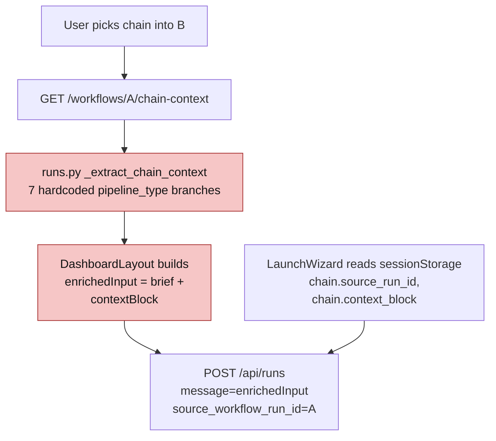
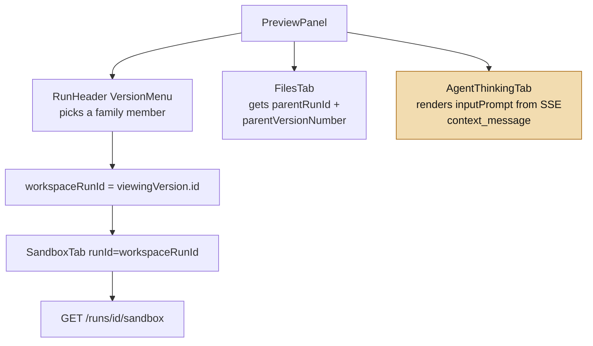
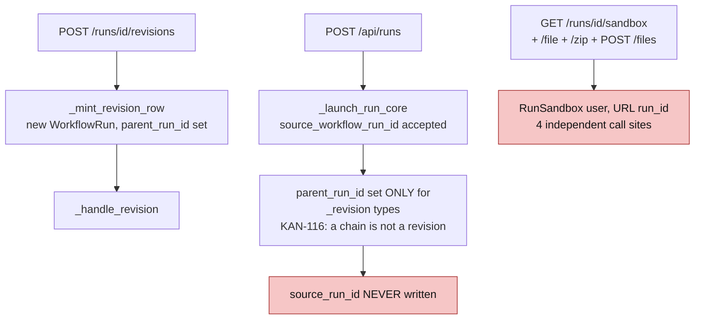
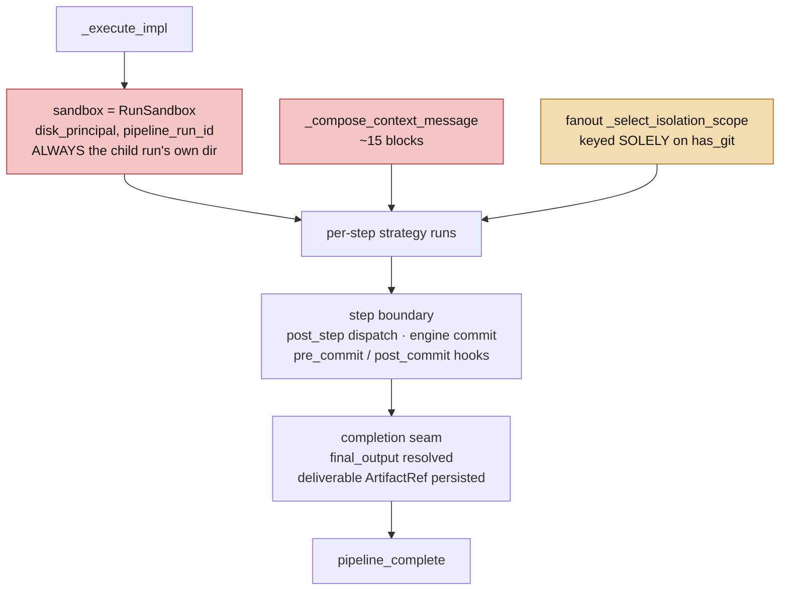
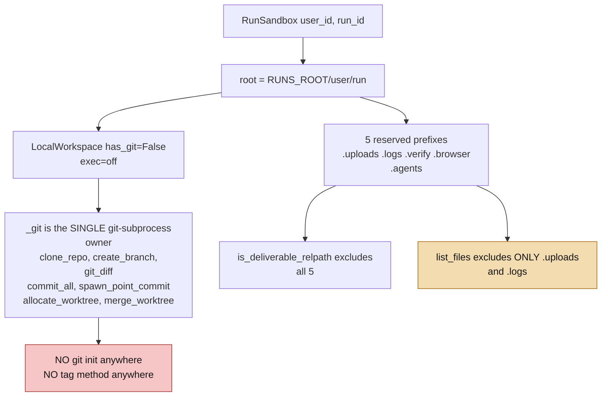
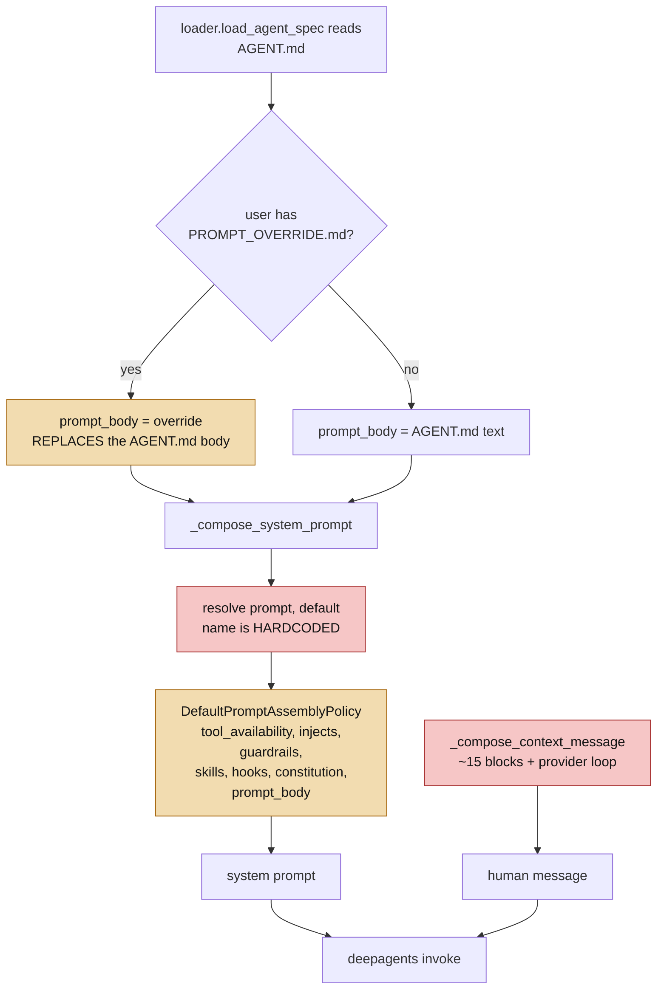

# Layers — user input to LLM call

Spec 019 · sandbox reuse, git versioning, chain payload, chaining, prompt-injection removal
Analysed against `feat/git-versioning` @ `15d3d6535`, main checkout.

Nine layers, from the click that starts a run to the string handed to the model. Every
layer is listed for every requirement, including the ones it does not touch — a layer
tagged **no change** is a checked result, not an omission.

**On diagrams.** One activity diagram per *layer* plus one end-to-end spine — not one per item; roughly
seventy items across nine layers would produce seventy diagrams nobody reads. Where a requirement's path
matters more than a layer's, its diagram lives with that requirement in [`03-phasing.md`](03-phasing.md) and
[`spec.md`](../spec.md). L3, L5 and L6 carry no diagram: their changes are additive fields with no
branching to draw.

## Requirement key

| id | requirement |
|---|---|
| **R1** | Every revision runs on the existing sandbox, not a newly minted one |
| **R2** | Each sandbox has git enabled; agents commit their work when done |
| **R3** | The last agent commits and tags the result `v1` / `vN` |
| **R4** | Agent prompts change so those agents know to commit, tag, write the chain payload |
| **R5** | The Workspace surface gets a dropdown of tags to switch versions |
| **R6** | The last agent prepares a `.chain/` folder — logs, final output, summary |
| **R7** | Chaining copies the source run's `.chain/` into the new sandbox |
| **R8** | The chained-into pipeline is told about `.chain/`, how to read it, plus the new request |
| **R9** | Global: remove engine-side prompt injection — the agent gets only its own prompt |

## The spine — every layer, every load-bearing component

**How to read it.** Every node is a real file, with the line reference where one is
load-bearing. The tag is a verdict, not a guess — each was checked against source.

🟢 **no change** — investigated and confirmed already agnostic to this feature set.
🔴 **changes needed** — code in that component has to change.
🟡 **reused as-is** — its own code does not change, but it is load-bearing for the new
behaviour, so it is called out separately from 🟢.
⛔ **prerequisite** — a live defect in shipped code that this feature would expose. Not
part of the feature; must land before it.

```mermaid
%%{init: {"flowchart": {"htmlLabels": true, "wrappingWidth": 340, "nodeSpacing": 45, "rankSpacing": 45}}}%%
flowchart TD

  subgraph L1["L1 · Frontend composer"]
    direction TB
    DL["DashboardLayout.tsx :1810-1965<br/>builds enrichedInput = brief +<br/>contextBlock<br/>🔴 retire or coordinate"]
    RI["lib/runInput.ts parseRunInput<br/>🟡 canonical marker parser — keep<br/>in sync"]
    LW["LaunchWizard.tsx :830-833<br/>🟢 chain ids already threaded"]
    DL ~~~ RI ~~~ LW
  end

  subgraph L4["L4 · API routes"]
    direction TB
    RCM["run_commands.py _mint_revision_row<br/>· _launch_run_core<br/>🔴 write source_run_id · add the<br/>FR-004 lock"]
    RF["run_files.py :234,534,590,650<br/>🔴 FOUR RunSandbox sites must<br/>resolve the root key"]
    ECC["runs.py :611-813<br/>_extract_chain_context<br/>🔴 seven hardcoded pipeline_type<br/>branches"]
    CRI["runs.py :211-260 _compute_root_ids<br/>🟡 cycle-guarded walk — prior art<br/>for FR-001"]
    SH["runs.py :1625 GET /s/token ·<br/>UNAUTHENTICATED<br/>🟡 safe only while the deliverable<br/>exclusions hold"]
    RCM ~~~ RF ~~~ ECC ~~~ CRI ~~~ SH
  end

  subgraph L5["L5 · Persistence"]
    direction TB
    WR["models/workflow.py :62<br/>parent_run_id · :76 source_run_id<br/>🔴 +git_tag · start writing<br/>source_run_id"]
    AG["artifacts/graph.py ARTIFACT_KINDS<br/>🟢 summary already recognised — no<br/>migration"]
    WR ~~~ AG
  end

  subgraph L6["L6 · Compiler"]
    direction TB
    CMP["compiler.py :277,346<br/>🔴 one declared chain flag"]
    PLN["plan.py :410 hooks · :515 is_leaf<br/>🟢 both already exist — this is why<br/>R2/R3 are cheap"]
    PC["permission_caps.py :84,93<br/>git=False<br/>🟡 flips only when a declared<br/>hook requires git"]
    CMP ~~~ PLN ~~~ PC
  end

  subgraph L7["L7 · Execution kernel"]
    direction TB
    EXE["engine.py _execute_impl ·<br/>RunSandbox<br/>🔴 THE key change — resolve to the<br/>chain root"]
    TRC["engine.py run · RunTrace<br/>RunSandbox<br/>🔴 built BEFORE resolution —<br/>orphans every log"]
    PST["engine.py step-boundary commit<br/>🔴 NEW — engine commits, gated<br/>on has_git, before routing"]
    CAN["engine.py cancel · caught AFTER<br/>the commit<br/>🔴 wip: commit on post_run"]
    FAN["fanout.py _select_isolation_scope<br/>🔴 keyed SOLELY on has_git —<br/>reroutes every fan-out"]
    SWP["main.py sweep · protects run ids,<br/>matches dir names<br/>🔴 chain-aware, or it deletes a<br/>live revision"]
    RLG["run_log.py · .logs/run-logs.jsonl<br/>is a FIXED path<br/>🔴 a shared dir merges every<br/>revision's trace"]
    CCM["engine.py _compose_context_message<br/>· ~15 blocks<br/>🔴 R9 seam 2 — needs block-by-block<br/>triage"]
    EXE ~~~ TRC ~~~ PST ~~~ CAN ~~~ FAN ~~~ SWP ~~~ RLG ~~~ CCM
  end

  subgraph L8["L8 · Runtime and workspace"]
    direction TB
    MW["local.py merge_worktree · a<br/>REFUSED merge<br/>returns conflicts=[] then --abort<br/>destroys the prior<br/>⛔ PREREQUISITE — silent total data<br/>loss"]
    G3["merge/git_3way.py · loops merge<br/>per fragment<br/>with NO commit between<br/>⛔ PREREQUISITE — other half of the<br/>same bug"]
    LOC["local.py · the single<br/>git-subprocess owner<br/>🔴 NO git init anywhere · no tag ·<br/>no gc policy"]
    RSB["sandbox.py RunSandbox · 5 reserved<br/>prefixes<br/>🔴 root key · has_git · .git +<br/>.gitignore exclusions"]
    PRV["previous_run.py + kernel_services<br/>read_parent_file<br/>🔴 short-circuit · root-resolve ·<br/>prefix guard"]
    SEC["hooks/secret_scan.py declares<br/>pre_commit<br/>🔴 pre_commit is FIRED NOWHERE —<br/>history unscanned"]
    PRT["runtime/base.py Workspace Protocol<br/>🟢 STAYS SHUT — 3 import-linter<br/>contracts"]
    MW ~~~ G3 ~~~ LOC ~~~ RSB ~~~ PRV ~~~ SEC ~~~ PRT
  end

  subgraph L9["L9 · Prompt assembly"]
    direction TB
    FAC["factory.py :660 · resolve prompt,<br/>default<br/>🔴 the policy name is HARDCODED —<br/>one line"]
    POL["capabilities/prompt/policy.py :60<br/>· 7-block order<br/>🔴 a body-only order drops SIX<br/>blocks, not one"]
    OVR["prompt_overrides.py · override<br/>REPLACES the body<br/>🔴 silently shadows every new<br/>instruction"]
    SRC["context_providers/chain_context ·<br/>NEW<br/>🔴 clone of previous_run's gate +<br/>assert_owns"]
    AGM["prompts/*/AGENT.md · 94 files<br/>🔴 rewritten under Q4 — say<br/>where to look and how"]
    FAC ~~~ POL ~~~ OVR ~~~ SRC ~~~ AGM
  end

  MODEL[["deepagents runtime · the actual<br/>model call<br/>🟢 no workflow concept at all"]]

  subgraph L3["L3 · Frontend data"]
    direction TB
    API["lib/api.ts :1086-1201<br/>🔴 ref param on 4 fns +<br/>getRunSandboxRefs"]
    UWH["hooks/useWorkflow.ts :1036<br/>🟢 inputPrompt is a pure<br/>passthrough"]
    API ~~~ UWH
  end

  subgraph L2["L2 · Frontend run surface"]
    direction TB
    ST["SandboxTab.tsx :887<br/>🔴 renders EMPTY for revisions once<br/>routes re-key"]
    RH["RunHeader.tsx VersionMenu · a<br/>SHIPPED feature<br/>🔴 breaks the moment L4 re-keys"]
    ATT["AgentThinkingTab · renders the<br/>context_message<br/>🔴 goes near-empty under R9"]
    ST ~~~ RH ~~~ ATT
  end

  L1 --> L4 --> L5 --> L6 --> L7 --> L8 --> L9 --> MODEL --> L3 --> L2

  classDef nochange fill:#d3f9d8,stroke:#2f9e44,color:#1b1b1b;
  classDef changed  fill:#ffe3e3,stroke:#e03131,color:#1b1b1b;
  classDef reused   fill:#fff3bf,stroke:#e8590c,color:#1b1b1b;
  classDef prereq   fill:#ffa8a8,stroke:#c92a2a,color:#1b1b1b,stroke-width:3px;
  classDef terminal fill:#e7e7e7,stroke:#495057,color:#1b1b1b;

  class LW,AG,PLN,PRT,UWH nochange;
  class DL,RCM,RF,ECC,WR,CMP,EXE,TRC,PST,CAN,FAN,SWP,RLG,CCM,LOC,RSB,PRV,SEC,FAC,POL,OVR,SRC,API,ST,RH,ATT changed;
  class RI,CRI,SH,PC,AGM reused;
  class MW,G3 prereq;
  class MODEL terminal;
```

**What the picture says.** Three layers carry the work — **L7 kernel**, **L8 runtime**,
**L9 prompt assembly**. L5 and L6 take small additive changes, and that is the good news:
`Step.hooks` and `is_leaf` already exist, which is why the commit seam and tagging are days rather than weeks.
L1–L3 are mostly consequences of decisions made further down.

The two ⛔ nodes are the ones to look at first. They are not part of this feature — they
are already in `main`, dormant only because no artifact sandbox has ever had `has_git=True`.
Requirement 2 is what wakes them.

Seven 🟢 nodes are load-bearing *because* they need no change: the `Workspace` Protocol
stays shut, `Step.hooks` and `is_leaf` already ship, and `summary` is already a recognised
artifact kind. Every mechanism this feature does not have to build is a week it does not cost.

---

## L1 — Frontend composer

Pre-run surfaces: the composer canvas, agent selection, the launch wizard.

| item | file | R | change | sev |
|---|---|---|---|---|
| Launch wizard chain threading | `frontend/src/components/workflow/LaunchWizard.tsx:830-833` | R7 | **no** | low |
| Chain text-block assembly | `frontend/src/components/layout/DashboardLayout.tsx:1810-1965` | R8 | **YES** | high |
| Composer canvas, agent picker | `frontend/src/components/workflow/*` | R1–R6, R9 | **no** | low |

**R8 changes.** The chained context block is assembled **on the frontend today** — `handleChainPipeline`
and `handleChainFromHistory` fetch `chain-context`, string-concatenate `enrichedInput = brief + contextBlock`,
and send that as `LaunchCommand.message`. Adding a file-based `.chain/` channel without retiring this
gives agent B the same information twice in two formats. Either retire this assembly in favour of the
server-side mechanism, or gate it on the absence of a chain payload. The failure fallback at
`DashboardLayout.tsx:1828,1927` also hardcodes `workflowType === "ppt" || "prototype"` client-side —
if it survives, it should stop special-casing built-in type strings.

---

## L2 — Frontend run surface

The run screen: `PreviewPanel` and the tabs mounted in it.

| item | file | R | change | sev |
|---|---|---|---|---|
| `SandboxTab` file listing | `frontend/src/components/results/SandboxTab.tsx` | R1 | **YES** | high |
| `SandboxTab` reserved-prefix sections | `SandboxTab.tsx:77-170` | R6 | **YES** | medium |
| `SandboxTab` version props | `SandboxTab.tsx:887` | R5 | **YES** | medium |
| `.git/` in the listing | via `sandbox.py` `list_files` | R2 | **YES** | medium |
| `v{revision_index}` chip | `RunDetailPage.tsx:441-455`, `RevisionFamilyView.tsx:727-729` | R3 | **YES** | low |
| `AgentThinkingTab` / `AgentDetailPanel` input-prompt viewer | `frontend/src/components/results/` | R9 | **YES** | medium |
| `RunHeader` VersionMenu | `frontend/src/components/preview/RunHeader.tsx:23-120` | R5 | **no** | low |

**R1 changes.** If the engine re-keys the sandbox to a chain root while these tabs keep asking for
the request's own `run_id`, a revision's Workspace, Files and Preview tabs render an **empty
directory**. This is a functional break, not a cosmetic one, and it must land in the same change
as the L4/L7 key change.

**R6 changes.** `SandboxTab` already groups by reserved prefix with dedicated sections for `.agents/`
and `.verify/`. Adding a `.chain/` section follows that exact pattern. Note the correction: `list_files`
excludes only `.uploads/` and `.logs/` — `.verify/`, `.browser/` and `.agents/` are all **listed** today.

**R2 changes.** Once `.git/` is real it must be excluded from `list_files`, or the Workspace tab renders
thousands of loose git objects.

**R3 changes.** `v1`/`v2`/`vN` display **already ships** from `revision_index`. Only a "tagged" badge
is new.

**R5 changes.** See the disambiguation in `report.md` — under reading (a) this layer is prop-threading
that mirrors `FilesTab`; under reading (b) it is a new `selectedRef` state plus a tag picker.

**R9 changes.** No code change is strictly required, but `inputPrompt` is sourced verbatim from the
SSE `agent_input` event's `context_message` (`frontend/src/hooks/useWorkflow.ts:1036`). Removing engine-side
composition empties a user-facing transparency panel whose entire purpose is showing what the agent was
given. That is a product regression to accept deliberately, not discover later.

---

## L3 — Frontend data

Hooks, the API client, SSE replay, shared TS types.

| item | file | R | change | sev |
|---|---|---|---|---|
| `getRunSandbox` / `File` / `Blob` / `Zip` | `frontend/src/lib/api.ts:1086-1201` | R5(b) | **YES** | low |
| `FamilyMember` type | `frontend/src/types/index.ts:428-440` | R3 | **YES** | low |
| `inputPrompt` passthrough | `frontend/src/hooks/useWorkflow.ts:1036` | R9 | **no** | low |
| `SandboxFile` / `SandboxListing` | `frontend/src/lib/api.ts:1067-1090` | R6 | **no** | low |
| `RunConnectionProvider`, SSE replay | `frontend/src/providers/`, `frontend/src/hooks/` | R1, R2, R7, R8 | **no** | low |

**R3 changes.** Add optional `git_tag: string | null` to `FamilyMember`. No SSE shape change — the tag
is a post-hoc DB stamp read through `/family`, exactly as `revision_index` already is.

**R5(b) changes.** Add an optional `ref` query param to the four sandbox functions and a new
`getRunSandboxRefs`. Under reading (a) this layer needs nothing at all — a version switch already
calls the same function with a different `runId`.

---

## L4 — API routes

FastAPI REST, SSE and WebSocket.

| item | file | R | change | sev |
|---|---|---|---|---|
| Four `RunSandbox(...)` constructions | `backend/app/api/run_files.py` — upload, list, zip, read | R1 | **YES** | high |
| `_extract_chain_context` | `backend/app/api/runs.py:611-813`, branches at `699-778` | R8 | **YES** | high |
| `resolve_launch_od_context` | `backend/app/api/launch_context.py` (138 lines) | R9 | **YES** | high |
| `FamilyMemberResponse` | `backend/app/api/runs.py:1120` | R3 | **YES** | low |
| `source_run_id` write | `backend/app/api/run_commands.py` `_launch_run_core` | R7 | **YES** | low |
| Sandbox single-file read prefix gate | `backend/app/api/run_files.py` (`.uploads/` + `.logs/` only) | R6 | **YES** | low |
| Ref-scoped reads + `GET /sandbox/refs` | `backend/app/api/run_files.py` | R5(b) | **YES** | high |
| `_mint_revision_row`, `create_revision`, revision channel | `backend/app/api/run_commands.py` | R1 | **no** | low |
| Any git endpoint | — | R2 | **no** | low |

**R1 changes.** The four `run_files.py` call sites each build `RunSandbox(current_user.id, run_id)`
from the URL's own `run_id`, entirely outside the engine path. Each must resolve the **same** effective
key the kernel now uses. Miss one and that route silently serves an empty directory.

**R8 changes.** `_extract_chain_context` hardcodes seven `pipeline_type` branches (`runs.py:699-778`)
to decide what to extract, with a crude `else: final output` fallback. It is API-layer, so it does not
violate INV-1 literally — but a custom-to-custom chain gets only the fallback, never the rich extraction
built-ins get. That is a pre-existing SC-001-adjacent gap. R8 should either generalise it or declare it
out of scope explicitly.

**R9 changes.** `launch_context.py` is itself the **completed** SC-001 fix (D-15/C, Phase 37) that replaced
a `pipeline_type == "od_prototype"` branch with eligibility keyed on the declared `context_providers: [opendesign]`
manifest signal. Removing its call does not just orphan data — see L5.

**R7 changes.** `source_run_id` exists (`models/workflow.py:76`, migration 0014), is exposed on the response
schema (`runs.py:126`) with a comment claiming it is set on chaining, and is **never assigned anywhere**
(verified). Writing it for the first time is smaller than adding a column and fixes the dead "(Chained)"
indicator as a side effect.

---

## L5 — Persistence

SQLAlchemy models, the linear alembic chain, the artifact store.

| item | file | R | change | sev |
|---|---|---|---|---|
| `WorkflowRun.git_tag` | new migration (latest is `0040_workflow_run_share_token`) | R3 | **YES** | medium |
| `WorkflowRun.od_context_json` + resume | `models/workflow.py:107`, `engine.py` `resume_run` | R9 | **YES** | high |
| `source_run_id` population | `models/workflow.py:76` | R7 | **YES** | low |
| Chain-root key: walk vs materialised column | `models/workflow.py:62` `parent_run_id` | R1 | **decision** | medium |
| `Workspace` model | `models/workspace.py` | R2 | **no** | low |
| `ARTIFACT_KINDS` already has `summary` | `agents/artifacts/graph.py` | R6 | **no** | low |
| `WorkflowDefinition.attached_hooks` | `models/workflow_definition.py:70` | R4 | **no** | low |

**R1 decision.** `parent_run_id` points at the **immediate** parent only, so a revision-of-a-revision needs
either an O(depth) walk at key-resolution time (zero migration) or a materialised `root_run_id` column
(O(1), one additive nullable column). Recommend the walk first; add the column only if depth is measured
to matter.

**R3 changes.** One nullable `git_tag` column. Do **not** add a `version_number` column — `revision_index`
from the family walk already serves the displayed version, and `git_tag` should mean only "a real git tag
object was created".

**R9 changes.** `od_context_json` is persisted at run creation *specifically so* `resume_run` can rebuild
it after a backend restart. Removing launch-time population silently breaks resume of any in-flight
`od_prototype`/`od_ppt` run across a restart — the run continues with different context than its earlier
steps had. This must be handled, not orphaned.

---

## L6 — Compiler

`manifest -> CompiledWorkflow / ExecutionPlan`.

| item | file | R | change | sev |
|---|---|---|---|---|
| Commit capability registration | none — the commit is an engine call (L7); `post_step` is singular and already taken | R2 | **no** | low |
| Declared chain-payload flag | `backend/agents/workflows/plan.py`, `compiler.py` | R7 | **YES** | medium |
| `context_providers` threading | `compiler.py:277,346`; `manifest.py:73,294,348` | R9 | **YES** | high |
| `git` permission binding | `backend/agents/workflows/permission_caps.py:84,93` — `False` in both caps; flips only when a declared hook requires `git` | R2, R4 | **conditional** | high |
| `Step.hooks` field + registry validation | `plan.py:410`, `compiler.py` | R2, R3 | **no** | low |
| `_compute_is_leaf` | `compiler.py` | R3 | **no** | low |
| `REVISION_BASE_MAP` | `backend/agents/registry.py:145-153` | R1 | **no** | low |

**R2/R3 changes are small because the seam already exists — and it is `Step.hooks`, not `post_step`.**
`Step.post_step` is singular (`str | None`) and already taken on four shipped manifests, including all
three prototype revision workflows (`revision_validation`), so a commit cannot ride it. `Step.hooks` is a
list, validated against the capability registry and dispatched by `_fire_hooks` on the permission-bound
contract that already exists. The commit itself is an engine call at the step boundary; R2 and R3 add
hook *events*, not capabilities, and neither needs compiler schema work.

**R4 conditional.** `permission_caps.py` is the sole authority on tool permissions and sets `git=False`
in **both** trust caps, with a docstring saying git is off "because nothing binds them yet". `PERMISSION_TOOLS`
has no `git` key. **There is no agent-callable git tool in this codebase.** Q2 chose engine-driven, so no
git tool is built and the engine's own commit bypasses the cap. The cap is still the switch for hooks: a
declared hook whose `required_permission` is `git` binds only once the cap allows it, so the first such
hook flips `git=True` in the same PR — one line, in the one file allowed to widen a permission.

**R7 changes.** Mirror `revises_existing`: a declared flag compiled into a ctx field. Never fire on the raw
presence of a source id — `previous_run.py` was deliberately hardened (WR-06) so a stray parent id cannot
trigger an unintended cross-run seed.

---

## L7 — Kernel

`execution_engine`: engine, state machine, strategies, gates, post_step dispatch, hook dispatch.

| item | file | R | change | sev |
|---|---|---|---|---|
| Sandbox construction — `_execute_impl` | `engine.py`, the primary sandbox | R1 | **YES** | high |
| Sandbox construction — `run()` `RunTrace` | `engine.py`, built **before** `_execute_impl` | R1, R6 | **YES** | high |
| Sandbox construction — `create_runner` | `factory.py`, keyed on `ctx.run_id` | R1 | **YES** | medium |
| Step-boundary commit, gated on `has_git`, fired before routing | `engine.py` step boundary; `if _routed: … continue` still skips `post_step` only | R2, R3 | **YES** | high |
| Stop-button cancel skips the step commit | `engine.py` cancel raise, caught after the commit; `wip:` commit on `post_run` | R1, R2 | **YES** | high |
| `_fire_hooks` new events `pre_commit`, `post_commit`, `post_run` | `engine.py:6316` `_fire_hooks` — three events today, dispatch contract unchanged | R2, R3, R6 | **YES** | medium |
| `.logs/run-logs.jsonl` is a fixed path | `execution_engine/run_log.py` | R1, R6 | **YES** | high |
| Revision ordinal unreachable from a capability | `execution_engine/context.py` | R3 | **YES** | medium |
| `has_git` provenance | same site + `RunSandbox.__init__` | R2 | **YES** | high |
| Fan-out isolation scope | `execution_engine/fanout.py` `_select_isolation_scope` | R2 | **YES** | high |
| `_compose_context_message` ~15 blocks | `engine.py` | R9 | **YES** | highest |
| `_seed_workflow_context`, `_compose_input_blocks` | `engine.py` | R9 | **YES** | high |
| Completion seam chain-payload writer | `engine.py` completion seam | R6 | **YES** | high |
| New `chain_source_run_id` ctx field | `execution_engine/context.py` | R7 | **YES** | low |
| TTL sweep protected set | `backend/app/main.py` periodic sweep | R1 | **YES** | high |
| `post_step` dispatch loop | `engine.py:3425-3426` — stays with `revision_validation` / `api_prefix_audit` | R2, R3 | **no** | low |
| `is_leaf` runtime consumption | `engine.py:3430+` | R3 | **no** | low |
| `is_first_agent` marker split | `engine.py` `_compose_context_message` | R8 | **no** | low |
| `resume_run` | `engine.py` | R9 | **YES** | high |

**R1 changes.** Keying the sandbox off a resolved chain root is genuinely small — `parent_run_id` is already
threaded end-to-end into `_execute_impl`. But it is **not one site.** `run()` builds
`RunTrace(RunSandbox(user_id, pipeline_run_id).root)` before `_execute_impl` is entered, so the run-log
keeps landing in a per-revision directory that nothing else writes to and the sweep fix does not
protect — and that is the very file R6's chain payload is meant to point at. `create_runner` keys on
`ctx.run_id`, so it follows only if root resolution reassigns that variable rather than a local. The walk
itself must carry a visited-set cycle guard: `_compute_root_ids` in `runs.py` already performs exactly
this walk and names the cyclic-chain threat as T-A-04.

**R2/R3 change — the commit seam.** The commit is engine-driven at the step boundary, gated on
`has_git`, and fires before the routing decision consumes a gate's outcome — so a routing pass, including
every backward jump of a retry loop, is captured. It does not ride `post_step`: that field is singular
and already taken by `revision_validation` on all three prototype revision workflows, and the engine
skips it outright on a routing pass (`if _routed: … continue`). Hooks bracket the commit on the existing
`_fire_hooks` contract — `pre_commit` may block, `post_commit` observes — bound only where the step's
permissions grant `git`, exactly the case its docstring already anticipates (HOOK-02).

The rest of the danger is elsewhere: `main.py`'s periodic sweep builds
`protected_run_ids` from **run ids**, and `sweep_expired` matches those against **directory basenames**. Once
the directory is named after the root, a terminal parent plus a live child means the live child's directory
is unprotected and can be deleted mid-run. Fix in the same change; this is not a follow-up.

**R2 changes.** Two, and the second is the trap. First, `has_git` must be threaded and a real `git init` must
happen — `git init` is called **nowhere** in this codebase; the only path to a `.git` directory is `clone_repo`.
Without it, `commit_all` catches `CalledProcessError` and returns `""`, so the whole feature is a permanent
silent no-op. Second, `_select_isolation_scope` derives worktree-vs-sub_sandbox **solely** from `has_git`, with
an explicit comment that the scope is never manifest-driven. Turning `has_git` on globally silently reroutes
every fan-out step from `sub_sandbox` + `copy_disjoint` to `worktree` + `git_3way`.

**R3 is one new event.** Tagging fires on `post_run` (FR-061) at the terminal path, after the final status is
known — not on a leaf step: a workflow has many leaves (conditional-gate siblings are leaves by
construction), a leaf does not always end the walk, and a step-level trigger cannot see the run's status.
`post_run` also takes `git gc` and the `.chain/` write, so the terminal path has one declared seam rather
than three inline calls.

**R6 changes.** One best-effort, never-raising call at the completion seam, alongside the budget-snapshot
persist, mirroring `write_agent_output`'s contract.

**R9 changes.** This is the largest single item in the set. Every block in `_compose_context_message` carries
an in-code comment tying it to INV-1/INV-3/SC-001 — retry feedback, planning context, provider OD blocks,
consumed outputs, prior artifact, redo directive, spec-revision context, user guidance, revision analysis,
prototype HTML, build task. They are individually removable, which makes block-by-block triage tractable, but
someone has to do that triage before R9 is a task rather than a direction.

---

## L8 — Runtime and workspace

`RunSandbox`, the `Workspace` port, `LocalWorkspace`, deliverables, merge.

| item | file | R | change | sev |
|---|---|---|---|---|
| `RunSandbox.__init__` key | `backend/app/agents/sandbox.py` | R1 | **YES** | high |
| `sweep_expired` protected-name matching | `backend/app/agents/sandbox.py` | R1 | **YES** | high |
| Concurrent-revision isolation | `runtime/local.py` `allocate_worktree` | R1 | **YES** | high |
| `git init` — **missing entirely** | `backend/app/agents/runtime/local.py` | R2 | **YES** | high |
| `has_git` param on `RunSandbox` | `backend/app/agents/sandbox.py` | R2 | **YES** | high |
| `merge_worktree` false-clean merge | `runtime/local.py`, `fanout.py`, `merge/git_3way.py` | R2 | **YES — prerequisite** | critical |
| `git init` must leave an initial commit | `runtime/local.py` | R2 | **YES** | critical |
| Secret scanning on commit and chain payload | `capabilities/hooks/secret_scan.py` — `pre_commit` fires nowhere | R2, R6 | **YES** | high |
| `.gitignore` seeding — **seven** paths | `runtime/local.py` at init | R2, R6 | **YES** | high |
| `.gitignore` itself excluded from listing + deliverable | `sandbox.py` `_DELIVERABLE_EXCLUDE` | R2 | **YES** | medium |
| `skills/` — a sixth engine-written dir | `backend/app/agents/skill_staging.py` | R2 | **YES** | high |
| No delete path out of an accumulating sandbox | deliverable walk; no agent delete tool exists | R1 | **YES** | high |
| `.git/` exclusion in **both** lists | `sandbox.py` deliverable walk + `list_files` | R2 | **YES** | high |
| `commit_all` passthrough on `RunSandbox` | `backend/app/agents/sandbox.py` | R2 | **YES** | medium |
| `create_tag` on `LocalWorkspace` | `runtime/local.py`, duck-typed | R3 | **YES** | high |
| Tag-name derivation vs displayed `vN` | `runtime/local.py` + `runs.py` `revision_index` | R3 | **YES** | medium |
| `ref` validated against `list_tags()` | `runtime/local.py` `_git` | R5(b) | **YES** | medium |
| No `gc` / `repack` / size policy | `runtime/local.py` | R2 | **YES** | low |
| `list_tags` + ref-scoped read | `runtime/local.py` | R5(b) | **YES** | high |
| `_CHAIN_PREFIX` + writer helper | `backend/app/agents/sandbox.py` | R6 | **YES** | high |
| `read_chain_source_file` | `execution_engine/kernel_services.py` | R7 | **YES** | medium |
| `Workspace` Protocol | `backend/agents/runtime/base.py` | all | **no** | — |

**The port stays shut.** `Workspace` (the Protocol) has `read_file`, `write_file`, `search`, `clone_repo`,
`create_branch`, `git_diff`, `exec_command`, `teardown` — and no commit or tag. `LocalWorkspace` already has
`commit_all` and `spawn_point_commit`, reached **only** via `getattr(ws, "commit_all", None)` duck-typing from
`fanout.py` and `kernel_services.py`. That is the established pattern for adding workspace capability without
widening the port, and it keeps the three import-linter contracts green. Every new method here follows it.

**R2 is the load-bearing gap.** No `git init` means flipping `has_git=True` produces a silent no-op forever,
and a naive `git add -A` without a seeded `.gitignore` sweeps owner-uploaded documents, engine traces, verify
evidence, browser screenshots and every sibling agent's transcript into permanent git history.

---

## L9 — Prompt assembly

Context providers, the context pack, the prompt policy, the factory, the deepagents runtime.

| item | file | R | change | sev |
|---|---|---|---|---|
| Policy name resolution is hardcoded | `backend/agents/factory.py` `resolve("prompt", "default")` | R9 | **YES** | high |
| `DefaultPromptAssemblyPolicy` order | `capabilities/prompt/policy.py:60` | R9 | **YES** | high |
| `_compose_injection` — template, design_system, craft | `backend/agents/factory.py` | R9 | **YES** | high |
| Context providers | `capabilities/context_providers/*.py` | R9 | **YES** | high |
| 94 `AGENT.md` files | `backend/agents/prompts/*/AGENT.md` | R4 | **YES** | high |
| Per-user override shadowing | `backend/agents/factory.py` override branch | R4 | **YES** | high |
| New `chain_context` context provider | new file under `capabilities/context_providers/` | R7, R8 | **YES** | high |
| Body-only policy also drops constitution + hooks | `capabilities/prompt/policy.py`, `factory.py` | R9 | **YES** | high |
| No workflow opts into the new policy | every `workflow.yaml` | R9 | **YES** | high |
| `previous_run` reserved-prefix guard | `capabilities/context_providers/previous_run.py` | R6 | **YES** | medium |
| `previous_run` seeding becomes redundant | same file | R1 | **YES** | medium |
| Behavioral-hooks block | `capabilities/hooks/behavioral.py` | R4 | **alternative** | — |

**R9's mechanism is smaller than it looks.** The block order is *already* a registered capability —
`DefaultPromptAssemblyPolicy`, kind `prompt`, name `default`, `user_allowed=True`. "Only the agent's actual
prompt" is a second registered policy whose order is `("prompt_body",)`. The one engine change is that
`factory.py` hardcodes the policy name; it must come from the manifest, defaulting to `default`. Existing
workflows keep `default`, so the characterization snapshots stay green. What R9 *cannot* reach this way is
`_compose_context_message` — that is a separate seam on the human message, and it needs the block-by-block
triage described in L7.

**R4 grew, it did not shrink.** Q2 chose engine-driven commits, so no agent needs telling about git —
but Q4 removed the context-message seam entirely, so every migrated agent must now be told *where its
context lives on disk and how to find it*. That is a genuine rewrite of the built-in prompts, and the
per-workflow migration behind it is Phase 7's bulk. See `../spec.md` FR-046 – FR-049.

**R4's other blocker is not the 94 files either.** It is that the per-user override **replaces** `prompt_body` wholesale.
Any user who has ever saved a `PROMPT_OVERRIDE.md` will silently never receive new git/tag/chain instructions.
The migration story is incomplete without handling them.

**R1's cleanup.** Once the sandbox is shared, `previous_run`'s seed loop is copying files that are already
there. Short-circuit it rather than leaving a redundant double-write that a second concurrent revision could
use to overwrite the first one's edits.
