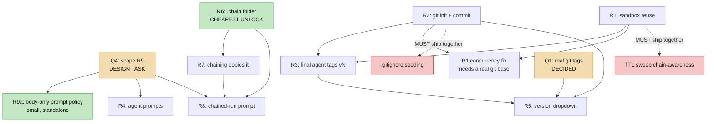

# Report — how to build this, in how many phases

Spec 019 · sandbox reuse, git versioning, chain payload, chaining, prompt-injection removal
Companion to [`01-layers.md`](01-layers.md) and [`02-blast-radius.md`](02-blast-radius.md).

## Headline

Nine requirements. Seven are **feasible with caveats**, one is **blocked on a question only
you can answer** (R5), and one is **a direction rather than a task until someone triages it**
(R9). The engineering is smaller than the requirement list suggests, because four of the five
mechanisms this needs already exist in the codebase and are proven in production. What is
genuinely missing is narrower and more specific than "add git": there is **no `git init`
anywhere in this repo**, and no `commit` or `tag` on any workspace surface.

The order matters more than the effort. Two items must ship inside another item's pull
request or they become silent production bugs; one item must be *scoped* before two others
can even be estimated.

## Status of each requirement

| # | requirement | verdict | size | gated on |
|---|---|---|---|---|
| R1 | Revision reuses the existing sandbox | feasible, caveats | M | ships with its own sweep fix |
| R2 | Git-enabled sandbox, agents commit | feasible, caveats | M | `git init` does not exist; **Q5** scope |
| R3 | Last agent commits and tags `vN` | feasible, smaller than scoped | S | R2 |
| R4 | Agent prompts change | feasible, caveats | S–L | *how* agents commit (Q2) |
| R5 | Version dropdown in Workspace | feasible, larger reading | L | **Q1 = real git tags** (decided) |
| — | *cross-cutting: no way to delete a file from an accumulating sandbox* | needs a decision | S | FR-033 |
| R6 | `.chain/` folder | feasible, caveats | S | contents (Q3) |
| R7 | Chaining copies `.chain/` | feasible, caveats | M | R6 |
| R8 | Chained pipeline is told about it | feasible, caveats | M–L | R6, R7, R9 scope |
| R9 | Remove engine-side prompt injection | feasible, a real rewrite | L | **Q4 = both seams go, context becomes files** (decided) |

## What already exists — and why that shrinks the work

Four mechanisms this feature set needs are already built, tested and in production:

- **`Step.hooks` + `_fire_hooks`** — a manifest-declarable list of hook names, bound only when the
  step's permissions grant the hook's `required_permission`, with three live events. R2's commit is
  an engine call at the step boundary; `pre_commit` / `post_commit` / `post_run` are new events on
  this seam, not new dispatch machinery. `post_step` is singular and already taken on the revision
  workflows, so it is **not** the seam.
- **`is_leaf`** — the compiler already computes which steps are terminal, correctly across
  conditional and parallel graphs, and the engine already consumes it at runtime. It is **not**
  R3's trigger, though: a workflow has many leaves and a leaf cannot see the run's final status,
  so the tag fires on `post_run` at the terminal path (FR-012, FR-061).
- **Ownership-gated cross-run sandbox reads** — `previous_run.py` already reads named files
  from another run's sandbox, gated on `ScopedStore.assert_owns` with fail-closed semantics,
  fired only on a *declared* manifest flag. R7's copy is a second caller of the same primitives.
- **A registered prompt-assembly policy** — the system-prompt block order is already a
  capability (`DefaultPromptAssemblyPolicy`, `user_allowed=True`), not hardcoded logic.
  Half of R9 is registering a second policy.

The genuinely missing pieces are small and specific: `git init`, a `.gitignore`, a `create_tag`
method, a `.chain/` prefix, one declared chain flag, and one line in `factory.py` that
currently hardcodes a capability name.

## The five decisions

All answered 2026-09-07. Full text and consequences in [`../spec.md`](../spec.md) §2.

| # | decision | what it changed here |
|---|---|---|
| **Q1** | R5 means **real git tags**, not the shipped picker | FR-040/FR-043 in scope; Phase 6 grows |
| **Q2** | the **engine** commits at every step boundary; declared hooks bracket it | no git tool; not a `post_step` (singular, already taken); the `git` permission binds a declared hook |
| **Q3** | **summary + final output + copied logs**, folder renamed **`.chain/`** | FR-016 fixed; disk growth sharpened |
| **Q4** | **remove both prompt seams**; context becomes files | new Phase 7; R4 grows from near-zero to a real rewrite |
| **Q5** | `has_git` is a **global default, on** | FR-034 becomes a ship-blocker — no flag left to stage behind |

**Q4 is the one that reshaped the plan.** The system prompt becomes the agent's own `AGENT.md`; the
user's brief reaches the first agent only; every later agent reads what it needs from the sandbox. It is
buildable because all four channels already exist and are already populated — `.agents/{NN}-{agent_id}.md`
is written for every agent today, `.uploads/` holds extracted text, the shared sandbox carries the
previous revision, and `.chain/` carries the source run. `is_first_agent` already lives in the function
that has to change. What it costs is rewriting the built-in prompts to say where things are, and
migrating each workflow individually before seam 2's code can be deleted.

**Q5's consequence, once.** Global `has_git` moves every fan-out step in every workflow onto git
worktrees and 3-way merge from the first run after deploy, with no per-workflow flag to stage it behind.
The `merge_worktree` defect must therefore be fixed **before this ships**, not before a workflow opts in.

## Dependency order

**R6 is the cheapest unlock in the set.** One constant, one exclusion line, one best-effort writer
mirroring an already-proven pattern, one call at the completion seam, one UI section. It depends
on nothing, and both R7 and R8 are dead without it.

**Two things are not follow-ups.** The TTL-sweep chain-awareness ships *inside* R1's PR, and the
`.gitignore` seeding ships *inside* R2's `git init`. Deferring either converts a design decision
into a silent production bug — see `blast-radius.md`'s closing section.

## Phases

**Phase 0 — decisions.** All five are taken (see "The five decisions" above): Q1 real git tags, Q2
engine-driven commits, Q3 summary + final output + copied logs in `.chain/`, Q4 both prompt seams go and
context becomes files, Q5 `has_git` on globally. Q2 keeps git out of every prompt; Q4 is what makes the
`AGENT.md` rewrite real work rather than nothing (Phase 7). *Done.*

**Phase 1 — `.chain/` foundation (R6).** Reserved prefix, deliverable exclusion, best-effort
writer on the `post_run` hook event (FR-061 — this phase introduces the event, Phase 4 reuses it),
`SandboxTab` section, defensive reserved-prefix guard in `previous_run.py`. Independent of everything
else, unlocks two later phases. *1–2 days.*

**Phase 2 — git foundation (R2).** **Starts with a prerequisite that is not part of the feature:**
`merge_worktree` currently reports a clean merge when git *refused to merge at all*, and its
`git merge --abort` recovery then destroys the previous fragment's work. A fan-out step with two
worktree workers loses everything and the engine says it succeeded. This is reproducible against real
git today; it is dormant only because no artifact sandbox has ever had `has_git=True`. Flipping git on
without fixing it first is how this feature ships as data loss. Fix it, then `git init` **with an
initial commit** (an unborn HEAD hits the same false-clean path), `.gitignore` seeding for every
reserved prefix, `has_git` threading, `commit_all` passthrough, `.git/` and `.gitignore` excluded from
**both** the deliverable walk and `list_files`, and the engine's step-boundary commit with its
`pre_commit` / `post_commit` hook events. `has_git` is a global default (Q5), which silently reroutes
every fan-out step onto git worktrees and 3-way merge. The `.gitignore` covers **seven** paths, not five:
the five existing prefixes plus `.chain/` and `skills/`. *2–3 days, plus dedicated tests for init
idempotency and fan-out activation.*

*Rollout.* Q5 made `has_git` a global default, so this phase does **not** land dark: every workflow's
fan-out moves onto git worktrees from the first run after deploy, with no manifest line to revert. That
is why the FR-034 ship-blocker precedes it and why its tests must be green first. Phase 3 shares the
same shape — it changes behaviour for existing runs and needs a real code revert — which is why its
guards are non-negotiable rather than nice-to-have.

**Phase 3 — sandbox reuse (R1).** Chain-root key resolution, the four `run_files.py` call sites,
the TTL sweep fix, and a fast-fail concurrency guard on the parent row. Re-baseline the three
revision characterization tests. Short-circuit the now-redundant `previous_run` seeding.
*2–3 days.* Ship the advisory lock now; build worktree isolation properly later.

**Phase 4 — tagging (R3).** Tagging on the `post_run` hook event at the terminal path (FR-012, FR-061), a duck-typed `create_tag` on
`LocalWorkspace`, one nullable `git_tag` column, one additive API field, one badge. Reuse
`revision_index` for the displayed version rather than inventing a second counter. Exclude
`diverted` from tagging. *1 day.*

**Phase 5 — chaining (R7, R8).** A declared chain flag, a new ctx field that is **not**
`parent_run_id`, a `chain_context` context provider cloning `previous_run`'s gate-and-ownership
shape, and the first-ever write to the dead `source_run_id` column. Then decide the frontend
question: retire `DashboardLayout`'s text-block assembly, or coordinate it. *3–5 days,* and it
needs Q4 settled first.

**Phase 6 — seam 1 and the tag UI.** The body-only prompt policy, the manifest-selectable policy name,
the tag dropdown and ref-scoped reads. Q1 confirmed the larger reading of R5, so this is ~5-7 days.

**Phase 7 — file-based context (the Q4 architecture).** Remove seam 2, rewrite the built-in `AGENT.md`
files to name the sandbox paths, gate the brief to the first agent, and migrate workflows one at a time
with `prototype` last. Seam 2's code is deleted only when the final workflow is off the default policy.
~6-10 days, and the prompt rewrite — not the plumbing — is the bulk of it.

**Superseded by the above.** R4's 94 `AGENT.md` edits are mechanical and may evaporate
entirely under Q2's engine-driven recommendation; the real work is the per-user override migration
(FR-032), since an override *replaces* the base body and silently shadows new instructions. R5 is a day
or a week depending on Q1. Also here: FR-039 (name which manifests actually adopt the body-only policy —
without it R9 ships a mechanism nobody uses) and FR-040 (`ref` validation), the latter only if Q1 = (b).
*0–9 days, depending on Q1 and Q2.*

**Where the rest of the FRs live.** Rev 3 and rev 4 added requirements that belong inside the phases
above rather than beside them:

| FR | phase | why there |
|---|---|---|
| FR-034 merge false-clean, FR-006 initial commit | **2** | prerequisites — nothing gets `has_git=True` before them |
| FR-035 secret scanning, FR-041 gc/size policy, FR-008b `.gitignore` exclusion | **2** | they are properties of turning git on |
| FR-033 no delete path | **3** | it is a direct consequence of the accumulating sandbox |
| FR-037 per-run log, FR-038 version-picker regression, FR-055 cancel commits what it has (supersedes FR-042) | **3** | all three are caused by the shared directory and must land with it |
| FR-036 tag numbering | **4** | it is part of deciding what a tag is called |
| FR-005a root-resolved cross-run reads | **5** | chaining is where it bites; the revision case is covered by FR-005 |
| FR-043 ref-scoped browsing, FR-044 input-prompt viewer | **6** | both are UI work; FR-043 is in scope under Q1 = real git tags |
| FR-045 do not extend `_extract_chain_context` | — | a standing constraint, not a task |
| **FR-031 `od_context_json` / `resume_run`** | **with R9a / seam 1** | seam 1 is *not* standalone: removing launch-time `od_context` population without moving `resume_run` breaks resume of any in-flight OD run across a restart. Schedule them together |
| FR-052, FR-053, FR-054, FR-059 one committer, merge sequence, conflict adjudication, cancel during fan-out | **2** | they are properties of the merge path FR-034 fixes |
| FR-060 `pre_commit` / `post_commit` events | **2** | they bracket the step-boundary commit |
| FR-061 `post_run` event | **1**, reused in **4** | the `.chain/` writer introduces it; the tag, `git gc` and the `wip:` commit reuse it |
| FR-065 `.context/` — what the run was given, written at sandbox open | **6**, with R9a / seam 1 | seam 1 cannot stop pasting the template and design system until they are on disk |
| FR-062 dirty-tree reconciliation on resume and on shared-root open | **3** | it is what happens when the shared directory meets a restart |
| FR-063 per-run budget, FR-064 no tier gate | — | deferred with stated defaults and revisit triggers, not tasks |
| FR-056, FR-057, FR-058 browse read-only, restore as a forward commit, serve without materialising | **6** | the semantics of the tag UI |
| FR-046, FR-047, FR-048, FR-049, FR-050, FR-051 brief to agent 1, files not blocks, `AGENT.md` guidance, per-workflow migration, retry-only injection | **7** | the file-based context architecture |

No FR is left unscheduled. FR-030 (seam-2 removal) is Phase 7. FR-032 (override migration) is deferred —
there are no production users yet — and says so in the spec.

**R9a — the body-only prompt policy** can ship any time after Q4, independently of every phase
above. It is the smallest item in the set and the only one that is purely additive.

## Rough total

With the five decisions taken — engine-driven commits, real git tags, both prompt seams removed:

| | |
|---|---|
| Ship-blocker — FR-034 merge fix + initial commit | **1–2 days** |
| Phases 1–4 (the core: chain payload, git, reuse, tagging) | **6–9 days** |
| Phase 5 (chaining) | **3–5 days** |
| Phase 6 — body-only policy, ref-scoped reads and tag UI | **5–7 days** |
| Phase 7 — file-based context: seam 2 removal, `AGENT.md` rewrite, per-workflow migration | **6–10 days** |

Summing the table's own bounds: **21–33 days — call it 20–35, four to seven weeks**, the same figure
`00-START-HERE.md` carries. The spread is now implementation rather than decisions, and Phase 7's prompt
rewrite is the widest line. Excludes only FR-032 (override migration), deferred because there are no
production users yet.

## What I would change about the requirements

Three notes, offered as engineering input rather than pushback.

**R9 is two requirements wearing one coat.** The system-prompt half is a clean win available
almost immediately. The context-message half is a significant architectural decision that would
remove the mechanism custom workflows currently use to get context without engine edits. Splitting
them lets you have the first without committing to the second.

**R2's "agents will commit" is better served by the engine committing.** An agent that forgets to
call a tool produces a run with no history and no way to notice. An engine commit that fires after every
step cannot forget. The requirement's intent — a commit per unit of work — is better met by the
mechanism that does not depend on model compliance.

**R5 may already be built.** Please check the existing "Version ▾" menu on a run before we build a
second one.
