# Walkthrough — one prototype, then a revision

Spec 019 · a single story traced end to end, so the changes can be read as a sequence rather than as a
requirement list. Every step names the real component and the change we are making to it, or says
explicitly that it does not change.

Two runs, back to back:

- **Run A** — the user launches a prototype from a brief and gets `prototype.html`, tagged `v1`.
- **Run B** — the user asks the concierge to revise it, and it executes **in the same sandbox**.

Verified against `feat/git-versioning` @ `15d3d6535`. Line numbers drift; the symbol names do not.

**Legend.** 🔴 changes · 🟢 checked, no change · ⛔ prerequisite fix to shipped code · 🆕 new component

**Areas.** 🪝 Hooks · 🌿 Git · 💬 Prompt change · 📁 File creation · 🏷️ Versioning · 🛑 Cancellation and
terminal path · 📦 Sandbox identity and lifetime · 🔗 Chaining. Every changed box in the diagram has a
chip on a dotted line naming its area, and every changed step below states it. The full area table
with FR ids is in `00-START-HERE.md`.

---

## Activity — every component, not just the visible steps

62 components, in the order the run actually touches them. Bands A–H are phases, not layers; each is a
single column, so the whole thing reads top to bottom. Green nodes are the ones worth noticing as much
as the red — they are components that were checked and confirmed to need nothing, which is why the work
is smaller than the requirement count suggests.

Band **E** only fires for a step that fans out; `prototype` does not, but every workflow inherits it the
moment `has_git` goes on globally — which is why the two ⛔ nodes sit there.

```mermaid
%%{init: {"flowchart": {"htmlLabels": true, "wrappingWidth": 340, "nodeSpacing": 30, "rankSpacing": 34}}}%%
flowchart TD

  subgraph AREAS["Areas — one chip per changed box"]
    direction TB
    AR1(["🪝 Hooks"]) ~~~ AR3(["💬 Prompt change"]) ~~~ AR5(["🏷️ Versioning"]) ~~~ AR7(["📦 Sandbox identity"])
    AR2(["🌿 Git"]) ~~~ AR4(["📁 File creation"]) ~~~ AR6(["🛑 Cancel / terminal"]) ~~~ AR8(["🔗 Chaining"])
  end

  subgraph LAUNCH["A · Launch"]
    direction TB
    L1["LaunchWizard.tsx<br/>collects brief, template, DS<br/>🟢 no change"]
    L2["POST /api/runs · launch_run<br/>🟢 no change"]
    L3["_resolve_launch_agents<br/>roster + selections<br/>🟢 no change"]
    L4["launch_context.py<br/>resolve_launch_od_context<br/>🔴 writes .context/ instead"]
    L4 -.- L4a(["📁 Files · 💬 Prompt"])
    L5["_launch_run_core<br/>WorkflowRun minted<br/>🟢 parent_run_id is NULL"]
    L6["_drive_launch_to_queue<br/>_PIPELINE_QUEUES<br/>🟢 no change"]
    L1 ~~~ L2 ~~~ L3 ~~~ L4 ~~~ L4a ~~~ L5 ~~~ L6
  end

  subgraph SANDBOX["B · Sandbox and git"]
    direction TB
    S1["engine.run<br/>RunTrace RunSandbox<br/>🔴 2nd site, runs pre-resolution"]
    S1 -.- S1a(["📦 Sandbox"])
    S2["chain-root walk<br/>parent_run_id + visited set<br/>🆕 mirrors _compute_root_ids"]
    S2 -.- S2a(["📦 Sandbox"])
    S3["_execute_impl<br/>RunSandbox<br/>🔴 keyed on the chain ROOT"]
    S3 -.- S3a(["📦 Sandbox"])
    S4["factory.create_runner<br/>3rd RunSandbox site<br/>🔴 follows ctx.run_id"]
    S4 -.- S4a(["📦 Sandbox"])
    S5["LocalSandboxRuntime<br/>create_workspace<br/>🔴 has_git True by default"]
    S5 -.- S5a(["🌿 Git"])
    S6["LocalWorkspace<br/>⛔ git init + first commit<br/>🔴 seed .gitignore, 7 paths"]
    S6 -.- S6a(["🌿 Git"])
    S7["RunLog · .verify · .browser<br/>🔴 per-run names, not flat"]
    S7 -.- S7a(["📁 Files"])
    S8["main.py periodic sweep<br/>🔴 protect the whole chain"]
    S8 -.- S8a(["📦 Sandbox"])
    S1 ~~~ S1a ~~~ S2 ~~~ S2a ~~~ S3 ~~~ S3a ~~~ S4 ~~~ S4a ~~~ S5 ~~~ S5a ~~~ S6 ~~~ S6a ~~~ S7 ~~~ S7a ~~~ S8 ~~~ S8a
  end

  subgraph COMPILE["C · Compile"]
    direction TB
    C1["compile_for_run<br/>manifest to CompiledWorkflow<br/>🔴 chain flag, outputs"]
    C1 -.- C1a(["🔗 Chaining · 🌿 Git"])
    C2["_validate_dag<br/>_compute_is_leaf<br/>🟢 many leaves is normal"]
    C3["WorkflowResolver<br/>ordered_agents<br/>🟢 no change"]
    C4["clarify gate<br/>2 rounds, 8 topics<br/>🟢 no change"]
    C5["planner<br/>writes PLANNER.md<br/>🟢 already a file agents read"]
    C1 ~~~ C1a ~~~ C2 ~~~ C3 ~~~ C4 ~~~ C5
  end

  subgraph STEP["D · Per step, five times"]
    direction TB
    P1["dispatch loop<br/>cursor over ordered_agents<br/>🟢 no change"]
    P2["loader.load_agent_spec<br/>reads AGENT.md<br/>🔴 rewritten to name paths"]
    P2 -.- P2a(["💬 Prompt"])
    P3["prompt_overrides<br/>override REPLACES the body<br/>🔴 deferred, no users yet"]
    P3 -.- P3a(["💬 Prompt"])
    P4["factory<br/>_compose_system_prompt<br/>🔴 policy name from manifest"]
    P4 -.- P4a(["💬 Prompt"])
    P5["prompt policy<br/>7 blocks today<br/>🔴 body-only order"]
    P5 -.- P5a(["💬 Prompt"])
    P6["_compose_injection<br/>template, design, craft<br/>🔴 gone; read .context/design/"]
    P6 -.- P6a(["💬 Prompt"])
    P7["_compose_context_message<br/>about 15 blocks today<br/>🔴 gone, files instead"]
    P7 -.- P7a(["💬 Prompt"])
    P8["is_first_agent<br/>🔴 brief stops at agent 1"]
    P8 -.- P8a(["💬 Prompt"])
    P9["context providers<br/>opendesign, previous_run<br/>🔴 replaced by disk reads"]
    P9 -.- P9a(["💬 Prompt"])
    P10["deep_agent_runner<br/>deepagents invoke<br/>🟢 no change"]
    MODEL[["the model call<br/>🟢 no workflow concept"]]
    P11["write_agent_output<br/>.agents NN-agent.md<br/>🟢 becomes the channel"]
    P12["task_loop<br/>writes spec, design, tasks<br/>🟢 workers already read disk"]
    P13["validators and gates<br/>html_static, html_render<br/>🟢 no change"]
    P14["engine step-boundary commit<br/>🔴 commit, THEN route"]
    P14 -.- P14a(["🌿 Git"])
    P15["pre_commit / post_commit<br/>🆕 new hook events"]
    P15 -.- P15a(["🪝 Hooks"])
    P16["secret_scan pre_commit<br/>🔴 fired for the first time"]
    P16 -.- P16a(["🪝 Hooks"])
    P17["commit_all<br/>🔴 passthrough on RunSandbox"]
    P17 -.- P17a(["🌿 Git"])
    P1 ~~~ P2 ~~~ P2a ~~~ P3 ~~~ P3a ~~~ P4 ~~~ P4a ~~~ P5 ~~~ P5a ~~~ P6 ~~~ P6a ~~~ P7 ~~~ P7a ~~~ P8 ~~~ P8a ~~~ P9 ~~~ P9a ~~~ P10
    P10 --> MODEL --> P11
    P11 ~~~ P12 ~~~ P13 ~~~ P14 ~~~ P14a ~~~ P15 ~~~ P15a ~~~ P16 ~~~ P16a ~~~ P17 ~~~ P17a
  end

  subgraph FAN["E · Only if the step fans out"]
    direction TB
    F1["fanout<br/>_select_isolation_scope<br/>🔴 has_git flips to worktree"]
    F1 -.- F1a(["🌿 Git"])
    F2["allocate_worktree<br/>per-worker branch<br/>🟢 no change"]
    F3["merge_worktree + git_3way<br/>⛔ false-clean merge fixed<br/>🔴 commit between fragments"]
    F3 -.- F3a(["🌿 Git"])
    F4["_resolve_conflict<br/>human_gate or merge_agent<br/>🔴 reachable for the first time"]
    F4 -.- F4a(["🌿 Git"])
    F1 ~~~ F1a ~~~ F2 ~~~ F3 ~~~ F3a ~~~ F4 ~~~ F4a
  end

  subgraph DONE["F · Completion"]
    direction TB
    K1["completion seam<br/>resolver.resolve<br/>🟢 no change"]
    K2["ArtifactRef via ScopedStore<br/>🟢 no change"]
    KH["post_run hook event<br/>🆕 tag, .chain, gc, wip commit"]
    KH -.- KHa(["🪝 Hooks"])
    K3["tag vN<br/>🔴 HERE, not on a leaf step"]
    K3 -.- K3a(["🏷️ Versioning"])
    K4[".chain/{run_id} writer<br/>🆕 summary, output, logs"]
    K4 -.- K4a(["📁 Files"])
    K5["budget snapshot<br/>🟢 no change"]
    K6["pipeline_complete over SSE<br/>🟢 no change"]
    K7["cancel or fail path<br/>🔴 wip commit, never a reset<br/>🔴 keep worker branches"]
    K7 -.- K7a(["🛑 Cancel / terminal"])
    K1 ~~~ K2 ~~~ KH ~~~ KHa ~~~ K3 ~~~ K3a ~~~ K4 ~~~ K4a ~~~ K5 ~~~ K6 ~~~ K7 ~~~ K7a
  end

  subgraph UI["G · Back to the user"]
    direction TB
    U1["run_files.py<br/>4 RunSandbox sites<br/>🔴 resolve the same root"]
    U1 -.- U1a(["📦 Sandbox"])
    U2["SandboxTab<br/>🔴 hide .git, add .chain"]
    U2 -.- U2a(["🌿 Git · 📁 Files"])
    U3["PreviewPanel<br/>🟢 renders from content"]
    U4["RunHeader VersionMenu<br/>🔴 off in phase 3, tags later"]
    U4 -.- U4a(["🏷️ Versioning"])
    U1 ~~~ U1a ~~~ U2 ~~~ U2a ~~~ U3 ~~~ U4 ~~~ U4a
  end

  subgraph REV["H · The revision, same sandbox"]
    direction TB
    R1["chat post_message<br/>channel is revision<br/>🟢 no change"]
    R2["_classify_revision_tier<br/>🟢 no change"]
    R3["_mint_revision_row<br/>🔴 server-side lock"]
    R3 -.- R3a(["📦 Sandbox"])
    R4["_handle_revision<br/>ScopedStore lookup<br/>🟢 sandbox-independent"]
    R5["_execute_impl again<br/>🔴 the SAME directory"]
    R5 -.- R5a(["📦 Sandbox"])
    R6["previous_run provider<br/>🔴 seed loop short-circuited"]
    R6 -.- R6a(["📦 Sandbox"])
    R7["revision agents<br/>🔴 read prototype.html on disk"]
    R7 -.- R7a(["💬 Prompt"])
    R8["tag v2<br/>🔴 terminal path again"]
    R8 -.- R8a(["🏷️ Versioning"])
    R9["ref-scoped reads<br/>🔴 git show, never a checkout"]
    R9 -.- R9a(["🏷️ Versioning"])
    R1 ~~~ R2 ~~~ R3 ~~~ R3a ~~~ R4 ~~~ R5 ~~~ R5a ~~~ R6 ~~~ R6a ~~~ R7 ~~~ R7a ~~~ R8 ~~~ R8a ~~~ R9 ~~~ R9a
  end

  AREAS ~~~ LAUNCH
  LAUNCH --> SANDBOX --> COMPILE --> STEP
  STEP --> FAN --> DONE
  DONE --> UI --> REV

  classDef chg  fill:#f6c6c6,stroke:#a83232,color:#141414;
  classDef ok   fill:#d3f9d8,stroke:#2f9e44,color:#141414;
  classDef new  fill:#cbdff5,stroke:#2b6099,color:#141414;
  classDef pre  fill:#ffa8a8,stroke:#c92a2a,color:#141414,stroke-width:3px;
  classDef term fill:#e7e7e7,stroke:#495057,color:#141414;

  class L4,S1,S3,S4,S5,S7,S8,C1,P2,P3,P4,P5,P6,P7,P8,P9,P14,P16,P17,F1,K3,K7,U1,U2,U4,R3,R5,R6,R7,R8,R9 chg;
  class L1,L2,L3,L5,L6,C2,C3,C4,C5,P1,P10,P11,P12,P13,F2,K1,K2,K5,K6,U3,R1,R2,R4 ok;
  class S2,P15,KH,K4 new;
  class S6,F3,F4 pre;
  class MODEL term;


  classDef aHook fill:#ffe8cc,stroke:#e8590c,color:#141414;
  classDef aGit  fill:#c3fae8,stroke:#0ca678,color:#141414;
  classDef aPrm  fill:#e5dbff,stroke:#7048e8,color:#141414;
  classDef aFile fill:#fff3bf,stroke:#f08c00,color:#141414;
  classDef aVer  fill:#fcc2d7,stroke:#d6336c,color:#141414;
  classDef aCan  fill:#f3d9fa,stroke:#ae3ec9,color:#141414;
  classDef aSbx  fill:#c5f6fa,stroke:#1098ad,color:#141414;
  classDef aChn  fill:#e9fac8,stroke:#74b816,color:#141414;
  class P15a,P16a,KHa,AR1 aHook;
  class S5a,S6a,P14a,P17a,F1a,F3a,F4a,U2a,AR2 aGit;
  class L4a,P2a,P3a,P4a,P5a,P6a,P7a,P8a,P9a,R7a,AR3 aPrm;
  class S7a,K4a,AR4 aFile;
  class K3a,U4a,R8a,R9a,AR5 aVer;
  class K7a,AR6 aCan;
  class S1a,S2a,S3a,S4a,S8a,U1a,R3a,R5a,R6a,AR7 aSbx;
  class C1a,AR8 aChn;
```

---

# Run A — building the prototype

### 1 · The user writes a brief

**Component:** `frontend/src/components/workflow/LaunchWizard.tsx` · 🟢 no change

The `prototype` manifest declares `launch_surface: wizard`, so the wizard collects the brief plus a
template and design system. Nothing about git, versions or sandboxes surfaces here.

### 2 · Frontend calls the API

**Component:** `POST /api/runs` → `backend/app/api/run_commands.py` `launch_run` · 🟢 no change

The payload carries the brief, the pipeline type `prototype`, and the wizard's selections. Launch is
untouched by this spec — every change is downstream of the mint.

### 3 · The run row is minted and queued

**Component:** `_resolve_launch_agents` → `_launch_run_core` → `_drive_launch_to_queue` · 🟢 no change

A `WorkflowRun` row is created and an `asyncio.Queue` registered in `_PIPELINE_QUEUES`. For a *first*
run, `parent_run_id` is NULL — this run **is** its own chain root, which is what step 4 depends on.

### 4 · The engine opens the sandbox — **first real change**

**Component:** `backend/agents/execution_engine/engine.py` `run()` → `_execute_impl` · 🔴 **FR-001,
FR-002, FR-006, FR-007, FR-010** · ⛔ **FR-034**

**Area:** 📦 Sandbox · 🌿 Git · 📁 Files
Today `_execute_impl` does `RunSandbox(disk_principal, pipeline_run_id)` — one directory per run.

**What changes:**
- The sandbox is keyed on the **chain root**, resolved by walking `parent_run_id` with a visited-set
  cycle guard. For run A the root is itself, so the path is unchanged — the change only bites in run B.
- **All seven** construction sites resolve the same key. Two live in this file: `_execute_impl`, and
  `run()`'s `RunTrace(RunSandbox(...))` built *before* `_execute_impl` is entered. A third is
  `factory.create_runner`. Four more are in `run_files.py` (step 20).
- The sandbox is **git-initialised with an initial commit** (FR-006), and a `.gitignore` covering seven
  paths is seeded in the same call (FR-007) — the five existing reserved prefixes plus `.chain/` and
  `skills/`. Without the initial commit, the first worktree merge fails into an unborn HEAD and the
  failure is laundered into a reported success.
- `has_git=True` for every sandbox (FR-010). **This is the step that requires FR-034 to have shipped**:
  `has_git` also flips fan-out isolation from `sub_sandbox` onto git worktrees, and the worktree merge
  path currently discards all worker output while reporting success.
- `.context/` is written before step 1 (FR-065): the OpenDesign material under `.context/design/` —
  the template, `design-system.md`, `craft.md` — and `selections.json`, all of which seam 1 used to
  paste into the prompt. It is what this run was *given*;
  `.chain/{run_id}/` at step 12 is what it hands on.
- The run log becomes `.logs/{run_id}.jsonl` rather than a fixed name, and `.verify/` and `.browser/`
  get the same run-scoped subpaths (FR-037), so run B's evidence does not overwrite run A's and its log does not
  merge into run A's.

### 5 · The manifest is compiled

**Component:** `compile_for_run` (`engine.py:645`) → `agents/workflows/compiler.py` · 🔴 **FR-009,
FR-021, FR-033**

**Area:** 🔗 Chaining · 🌿 Git
The `prototype` manifest becomes a `CompiledWorkflow`: five steps, the `single_file` deliverable
`prototype.html`, `context_providers: [opendesign]`, and the `clarify` block. `_validate_dag` and
`_compute_is_leaf` run here.

**What changes:** two new declarations the compiler must accept — the chain flag for run B (FR-021)
and the optional `outputs` / `replaces: true` output surface that makes deletion reconciliation possible
without guessing (FR-033). Nothing is declared for the commit itself: it is engine-driven (FR-009), and
`post_step` stays with `revision_validation`. All additive; a manifest declaring none behaves exactly as
today.

### 6 · Clarify gate, then the planner

**Component:** the `clarify` capability and `planner: run` · 🟢 no change — one ordering check

`prototype` declares `clarify.mode: auto` with two rounds and eight default topics, then runs the
planner, which writes `PLANNER.md` into the sandbox. Untouched — but note `PLANNER.md` is already a
sandbox file agents can read, which is the pattern step 9 generalises. One check before relying on
it: the write today sits before the clarify answers merge into the planning context, so the file
must be written after that merge or agents read a plan without the answers (FR-030, row 10).

### 7 · Step 1 · `prototype-specify` — **the prompt change**

**Component:** `factory.create_runner` → `_compose_system_prompt` → `deep_agent_runner` · 🔴 **FR-028,
FR-029, FR-046, FR-050**

**Area:** 💬 Prompt
Today this agent receives a system prompt of seven blocks wrapped around its `AGENT.md`, plus a human
message carrying the brief and roughly fifteen more blocks.

**What changes:**
- `factory.py` reads the **prompt policy name from the manifest** instead of hardcoding
  `resolve("prompt", "default")` (FR-029). The `prototype` workflow selects the body-only policy once it
  is migrated, so the system prompt becomes exactly `prototype-specify/AGENT.md` (FR-028). The
  template, design system and craft it used to receive pasted in are under `.context/design/` (FR-065).
- Governance is preserved: an agent with a Constitution or behavioural hooks gets the
  `("guardrails", "hooks", "constitution", "prompt_body")` order instead of the bare one, so migrating a workflow
  cannot silently strip a user's governing principles.
- The **brief reaches this agent and stops here** (FR-046, FR-050). It is agent 1's job to turn the ask
  into `spec.md`. That makes this step's output load-bearing in a way it was not before — a first step
  that produced nothing readable would leave every later agent with no contract at all.

### 8 · The step commits

**Component:** `engine.py` step boundary → 🆕 `_fire_hooks` events `pre_commit` / `post_commit` · 🔴
**FR-009, FR-009a, FR-011, FR-035, FR-052, FR-060**

**Area:** 🌿 Git · 🪝 Hooks
After the strategy returns, the engine stages and commits the step's work itself, gated on `has_git` —
not through a `post_step` capability, which is singular and already taken by `revision_validation` on
the revision workflows. Declared hooks bracket the commit: `pre_commit` may block it, `post_commit`
observes it.

**What changes:**
- **One boundary commit per step** — never mid-strategy (FR-052). A fan-out step is the stated
  exception: one merge commit per fragment, then the boundary commit (FR-053).
- `pre_commit` fires over the staged diff before the commit (FR-035). The `secret_scan` hook already
  declares that binding and nothing has ever fired it.
- If `has_git` is true but the commit no-ops, that is logged rather than swallowed (FR-011) — today
  "nothing to commit" and "not a git repo" are the same return value.
- A routing step **commits first, then routes** (FR-009a). The engine skips the `post_step` capability
  when a gate redirects the cursor; the commit no longer rides that dispatch, so it fires before the
  routing decision consumes the gate outcome — including on the retry passes where it matters most.

### 9 · Steps 2–3 · `prototype-plan`, `prototype-analyze` — **context from files**

**Component:** `engine.py` `_compose_context_message` · 🔴 **FR-030, FR-047, FR-048**

**Area:** 💬 Prompt
Today the engine pastes step 1's output into step 2's message.

**What changes:** it does not. `prototype-plan` **reads `spec.md` from the sandbox** with `read_file`,
which it already has through the `read_files` grant. If it wants the raw prose rather than the artifact,
`.agents/01-prototype-specify.md` is already written for every agent by `write_agent_output` — that file
exists today and becomes the agent-to-agent channel unchanged (FR-047). Each `AGENT.md` states which
paths hold what (FR-048); "read the files" without saying which files just moves the vagueness.

### 10 · Step 4 · `prototype-build` — task_loop

**Component:** `capabilities/strategies/task_loop.py` · 🟢 strategy unchanged · 🔴 commit granularity

**Area:** 🌿 Git
`task_loop` parses `tasks.md` via `heading_tasks` and runs one sub-agent invocation per task, with
validators `html_static` and `html_render`, and `require_render: true`.

**What changes:** nothing in the strategy — and this is the step that most needed checking.
`task_loop` **already writes `spec.md` / `design.md` / `tasks.md` into the sandbox before its loop
starts**, so its workers already read their tasks from disk and need no new channel.

The one thing to know: the engine commits once per **step**, not per task, so a ten-task build produces
**one commit**, not ten (FR-009). That is the intended granularity, recorded so nobody is surprised by
the `git log`.

### 11 · Step 5 · `prototype-validate`

**Component:** the `validation` gate and `render_check` · 🟢 no change

Runs headless Chromium against the built prototype. Untouched.

### 12 · Completion — **tag, and write the chain payload**

**Component:** `engine.py` completion seam → 🆕 `post_run` hook event · 🔴 **FR-012, FR-014, FR-016,
FR-036, FR-055, FR-061**

**Area:** 🏷️ Versioning · 📁 Files · 🛑 Cancel / terminal · 🪝 Hooks
`_resolver.resolve(ectx)` produces `final_output`, persisted as a `kind="deliverable"` `ArtifactRef`,
then the budget snapshot, then `pipeline_complete`.

**What changes — and this is a correction worth reading:**
- **The tag is created here, on the terminal path — not on a leaf step's post_step** (FR-012). A
  workflow has *many* leaves: `_compute_is_leaf` marks every step with nothing compiled after it, and
  conditional-gate branch siblings are leaves by construction. Reaching one does not even always end the
  run — the engine's own condition is `is_leaf and (next_spec is None or next_spec.id in
  _steps_by_agent)`. And a post_step cannot see the run's final status, which FR-014 needs. Tagging on
  the first leaf reached would name a version the run then kept building on.
- The tag is `v{revision ordinal}`, threaded onto `ExecutionContext` at launch so it can never drift
  from the number the UI shows (FR-036). Run A is `v1`.
- **No tag** unless the status is `completed` (FR-014). `diverted` is excluded explicitly — it reads
  like success and is not.
- `.chain/{run_id}/` is written (FR-016) — per run, because the directory is shared and a flat payload
  would be overwritten by run B: `summary.md`, the final output, and a **copy** of the logs, so a later
  chained run still has the full trace after this sandbox is swept.
- If the user had pressed **Stop** at any point, this path instead commits `wip: cancelled at step {id}`
  (FR-055) — never a reset. Nothing is lost, the tree is clean for run B, and the abandoned work is
  attributable rather than silently absorbed.
- All of this fires on the **`post_run` hook event** (FR-061): Phase 1 introduces the event for the
  `.chain/` writer, Phase 4 reuses it for the tag, `git gc` and the `wip:` commit. One declared seam on
  the terminal path, not four inline calls — reached through a fire-once finalizer in the existing
  `finally` blocks, because the engine has more than eight terminal early-returns and one call per
  exit site would miss the next one.

### 13 · The user sees the prototype

**Component:** `PreviewPanel` · `SandboxTab` · `run_files.py` · 🔴 **FR-002, FR-008, FR-008a, FR-017**

**Area:** 📦 Sandbox · 🌿 Git · 📁 Files
**What changes:** the Workspace tab must not show `.git/` (thousands of loose objects), `.gitignore`, or
`skills/` — the last of which is *already* leaking into deliverables today, unrelated to git, and is
closed here deliberately (FR-008a). `.chain/` is listed but not delivered, mirroring `.agents/`.

---

# Run B — the revision, in the same sandbox

### 14 · The user asks the concierge

**Component:** `frontend/src/components/chat` → `POST /api/runs/{id}/messages` · 🟢 no change

*"Make the nav sticky and add a dark mode toggle."*

### 15 · The concierge classifies it

**Component:** `run_commands.py` `post_message`, `channel == "revision"` → `_classify_revision_tier` ·
🟢 no change

A one-word LLM classification picks the revision pipeline —
`prototype_revision` / `prototype_large_revision` / `prototype_feature_revision`. Say it picks
`prototype_large_revision`, whose manifest declares `deliverable.revises_existing: true` and
`context_providers: [previous_run, uploaded_files]`.

Because this is a **consequential** channel, it is held behind a confirm chip. The user confirms.

### 16 · The child run is minted

**Component:** `_mint_revision_row` → `_drive_revision_to_queue` · 🔴 **FR-004**

**Area:** 📦 Sandbox
A new `WorkflowRun` with `parent_run_id` = run A. A *new run id* — which is correct and stays correct;
what changes is that the run id no longer decides the directory.

**What changes:** a **server-side lock** rejects a second concurrent revision of the same parent with
"a revision is already in progress" (FR-004). Today nothing prevents it — the only occurrence of that
phrase in the codebase is an instruction in the concierge's LLM prompt telling the model to refuse,
which a direct API call walks straight past. With a shared sandbox, two concurrent revisions interleave
writes on one directory.

### 17 · The engine reuses the sandbox — **the headline change**

**Component:** `engine.py` `_handle_revision` → `_execute_impl` · 🔴 **FR-001, FR-003, FR-005, FR-005a**

**Area:** 📦 Sandbox
`_handle_revision` resolves run A's deliverable through a DB-backed, owner-scoped `ScopedStore` lookup —
already sandbox-independent — then dispatches the normal execute path.

**What changes:**
- `_execute_impl` walks `parent_run_id` to the chain root — run A — and opens **that** directory. Run B
  writes where run A wrote. `prototype.html`, `spec.md`, `tasks.md` and the whole tree are simply there.
- The **TTL sweeper must already be chain-aware** (FR-003), and this is the exact scenario: run A's
  status is now `completed` — terminal — while run B is live. The sweeper builds its protected set from
  run ids and matches directory *names*, so a directory named for run A, whose own row is terminal, is
  unprotected while run B is actively writing to it. This ships in the same PR as FR-001; deferring it
  is how a user loses a revision they left open overnight.
- `previous_run`'s seed loop is **short-circuited** (FR-005) — it would be copying files that are
  already present, and a re-copy could overwrite edits run B has already made.
- Any remaining cross-run read root-resolves its target first (FR-005a). A raw `parent_run_id` is
  correct only when the parent *is* the root — true here, false the moment the user revises the
  revision.

### 18 · The revision agents run

**Component:** `prototype-revision-analyzer` → `-planner` → `-builder` · 🔴 **FR-046, FR-047, FR-050,
FR-051**

**Area:** 💬 Prompt
**What changes:**
- The **revision instruction** goes to the first agent, `prototype-revision-analyzer`, and stops there.
  It produces the solution plan (`produces_solution_plan: true`), and the planner and builder work from
  that artifact.
- The builder **reads `prototype.html` from disk** — it is right there in the shared sandbox — rather
  than receiving it pasted into its message. This is the case that motivated the whole architecture: the
  prototype is a large HTML file, and injecting it into every downstream agent's context was the
  pollution being removed.
- If a validator sends the builder back, **that agent alone** receives the retry block and the user's
  prompt (FR-051). Every other agent is unaffected. Per-dispatch control flow is targeted, not injected.

### 19 · Completion — `v2`

**Component:** completion seam, `post_run` · 🔴 **FR-012, FR-036, FR-061**

**Area:** 🏷️ Versioning
Tagged `v2` from the revision ordinal. Run A's `v1` is still in history, on the same linear history,
in the same repository.

### 20 · The user switches versions

**Component:** `RunHeader` VersionMenu · `SandboxTab` · `run_files.py` · 🔴 **FR-038, FR-043, FR-056,
FR-057, FR-058**

**Area:** 🏷️ Versioning
**What changes, and it is a two-phase story:**

- **The shipped picker breaks the moment step 17 lands** (FR-038). It works today by handing the
  selected member's own run id to `SandboxTab`; once the file routes resolve to the chain root, v1 and
  v2 render identical accumulated content — a live feature silently lying. So Phase 3 **disables
  per-version browsing with an explicit notice** rather than pretending to switch, and Phase 6 restores
  it on tags.
- Then browsing is **read-only against the ref** (FR-043, FR-056): `git ls-tree -r v1` for the listing,
  `git show v1:prototype.html` for the file, and a zip built in memory exactly as `download_sandbox_zip`
  already does. **HEAD never moves** — which is the direct answer to "what if the user opens v1 while
  agents are working on v3": they are reading history while the run writes the working tree, and the two
  never meet. No copy is materialised, because nothing needs one — the preview renders from content
  through a sandboxed iframe (FR-058).
- **Restoring** v1 is a forward commit — `read-tree` + commit, so v2 stays browsable — and it is
  **refused while a run is active** (FR-057).

---

## What this story does not exercise

Named so the walkthrough is not mistaken for full coverage.

| not shown here | where it lives |
|---|---|
| Fan-out and waves — `prototype` is `task_loop`, not `parallel_group` | FR-052, FR-053, FR-059 |
| Merge conflicts and `on_conflict` adjudication — needs two workers touching one file | FR-054 |
| Chaining into a *different* workflow — this story revises, it does not chain | FR-020 – FR-027 |
| Conditional gates routing mid-run | FR-009a, FR-012 |
| A cancelled run — mentioned at step 12, not walked | FR-055, FR-059 |
| A backend restart mid-run — resume on a dirty tree | FR-062 |

The single most important of these is FR-054: `on_conflict` is fully built and has **never once run**,
because a refused merge currently reports no conflict. Turning git on globally activates it for every
workflow at once — which is why FR-034 is a ship-blocker rather than a prerequisite.
