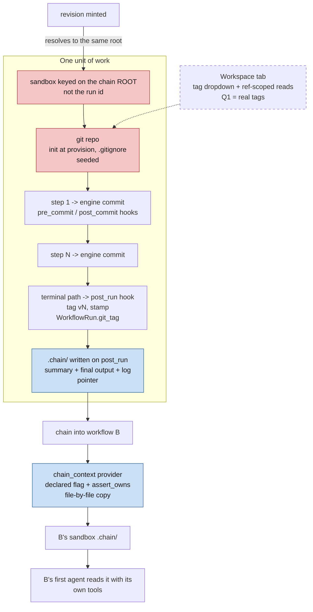

# Feature Specification: Persistent git-versioned sandboxes, chain payloads, and chained workflows

**Spec ID**: 019-sandbox-git-versioning
**Created**: 2026-09-07
**Status**: **Draft (rev 8)** — **all five decisions taken** (§2); ready for planning. Five verification rounds applied, the last a 48-agent sweep along the walkthrough (§12). **Two prerequisite fixes target live defects in shipped code** (FR-034, FR-006) and, under the Q5 decision, are ship-blockers rather than per-workflow gates. See §12.
**Root** *(illustrative — §13 is the authoritative file list)*: `backend/app/agents/{sandbox,skill_staging,prompt_overrides}.py`, `backend/app/agents/runtime/local.py`, `backend/agents/capabilities/{merge/git_3way,hooks/secret_scan}.py`, `backend/agents/execution_engine/{engine,fanout,kernel_services,context}.py`, `backend/agents/capabilities/{context_providers,prompt}/`, `backend/agents/{factory,workflows/plan,workflows/compiler,workflows/permission_caps}.py`, `backend/agents/prompts/*/AGENT.md` (94 files), `backend/agents/execution_engine/run_log.py`, `backend/alembic/versions/`, `backend/app/api/{run_files,run_commands,runs,launch_context}.py`, `backend/app/models/workflow.py`, `backend/app/main.py`, `frontend/src/components/results/{SandboxTab,FilesTab,AgentThinkingTab,AgentDetailPanel}.tsx`, `frontend/src/components/history/{RunDetailPage,RevisionFamilyView}.tsx`, `frontend/src/components/preview/RunHeader.tsx`, `frontend/src/components/layout/DashboardLayout.tsx`, `frontend/src/lib/api.ts`, `frontend/src/types/index.ts`
**Start here if you are implementing**: §13 *Component map* is the file-by-file index — every component, what happens to it, and the requirement that owns it. §5 is the *what*, §13 is the *where*. Nothing outside §13 is touched by this spec.
**Grounding**: [`reports/01-layers.md`](reports/01-layers.md) — per-layer change map, frontend to LLM call. [`reports/02-blast-radius.md`](reports/02-blast-radius.md) — what else moves, per item, plus the cross-cutting risks. [`reports/03-phasing.md`](reports/03-phasing.md) — phasing, dependency order and effort. [`reports/04-walkthrough.md`](reports/04-walkthrough.md) — one prototype run and one revision traced step by step, with the change at each component. Those three are the file/line-level reference; this document states *what* is being built and *why*.

---

## 1. Problem

A Velocity run today is a closed box that opens once. `RunSandbox` roots at
`<RUNS_ROOT>/<user>/<run_id>/` — one directory per **run**, not per piece of work. Every
consequence below follows from that single choice.

**A revision starts from nothing.** Revising a run mints a fresh `WorkflowRun` with a new
UUID, which produces a brand-new, empty sandbox. To make revisions work at all, the
`previous_run` context provider copies a narrow allowlist forward — `spec.md`, `design.md`,
`tasks.md`, one named deliverable file, and `.uploads/` — file by file, from the parent's
directory into the child's. That design is deliberate, tested and gracefully degrading, but
it is a workaround for a directory that should not have been new. Anything the agent wrote
that is not on the allowlist is gone. For `app_builder_revision`, whose deliverable is a whole
serialized tree rather than one file, the one-file seed is already a poor fit.

**There is no history.** The sandbox is a flat working tree with no record of how it got there.
A user cannot see what the third agent changed, cannot compare the current output to the previous
one, and cannot go back. `LocalWorkspace` is described in its own docstring as "the single owner
of the git-subprocess surface" and already implements `clone_repo`, `create_branch`, `git_diff`,
`commit_all`, `spawn_point_commit`, `allocate_worktree` and `merge_worktree` — but **`git init`
is called nowhere in this repository**. The only path to a `.git` directory is cloning an external
repo. Every artifact sandbox is, permanently, not a repository.

**Nothing carries between workflows.** Chaining exists — there is a `chain` channel, `chain_hints`,
and a `GET /workflows/{id}/chain-context` endpoint — but it carries **text**. The frontend fetches
a context block, string-concatenates it onto the user's brief, and sends the result as the run's
message. `_extract_chain_context` hardcodes seven `pipeline_type` branches to decide what to extract,
so a custom-to-custom chain gets only a crude "first 3000 characters of the final output" fallback.
`WorkflowRun.source_run_id` exists for exactly this purpose, is exposed on the API response with a
comment claiming it is set on chaining, and **is never assigned anywhere** — the "(Chained)" indicator
it feeds has no writer. The files workflow A produced never reach workflow B.

**Every agent is handed a composed context it did not ask for.** Two separate seams assemble text
around an agent's own prompt: `_compose_system_prompt` layers seven block categories, and
`_compose_context_message` assembles roughly fifteen more into the human message. Both are
manifest-gated and generic — but the result is that the prompt an agent actually receives is
substantially not the prompt its author wrote.

## 2. Decisions

### Session 2026-09-07 — all five resolved

- **Q1 — R5 means real git tags.** Not the run-family picker that already ships. Tag creation, tag
  listing and ref-scoped reads are in scope; **FR-043 and FR-040 are therefore active, not conditional.**
  The existing "Version ▾" menu still has to survive the sandbox re-key — that is FR-038 and it stands
  either way.

- **Q2 — the engine commits, not the agent.** The engine commits at every step boundary, gated on
  `has_git`, and declared hooks bracket that commit (`pre_commit` / `post_commit`, FR-060) — not a
  `post_step` capability, which is singular and already taken on the revision workflows (FR-009). No
  agent-callable git tool is built, `permission_caps.py` is not edited for the commit itself (its
  existing `git` permission is what binds a declared git hook), and no prompt needs to mention git.
  Note this does **not** shrink R4 to nothing — see Q4.

- **Q3 — contents: summary, final output, and a *copy* of the logs.** Self-contained by decision: a
  chained run gets the full trace even when the source sandbox has already been swept. The cost is
  accepted — traces are the largest thing in a sandbox, so this is the option that grows disk fastest,
  which sharpens FR-041 and §8's unbounded-growth note rather than softening them.

- **Q3b — the folder is `.chain/`, not `.handoff/`.** `handoff` already names the unrelated
  `/flowin-handoff` IDE feature, which does its own git commit, push and PR. Renamed throughout this
  document set before any code exists.

- **Q4 — remove BOTH seams. Context becomes files.** Stated in full below, because it is the largest
  decision here and it changes R4's shape.

- **Q5 — `has_git` is a global default, on.** Every sandbox is a git repository. Simpler, and it
  matches "each sandbox will have git enabled" literally. Two consequences are accepted deliberately:
  every fan-out step in every workflow moves onto git worktrees and `git_3way` merge on day one, and
  the rollback for that is a code revert rather than deleting a manifest line. **This makes FR-034 a
  hard ship-blocker rather than a per-workflow prerequisite** — see §8.

### Q4 in full — the file-based context architecture

The decision, in the requester's words: *"Seam 2 is polluting all agents without any reason … the user
message needs to go into the first agent only. Next agents will get what the previous agent produced,
not in the context. All agents should work now to read files and get it from files if they need
anything. Prompts should be clear and proper."*

So both seams go, and the replacement is explicit: **the sandbox is the context channel.**

| today | after |
|---|---|
| the system prompt carries 7 blocks around `AGENT.md` | the system prompt **is** `AGENT.md` |
| every agent receives the user's brief | **only the first agent** receives it |
| the engine pastes earlier agents' outputs into the message | later agents **read them from disk** |
| uploaded file text is pasted in | agents read `.uploads/` |
| the previous revision's output is pasted in | it is already in the shared sandbox (FR-001) |
| the template, design system and craft are pasted in | agents read `.context/design/` (FR-065) |
| a chained run's source context is pasted in | it is in `.context/` too (FR-024) |

**This is buildable because every channel it needs already exists.** That is the finding that makes the
decision sound rather than aspirational:

- `write_agent_output` already persists **every** agent's streamed text to
  `.agents/{NN}-{agent_id}.md` — one-based index, with `-t{task}` / `-p{visit}` suffixes when a step
  repeats. Nothing new is needed for agent-to-agent handover; the files are already being written and
  are already visible in the Workspace tab.
- `is_first_agent` already exists **in the exact function that has to change**
  (`_compose_context_message`), where it already strips the chained-pipeline block for non-first
  agents. First-agent-only gating is an extension of a live mechanism, not a new one.
- `.uploads/` already holds the raw upload plus an extracted-text `.txt` sidecar per file.
- Every agent already has `read_file`, `ls`, `glob` and `grep` — `PERMISSION_TOOLS`'s `read_files`
  grant. No new tool, no permission change.

**What it costs.** R4 comes back. Under Q2 alone the agents needed to be told nothing; under Q4 they
must be told *where things are and how to find them*, which is a real rewrite of the built-in
`AGENT.md` files rather than a mechanical edit. And every built-in workflow has to be migrated before
seam 2's code can be deleted, because they depend on it today. That migration is the bulk of the work
this decision adds — see FR-046 through FR-049.

## 3. Goals

- A unit of work — an original run and every revision of it — lives in **one** sandbox that
  accumulates, rather than a chain of directories that copy fragments forward.
- That sandbox is a **real git repository**, so every step's output is a commit and the history
  is inspectable.
- The finalizing step **commits and tags** its result, so a version is a real, addressable object
  rather than an inferred row index.
- A run leaves behind a **structured chain payload** describing what it did, discoverable by a human and
  readable by a later workflow.
- **Chaining carries files, not just prose** — the payload moves into the chained run's sandbox and
  the receiving pipeline is told it is there.
- An agent's prompt can be **exactly what its author wrote**, opt-in per workflow.

### Non-goals

- Exposing git history as a product surface beyond a version selector and the existing Workspace tab.
- Push, remotes, branches or pull requests from an artifact sandbox. The `/flowin-handoff` feature
  already owns outbound GitHub integration and is out of scope here.
- Cross-tenant chaining. Same-owner only, enforced by the existing `assert_owns` gate.
- Retiring the `previous_run` context provider. It is short-circuited where redundant, not removed.

## 4. Design overview

Five mechanisms already exist and are reused rather than rebuilt. That is the core of this design.

| need | existing mechanism | what is new |
|---|---|---|
| "run code around a commit, or at run end" | `Step.hooks` + `_fire_hooks`, declaration-driven, permission-bound, three live events | three new events (`pre_commit`, `post_commit`, `post_run`); the commit itself is an engine call |
| "which step is last" | `is_leaf`, compiler-computed, runtime-consumed | nothing |
| "read another run's files, safely" | `read_parent_file` + `ScopedStore.assert_owns`, fail-closed | one sibling method |
| "change what a prompt contains" | registered `prompt` policy, `user_allowed=True` | one new policy, one un-hardcoded name |
| "declare cross-run behaviour" | `revises_existing` → `ctx.is_revision_workflow` | one sibling flag |

What is genuinely missing is narrow: `git init`, a seeded `.gitignore`, `create_tag` and `list_tags`,
a `.chain/` prefix and writer, one declared chain flag, one nullable column, and the four
`run_files.py` call sites that resolve a sandbox independently of the engine.



## 5. Functional requirements

### Sandbox lifetime

- **FR-001** A revision executes against the sandbox of its chain **root**, not its own run id.
  The root is resolved by walking `parent_run_id`; a materialised `root_run_id` column is a later
  optimisation, not a prerequisite. The walk **carries a visited-set cycle guard**. This is not
  hypothetical: `_compute_root_ids` (`backend/app/api/runs.py:211-260`) already performs exactly this
  walk for the run-family API, and its docstring names a corrupt cyclic chain as threat **T-A-04**
  with a visited set as the mitigation. Reuse that helper if it is reachable without breaching an
  import-linter contract; otherwise mirror it, guard included. The walk follows `parent_run_id`
  **only**: `source_run_id` (FR-020) is never followed, because a chained run is its own root with its
  own sandbox. Two root-level files are simply rewritten by each revision and need no per-run name,
  because they are tracked and the previous run's copy is in history under its tag: `PLANNER.md`
  and the deliverable itself.
- **FR-002** Every sandbox-resolving caller uses the same key. There are **seven** construction
  sites, not four, and they do not all live where the engine can fix them at once:
  - `engine.py` `_execute_impl` — the primary sandbox. The one everyone thinks of.
  - `engine.py` `run()` — `RunTrace(RunSandbox(user_id, pipeline_run_id).root)`, built **before**
    `_execute_impl` is entered and therefore before any root resolution can apply. Left alone, every
    revision's `.logs/run-logs.jsonl` lands in a per-revision directory that nothing else writes to,
    that FR-003's sweep fix does not protect, and that the chain payload's logs would reference
    as an empty path.
  - `factory.py` `create_runner` — keyed on `ctx.run_id`. Consistent with the primary sandbox **only
    if** root resolution reassigns that variable rather than a local.
  - four independent constructions in `run_files.py` — upload, list, zip, read — outside the engine
    path entirely. A route left on the raw `run_id` silently serves an empty directory.

  An **eighth** site exists and is deliberately out of scope: `LocalWorkspaceRuntime.create_workspace`
  (`runtime/local.py:700`), reached from the exec-workspace bind at `engine.py:2521` behind
  `_plan_grants_exec`. It is keyed on `ectx.workspace_id` — a fresh UUID minted by
  `ScopedStore.create_workspace`, unrelated to any run id — so root resolution neither helps nor harms
  it. Named here because FR-002 says "every caller", and an unexplained omission reads as an oversight.

  `kernel_services.py`'s `RunSandbox(disk_principal, parent_run_id)` is **not** simply an exception.
  It reads another run's sandbox by design, but after FR-001 a non-root run has no directory of its own,
  so a raw `parent_run_id` resolves to a path nothing writes to. See FR-005a.
- **FR-003** The TTL sweeper protects the whole non-terminal chain, not each run's own id. Its
  protected set is built from run ids and matched against directory basenames; once a directory is
  named for a root, a terminal parent with a live child leaves that child unprotected.
  **This ships in the same change as FR-001.**
- **FR-004** Two concurrent revisions of one parent must not interleave writes on the shared
  directory. v1 fails the second fast with an explicit "a revision is already in progress"; real
  worktree isolation is a follow-up and depends on FR-006. **It must be a server-side check** — a
  unique constraint or a row lock on the parent, evaluated at insert time. The only existing occurrence
  of that phrase in this codebase is an *instruction in the Concierge's LLM prompt* telling the model to
  refuse (`app/agents/chat/concierge.py`). That is advisory, not a mutex, and a direct API call or a
  second chat session walks straight past it. Do not copy that pattern.
- **FR-005** Once FR-001 holds, `previous_run`'s seed loop is short-circuited where the files are
  already present, rather than redundantly re-copying them over an in-progress revision's edits.
  `.uploads/` accumulates across the family **by design**: a revision's `uploaded_files` provider
  sees the root's uploads and its own, which is what a revision wants.
- **FR-005a** Every cross-run read resolves its target to that target's **own chain root** before
  constructing a `RunSandbox`. A raw id is correct only when the target happens to be a root — that is,
  a single-hop revision. Two call sites break at depth ≥ 2 and one of them breaks the headline feature:
  - `previous_run`'s `_seed_existing_artifact` Concierge fallback is a textually separate call site from
    the seed loop FR-005 short-circuits. Left alone, a depth-≥-2 Concierge revision silently seeds no
    existing artifact — on precisely the path built to stop an agent rewriting the prototype from scratch.
  - **The chain-payload read (FR-024) is worse.** Users chain from their most-refined revision, not from
    the family's original. `source_run_id` is therefore almost never the root, so the copy reads an empty
    path — and FR-025's "degrade gracefully, never fail" turns that into a chained run that completes
    successfully with an empty chain payload. The feature would appear to work and carry nothing, in the
    majority case. Root-resolve the source id; then FR-025's graceful degradation covers only genuinely
    missing payloads, which is what it was written for.

### Git

- **FR-006** A sandbox is git-initialised at provision time, idempotently, **and receives an initial
  commit**. `git init` alone leaves an unborn HEAD, and that is not merely untidy: `git merge --no-ff`
  into an empty head fails with `fatal: Non-fast-forward commit does not make sense into an empty head`,
  which the current error handling converts into a *reported clean merge* (see FR-034). Commit the seeded
  `.gitignore`, or `git commit --allow-empty`. Without the init at all, every `commit_all` catches
  `CalledProcessError` and returns `""`, making the feature a permanent silent no-op indistinguishable
  from "nothing to commit".
- **FR-007** A `.gitignore` is seeded inside the same `git init`, covering **eight** paths, not five:
  the five existing reserved prefixes (`.uploads/`, `.logs/`, `.verify/`, `.browser/`, `.agents/`),
  plus `.chain/` from FR-016, plus `.context/` from FR-065, plus **`skills/`**. **This is not optional.** Without it `git add -A`
  commits owner-uploaded documents, engine traces, verify evidence, browser screenshots and every
  agent's transcript into permanent history.
  - `.chain/` matters because of FR-001: the *next* revision runs in the same directory and its
    `git add -A` would otherwise sweep the *previous* revision's chain payload into permanent history.
  - `skills/` is written by `stage_skills` (`backend/app/agents/skill_staging.py`). It prunes the
    subdirectories no longer in scope and rewrites changed ones idempotently — it does **not** wipe the
    tree per call, and the function's own docstring saying otherwise is stale. Churn is real but bounded:
    content changes as skills are attached and pruned across steps, so un-ignored it still accumulates
    history. It is also, today, an ordinary deliverable member — see FR-008a.
- **FR-008** `.git/` is excluded from **both** the deliverable walk and `list_files`. They are two
  separate lists; `list_files` today excludes only `.uploads/` and `.logs/`. This exclusion is
  load-bearing beyond the UI: the deliverable walk feeds `WorkflowRun.output`, and `output` is what
  the **unauthenticated** `GET /s/{token}` share route serves (`backend/app/api/runs.py:1625`). The
  share route never touches the filesystem itself, so it introduces no new exposure — but only for as
  long as this exclusion holds.
- **FR-008a** `skills/` is **excluded** from the deliverable walk and the Workspace listing. It is
  already an unexcluded member of both today — a pre-existing gap, unrelated to git, that means staged
  skill bodies ship inside user deliverables. Closed here deliberately rather than by accident via
  FR-007's `.gitignore`.
- **FR-008b** The seeded `.gitignore` is itself excluded from the deliverable walk and `list_files`.
  It is a bare filename, not a prefix, so neither the prefix checks nor `_DELIVERABLE_EXCLUDE`
  (currently `{"PLANNER.md"}`) catches it. Written at provision time, it is never dormant: without this,
  every git-enabled run gains a permanent implementation artefact in its Files tab, its zip, and
  `WorkflowRun.output` — and shifts the deliverable byte-oracle on every such run, not only on runs that
  touch a new prefix.
- **FR-009** Committing is **engine-driven at the step boundary and gated on `has_git`** — not a
  `post_step` capability. The earlier design used `post_step: git_commit`, and it does not work:
  `Step.post_step` is `str | None`, **singular**, and it is already taken on four shipped manifests —
  `app_builder` declares `api_prefix_audit`, and all three prototype revision workflows declare
  `revision_validation`. Those steps could not also declare a commit, and they are precisely the
  workflows this feature exists for. A per-step declaration is also the wrong shape for behaviour that
  is now universal (FR-010).

  So the engine commits, exactly as it already writes deliverables, and hooks observe or veto around it —
  mirroring the shipped `before_write` seam where the engine performs the write and a declared hook may
  block it. `Step.hooks` is `list[str]`, so a git hook composes with whatever else a step declares;
  `post_step` stays free for `revision_validation` and `api_prefix_audit`. The cost is one
  `git add -A` and one commit per step — sub-second on a prototype-sized tree, and FR-041's
  instrumentation records it so a large-tree workflow is measured rather than guessed at.
- **FR-009a** A routing step still commits. `engine.py:3409-3415` skips the `post_step` capability when a
  conditional gate redirects the cursor (`if _routed: … continue`). Under FR-009 the commit no longer
  rides `post_step`, so it is unaffected by that skip — but the commit boundary must still be reached on
  a routing pass, including every backward jump of a retry loop, which is exactly where capturing the
  step's work matters most. The engine's commit fires before the routing decision consumes the gate
  outcome.
- **FR-010** `has_git` is **on by default for every sandbox** (Q5). `_select_isolation_scope` derives
  worktree-vs-`sub_sandbox` **solely** from `has_git`, so this reroutes every fan-out step in every
  workflow onto git worktrees and `git_3way` merge instead of `sub_sandbox` and `copy_disjoint` — from
  the first run after deploy, with no per-workflow opt-in to stage it behind. Two things follow and
  neither is optional: **FR-034 must be fixed and tested before this ships** (there is no manifest flag
  to hide behind), and `test_isolation.py`'s scope-selection assertions change meaning rather than
  break, so re-read them rather than re-baselining them. `sub_sandbox` isolation and `copy_disjoint`
  merge become **dormant, not deleted** — they remain the path a sandbox takes when it has no `.git`,
  which after FR-006 means a failed init, the case FR-011 logs.
- **FR-011** The engine logs a warning when `has_git` is true but a commit no-ops. Today `commit_all`
  catches `CalledProcessError` and returns `""` for both "nothing to commit" and "not a git repo",
  which are not the same thing. Without this, a failed `git init` masquerades as an idle step forever.
- **FR-060** Two new hook events bracket the commit: **`pre_commit`** fires over the staged diff before
  `git commit` and a declared hook may **block** it; **`post_commit`** fires after the commit lands and
  is observation only. This gives the commit seam the before/after pair the step seam already has —
  `_fire_hooks` currently fires exactly three events, `before_step`, `after_step` and `before_write`, so
  the commit boundary has a before and no after. `post_commit` is where an audit row, a lineage
  `ArtifactRef`, or a "new version exists" notification belongs.

  Both follow the existing `_fire_hooks` contract unchanged: declaration-driven from `step.hooks`,
  bound only when the step's effective permissions grant the hook's `required_permission`, a raising
  hook is swallowed and treated as continue, and `block` is the aggregate if any hook blocks. Note the
  contract already anticipates this case — its own docstring says "a declared git/exec hook stays NOT
  bound while those perms are OFF (HOOK-02)", and `git` is already a permission in
  `permission_caps.py`, set `False` in both caps because nothing bound it yet.

  A blocked commit follows `before_write`'s block semantics: the commit is skipped, the step continues,
  and the diff stays in the working tree where every later commit re-scans it — so a secret never
  reaches history, and nothing else does either until it is removed. Because the tree then carries
  uncommitted work, a run whose **last** commit was blocked ends `degraded`, not `completed`, and is
  therefore not tagged (FR-014); the block reason is surfaced on the run, and FR-011's warning fires.
- **FR-061** A **`post_run`** hook event fires on the terminal path, and the run-level git work moves
  onto it: tag creation (FR-012), `git gc` (FR-041), and writing `.chain/` (FR-016). Those are currently
  specified as bespoke calls bolted into the completion seam; as a declared event they are consistent
  with every other lifecycle action and become observable and testable the same way. The cancel path
  (FR-055) fires the same event, so the `wip:` commit, worktree teardown and worker-branch retention
  have a principled home rather than an inline branch.

  It fires from **one fire-once finalizer**, not from each terminal exit. `_execute_impl` emits
  `pipeline_cancelled` / `pipeline_failed` from more than eight distinct early-return sites today while
  `pipeline_complete` has one; wiring `post_run` at each site would miss the next one added. The
  finalizer is keyed on the run id, reads the final status off the state machine, and is called from
  the existing catch-every-exit blocks — the `finally` of `_execute_impl` and of `run()`; a second call
  is a no-op. The acceptance test enumerates the terminal-event emission sites and asserts every one
  reaches it.

### Versioning

- **FR-012** The version tag is created **on the run's terminal path, not on a leaf step's `post_step`.**
  This is a correction: a leaf is the wrong trigger, on three independent counts.
  1. **A workflow has many leaves.** `_compute_is_leaf` marks every step with nothing compiled after it,
     and branch siblings are leaves by construction — `ex_A2_branch`'s `say_hello` and `say_hola` are
     both `is_leaf`, sitting array-adjacent under one shared route step. Conditional gates make several
     leaves the normal case, not the exception.
  2. **Reaching a leaf does not always end the run.** The engine's own condition is
     `_leaf_ends_the_walk = is_leaf and (next_spec is None or next_spec.id in _steps_by_agent)` — on a
     composed run, a leaf whose next roster entry has no compiled step is walked straight past. A tag
     fired at that leaf would name a version the run then kept building on.
  3. **A `post_step` cannot know the final status**, and FR-014 requires exactly that: no tag for a
     failed, cancelled, degraded or `diverted` run. Only the terminal path knows.

  So: the per-step commit stays at the step boundary (FR-009) — commit per unit of work is correct.
  **Tagging moves to the terminal path**, where `final_output` is resolved and the deliverable artifact
  is persisted, and
  fires once, after the run's terminal status is known. That seam is already workflow-agnostic and
  already does exactly this kind of end-of-run work, so INV-1 holds and no first-writer-wins guard is
  needed — there is one terminal path, reached once.

  Tagging fires on the `post_run` hook event (FR-061), so it is a declared lifecycle action like every
  other, rather than a bespoke call inlined into the completion seam.
- **FR-013** The displayed version stays `revision_index` from the existing family walk — already
  rendered as `v{n}` today. `WorkflowRun.git_tag` is a nullable stamp meaning only "a real tag object
  was created", decoupling display from the git operation.
- **FR-014** No tag is created for a run that ends in a non-success terminal state. Gating reuses the
  existing `TERMINAL_RUN_STATUSES` constant — `completed`, `cancelled`, `failed`, `degraded`,
  `diverted` — and tags only `completed`. `diverted` is called out explicitly because it is easy to read
  as a success: the run handed off mid-flight and never reached its own end. A `wip:` commit from
  FR-055 is never tagged. This gating is *why* FR-012 moved to the terminal path — the status does not
  exist yet at a leaf.
- **FR-015** `create_tag` and `list_tags` are added to `LocalWorkspace` and reached by `getattr`
  duck-typing, exactly as `commit_all` and `allocate_worktree` already are. **They are not added to the
  `Workspace` Protocol** — that would widen the port three import-linter contracts hold shut for the
  ECS swap.

### Chain payload

- **FR-016** A sixth reserved prefix holds the run's chain payload, written at the completion seam by a
  best-effort helper that never raises — the same contract as `write_agent_output` and the
  budget-snapshot persist beside it. **Its contents are normative, not left to the implementer** —
  per Q3, the shape is exactly three things:
  - `summary.md` — a rendered summary of the run: what it built, which steps ran, the terminal status,
    and the tag if one was created. Engine-rendered from `ectx`, not agent prose.
  - the run's **final output**, copied under its own deliverable filename.
  - `logs/` — a **copy** of this run's `.logs/{run_id}.jsonl` (FR-037) and the `.agents/` transcripts. Copied, not
    pointed at, so a chained run still has the full trace after the source sandbox is swept (Q3).
    This is the single largest contributor to sandbox growth in the feature set; FR-041 and §8 own
    the consequence.

  The payload is written for **every** terminal status — `summary.md` carries the status — so a
  cancelled or failed run can still be chained from deliberately, and the receiving run knows what it
  got. It is written to **`.chain/{run_id}/`**, one subdirectory per run, not to a flat `.chain/`.
  The sandbox is shared by the whole chain (FR-001), so a flat payload would be overwritten by the next
  revision — chaining from run A after run B completed would silently ship B's payload under A's name.
  The *incoming* copy on the receiving side lands in the new workflow's `.context/` (FR-024, FR-065),
  so the first agent's `AGENT.md` can name `.context/summary.md` without knowing any run id.
- **FR-017** It is excluded from the deliverable walk and **listed** in the Workspace tab, mirroring
  `.agents/`. `sandbox.py`'s comment claiming `.agents/` is the only listed-but-undelivered prefix is
  updated, since it stops being true. The **single-file read endpoint** is a third, separate tier and
  is **readable**, like `.agents/`. That endpoint blocks only `.uploads/` and `.logs/` today; the chain
  payload is a rendered summary of this owner's own run, so blocking it would be inconsistent for no
  gain. Decided rather than inherited.
- **FR-018** It is written by the engine, not by an agent tool. No reserved prefix is agent-owned today
  and there is no precedent for one.
- **FR-019** A reserved-prefix guard in `previous_run.py` rejects any `seed_files.from_run` entry naming
  a reserved prefix, regardless of manifest declaration — closing the hole defensively rather than trusting
  every future manifest author.

- **FR-065** A seventh reserved prefix, **`.context/`**, holds **what this run was given**, and it is
  written by the engine when the sandbox opens, before step 1. Seam 1 stops pasting the template,
  design system and craft blocks (FR-028) — this is where they go instead, as files. The OpenDesign
  material lives under **`.context/design/`**: `design-system.md`, `craft.md`, and `template/` holding
  `SKILL.md`, `example.html` and the seed and reference files (FR-030 rows 2, 11 and 21); `selections.json` with the wizard's choices sits at
  the `.context/` root. All of it is produced by the same resolver `resolve_launch_od_context` runs today. For a chained run the source's
  `.chain/{run_id}/` is copied in here as well (FR-024), so `.context/` is the single place an agent
  looks for its inputs and `.chain/` is the single place a run leaves its outputs for the next one.
  A revision inherits its root's `.context/` unchanged (FR-001). It is gitignored (FR-007), excluded
  from the deliverable walk and listed in the Workspace tab (as FR-017 does for `.chain/`), and each
  migrated `AGENT.md` names the paths under it (FR-048). `resume_run` reads it back instead of
  `od_context_json` (FR-031).

### Chaining

- **FR-020** A chained run records its source in the **existing, currently dead** `source_run_id` column,
  written for the first time. This also repairs the non-functional "(Chained)" indicator.
- **FR-021** The copy is gated on a **declared manifest flag**, never on the mere presence of a source id.
  `previous_run.py` was deliberately hardened this way so "a forward build carrying a stray `parent_run_id`
  can no longer trigger an unintended cross-run seed"; chains inherit that discipline.
- **FR-022** The source id is threaded as its own `ExecutionContext` field. It **must not** alias into
  `parent_run_id` — a chain is not a revision, and the family-walk BFS has no type filter.
- **FR-023** Ownership is asserted before any cross-run read, fail-closed, `PermissionError` never
  swallowed — reusing `assert_owns` exactly as `previous_run` and `repo` already do.
- **FR-024** The copy is file-by-file through existing read/write primitives, mirroring the proven
  `.uploads/` seed loop, and resolves the source id to its chain root first (FR-005a). No recursive-copy
  primitive is added to `RunSandbox`; that would need its own traversal-proofing and size caps.
  The source is `<root>/.chain/{source_run_id}/` — that run's own payload, never whichever payload was
  written last (FR-016) — and the destination is the receiving sandbox's `.context/` (FR-065): what
  the source run handed on becomes what the new run was given.
- **FR-025** A missing, failed or TTL-swept source degrades gracefully to an empty chain payload and never
  fails the chained run.
- **FR-026** The receiving pipeline learns about the chain payload through the declared context-provider
  mechanism, not a new bespoke channel, and reuses the existing block-marker convention rather than
  inventing a third format.
- **FR-027** The frontend's existing `enrichedInput` text-block assembly is retired or coordinated in the
  same change. Left alone, agent B receives the same information twice in two formats that will diverge.

### Prompt assembly

- **FR-028** A second `prompt` policy is registered whose order is `("prompt_body",)` — the system
  prompt becomes exactly the agent's own `AGENT.md`. **Name what that removes.** The default order is
  `tool_availability → injects → guardrails → skills → hooks → constitution → prompt_body`, so a
  body-only order drops **six** blocks, not one. `injects` is the files/templates/design block the
  requirement names — but `constitution` is the user's saved governing principles, injected
  unconditionally for every governed agent from Workflow_Memory and independent of any manifest
  declaration, and `hooks` is the rendered behavioral-hook block. Losing the Constitution as a side
  effect of a formatting change is not acceptable, so **register two orders**: `("prompt_body",)` for
  agents with no governance attached, and `("guardrails", "hooks", "constitution", "prompt_body")` where a
  Constitution or behavioral hooks exist. The compiler warns when a governed agent selects the bare
  order. Skills are unaffected either way — deepagents' own `SKILLS_SYSTEM_PROMPT` already names every
  staged skill and its read path, which is why the factory's own skill block was removed once before.
- **FR-029** The policy name is read from the manifest, defaulting to `default`. `factory.py` hardcodes
  `resolve("prompt", "default")` today. Existing workflows keep `default`, so composition stays
  byte-identical and the characterization snapshots hold.
- **FR-030** The context-message seam is removed too (Q4). `_compose_context_message`'s ~15 blocks stop
  being assembled; what an agent needs, it reads from the sandbox. The removal is **staged per
  workflow** behind FR-029's policy selection, not flipped globally in one commit: each built-in moves
  when its `AGENT.md` files have been rewritten to FR-048, and seam 2's code is deleted only once the
  last workflow is off the default policy. A block-by-block inventory is still written first — not to
  decide *whether* each block goes, which Q4 settled, but to record what each one supplied so its file
  equivalent can be named in the prompt that replaces it.

  **That inventory is this table, and it is normative: no row may be blank.** Every input an agent
  receives today, read off the emitters at `15d3d6535`, with where it lives afterwards. The rule from
  FR-051 decides each row — *control* for this dispatch stays a targeted payload, *the world* becomes a
  file. Anything not in this table is not injected today and needs no home.

  | # | today | source | after | owner |
  |---|---|---|---|---|
  | 1 | `tool_availability` block | seam 1 policy | dropped — deepagents hands the model its tool schemas itself; there is nothing to read | FR-028 |
  | 2 | `injects` block: critical rules → design system → craft rules → template SKILL.md | seam 1, `_compose_injection` | `.context/design/` | FR-065 |
  | 3 | `guardrails` | seam 1 policy | kept, in the governance order | FR-028 |
  | 4 | `skills` | seam 1 policy | unaffected — deepagents' `SKILLS_SYSTEM_PROMPT` already names the staged `skills/` | FR-028 |
  | 5 | `hooks` — the rendered behavioural-hook block | seam 1 policy | kept, in the governance order — which therefore becomes `("guardrails", "hooks", "constitution", "prompt_body")`; rev 8 corrects FR-028, which had listed the order without it | FR-028 |
  | 6 | `constitution` | seam 1 policy | kept, in the governance order | FR-028 |
  | 7 | `prompt_body` | seam 1 policy | the `AGENT.md` itself | FR-028 |
  | 8 | the brief, with `=== CONTEXT FROM PREVIOUS PIPELINE` stripped for every agent but the first | seam 2, `user_message` | agent 1's message only; the chained context is in `.context/` | FR-046, FR-050, FR-024 |
  | 9 | `=== RETRY — pass N of M ===` | seam 2, `pending_route_feedback` | **control** — stays, targeted at the retrying agent | FR-051 |
  | 10 | `## Planning Context (Deep Planner Analysis)` — the planner's analysis, which the clarify rounds merge into | seam 2, `planning_context` | `PLANNER.md`, already written per run by the engine (`engine.py:2221`) and excluded from deliverables. **Check before relying on it:** that write precedes the clarify merge (`:2339`); the file must be written, or rewritten, after the merge, or agents read a plan without the answers | FR-047, FR-048 |
  | 11 | `ACTIVE DESIGN SYSTEM`, `ACTIVE TEMPLATE (SKILL.md)`, `TEMPLATE EXAMPLE (example.html)`, seed + reference parts | seam 2, `opendesign` provider | `.context/design/`: `design-system.md`, `template/SKILL.md`, `template/example.html`, the seed and reference files under `template/` | FR-065 |
  | 12 | `--- Output from {label} ---` for each consumed upstream agent | seam 2 | `.agents/{NN}-{agent_id}.md` | FR-047 |
  | 13 | `PRIOR OUTPUT` — the agent's own previous pass on a redo | seam 2 | `.agents/{NN}-{agent_id}-p{visit-1}.md`; the retry payload names the path | FR-051 |
  | 14 | `REVISE` directive — the HITL rejection text | seam 2, `redo_directive` | **control** — stays, targeted | FR-051 |
  | 15 | `REVISION MODE` — the previous spec and task list | seam 2, `spec_revision_context` | the shared tree: `spec.md` and `tasks.md` are already there (FR-001) | FR-047 |
  | 16 | `=== USER GUIDANCE ===` — mid-run chat steering | seam 2, `steering_notes` | one-shot notes: **control** — stays, targeted at the next dispatch. Sticky uploaded-context notes: `.uploads/` and its `.txt` sidecars | FR-051 |
  | 17 | `=== REVISION ANALYSIS ===` — the revision analyzer's plan | seam 2, `analyzer_solution` | the analyzer's artifact on disk — agent 1's artifact is the contract — and `.agents/01-…md` | FR-050, FR-047 |
  | 18 | `=== CURRENT PROTOTYPE HTML ===` + `=== REVISION INSTRUCTION ===`, inlined only for a **no-tools** agent (tool-using agents already get a `read_file` pointer) | seam 2, `revision_original_html` | a migrated agent's manifest grants `read_files`; the no-tools inline copy retires with the seam. The instruction is the brief and goes to agent 1 | FR-048, FR-046 |
  | 19 | `=== CURRENT TASK === Task N of M` | seam 2, `task_loop` scratch | **control** — stays, targeted per task; the task text is also in `tasks.md` | FR-051 |
  | 20 | the build skeleton — compacted current HTML for task 2+ | seam 2, `current_prototype_skeleton` | the worker reads `prototype.html` from the tree. The compaction goes with it, and so does its context saving — that is the recorded cost | FR-047 |
  | 21 | `=== TEMPLATE COMPLIANCE ===` — template and design-system ids, every build task | seam 2, `od_context` | the ids are in `.context/selections.json`; the rule itself belongs in the builder's `AGENT.md` | FR-065, FR-048 |
  | 22 | multimodal image blocks — run images and per-turn images | `_compose_input_blocks` | **unchanged** — not a text block; out of this spec's scope per the file-extract decision | — |
  | 23 | `resolve_launch_od_context` → `od_context_json` | launch | `.context/`, written at sandbox open; `resume_run` reads it | FR-065, FR-031 |
  | 24 | the frontend `enrichedInput` text block, `_extract_chain_context` | chaining API | retired; `.context/` carries the copied `.chain/{run_id}/` | FR-027, FR-024 |
  | 25 | `previous_run` provider — seed loop plus a file-pointer message | context provider | the shared tree (FR-001); the seed is short-circuited | FR-005 |
  | 26 | `uploaded_files` provider | context provider | `.uploads/` | Q4 |
  | 27 | `skills/` staging | `stage_skills` | unchanged | FR-008a |
  | 28 | `=== VALIDATION ERRORS (fix {filename}) ===` — the validation fix loop's own message | `_run_validation_fix_loop`, `engine.py:6128-6181`, the one model call outside the dispatch path | **control** — unchanged; it already tells the agent to `read_file` the deliverable and `edit_file` it, and carries only the error list | FR-051 |
  | 29 | the deep planner's `design_context` argument | `smart_planner._build_prompt`, an engine-side call, not an agent dispatch | unchanged in-process: it keeps receiving the resolver's result. On resume it is read back from `.context/` | FR-065, FR-031 |
  | 30 | every other engine-side reader of `ectx.od_context` — the clarify no-template gate (`engine.py:2175`), `:2195`, the completion seam (`:3891`), the agent-context factory (`:4910`), template compliance (`:10954`), the example-html loader (`:11049`), and six sites in `kernel_services.py` | in-memory launch product | unchanged while the process lives. After a restart, `resume_run` rebuilds `ectx.od_context` from `.context/selections.json` and `.context/design/` instead of `od_context_json` — that rebuild is FR-031's whole content | FR-031, FR-065 |
- **FR-031** `resume_run`'s dependency on `od_context_json` is handled **in the same change** as seam 1's
  removal. Not conditional — Q4 decided both seams go, so launch-time `od_context` population is going.
  The replacement is FR-065: the resolved context is written to `.context/` when the sandbox opens, so
  a resumed run reads the same files its earlier steps read and the column has nothing left to carry.
  Concretely, `resume_run` rebuilds `ectx.od_context` from `.context/selections.json` and
  `.context/design/`, because the engine-side readers in FR-030 rows 29 and 30 — the clarify gate, the
  planner, the completion seam, template compliance — keep reading that in-memory dict, and a resumed
  run with an empty one would silently behave as a no-template run.
  Orphaning it breaks resume of an in-flight run across a backend restart: the run continues with
  different context than its earlier steps used, and nothing surfaces that.
- **FR-032** **Deferred — no production users yet.** An override *replaces* `prompt_body` wholesale, so a
  saved `PROMPT_OVERRIDE.md` would shadow the Phase 7 rewrite and leave that agent told to read files by
  a prompt that never mentions files. That matters only once real users have saved overrides, and today
  none have. **Trigger to revisit: the first production user saves an override, or GA — whichever comes
  first.** Recorded rather than solved so it cannot be rediscovered as a surprise. Correct the prompt
  API's docstring regardless — it claims the override is injected *ahead of* the base body, and it is
  not; that is a two-line fix and a lie in the codebase either way.
- **FR-033** Stale files are reconciled **by the engine at commit, against a declared output surface**.
  No `delete_file` is added to the agent surface.

  The mechanism must not guess, and this is the part that needs stating precisely: the engine cannot
  know that a file an agent stopped writing is *stale* rather than *deliberately left alone*. So
  reconciliation is **declarative**. A step may declare the surface it owns and that it owns it
  completely:

  ```yaml
  outputs: ["src/**", "index.html"]   # this step's output surface
  replaces: true                       # my output is the COMPLETE content of that surface
  ```

  When a step declares `replaces: true`, the engine's step-boundary commit stages a removal for every tracked path under that
  surface the step did not write this pass — determined from `changed_since(spawn_point)`, which
  `LocalWorkspace` already implements, not from inference. When a step declares nothing, nothing is
  removed and the sandbox accumulates exactly as it does today. That is the safe default, and it means
  the feature is opt-in per step rather than a behaviour every workflow inherits.

  **Residual, stated rather than hidden:** a file outside every declared surface still accumulates
  forever, and a workflow that declares no surface gets no reconciliation at all. This closes the
  rename-and-restructure case — which is the one users actually hit — and does not close the general
  case. Closing the general case needs an agent-side delete verb, which is deliberately not being added.
- **FR-046** The user's brief reaches the **first agent only**. Every later agent's message carries the
  step's own task and nothing else. The gating mechanism already exists in the function that changes:
  `_compose_context_message` computes `is_first_agent` and already uses it to strip the
  chained-pipeline block for non-first agents. This extends a live mechanism rather than inventing one.
- **FR-047** Agent-to-agent context is **files, not pasted blocks**. Agent-to-agent handover needs no
  new channel, because every one already exists and is already populated (what the run was *given*
  is the one new prefix, `.context/` — FR-065):
  - `.agents/{NN}-{agent_id}.md` — `write_agent_output` already persists **every** agent's streamed
    text here on the completion path, one-based index, with `-t{task}` and `-p{visit}` suffixes when a
    step repeats. This is the agent-to-agent channel.
  - `.uploads/` — the raw upload plus an extracted-text `.txt` sidecar per file.
  - the sandbox root — after FR-001 a revision's predecessor wrote into this same directory. It also
    already holds `spec.md` / `design.md` / `tasks.md`, which `task_loop` writes **before** its loop
    starts (`_SEED_FILES`), and `PLANNER.md`. A task worker can already read its own task from disk —
    checked, and it is why the highest-volume strategy needs no new channel.
  - `.chain/` — the source run's payload, for a chained run (FR-024).

  Every agent already holds `read_file`, `ls`, `glob` and `grep` through the `read_files` grant, so no
  tool is added and `permission_caps.py` is untouched.
- **FR-048** Every `AGENT.md` in a migrated workflow states **where to look and how**, concretely:
  which paths hold what, that `.agents/` is ordered by step, and that reading is the agent's own job.
  A prompt that merely says "read the files" is not sufficient — the whole point of removing the
  injection is that the prompt now carries the knowledge the engine used to supply, so vagueness here
  reproduces the problem in a worse place. This is R4's real content, and it is a genuine rewrite of
  the built-in prompts, not the near-zero edit Q2 alone implied.
- **FR-050** The request reaches **agent 1 only, and stops there — by design.** Agent 1's job is to
  turn it into an artifact; every later agent takes its contract from that artifact or from its own
  `AGENT.md`, not from the original ask. There is deliberately no `REQUEST.md` and no propagation.

  This makes **agent 1's output load-bearing in a way it was not before.** Today a first agent that
  streams prose and writes no file still works, because the engine re-injects the brief downstream.
  After this, a workflow whose first step produces nothing readable leaves every later agent with no
  contract at all. So: the first step of a migrated workflow **must** write a durable artifact, and its
  `AGENT.md` must say so explicitly (FR-048). `task_loop` already satisfies this — it writes
  `spec.md`/`design.md`/`tasks.md` before its loop — and the revision workflows satisfy it through their
  planner step. Any workflow whose first step is a bare streaming agent has to be migrated with that in
  mind, and `.agents/01-{agent_id}.md` is the fallback contract when nothing better exists.

- **FR-051** Retry and HITL feedback is **injected into the retrying agent only** — never a default
  block on every dispatch. When a gate sends a step back, that one agent receives the feedback *and*
  the user's prompt, because it is being asked to redo work against the original ask. Every other agent
  in the run is unaffected and still receives only its own task.

  The block already exists — `=== RETRY — pass N of M ===`, naming which step sent it back, that step's
  output and what to change. What changes is its scope: it stops being part of the general context
  assembly and becomes a targeted, per-dispatch payload keyed on the retry. Removing it wholesale with
  the rest of seam 2 would silently degrade every spec-014 conditional-gate loop — the agent would
  re-run with no idea it had failed. The general rule for FR-030's inventory: **per-dispatch control
  flow is targeted, not injected**; anything describing *this dispatch* survives as a targeted payload,
  anything describing *the world* becomes a file.

- **FR-049** Migration is per workflow and reversible. A workflow moves when its prompts are ready; it
  keeps the `default` policy until then. The last workflow off `default` is the trigger to delete seam
  2's code — not before, because the built-ins depend on it today. Each migrated workflow's
  characterization test is re-derived deliberately at that point, and a re-baseline here is a real
  behaviour change being blessed, so it needs a reviewer who knows that.

### Git lifecycle — who commits, when, and what happens when it goes wrong

Once every sandbox is a git repository (Q5), commits stop being a feature and become a concurrency
problem. These requirements define the ordering. **All of them sit downstream of FR-034** — until a
refused merge stops reporting success, none of the conflict handling below can even be observed.

- **FR-052** There is exactly **one committer of the base tree, and it commits only at step
  boundaries.** Workers commit on their own branches; the base is committed by the engine after the step's strategy has fully returned (FR-009) — which, for a fan-out step, means after every
  fragment has merged. A commit must never be attempted on the base while a merge is in flight: `git`
  refuses to merge with `MERGE_HEAD` set, and `commit_all` swallows the resulting `CalledProcessError`
  as "nothing to commit". "Immediate commit" is the wrong instinct here; **commit at the boundary, not
  at the moment.** One committer does not mean one commit: a fan-out step also carries one merge commit
  per fragment between the spawn point and the boundary commit (FR-053), all of them made by the engine.
- **FR-053** The fan-out and wave merge sequence is stated and ordered:
  1. `spawn_point_commit` captures the base HEAD as the merge base.
  2. Each worker commits on its own `fanout/{step}/{i}` branch (already done today, CR-06).
  3. Fragments merge into the base **one at a time, with a base commit between each** (FR-034). Those
     merge commits are real and stay in history — they are what clears `MERGE_HEAD` so the next fragment
     can merge, and they keep each worker's contribution attributable. No squash, no soft reset.
  4. Only then does the engine's step-boundary commit run (FR-009). A fan-out step is therefore the one
     stated exception to "one commit per step": `git log` shows one merge commit per fragment followed
     by the boundary commit, and §9's acceptance line says so.

  **Waves need no separate mechanism.** `wave_scheduler` deliberately owns no isolation or merge logic
  — it delegates to the unmodified `run_fanout` (INV-12, single home), so every wave inherits this
  sequence and FR-034's fix covers both. That is worth knowing before anyone designs a second merge
  path for waves.
- **FR-054** Conflict adjudication is **already built and has never run.** A step declares
  `on_conflict`, validated at compile time against exactly `{human_gate, merge_agent, partial, abort}`,
  defaulting to `human_gate`; `_resolve_conflict` dispatches on all four; a conflicting merge writes an
  owner-scoped `merge_conflict` artifact and emits a `merge_conflict` event; and `FanoutSpec.merge_agent`
  designates the bounded worker for `on_conflict: merge_agent` — **that is the resolving agent, and it
  exists.**

  The catch is why it has never fired: today a refused merge reports `conflicts: []`, so a real conflict
  is indistinguishable from a clean merge and adjudication is never reached. Turning `has_git` on
  globally therefore **activates a code path that has never run in production** — for every workflow, at
  once. Fixing FR-034 is what makes conflicts detectable; this requirement is that the four policies are
  then exercised by test before ship, not discovered by a user. Nothing new is designed here; what is
  new is that it becomes reachable.
- **FR-055** A cancelled, failed or degraded run **commits what it has** rather than discarding it.
  *(This supersedes rev-3's FR-042, which reset the tree to HEAD — that would have destroyed the work a
  user had just paid for.)* A mid-step Stop raises past the step-boundary commit, so the step's normal
  commit never runs and the tree is left dirty; under a shared sandbox the next revision's `git add -A`
  would then sweep that abandoned work into its own history as if it were its own. Instead, the engine
  commits on the terminal path with an explicit marker — `wip: cancelled at step {id}` — so: nothing is
  lost, the tree is clean for the next revision, the abandoned work is attributable rather than
  anonymous, and it is trivially identifiable for a later `git revert`. A WIP commit is never tagged
  (FR-014) and never becomes a version.
- **FR-056** Browsing a version is **read-only and never touches the working tree.** Reads go through
  `git show <ref>:<path>` and `git archive <ref>` (FR-043). A `git checkout` of a ref into the live tree
  is forbidden — verified that nothing does this today; the only `checkout` in the codebase is
  `checkout -b` for branch creation. This is what makes it safe to open v1 while v3 is running: the
  viewer reads history, the run keeps writing the working tree, and the two never meet.
- **FR-057** **Restoring** a version is a forward commit, never a rewind — and it is refused while a run
  is active on that sandbox. Selecting v1 while v3 is mid-run must not be able to move the tree under a
  running agent, so the restore action is disabled for the duration and the UI says why. When it does
  run, it materialises the old tree as a **new commit on top** (`git read-tree` + commit, or a revert
  range), so v2 and v3 remain in history and remain browsable. No `reset --hard`, no history rewrite,
  no branch move. A restore is a **commit, not a tag** — `restore: vN` in the message — because a tag
  names a run's completion and takes an ordinal (FR-036) that a restore has no run to draw from; the
  next completed run tags the restored tree as its own version. The active-run check is **chain-root
  scoped** — any non-terminal run whose resolved root is this sandbox refuses the restore, not only the
  direct children FR-004's constraint sees — and restore takes the same short lock on the root that
  FR-004 takes on the parent, so two restores cannot race either.

- **FR-058** A version is served **without materialising it**, and never by moving HEAD. Verified that no
  consumer needs a directory: the preview renders through a sandboxed iframe from *content*, and the zip
  route builds in memory from `list_files()` — so a ref-scoped listing (`git ls-tree -r <ref>`), a
  ref-scoped read (`git show <ref>:<path>`) and a ref-scoped zip built the same in-memory way cover every
  surface. HEAD stays where the run left it, and an agent mid-step never sees the tree change.

  **If a future surface genuinely needs a directory** — a preview served from a real root, say — extract
  `git archive <ref>` into a disposable, TTL'd, read-only preview directory keyed by `(run, ref)`. Do
  **not** use `git worktree add` for this: fan-out already registers worker worktrees under
  `.worktrees/` in the same repository, so preview worktrees would share that registration and lock
  surface with running workers, and a stale entry would outlive the preview. An extracted copy has no git
  metadata, cannot contend, and is deleted by unlinking it.
- **FR-059** Cancelling during a fan-out or a wave leaves **nothing orphaned and nothing lost.** Workers
  hold their own worktrees and branches, so the terminal path: commits the base as WIP (FR-055), removes
  each worker worktree with the existing `remove_worktree`, and **retains the worker branches** —
  `fanout/{step}/{i}` — rather than deleting them. Retention is the point: a cancelled wave's workers may
  each have completed real work that was never merged, and a deleted branch makes it unreachable. The
  branches are cheap, they are visible to `git branch` — **not** in the picker, which lists tags only
  (FR-040) — and a later revision can merge or
  discard them deliberately. Waves need no separate handling here for the same reason as FR-053 —
  `wave_scheduler` delegates to `run_fanout`, so one path covers both.

  The existing `remove_worktree` deletes the branch after removing the worktree — `git worktree remove
  --force`, then `git branch -D` — with no way to skip the second step. It gains a `delete_branch: bool =
  True` parameter: the happy-path teardown after a successful merge keeps the default, the cancel path
  passes `False`. That is the whole change; §13's row for `remove_worktree` said "no change", which
  contradicted this requirement.

### Recovery and deferred decisions

- **FR-062** A **dirty working tree is reconciled before any run writes to it.** The cooperative paths
  commit on the terminal path (FR-055), but a process that is killed — SIGKILL, OOM, a backend restart
  mid-step — runs no terminal code, and `resume_run` re-drives the interrupted step on top of whatever
  the crash left behind, folding it anonymously into that step's commit. So in the one existing restart
  seam, `restore_non_terminal_runs()`, and again when a revision opens a shared root (FR-001), the
  engine checks `git status --porcelain`; a non-empty tree is committed through the ordinary path as
  `wip: recovered dirty tree at step {id}` — subject to `pre_commit` like any commit — before the next
  step runs. Nothing is discarded, and the marker makes the recovered work attributable, exactly as
  FR-055 does for a Stop. This closes the SIGKILL gap §8 previously listed as unowned.
- **FR-063** **Budget accounting across a chain is deferred, and the default is stated:** every run —
  root, revision or chained run — keeps its own budget, exactly as today, and nothing aggregates across
  the family. A chained or revised run never fails because an ancestor spent; the cost of a chain is a
  sum a report can compute, not a limit the engine enforces. Revisit trigger: the first request for a
  family-level cap, at which point the aggregate is one query over `parent_run_id` / `source_run_id`,
  which FR-001 and FR-020 already make walkable.
- **FR-064** **Tier gating of git history and chaining is deferred, and the default is stated:** neither
  is gated. `has_git` is global (FR-010) and chaining is available wherever a workflow declares the
  chain flag (FR-021); no entitlement is consulted. Revisit trigger: the first tier that should not get
  either, at which point the gate is one more flag in the existing entitlement table, read at launch —
  never inside the kernel (INV-1).

### What happens when — the interaction matrix

The combinations worth stating outright, because they are the ones that look dangerous and mostly are not.

| while this is happening | the user does this | what happens |
|---|---|---|
| a step is running | opens v1 in the dropdown | nothing to the run. A history read; HEAD does not move (FR-056, FR-058) |
| a step is running | tries to **restore** v1 | refused, with a reason. The restore action is disabled while a run is active (FR-057) |
| a fan-out or wave is mid-merge | presses Stop | base committed as WIP, worker worktrees removed, worker branches kept (FR-055, FR-059) |
| a fan-out or wave is mid-merge | — a merge conflicts | `on_conflict` decides: `human_gate` by default, so the run pauses and waits (FR-054) |
| a run was cancelled earlier | starts a new revision | it begins from the WIP commit on a clean tree — the abandoned work is in history, attributed, and not silently absorbed (FR-055) |
| nothing is running | restores v1 | a forward commit on top; v2 and v3 stay in history and stay browsable (FR-057) |
| two revisions are requested at once | — | the second fails fast: "a revision is already in progress" (FR-004) |
| a step's `pre_commit` hook blocks | — | the commit is skipped and the step continues; the diff stays uncommitted and every later commit re-scans it. If it was the run's last commit, the run ends `degraded` and untagged (FR-060, FR-014) |
| the backend is killed mid-step | restarts it | the run resumes; before the step re-runs, the dirty tree is committed as `wip: recovered dirty tree at step …` (FR-062) |

### Prerequisites and consequences

Found by auditing rev 2 against source. Two of these are **live defects in already-shipped code** that
this spec's own `has_git` flip would expose; they are prerequisites, not follow-ups.

- **FR-034** `merge_worktree`'s false-clean merge is fixed **before** any workflow is allowed
  `has_git=True`. Reproduced against real git:
  1. `_merge_fragments` calls `merge_worktree` once per fragment in a loop, and `merge_worktree` runs
     `git merge --no-ff --no-commit` without committing between iterations.
  2. Fragment 1 merges and leaves `MERGE_HEAD` set — by design, staged for the deliverable resolvers.
  3. Fragment 2's merge is **refused**: `fatal: You have not concluded your merge (MERGE_HEAD exists)`.
  4. The handler probes for conflicts with `git diff --name-only --diff-filter=U`, which returns
     nothing — the merge never ran, so there is nothing conflicting — and `conflicts` stays `[]`.
  5. `git merge --abort` then **discards fragment 1's clean merge as well**.
  6. `Git3WayMerge` sees `conflicts: []` twice and reports both branches applied; the engine emits
     `merge_completed`. The base tree is unchanged. Every worker's output is gone, silently.

  Two fixes, both needed. The specific one: commit the base after each successful `merge_worktree`
  before merging the next fragment (verified to resolve it). The general one: a `CalledProcessError`
  with no `--diff-filter=U` output must **never** be reported as `conflicts: []` — "the merge refused
  to start" and "the merge ran and found nothing" are different outcomes and must stop being the same
  return value.
- **FR-035** `pre_commit` is **wired into the commit path**. `secret_scan` already declares itself bound
  to `pre_commit`, and `pre_commit` is currently fired nowhere in the backend — the hook and its trigger
  were built to meet and never connected. The engine fires it at the commit boundary (FR-060) over the staged diff before `git commit`, honouring whatever block-or-warn behaviour the hook
  already defines. This is the cheap end of a real problem: git history is immutable, so a secret written
  in step N and deleted in step N+2 stays retrievable by `git log -p` for the life of a now-permanent
  shared sandbox, and a chain payload carries it across a workflow boundary. Scanning at the commit
  boundary catches it at the only moment it is still preventable.
- **FR-036** The tag name uses a **revision ordinal threaded onto `ExecutionContext` at launch** — a
  plain int set app-side, read by the engine on `post_run`, no DB access from inside it and no import-linter breach.
  `revision_index` (what the UI shows) is computed app-side by enumerating family members chronologically
  regardless of status, so a failed or diverted revision consumes an index but gets no tag (FR-014). The
  only number otherwise reachable from the sandbox is `list_tags() + 1`, which diverges from the
  displayed version the first time any revision in a chain fails. **Decision: thread the ordinal**, so the
  tag and the UI never disagree. Letting them diverge was the alternative and buys nothing but a
  permanent support question.
- **FR-037** The run log is written to a **per-run filename** under the shared root —
  `.logs/{run_id}.jsonl`. `RunLog` writes a fixed path in append mode today, so under FR-001 every
  revision in a chain would append into one file, and the highest-volume events (`agent_chunk`,
  `agent_thinking`, `tool_call`, `tool_result`) carry only `agent_id`, no run identifier, so the lines
  could not be attributed afterwards. **Decision: rename the file, do not stamp the entries.** Stamping
  means touching every emit site and missing one is silent; the filename is one change in `RunLog`'s
  constructor. It also makes Q3's log copy well-defined — the chain payload copies *this run's* file.

  The same treatment applies to the two other per-run, engine-written prefixes that are flat today:
  `.verify/` (validator evidence) and `.browser/` (browser artefacts such as `deck-styles.json`) become
  `.verify/{run_id}/…` and `.browser/{run_id}/…`, or a revision silently overwrites the previous run's
  evidence in the shared directory. `RunSandbox` carries the run id alongside its root key, so the
  writers — `run_log.py`, the validators, `pptx_tools`' `path_for(".browser/…")` — take the run-scoped
  path from one helper and need no new argument. `.agents/` stays flat by design (§12, rev 8) and
  `.uploads/` accumulates by design (FR-005).
- **FR-038** The regression window on the **existing** version picker is closed by **disabling
  per-version file browsing in Phase 3 and re-enabling it on tags in Phase 6.** `RunHeader`'s shipped
  "Version ▾" menu works today by handing the selected member's own run id to `SandboxTab`; the moment
  FR-002 root-keys the file routes, every version resolves to the same directory and renders identical
  accumulated content — a live feature silently lying to the user. Phase 3 therefore makes the picker
  show the current tree with an explicit notice ("older versions available once this run is tagged")
  rather than pretending to switch. Phase 6's ref-scoped reads (FR-043) restore real per-version
  browsing, on tags instead of on run ids. Accepting an unexplained regression was the alternative;
  a picker that silently shows the wrong content is worse than one that says it cannot. The
  per-member zip download (`download_sandbox_zip`) is covered by the same Phase 3 notice and the same
  Phase 6 restoration (FR-058); it is the fourth `run_files.py` site and lies the same way.
- **FR-039** R9's rollout is named, and it is not "register a policy and stop". Every built-in workflow
  moves onto the new policy under FR-049's per-workflow migration; the mechanism landing with nobody
  opting in would change zero agents' prompts while every test stayed green, which is the failure this
  requirement exists to prevent. The migration order is the workflow list in
  `backend/agents/workflows/`, cheapest first, with `prototype` last because it is the SC-001 anchor.
- **FR-040** A `ref` value is validated by exact match against the
  sandbox's own `list_tags()` output before reaching any git subprocess. Ownership checks gate *who* may
  read; they say nothing about the ref string itself, which would be new user-controlled input into a
  subprocess argument. Never accept a free-form revspec.
- **FR-041** Git housekeeping and disk growth: **instrument now, set policy on data.** `git gc --auto`
  runs on the terminal path, which bounds loose-object count but not blob bytes. No quota or size cap is
  imposed yet — instead the engine records, per terminal run, the sandbox's on-disk size, its `.git`
  size, and the chain's depth, so a retention policy can be set against real numbers rather than a guess.

  This is a deliberate decision to ship unbounded, and the reasoning should survive the decision: three
  multipliers compound here — sandboxes accumulate across a whole revision chain (FR-001), git history
  keeps every superseded blob and there is no delete path for most files (FR-033), and every chain
  payload copies the logs (Q3). **Trigger to revisit: the first sandbox over a threshold the
  instrumentation reveals, or the first disk-pressure incident.** Nothing else in this spec bounds it.
- **FR-042** *(superseded by FR-055.)* Kept as a pointer because the audit trail references it: the
  original wording reset the working tree to HEAD after a cancelled run, which would have discarded the
  user's in-flight work. FR-055 commits it instead.

### Conditional and deferred

- **FR-043** Ref-scoped workspace browsing — **in scope** (Q1 = real git tags). `run_files.py`'s three read
  routes — `GET /{run_id}/sandbox`, `/sandbox/file`, `/sandbox/zip` — take an optional `ref`; a new
  `GET /{run_id}/sandbox/refs` lists the sandbox's tags. `LocalWorkspace` gains `list_tags` and a
  ref-scoped read (`git show <ref>:<path>` / `git archive`), **not** a temp worktree per click — the
  worktree machinery exists for concurrent writer isolation, not serial browsing. `frontend/src/lib/api.ts`
  gains the param on `getRunSandbox`, `getRunSandboxFile`, `getRunSandboxFileBlob`, `getRunSandboxZip`
  plus a new `getRunSandboxRefs`; `SandboxTab.tsx` gains `selectedRef` state and a tag picker. Omitting
  `ref` must stay byte-identical to today, because `test_sandbox_deliverable.py` pins it. Ref values are
  validated per FR-040. FR-038's prop-threading is **also** required — the shipped "Version ▾" menu
  breaks under FR-002 regardless of which version mechanism wins, so both land.
- **FR-044** The agent input-prompt viewer is **repointed at the system prompt**, plus the targeted retry
  payload when there is one. `AgentThinkingTab.tsx` and `AgentDetailPanel.tsx` render `inputPrompt` from
  the SSE `agent_input` event's `context_message`; after Q4 that message is just the agent's own task, so
  the panel would go near-empty and quietly gut a transparency feature. Retiring it or leaving it
  near-empty were the alternatives — repointing keeps it honest, and after Q4 the system prompt is the
  part worth showing.
- **FR-045** `_extract_chain_context`'s seven hardcoded `pipeline_type` branches
  (`backend/app/api/runs.py:699-778`) are **out of scope and must not be extended**. They are API-layer, so
  they do not violate INV-1 literally, but a custom-to-custom chain gets only the crude
  `else: final output` fallback while built-ins get rich structured extraction — a pre-existing
  SC-001-adjacent gap. Do not add a branch for anything this spec introduces; the chain-payload mechanism
  (FR-024/FR-026) is the declarative replacement, and generalising the old path is separate work.

## 6. Invariants

Every requirement above was checked against the four that govern this codebase.

- **INV-1 — the kernel stays workflow-agnostic.** Held throughout. Every gate proposed here is a
  generic ctx field or a declared manifest flag, never a `pipeline_type` or `spec.id` branch. One
  pre-existing exception is noted and **not** extended: `_extract_chain_context` hardcodes seven
  pipeline-type branches, but it lives in the API layer, not the kernel.
- **SC-001 — a new workflow is manifest + `AGENT.md`, zero engine edits.** Held: the commit is one
  engine call gated on `has_git`, and everything around it — `pre_commit`, `post_commit`, `post_run` —
  is a hook a manifest declares by name in `Step.hooks`. The one place SC-001 is at
  genuine risk is FR-030: the context-message mechanism is currently *how* custom workflows satisfy
  SC-001, so removing it wholesale would raise the bar, not lower it. That is a decision to take
  deliberately, not a cleanup.
- **The Workspace port stays shut.** Three import-linter contracts forbid `agents.runtime`,
  `agents.workflows` and `agents.capabilities` from importing the kernel or the app layer. Every new
  git method lands on the concrete `LocalWorkspace` and is reached by duck-typing — the pattern
  `commit_all`, `spawn_point_commit` and `allocate_worktree` already established.
- **Migrations are additive only.** One nullable `git_tag` column; optionally one nullable `root_run_id`.
  `source_run_id` needs no migration at all — it already exists.
- **INV-3 — byte-identical goldens.** A new reserved prefix is dormant on golden runs, so the
  deliverable byte-oracle needs new cases, not re-pinning. The three revision characterization tests
  are a different matter: they pin end-to-end revision output and will likely need re-baselining once a
  sandbox holds accumulated files instead of a freshly seeded set.

## 7. Data model

| change | shape | migration |
|---|---|---|
| `WorkflowRun.git_tag` | nullable string, "a real tag object was created" | one additive revision |
| `WorkflowRun.source_run_id` | already exists — start writing it | **none** |
| `WorkflowRun.root_run_id` | optional optimisation over the parent-chain walk | one additive revision, if taken |
| `.chain/summary.md` as an artifact | optional; `summary` is already a recognised `ARTIFACT_KINDS` member and `kind` is a free string | none |

## 8. Risks

The ranked production failures, with their guards, are in
[`blast-radius.md`](reports/02-blast-radius.md) §*The most likely production failures*. Four, not three,
and the newest one outranks the rest: a fan-out step **silently discarding every worker's output while
reporting success** (FR-034), the TTL sweeper deleting a live shared sandbox, reserved prefixes landing
in permanent git history, and two concurrent revisions racing on one directory. All four are silent.
FR-034 is a prerequisite; the other three have cheap guards that must ship with the change that creates
them, not after.

Beyond those, four gaps were unowned through rev 7 and now each has a requirement: disk growth has **no
ceiling anywhere in the codebase** and this feature set makes runs accumulate by design (FR-041
instruments it); a SIGKILL between `git add` and `git commit` leaves a dirty tree on a directory two
revisions may share (FR-062 reconciles it); budget accounting across a revision chain is per run
(FR-063, deferred with a trigger); and git history and chaining are not tier-gated (FR-064, deferred
with a trigger).

**Rollout and revert.** The riskiest change here is FR-010's `has_git` scope, because it silently
reroutes fan-out isolation for every workflow. Q5 chose the global default, so that risk is **not**
bounded by opt-in: every workflow lands on git worktrees from the first run after deploy, with no
manifest line to remove, which is why FR-034 must be fixed and tested before FR-010 ships. Every
other change in this spec is additive behind a declaration — new hook events, a new prefix, a new
provider, a new prompt policy — and reverts the same way. The two exceptions that cannot be un-shipped
by configuration are the sandbox key (FR-001) and the `run_files.py` call sites (FR-002); they change
behaviour for existing runs, so they need a real code revert and should land in their own PR behind the
guards FR-003 and FR-004 describe.

## 9. Acceptance

- A revision writes into the same directory as its parent, and the Workspace, Files and Preview tabs
  all render that directory for both runs.
- `git log` in a completed run's sandbox shows one boundary commit per step — plus one merge commit per
  fragment for a fan-out step (FR-053) — and `git show --stat HEAD` contains **no** reserved-prefix path
  — asserted by test.
- A completed run carries a tag; a `diverted` or failed run carries none.
- A chained run's sandbox contains the source run's chain payload, and a chained run whose source was swept
  still completes.
- A migrated workflow's agent receives a **system prompt byte-identical to its `AGENT.md`**, and a
  context message containing only its own task. A workflow still on the `default` policy is
  byte-identical to today — that is the migration boundary and it is asserted on both sides.
- In a migrated workflow, **only the first agent** receives the user's brief; agent 2's message does not
  contain it (FR-046).
- In a migrated workflow, agent 2 reaches agent 1's output by reading `.agents/01-{agent_id}.md`, and the
  run still produces its deliverable — the acceptance test for FR-047 is that removing the injection did
  not remove the information (FR-047, FR-048).
- A governed agent — one with a Constitution or behavioral hooks — does **not** silently lose them when
  its workflow migrates (FR-028).
- In a migrated workflow, the **first step writes a durable artifact**, and agent 2 derives its whole
  contract from that artifact without ever seeing the user's request (FR-050).
- A conditional-gate retry loop in a migrated workflow still tells the agent why it was sent back, and
  **only that agent** receives it — asserted by test (FR-051).
- A fan-out step with two conflicting workers reaches `_resolve_conflict` and honours its declared
  `on_conflict` policy — all four exercised by test. Today none of them is reachable (FR-054).
- A run cancelled mid-step leaves a `wip: cancelled at step …` commit and a clean tree; the next
  revision's first commit contains none of the abandoned work (FR-055).
- Opening v1 while v3 is running does not modify the working tree, and the running step's output is
  unaffected (FR-056).
- Restoring v1 is refused while a run is active, and when allowed leaves v2 and v3 still browsable
  (FR-057).
- A revision held open past `RUN_DIR_TTL_HOURS` behind a gate, whose parent is already terminal, is
  **not** swept — asserted by test (FR-003).
- A second `create_revision` against a parent that already has an active child fails fast with the
  documented "a revision is already in progress" rather than racing — asserted by test (FR-004).
- A routing step commits before the gate outcome is consumed, including on a backward retry jump, as FR-009a decides — asserted by test.
- *Under Q1 (real git tags):* the Workspace version dropdown lists every tag on the sandbox, and
  selecting one renders that tag's ref-scoped file tree read-only.
- A fan-out step with two worktree workers writing disjoint files leaves **both** files in the base tree
  after merge — asserted by test. Today it leaves neither and reports success (FR-034).
- A merge that git refuses to start is reported as a failure, never as `conflicts: []` — asserted by test.
- A freshly provisioned git-enabled sandbox has at least one commit, so a first-step worktree fan-out
  merges rather than failing into an unborn HEAD — asserted by test.
- Chaining from a **mid-family revision**, not the family root, produces a non-empty chain payload in the
  chained run — asserted by test. A root-only test would pass while the majority case is broken (FR-005a).
- After a git-enabled run, `git show --stat HEAD` contains none of the eight ignored paths, and the
  sandbox listing contains neither `.git/` nor `.gitignore`.
- A chained run renders the "(Chained)" lineage indicator — the first time that column has ever been
  written (FR-020).
- A chained run's first agent is told about the chain payload **once**, not once by the frontend text block
  and again by the provider (FR-027).
- A cancelled, failed or degraded run leaves a `git status`-clean tree before the next revision runs
  against the same root (FR-042).
- A version's file listing, single-file read and zip are served by `git ls-tree` / `git show` / an
  in-memory archive on the ref; no directory is materialised and HEAD does not move — asserted by test
  (FR-058).
- Cancelling mid-fan-out removes every worker worktree and leaves every `fanout/{step}/{i}` branch
  reachable — asserted by test (FR-059).
- A `pre_commit` hook returning `block` prevents the step-boundary commit and the step still finishes;
  `post_commit` fires only after a commit landed; a run whose last commit was blocked ends `degraded`
  and untagged — asserted by test (FR-060).
- `post_run` fires exactly once per terminal run for each of success, failure, cancel and divert, and is
  the only writer of the tag and `.chain/` — asserted by a test that enumerates the terminal-event
  emission sites (FR-061).
- Chaining from run A after run B completed in the same sandbox delivers **A's** payload, copied from
  `.chain/{A}/` into the new run's `.context/` — asserted by test (FR-016, FR-024, FR-065).
- FR-030's inventory has no row without a destination, and after step 1 of a migrated `prototype` run
  every file the table names for that workflow exists on disk — asserted by test.
- A migrated `prototype` run's first agent finds the template, design system and craft under
  `.context/design/` before step 1 starts, and a resumed run reads the same files — asserted by test (FR-065,
  FR-031).
- A run killed mid-step and resumed after a restart leaves a `wip: recovered dirty tree at step …`
  commit before the step re-runs, and the re-run step's own commit contains none of the crash
  leftovers — asserted by test (FR-062).
- The existing fan-out isolation tests still pass, or their change is a recorded, intended consequence
  of FR-010.

## 10. Phasing

Full phasing, dependency reasoning and effort live in the phasing report. The order itself is repeated
here so this document stands alone:

| phase | contains | why here |
|---|---|---|
| **0 · decisions** | Q1, Q4, Q5 answered; Q2 and Q3 approved | nothing below is safely scopable first |
| **1 · chain payload** | FR-016 – FR-019 | depends on nothing; both chaining requirements are dead without it |
| **prereq** | **FR-034**, and FR-006's initial commit | a live data-loss defect; nothing gets `has_git=True` before it |
| **2 · git foundation** | FR-006 – FR-011, FR-035, FR-041, FR-008a/b | properties of turning git on |
| **3 · sandbox reuse** | FR-001 – FR-005a, FR-033, FR-037, FR-038, FR-042 | **FR-003 and FR-004 ship in this same PR**, never after |
| **4 · tagging** | FR-012 – FR-015, FR-036 | needs phases 2 and 3 |
| **5 · chaining** | FR-020 – FR-027 | needs phase 1 and phase 3 |
| **6 · prompt policy + UI** | FR-028, FR-029, FR-031, FR-032, FR-040, FR-043, FR-044 | seam 1 and the tag dropdown; both now confirmed in scope |
| **7 · file-based context** | FR-030, FR-039, FR-046 – FR-049 | the Q4 architecture. Per-workflow migration, `prototype` last. Seam 2's code is deleted only when the last workflow is off `default` |

FR-032 is a design task before it is implementation. FR-045 is a standing constraint. Roughly
**20–35 days (four to seven weeks)** — larger than the pre-decision estimate because Q4 turns R4 from a
near-zero edit into a real prompt rewrite plus a per-workflow migration, and Q1 confirmed the larger
reading of R5.

## 11. Out of scope

Retiring `_extract_chain_context`'s seven hardcoded pipeline branches — real pre-existing debt,
noted so it is not accidentally extended. Push/remote/PR from an artifact sandbox. Cross-tenant
chaining. A DB cache of git refs: tags live in the repository, and a cache buys staleness handling
for no measured benefit.

## 12. Audit trail

**Rev 1 → rev 2** (2026-09-07). Rev 1 was audited by six independent lenses — citation accuracy,
requirement coverage, cross-document consistency, missed code surfaces, executability, and the design
itself — each verifying against source rather than against the prose. 22 findings; all applied.

Citations held up: roughly fifty path, symbol, count and existence claims were re-opened and one was
wrong by four lines. The substantive corrections were elsewhere:

| finding | change |
|---|---|
| `post_step` is skipped when a conditional gate routes (`engine.py:3409-3415`) | new **FR-009a** |
| three more `RunSandbox` sites, one of them pre-`_execute_impl` | **FR-002** rewritten, four sites → seven |
| `skills/` is a sixth engine-written directory, in no exclusion list | **FR-007**, new **FR-008a** |
| `.chain/` was missing from its own `.gitignore` list | **FR-007** |
| no way to delete a file from an accumulating sandbox | new **FR-033** |
| a cycle-guarded root walk already exists (`_compute_root_ids`, threat T-A-04) | **FR-001** |
| first-writer-wins tagging solved a race that does not exist; the real one is `index.lock` across revisions | **FR-012** rewritten |
| `has_git` scope was an unnumbered decision absent from Phase 0 | new **Q5** |
| acceptance tested one of the three named top risks | §9, three bullets added |
| no rollback or feature-flag story anywhere | §8 |
| override "migration" never said what it migrates | **FR-032** |

One claim was **withdrawn**: an earlier draft treated the public `GET /s/{token}` share route as a new
exposure surface. It serves only the `WorkflowRun.output` column and never reads the sandbox, so it
needs no requirement of its own — the guard is FR-008's deliverable-walk exclusion, and FR-008 now says
why that matters.

**Rev 2 → rev 3** (2026-09-07). A second six-lens audit: verify rev 2's fixes, then deep passes on the
sandbox key, git semantics, authz, test strategy, and a hostile read. 32 findings, three critical. The
two that matter most are **not spec defects — they are live bugs in shipped code**, reproduced against
real git, that this spec's own `has_git` flip would have exposed:

| finding | change |
|---|---|
| multi-worker worktree merge silently discards all output and reports success | new **FR-034** — prerequisite |
| `git init` alone leaves an unborn HEAD; the merge failure is laundered into a clean result | **FR-006** now requires an initial commit |
| `secret_scan` is bound to a `pre_commit` hook that fires nowhere; commits and the chain payload bypass every live hook seam | new **FR-035** |
| chaining reads a raw `source_run_id`, which after FR-001 has no directory — empty chain payload, reported success | new **FR-005a** |
| R9 as written moves zero workflows onto the new policy — a mechanism nobody opts into | new **FR-039** |
| tag numbering is unreachable from a capability and diverges from the displayed `vN` | new **FR-036** |
| the shared directory merges every revision's log into one unattributable file | new **FR-037** |
| the shipped "Version ▾" picker breaks the moment FR-002 lands | new **FR-038** |
| the seeded `.gitignore` is itself a visible deliverable file | new **FR-008b** |
| an eighth `RunSandbox` site (the exec workspace) | **FR-002** |
| `stage_skills` prunes, it does not wipe — rev 2 inherited a stale docstring | **FR-007** corrected |
| `read_parent_file`'s "keep its own key" is wrong at chain depth ≥ 2 | **FR-005a** |
| FR-004's phrase exists only as an LLM prompt instruction, not a lock | **FR-004** |
| ref values would reach a git subprocess unvalidated | new **FR-040** |
| no `gc`/`repack`/size policy anywhere | new **FR-041** |

Rev 2's own fixes were re-verified and held, with two exceptions corrected above.

**Rev 3 → rev 4** (2026-09-07). A third audit: independent re-verification of rev 3, a final
consistency sweep, a hunt for territory the first two rounds never entered, and a tech-lead sign-off
gate. **9 findings, down from 32 and 22** — the trend is the useful result. The verification lens
returned **zero** findings: it reproduced both git defects in its own throwaway repos and confirmed
every rev-3 FR against source. Sign-off came back YES-WITH-CONDITIONS.

| finding | change |
|---|---|
| the Stop button skips `git_commit`, so a cancelled run's stray files land in the next revision's history | new **FR-042** |
| the body-only prompt policy drops the Constitution, hooks, guardrails and skills — not just `injects` | **FR-028** |
| commit granularity is per step, so a ten-task `task_loop` build makes one commit | **FR-009** |
| §8 named three top risks and misquoted a heading; there are four, and FR-034 outranks them | §8 |
| five FRs traced to no layer and eight to no phase | layers.md, report.md |
| Root list omitted the file for the most critical fix | header |
| §2 said "four questions" over five bullets | §2 |
| Phase 6's estimate disagreed with its own decomposition | report.md |

**Three rounds, 63 findings, four revisions.** Round 1 was mostly document defects, round 2 mostly
product defects — including two live bugs in shipped code — and round 3 mostly loose ends. The audit
is at diminishing returns and this document should now be read by a person, not another lens.

### Rev 4 → rev 5 — the decisions

All five open questions answered by the requester on 2026-09-07. Four are recorded in §2; the fifth,
Q4, changed the shape of the work and is written out in full there.

| decision | effect on this spec |
|---|---|
| Q1 — R5 means **real git tags** | FR-043 and FR-040 stop being conditional; FR-038 lands regardless |
| Q2 — **engine commits**, not the agent | `permission_caps.py` untouched; no git tool built |
| Q3 — summary + final output + **copied** logs | FR-016 fixed; the copy is the largest single contributor to disk growth, sharpening FR-041 |
| Q3b — the folder is **`.chain/`** | renamed throughout, before any code exists |
| Q4 — **remove both seams**, context becomes files | new FR-046 – FR-049; FR-030 rewritten from "triage first" to "staged per-workflow removal"; FR-039 rewritten; R4 grows from near-zero to a real prompt rewrite |
| Q5 — `has_git` **global default, on** | FR-010 rewritten; **FR-034 becomes a ship-blocker**, because there is no manifest flag left to stage it behind |

**Gap pass after the decisions.** Re-checking rev 5 against source found two things the Q4 architecture
needs. The requester resolved both: the request stops at agent 1 **by design** — agent 1 materialises it
into an artifact and later agents take their contract from that, which makes the first step's output
load-bearing (FR-050); and retry/HITL feedback is injected into **the retrying agent only**, carrying the
user's prompt with it, rather than surviving as a block on every dispatch (FR-051). The general rule that
fell out: per-dispatch control flow is *targeted*, not injected. One thing checked out clean: `task_loop` already
writes `spec.md`/`design.md`/`tasks.md` before its loop, so the highest-volume strategy needs no new
channel.

The Q4 decision is better than the options it was chosen from, and the reason is worth recording: the
four channels it depends on — `.agents/`, `.uploads/`, the shared sandbox, and `.chain/` — all already
exist and are already populated, and `is_first_agent` already lives in the exact function that has to
change. What looked like the largest option is mostly wiring that is already there. What it genuinely
costs is the prompt rewrite and the per-workflow migration, and those are now FR-048 and FR-049 rather
than a footnote.

### Rev 5 → rev 6 — open items closed

Ten FRs still carried an either/or after the Q1–Q5 decisions, plus §8's unowned gaps. All resolved.

**Engineering calls taken here** — FR-008a `skills/` excluded from the deliverable; FR-009a a routing
step commits *then* routes; FR-017 the chain payload readable on the single-file endpoint; FR-031 made
unconditional; FR-036 the revision ordinal threaded rather than letting tags and the UI diverge; FR-037
a per-run log filename rather than stamping every emit site; FR-044 the input-prompt viewer repointed at
the system prompt; and `human_gate` stays the `on_conflict` default, because defaulting to an automated
resolver on a path that has never executed in production is how you get silently wrong merges.

**Product calls made by the requester** — FR-032 deferred (no production users yet, with a stated
trigger); FR-033 engine-side reconciliation; FR-035 `pre_commit` wired into the commit path; disk growth
instrumented rather than capped, also with a stated trigger.

**One of those needed a mechanism, not just a choice.** "Engine reconciles deletions" cannot work by
inference — the engine has no way to know that a file an agent stopped writing is stale rather than
deliberately left alone. FR-033 is therefore declarative: a step may declare the surface it owns and
that it owns it *completely* (`outputs` + `replaces: true`), and reconciliation removes only tracked
paths under that surface which the step did not write this pass, using `changed_since`, which already
exists. Absent a declaration, nothing is removed. The residual is in the FR rather than hidden: files
outside every declared surface still accumulate.

### Rev 6 → rev 7 — git moves onto the hook seam

The requester asked why `pre_commit` and git were separate areas when the engine triggers git through
hooks. Checking it surfaced a real defect: `Step.post_step` is **singular** and already declared on four
shipped manifests — `app_builder` uses `api_prefix_audit`, and all three prototype revision workflows use
`revision_validation`. `post_step: git_commit` could not be added to any of them, and those revision
workflows are the main case for this feature. FR-009 as written was broken.

Corrected: the engine commits at the step boundary gated on `has_git`, mirroring the shipped
`before_write` seam where the engine performs the action and a declared hook may block it. `Step.hooks`
is a list, so hooks compose; `post_step` stays free for its existing occupants. Two events bracket the
commit (`pre_commit`, `post_commit`, FR-060) and a third covers the run (`post_run`, FR-061), which
takes tagging, `git gc` and the `.chain/` write off bespoke inline calls.

The `_fire_hooks` contract needed no change to support this, and its own docstring had already named the
case: "a declared git/exec hook stays NOT bound while those perms are OFF (HOOK-02)". The `git`
permission exists in `permission_caps.py` and is `False` in both caps because nothing had ever bound it.

### Rev 7 → rev 8 — the walkthrough sweep

A 48-agent pass walked every band of `reports/04-walkthrough.md` against the code at `15d3d6535`,
assuming every FR implemented exactly as written, then tried to refute each finding. 66 raw findings,
36 distinct, 7 confirmed; the rest restated work an FR already assigns and were dropped.

| finding | change |
|---|---|
| `remove_worktree` deletes the branch after the worktree, and §13 said "no change" while FR-059 required retention | **FR-059** gains `delete_branch`; §13 row corrected |
| a killed process runs no terminal code, so `resume_run` folds crash leftovers into the next commit anonymously | new **FR-062** |
| budget across a chain and tier gating were listed in §8 as unowned | new **FR-063**, **FR-064** — deferred, defaults stated, triggers named |
| `_execute_impl` has more than eight terminal early-returns; a per-site `post_run` would miss the next one | **FR-061** — one fire-once finalizer |
| FR-053's merge commits contradicted FR-052 and §9's "one commit per step" | **FR-052**, **FR-053**, §9 — fan-out is the stated exception |
| a flat `.chain/` in a shared sandbox is overwritten by the next revision, so chaining from A after B ships B's payload | **FR-016** `.chain/{run_id}/`; **FR-024** copies the source run's own |
| FR-058 to FR-061 had no acceptance line | §9 |
| seam 1's removal dropped the template, design system and craft on the floor — nothing said where they go (raised by the requester) | new **FR-065** `.context/`; the chain copy lands there too |
| the block-by-block inventory FR-030 promised was never written, which is why the gap above could hide; the sweep looked for absences instead of enumerating presences | **FR-030** carries the 27-row ledger read off the emitters — no blank rows; it surfaced the `hooks` block missing from FR-028's governance order and the `PLANNER.md` write-before-clarify-merge ordering. Rows 28–30 cover the three model-call paths outside the seams: the fix loop (already file-based), the planner's `design_context`, and the engine-side `ectx.od_context` readers that a resumed run must rebuild from `.context/` |
| the requester asked for the same closure over *changes*: for each thing removed or re-keyed, every dependent must have a disposition | new **§14** dependency closure, ten changes and their dependents. It surfaced: `.verify/` and `.browser/` overwritten across revisions (FR-037 widened); FR-016 still naming the old fixed log file; FR-059 promising retained branches in a picker FR-040 restricts to tags; FR-057 tagging a restore that has no ordinal; the per-member zip missing from FR-038; `copy_disjoint` / `sub_sandbox` left unstated (dormant); the root walk's column left unstated; `.uploads/` and `PLANNER.md` behaviour across revisions left unstated; `.chain/` on a cancelled run left unstated |
| a `pre_commit` block on a run's last commit would tag a version missing work | **FR-060** — the run ends `degraded`, untagged |
| FR-057 cited a "first-writer-wins rule as FR-012" that FR-012 says is unnecessary | **FR-057** — chain-root-scoped check, its own lock |

Refuted and left alone, with the reason recorded: `.agents/` transcripts are overwritten across
revisions in the shared tree. That is by design — they are gitignored debug artifacts, and the per-run
log (FR-037) and `.chain/{run_id}/logs/` keep each run's own copy.

## 13. Component map — file by file

The implementation index. Every component the analysis found, what happens to it, and which
requirement owns it. If a file is not in this table, this spec does not touch it.

**On line numbers.** Every reference here was verified against `feat/git-versioning` @ `15d3d6535`, and
every path was re-checked to exist. Line numbers drift with any upstream commit — **re-grep the symbol
before you edit**, and treat the symbol name as the durable reference, not the number.

### L1 · Frontend composer

| component | what happens | FR |
|---|---|---|
| `frontend/src/components/layout/DashboardLayout.tsx` `handleChainPipeline` / `handleChainFromHistory` | Retire or coordinate the `enrichedInput = brief + contextBlock` assembly, or agent B is told the same thing twice in two formats | FR-027 |
| `frontend/src/lib/runInput.ts` `parseRunInput` | **No change** — but it is the single canonical parser of that marker family; any producer change must keep it in sync | FR-027 |
| `frontend/src/components/workflow/LaunchWizard.tsx` | **No change** — chain ids already thread through | — |

### L2 · Frontend run surface

| component | what happens | FR |
|---|---|---|
| `frontend/src/components/results/SandboxTab.tsx` | Renders empty for revisions unless it resolves the same key as the engine; gains a `.chain/` section; gains version props | FR-002, FR-017, FR-038 |
| `frontend/src/components/preview/RunHeader.tsx` `VersionMenu` | A **shipped** feature that breaks the moment L4 re-keys — close the window or accept it in writing | FR-038 |
| `frontend/src/components/results/AgentThinkingTab.tsx`, `AgentDetailPanel.tsx` | The input-prompt viewer goes near-empty under R9 — decide keep / repoint / retire | FR-044 |
| `frontend/src/components/history/RunDetailPage.tsx`, `RevisionFamilyView.tsx` | Add a tagged badge beside the existing `v{revision_index}` chip — the version number itself already renders | FR-013 |
| `frontend/src/components/results/FilesTab.tsx` | **No change** — it is the precedent `SandboxTab` should mirror for read-only version props | FR-038 |

### L3 · Frontend data

| component | what happens | FR |
|---|---|---|
| `frontend/src/lib/api.ts` | Optional `ref` on the four sandbox functions + a new `getRunSandboxRefs` | FR-043 *(Q1=b only)* |
| `frontend/src/types/index.ts` `FamilyMember` | Optional `git_tag` field | FR-013 |
| `frontend/src/hooks/useWorkflow.ts` | **No change** — `inputPrompt` is a pure passthrough | FR-044 |

### L4 · API routes

| component | what happens | FR |
|---|---|---|
| `backend/app/api/run_files.py` — **four** independent `RunSandbox(...)` constructions in upload, list, zip, read | All four must resolve the same root key the engine uses. Miss one and that route alone serves an empty directory | FR-002 |
| `backend/app/api/run_files.py` read routes | Optional `ref` + a new `/sandbox/refs` | FR-043 *(Q1=b only)* |
| `backend/app/api/run_commands.py` `_mint_revision_row`, `_launch_run_core` | Write `source_run_id` for the first time; add the server-side revision lock | FR-004, FR-020 |
| `backend/app/api/runs.py` `_extract_chain_context` | **Out of scope — do not extend** | FR-045 |
| `backend/app/api/runs.py` `FamilyMemberResponse` | Additive `git_tag` field | FR-013 |
| `backend/app/api/runs.py` `_compute_root_ids` | **No change** — it is the cycle-guarded walk FR-001 must mirror (threat T-A-04) | FR-001 |
| `backend/app/main.py` `view_shared_run` — the `GET /s/{token}` route (helper: `backend/app/api/runs.py` `get_shared_run_by_token`) | **No change** — unauthenticated, serves `WorkflowRun.output` only, never the filesystem. Safe exactly as long as the deliverable exclusions hold | FR-008 |
| `backend/agents/execution_engine/engine.py` — the `PLANNER.md` write (`:2221`) | Must run after the clarify rounds merge into `planning_context` (`:2339`), or move to after it; today the file may miss the answers the injected block carried | FR-030 row 10 |
| `backend/app/api/launch_context.py` | Its resolver stops feeding `od_context_json` and instead writes `.context/` when the sandbox opens — the OpenDesign material under `.context/design/` (template, `design-system.md`, `craft.md`), `selections.json` at the root; `resume_run` reads those files | FR-031, FR-065 |

### L5 · Persistence

| component | what happens | FR |
|---|---|---|
| `backend/app/models/workflow.py` | `+git_tag` (nullable); start writing the existing-but-dead `source_run_id`; `parent_run_id` is immediate-parent only, hence the walk | FR-013, FR-020, FR-001 |
| `backend/alembic/versions/` | **One** additive nullable column. Optional second (`root_run_id`) only if the walk is measured to be slow | FR-013 |
| `backend/agents/artifacts/graph.py` | **No change** — `summary` is already a recognised kind, so a chain payload artifact needs no migration | FR-016 |
| `backend/app/models/workspace.py` | **No change** — `has_git` is in-memory, never persisted | FR-010 |

### L6 · Compiler

| component | what happens | FR |
|---|---|---|
| `backend/agents/workflows/compiler.py` | One declared chain flag mirroring `revises_existing`. Nothing to register for commits — the commit is an engine call, not a capability | FR-021, FR-009 |
| `backend/agents/workflows/plan.py` | **No change** — `Step.hooks` (a list) and `is_leaf` already exist and are dispatched; `post_step` stays with `revision_validation` and `api_prefix_audit` | FR-009, FR-012 |
| `backend/agents/workflows/permission_caps.py` | **One deliberate flip, or none.** The `git` permission already exists and is `False` in both caps "because nothing binds them yet". A declared hook whose `required_permission` is `git` binds only once the cap allows it, so the first such hook flips the cap in the same PR. The engine's own commit does not go through it | FR-009, FR-060 |

### L7 · Execution kernel

| component | what happens | FR |
|---|---|---|
| `backend/agents/execution_engine/engine.py` `_execute_impl` — the `RunSandbox` construction | **The** key change: resolve to the chain root, with a visited-set cycle guard | FR-001, FR-002 |
| `backend/agents/execution_engine/engine.py` `run()` — the `RunTrace(RunSandbox(...))` construction | A **second** site, built before `_execute_impl` is entered, so root resolution misses it | FR-002, FR-037 |
| `backend/agents/factory.py` `create_runner` — third `RunSandbox` site | Follows only if root resolution reassigns `ctx.run_id` rather than a local | FR-002 |
| `backend/agents/execution_engine/engine.py` post_step dispatch | **No change** — `if _routed: … continue` still skips the capability, but the commit no longer rides it. The commit fires before the routing decision consumes the gate outcome | FR-009a |
| `backend/agents/execution_engine/engine.py` cancel handler | Caught *after* the step-boundary commit, so Stop leaves a dirty tree. The terminal path commits it as `wip: cancelled at step {id}` on `post_run` | FR-055, FR-061 |
| `backend/agents/execution_engine/engine.py` `_compose_context_message` | R9 seam 2 — block-by-block triage before anything is removed | FR-030 |
| `backend/agents/execution_engine/fanout.py` `_select_isolation_scope` | Keyed **solely** on `has_git`; turning git on reroutes every fan-out step onto worktrees + 3-way merge | FR-010 |
| `backend/app/main.py` periodic sweep | Protects run ids, matches directory names — must become chain-aware **in the same PR** as FR-001 | FR-003 |
| `backend/agents/execution_engine/run_log.py` | `.logs/run-logs.jsonl` is a fixed path; a shared directory merges every revision's trace | FR-037 |
| `backend/app/agents/sandbox.py` reserved-prefix helpers, the validator evidence writers, `pptx_tools`' `.browser/` path | `.verify/` and `.browser/` are flat today and a revision overwrites the previous run's evidence; they become `.verify/{run_id}/` and `.browser/{run_id}/` through one run-scoped helper on `RunSandbox` | FR-037 |
| `backend/agents/execution_engine/context.py` | `+chain_source_run_id`; `+revision ordinal` if FR-036 picks that route | FR-022, FR-036 |
| `backend/agents/execution_engine/kernel_services.py` `read_parent_file` | Root-resolve the target; the raw id is wrong at chain depth ≥ 2 | FR-005a |

### L8 · Runtime and workspace

| component | what happens | FR |
|---|---|---|
| `backend/app/agents/runtime/local.py` `merge_worktree` | **⛔ PREREQUISITE.** A refused merge returns `conflicts: []` — read as clean — and `--abort` then destroys the prior fragment | FR-034 |
| `backend/agents/capabilities/merge/git_3way.py` | **⛔ PREREQUISITE.** Loops the merge per fragment with no commit between; the other half of the same defect | FR-034, FR-053 |
| `backend/agents/execution_engine/fanout.py` `_merge_fragments`, `_resolve_conflict` | The four `on_conflict` policies are wired and dispatch correctly — they have simply never been reachable, because conflicts are never detected. Global `has_git` makes them live for every workflow at once | FR-054 |
| `backend/agents/workflows/compiler.py` `_ALLOWED_ON_CONFLICT`, `FanoutSpec.merge_agent` | **No change** — the resolving agent is already a declared, compile-time-validated concept | FR-054 |
| `backend/agents/capabilities/strategies/wave_scheduler.py` | **No change** — it owns no merge logic and delegates to `run_fanout`, so FR-034 and FR-053 cover waves too | FR-053 |
| `backend/agents/execution_engine/engine.py` terminal path | Commit `wip: cancelled at step {id}` instead of leaving a dirty tree. Never `reset --hard` | FR-055 |
| `backend/app/api/run_files.py` + `frontend/.../SandboxTab.tsx` — restore action | Restore is a forward commit, refused while a run is active; browsing stays read-only | FR-056, FR-057 |
| `backend/app/api/run_files.py` ref-scoped listing / read / zip | `git ls-tree -r <ref>`, `git show <ref>:<path>`, and a zip built in memory exactly as `download_sandbox_zip` already does. No directory is materialised and HEAD never moves | FR-058 |
| `backend/app/agents/runtime/local.py` `remove_worktree` | Gains `delete_branch: bool = True`. Today it runs `git worktree remove --force` and then `git branch -D` with no way to skip the second; the cancel path passes `False` so worker branches survive. The happy path is unchanged | FR-059 |
| `backend/app/agents/runtime/local.py` — the single git-subprocess owner | Add `git init` **with an initial commit**, seed `.gitignore`, add `create_tag` (+ `list_tags` and a ref-scoped read under Q1=b). Any `ref` is validated by exact match against `list_tags()` before it reaches a subprocess. State a gc/size policy | FR-006, FR-007, FR-015, FR-040, FR-041, FR-043 |
| `backend/app/agents/sandbox.py` `RunSandbox` and `sweep_expired` | Root key, `has_git` threading, `commit_all` passthrough, `.git/` and `.gitignore` exclusions, the new `.chain/{run_id}/` and `.context/` prefixes and their writers. **`sweep_expired` lives here**, not in `main.py` — it is the half of FR-003 that matches directory basenames | FR-001, FR-003, FR-006, FR-008, FR-008b, FR-016, FR-018 |
| `backend/agents/capabilities/context_providers/previous_run.py` | Short-circuit the redundant seed, root-resolve both call sites, guard reserved prefixes out of `seed_files.from_run` | FR-005, FR-005a, FR-019 |
| `backend/agents/capabilities/context_providers/` — **new** `chain_context` | Clone of `previous_run`: declared gate, `assert_owns` before any read with `PermissionError` never swallowed, file-by-file copy, graceful degradation to an empty chain payload | FR-021, FR-023, FR-024, FR-025, FR-026 |
| `backend/agents/execution_engine/engine.py` — commit at the step boundary | Engine-driven and gated on `has_git`, mirroring how it already performs deliverable writes. **Not** a `post_step` — that field is singular and already taken by `revision_validation` / `api_prefix_audit` | FR-009, FR-009a, FR-011 |
| `backend/agents/execution_engine/engine.py` `_fire_hooks` — new events | `pre_commit`, `post_commit`, `post_run`. The dispatch contract itself is unchanged — declaration-driven, permission-bound, raising hooks swallowed, `block` aggregated. `post_run` is reached through one fire-once finalizer called from the existing `finally` blocks, never wired per exit site | FR-060, FR-061 |
| `backend/agents/execution_engine/engine.py` `restore_non_terminal_runs` / `resume_run` — dirty-tree reconciliation | Before re-driving an interrupted step, and when a revision opens a shared root: `git status --porcelain` non-empty → commit as `wip: recovered dirty tree at step {id}` through the ordinary commit path | FR-062 |
| `backend/agents/execution_engine/engine.py` completion seam — tagging | Tag once, on the terminal path, after the final status is known. **Not** on a leaf `post_step`: a workflow has many leaves, a leaf does not always end the walk, and a post_step cannot see the run's status | FR-012, FR-014, FR-036 |
| `backend/app/agents/skill_staging.py` | `skills/` is a sixth engine-written directory in no exclusion list — ignore it, and decide the pre-existing deliverable gap | FR-007, FR-008a |
| `backend/agents/capabilities/hooks/secret_scan.py` + the engine's commit boundary | **Wire `pre_commit`.** The hook exists and its trigger does not; the engine fires it over the staged diff before every `git commit` (FR-060) | FR-035 |
| `backend/agents/workflows/{plan,compiler}.py` — new `outputs` / `replaces` step fields | The declared output surface that makes engine-side deletion reconciliation possible without inference. Opt-in per step; absent means accumulate, as today | FR-033 |
| `backend/app/agents/runtime/local.py` `changed_since` | **No change** — it already computes what a step touched since a base commit, which is the signal FR-033 uses instead of guessing | FR-033 |
| `backend/agents/runtime/base.py` `Workspace` Protocol | **No change — and that is the requirement.** New methods land on the concrete class and are reached by `getattr` duck-typing, exactly as `commit_all` already is | FR-015 |

### L9 · Prompt assembly

| component | what happens | FR |
|---|---|---|
| `backend/agents/factory.py` — the `resolve("prompt", "default")` call | The policy name is hardcoded; read it from the manifest, defaulting to `default` | FR-029 |
| `backend/agents/capabilities/prompt/policy.py` | Register a body-only order — and note it drops **six** blocks, including the Constitution | FR-028 |
| `backend/agents/factory.py` `_compose_injection` | The `template` / `design_system` / `craft` block — exactly the injection the requirement names | FR-028 |
| `backend/app/agents/prompt_overrides.py` + the factory override branch | An override *replaces* the body, silently shadowing every new instruction. The API docstring is wrong about this | FR-032 |
| `backend/agents/prompts/*/AGENT.md` (94 files) | **A real rewrite, not a mechanical edit.** Each migrated agent's prompt must state which sandbox paths hold what, that `.agents/` is ordered by step, and that reading is the agent's own job. This is R4's actual content under the Q4 decision | FR-039, FR-048, FR-049 |
| `backend/agents/execution_engine/engine.py` `_compose_context_message` — `is_first_agent` | Extend the existing first-agent gate so the user's brief reaches agent 1 only; later agents carry their own task and nothing else | FR-046 |
| `backend/agents/execution_engine/engine.py` `_compose_context_message` — the `=== RETRY ===` block | **Keep, but retarget.** Injected into the retrying agent only, carrying the feedback and the user's prompt. Not a default block on every dispatch | FR-051 |
| `backend/app/agents/sandbox.py` `write_agent_output` / `agent_output_relpath` | **No change — and that is the point.** `.agents/{NN}-{agent_id}.md` is already written for every agent on the completion path. It becomes the agent-to-agent channel as-is | FR-047 |

### Deliberately untouched

Two further `RunSandbox` construction sites exist and are deliberately out of scope. Neither is in the
seven FR-002 enumerates, and both are named here so their absence reads as a decision rather than an
oversight.

- `backend/app/agents/runtime/local.py` `LocalWorkspaceRuntime.create_workspace` — reached from the
  exec-workspace bind behind `_plan_grants_exec`, keyed on a freshly minted `workspace_id` UUID
  unrelated to any run id. Root resolution neither helps nor harms it.
- `backend/evals/minimal/run.py` — a standalone eval harness whose sandbox id never touches
  `WorkflowRun`, `parent_run_id` or `source_run_id`. Outside the run/revision/chain system entirely.

## 14. Dependency closure — every change and what depends on it

The companion to FR-030's input ledger, applied to changes instead of inputs. For each thing this spec
removes or re-keys, every dependent found in the code, and its disposition. A dependent with no
disposition is a gap; there are none. If a later revision changes something not in the left column, it
adds a row here before it adds an FR.

| change | dependents, each with its disposition |
|---|---|
| **sandbox keyed on the chain root, not the run id** (FR-001) | the seven `RunSandbox` sites (FR-002) · the TTL sweep's protected set (FR-003) · concurrent revisions (FR-004) · `previous_run`'s seed (FR-005) and `kernel_services`' cross-run read (FR-005a) · `.logs/`, `.verify/`, `.browser/` → run-scoped (FR-037) · `.agents/` flat by design (§12) · `.uploads/` accumulates by design (FR-005) · `.chain/{run_id}/` (FR-016) · `.context/` is the root's (FR-065) · `PLANNER.md` and the deliverable rewritten, tracked, in history (FR-001) · `skills/` re-staged per step (FR-008a) · the version picker and the per-member zip (FR-038, then FR-058) · the share route serves the per-run `output` column, untouched (FR-008) · `_handle_revision`'s deliverable lookup is DB-side, untouched · the root walk follows `parent_run_id` only (FR-001) · tests keyed on per-run directories (§9) |
| **both prompt seams removed** (FR-028, FR-030) | the thirty ledger rows (FR-030) · the characterisation goldens: default policy byte-identical, migrated workflows re-baselined deliberately (§9) · the frontend `enrichedInput` block (FR-027) · `od_context_json` and its engine-side readers (FR-031, rows 29–30) · the input-prompt viewer (FR-044) · the governance order keeps guardrails, hooks, constitution (FR-028) |
| **`has_git` on globally** (FR-010) | `_select_isolation_scope` (FR-010) · `allocate_worktree` needs a commit to branch from (FR-006) · `merge_worktree`'s false-clean (FR-034) · `on_conflict` reachable for the first time (FR-054) · `sub_sandbox` and `copy_disjoint` dormant, not deleted (FR-010) · `test_isolation.py` (FR-010) · disk growth (FR-041) · the seeded `.gitignore` (FR-007) and the exclusions (FR-008, FR-008a, FR-008b) |
| **the engine commits at every step boundary** (FR-009) | `commit_all` and its swallowed errors (FR-011) · `pre_commit` / `post_commit` (FR-060) · `changed_since` for declared surfaces (FR-033) · the fan-out sequence and its merge commits (FR-052, FR-053) · routing passes (FR-009a) · cancel (FR-055) · crash and restart (FR-062) · a blocked commit (FR-060) · per-step cost (FR-009, FR-041) |
| **the tag moves to `post_run`** (FR-012, FR-061) | `WorkflowRun.git_tag` (FR-013) · the ordinal (FR-036) · no tag on failure or divert (FR-014) · the picker lists tags only (FR-040, FR-043) · restore is a commit, not a tag (FR-057) · retained worker branches are not versions (FR-059) · the finalizer fires once from the existing `finally` blocks (FR-061) |
| **`.chain/{run_id}/` written, `.context/` written** (FR-016, FR-065) | listed in Workspace, excluded from deliverables (FR-017) · gitignored (FR-007) · never seedable via `seed_files.from_run` (FR-019) · named in every migrated `AGENT.md` (FR-048) · rebuilt on resume (FR-031) · written for every terminal status (FR-016) · a swept source degrades to an empty payload (FR-025) · disk growth (FR-041) |
| **`remove_worktree` gains `delete_branch`** (FR-059) | the happy-path teardown unchanged (FR-059) · the cancel path passes `False` (FR-059) · `git branch` shows them, the picker does not (FR-040) |
| **the brief reaches agent 1 only** (FR-046, FR-050) | every migrated `AGENT.md` (FR-048) · `is_first_agent` (FR-046) · the retry payload carries it again (FR-051) · the concierge's revision instruction is the brief of run B (row 18) · a chained run's first agent (FR-026) · `.chain/summary.md` is engine-rendered from `ectx`, not from the brief (FR-016) · the viewer (FR-044) |
| **`source_run_id` reused** (FR-020) | never followed by the root walk (FR-001) · never aliased into `parent_run_id` (FR-022) · the "(Chained)" indicator (FR-020) · per-run budget (FR-063) |
| **the run log gets a per-run name** (FR-037) | `RunLog`'s constructor (FR-037) · the `.chain/logs/` copy names the per-run file (FR-016) · no API route or frontend reads the old fixed path — verified at `15d3d6535`, the only mentions are comments |
