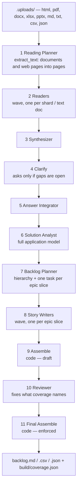

# Feature Specification: backlog — full-application user stories from an HTML prototype and its documents

**Spec ID**: 021-backlog
**Created**: 2026-09-25
**Status**: IMPLEMENTED (revision 3 — full application documents, §14). Not yet run live; see tasks.md § Status.
**Root**: `backend/agents/workflows/backlog/workflow.yaml`, `backend/app/agents/tools/html_extract.py` (new) + `file_extract_tools.py`, `backend/agents/capabilities/backlog_assemble.py`, `backend/app/api/run_files.py`, `backend/app/api/file_extract.py`, the frontend upload accept lists
**Grounding**: `backend/agents/workflows/prototype_v2/workflow.yaml` — the reading half (planner → shard readers → synthesizer → clarify → integrator) is reused, and its prompt-authoring conventions are adopted wholesale · `backend/agents/capabilities/assemble_step.py` — the pattern for a code-only (`mechanical:`) step · spec [019](../019-file-extract-support/spec.md) — `extract_text` and shards · [ADR-0047](../../.knowledge/cards/20260918-ADR-0047.md) — `ask_user` · live run `417e3c59` (prototype_v2, 2026-09-25) — the evidence in §3

---

## Clarifications

### Session 2026-09-25

Decisions taken in conversation, each with the reason it is not recoverable from the code.

- **Q: What is the input?**
  **A: Any HTML — most often a `prototype.html` — plus supporting documents: a TRD, small story sets, domain notes.** All arrive as uploads. Chaining from a finished prototype run is out of scope for this spec.

- **Q: How is the HTML read?**
  **A: By `extract_text`, like every other document** (revision 2). Its new HTML route opens the page in a headless browser — in code — finds every screen, dialog and state, and writes each one as a PAGE of `.extract/html/<slug>/`: a `text.md` holding the screen's fields, exact options, validation attributes, actions with their targets, tables, hidden states and messages, plus the screen's screenshot as `image-1.png`. The page's own scripts become further text pages. The Planner then shards a web page exactly as it shards a PDF, and the Readers read screens with their unchanged page-reading steps. A browser, not a static parser, because it sees screens that scripts build at runtime. Revision 1 put the browser work in the prompts — six JavaScript snippets run through the `playwright` tools by a Screen Inventory agent and per-screen readers; the user rejected code in prompts, so the code moved into the tool.

- **Q: Why a tool, and not a code-only step before the readers?**
  **A: No engine change, one entry point, reuse.** A tool lives in `app/` and reuses the backend's browser setup and URL policy; a `mechanical:` step lives in `agents/capabilities`, cannot import `app.*`, and needs another engine dispatch branch. Spec 019's own rule is one `extract_text` for every format, so an agent never picks a tool by container format. And every workflow that grants `file_extract` — prototype_v2 included — can then read an uploaded HTML.

- **Q: How are big files split?**
  **A: By `extract_text`.** `.pdf`/`.docx`/`.xlsx`/`.pptx` shard exactly as in prototype_v2; `.html`/`.htm` shard by screen (above), through the same packer. `.txt`/`.md`/`.csv`/`.json` are not extracted: a Reader reads each with `read_file`, paging to its end.

- **Q: What is the output?**
  **A: `backlog.md` (the deliverable), `backlog.csv` (Jira import) and `backlog.json`.**

- **Q: Why `backlog.md` and not `user_stories.md`?**
  **A: So the run page renders all of it.** `PreviewPanel.tsx:265` sends a deliverable named exactly `user_stories.md` to `UserStoryPreview`, whose parser (`frontend/src/lib/parsers/userStoryParser.ts`) knows two levels only — `#` epic, `##` story — reads acceptance criteria as `- ` bullets, skips tables and ignores fenced blocks. This format's Feature level, Gherkin blocks, tables and appendices would render as fake epics or not at all. Any other name falls through to the generic `MarkdownPreview` (`PreviewPanel.tsx:268`), which renders the whole document. Chosen over a parser change to keep the frontend untouched.

- **Q: When does it ask the user?**
  **A: Only when gaps are still open after every document has been read and cross-checked.** The Clarify step already asks nothing when no gap is open (prototype_v2 `fi-gaps` Phase 1 step 3).

- **Q: How wide is the scope?**
  **A: Everything a full application needs** — functional features, data models, integrations, roles and permissions, platform capabilities and NFRs. Every item is marked **evidenced** (with its source) or **inferred** (standard for a full application, absent from the documents). Inferred items become real stories labelled `inferred`, so one filter keeps or drops them all.

- **Q: What hierarchy?**
  **A: Both `Epic → Story` and `Feature → Epic → Story`, chosen by a rule** (§6.4), recorded in `backlog-plan.md`.

- **Q: Which writing standards?**
  **A: Connextra (`As a / I want / So that`) + INVEST for the story; EARS for requirements, exactly as prototype_v2's Analyst enforces it; Gherkin for acceptance criteria, with every scenario traced to a requirement.** EARS (Easy Approach to Requirements Syntax) originated at Rolls-Royce, not Porsche as first recalled; it is the standard the prototype spec already uses (`prototype_v2/workflow.yaml:633-647`).

- **Q: May the engine change?**
  **A: No major engine or kernel change.** The one engine touch allowed is registering the new code-only step kind `assemble_backlog` — the same per-kind dispatch branch `assemble_prototype` already has (`assemble_step.py:23-27`).

- **Q: What about the engine's `## How to deliver` footer?**
  **A: Engine-owned, untouched.** It is the fallback delivery for any agent whose prompt defines no output of its own. This workflow's prompts define their own documents by exact path, and the agent still writes the step file the footer names — carrying its one-line report (§3 F1, §9 rule 1). No code, test or manifest in this spec alters the footer or how its filename is derived.

- **Q: Which code changes are allowed?**
  **A: Four:** `.html`/`.htm` on the upload allow-lists; the HTML route in `extract_text`; the `assemble_backlog` step; the new manifest with its registration. Everything else is prompts, and prompts carry no code.

---

## 1. Problem

The shipped `user_stories` workflow (`backend/agents/workflows/user_stories/workflow.yaml`) runs six fixed agents over the brief and streams one markdown answer. It cannot do the job this spec is for:

- **It cannot read the inputs.** A full prototype is hundreds of KB of HTML; a TRD is tens of pages. Nothing in that pipeline shards, extracts or opens a browser. `.html` is not even uploadable (§3 F4).
- **It cannot prove coverage.** There is no inventory of what the inputs contain, so nothing can say which screen, field rule or integration has no story.
- **It stops at the screens.** Data models, integrations, roles and platform capabilities appear only when the brief spells them out.
- **It has no traceability and no Jira import.** Stories carry no link back to a source page or screen, and the only output is markdown.

## 2. What it does

Reads every upload — documents by shard, web pages by screen, both through `extract_text` — reconciles them into one synthesis, asks only about what is still open, derives the full application model, plans a backlog, writes stories in parallel one epic at a time, and assembles them **in code** into three outputs with a coverage report. A reviewer fixes what the coverage report names, and code assembles again.



## 3. Evidence from run `417e3c59` (prototype_v2, 2026-09-25)

The run the user was driving while this spec was written. Four findings shape the design.

- **F1 — the engine's delivery footer overrides a prompt's own output file.** Every custom-agent step's system prompt ends with `## How to deliver — Call write_file with path <instance>-<prompt-slug>.md. Its content is your answer` (the run's `agent_input` event). Coming last, it wins: the Synthesizer wrote its synthesis into `fi-synth-please-create-prototype-attached-screens.md` and the Analyst wrote the spec into `pb-spec-please-create-prototype-attached-screens.md`. **`synthesis.md` and `spec.md` never existed at the run root**; later steps found the step files and carried on. **Consequence for this spec:** every prompt names its work files explicitly AND says the step file carries one line — the report — never the work (§9 rule 1). The engine is not changed.
- **F2 — a text upload was silently dropped.** `screens.json` was uploaded and listed in `.uploads/manifest.json`, but the planner builds tasks only from `.extract/*/manifest.json` shards, and text formats are returned inline, never materialised. No reader saw it. **Consequence:** the planner creates one task per text upload too, and FR-012 makes every upload accounted for.
- **F3 — a reader wrote outside its directory.** `build/file-synthesis/4-azure/` appeared beside the correct `file-synthesis/4-azure/`. **Consequence:** reader prompts keep prototype_v2's "you write into X and nowhere else" rule, and the synthesizer reconciles against `build/tasks.json`, not against what it finds.
- **F4 — `.html` is refused twice.** The upload endpoint's allow-list (`backend/app/api/run_files.py:129-131`) is `pdf, docx, xlsx, pptx, txt, md, csv, json` → 415; `extract_text` refuses any other extension (`backend/app/agents/tools/file_extract_tools.py:75-77`). **Consequence:** FR-001..FR-003, and the HTML route FR-010, FR-011, FR-013.

## 4. Requirements

Written in EARS, the standard this workflow enforces on its own output.

### 4.1 Ingestion (code)

- **FR-001** | ubiquitous | The upload endpoint shall accept `.html` and `.htm` files under the existing per-file, file-count and aggregate caps.
- **FR-002** | ubiquitous | The extract-text preview endpoint shall accept `.html` and `.htm` and return an empty preview, as it does for `.xlsx`.
- **FR-003** | ubiquitous | The launch wizard shall let the user attach `.html` and `.htm` files.
- **FR-004** | unwanted | If an app route lists, previews or serves a run file under `.uploads/`, then the system shall not serve an uploaded `.html` with an executable content type. *(Already true — `.uploads/` is a reserved path excluded from every listing and serving route, §12 P0-6. No code; T01's test asserts it stays true.)*

### 4.2 Reading (prompts)

- **FR-010** | event | When `extract_text` is called on an `.html` or `.htm` upload, the tool shall materialise it into `.extract/html/<slug>/` with one page per screen, dialog or state, then its script pages, and a `manifest.json` whose shards have the same shape as a PDF's.
- **FR-011** | ubiquitous | Each screen page shall hold a `text.md` listing the screen's fields (label, control, required, validation attributes, options copied exactly), actions (label and target), tables (columns and up to five real rows), hidden states and messages, and reference its screenshot `image-1.png`.
- **FR-012** | unwanted | If an upload listed in `.uploads/manifest.json` has no task, then the Reading Planner shall record it under `skipped` in `build/tasks.json` with the reason.
- **FR-013** | unwanted | If no browser can be launched, then the tool shall materialise the page from its static markup and say so in the manifest (`"rendered_by": "static"`) and in its receipt.
- **FR-014** | event | When the Reading Planner runs, it shall write one task per shard — web pages included — and one per text upload into `build/tasks.json`.
- **FR-015** | ubiquitous | Every reader shall also record actors, entities, integrations, roles, NFRs and pre-existing stories wherever its source names them.

### 4.3 Reconciliation and clarification (prompts)

- **FR-020** | ubiquitous | The Synthesizer shall write one corpus `synthesis.md` whose every claim carries its source reference, and a `validate.json` listing every gap with `filled_from` set or null.
- **FR-021** | state | While no gap in `validate.json` has `filled_from: null`, the Clarify step shall ask the user nothing.
- **FR-022** | event | When the user answers, the Answer Integrator shall write each answer into `synthesis.md` as a fact marked `[user]`.

### 4.4 Application model and backlog (prompts)

- **FR-030** | ubiquitous | The Solution Analyst shall write `build/solution/{features,screens,entities,integrations,roles,nfrs,platform}.json`, every item carrying `provenance` (`evidenced` or `inferred`) and `sources`.
- **FR-031** | ubiquitous | The Backlog Planner shall choose the hierarchy by the rule in §6.4 and record the choice and its reason in `backlog-plan.md`.
- **FR-032** | ubiquitous | The Backlog Planner shall write `build/backlog-plan.json` (the hierarchy) and `build/story-tasks.json` with one task per epic slice, each naming the coverage items it must cover and its ID prefix.
- **FR-033** | unwanted | If a coverage item from `build/solution/` is assigned to no epic, then the Backlog Planner shall list it under `unassigned` in `build/backlog-plan.json`.

### 4.5 Story writing (prompts)

- **FR-040** | ubiquitous | Each Story Writer shall write exactly one file, `stories/<task id>.json`, in the schema of §6.6.
- **FR-041** | ubiquitous | Every story shall state its need in Connextra form and carry EARS requirements and Gherkin acceptance criteria per §7.
- **FR-042** | ubiquitous | Every Gherkin scenario shall carry an `@REQ-…` tag naming a requirement of its own story.

### 4.6 Assembly (code)

- **FR-050** | ubiquitous | The `assemble_backlog` step shall read `build/backlog-plan.json`, `build/solution/*.json` and `stories/*.json` and write `backlog.md`, `backlog.csv`, `backlog.json` and `build/coverage.json`.
- **FR-051** | ubiquitous | The step shall check every story against §6.6 and §7 and record each failure in `build/coverage.json` with its story id.
- **FR-052** | ubiquitous | The step shall record in `build/coverage.json` every coverage item no story covers, every requirement no scenario tags and every scenario whose tag names no requirement.
- **FR-053** | state | While `build/review.json` is absent, the step shall record failures without failing the run.
- **FR-054** | unwanted | If `build/review.json` exists and fewer than 85% of evidenced coverage items are covered, then the step shall fail the run, after writing all four files, naming every uncovered item.
- **FR-055** | unwanted | If no `stories/*.json` file parses, then the step shall fail the run.

### 4.7 Registration

- **FR-060** | ubiquitous | The workflow shall be launchable from the wizard as `backlog`, entitled on the same plans as `prototype_v2`.

## 5. The workflow

| # | instance_id | Name | Strategy | Tools | Model | Reads | Writes |
|---|---|---|---|---|---|---|---|
| 1 | `us-planner` | Reading Planner | single_shot | read, write, `file_extract` | sonnet-4-6 | `.uploads/manifest.json`, `.extract/*/*/manifest.json` | `build/tasks.json` |
| 2 | `us-readers` | Readers | wave_scheduler / `json_tasks` on `build/tasks.json`, max_parallel 6 | read, write | sonnet-4-6 | its task's pages, or its text file | `file-synthesis/<doc>/…` |
| 3 | `us-synth` | Synthesizer | single_shot | read, write | default | every `file-synthesis/<doc>/` | `synthesis.md`, `validate.json` |
| 4 | `us-gaps` | Clarify | single_shot | read, `ask_user` | default | `validate.json`, `synthesis.md` | — |
| 5 | `us-close` | Answer Integrator | single_shot | read, write | default | `clarify/answers.json` | `synthesis.md`, `validate.json` (edited) |
| 6 | `us-solution` | Solution Analyst | single_shot | read, write | sonnet-4-6 | `synthesis.md`, every per-document synthesis | `build/solution/*.json`, `solution.md` |
| 7 | `us-backlog` | Backlog Planner | single_shot | read, write | sonnet-4-6 | `build/solution/*.json`, `solution.md` | `backlog-plan.md`, `build/backlog-plan.json`, `build/story-tasks.json` |
| 8 | `us-write` | Story Writers | wave_scheduler / `json_tasks` on `build/story-tasks.json`, max_parallel 6 | read, write | sonnet-4-6 | its task, `build/solution/*.json`, `synthesis.md` | `stories/<task id>.json` |
| 9 | `us-assemble` | Assemble | `mechanical: assemble_backlog` | — | — | §6 | three outputs + `build/coverage.json` |
| 10 | `us-review` | Reviewer | single_shot | read, write | sonnet-4-6 | `build/coverage.json`, `stories/*.json` | `stories/*.json` (edited), `build/review.json` |
| 11 | `us-final` | Final Assemble | `mechanical: assemble_backlog` | — | — | §6 | the final outputs |

Per-stage Clarify (2026-09-26): every stage that makes decisions has its own Clarify step right before it, with no engine change. Solution Clarify (`us-gaps`, ids `gap-N`) serves the Solution Analyst. API Clarify (`us-api-clarify`, `api-N`) comes before the API Designer, Architecture Clarify (`us-architect-clarify`, `arch-N`) before the Architect, and Backlog Clarify (`us-backlog-clarify`, `plan-N`, which release each feature ships in) before the Backlog Planner. Each Clarify step assesses what its stage will be given and, before asking, writes `.clarify/<stage>.json` (`solution`, `api`, `architect`, `backlog`) as `{"for", "settled": [{"decision", "answer", "source"}], "asked": [question objects]}`. It never re-asks a question already in `clarify/answers.json`. The stage reads its `.clarify` file before it starts, and takes each asked question's answer from `clarify/answers.json` by id; an unanswered question falls back to its recommended answer, marked inferred. No engine change: the engine still writes only `clarify/answers.json`. A step inserted between a Clarify and its stage changes nothing. Fan-out workers and code steps never ask.

Step contracts (2026-09-26): every model step declares `produces` / `consumes` as file paths (folders end in `/`). Code steps declare none in the manifest; their capability's `@register(reads=, process=, writes=)` says what they read and write, and `/api/capabilities` serves it. Run inputs (`.uploads/`, `.context/`) are never listed in `consumes`: the engine's run-start check halts a run whose step consumes only files no earlier step produces.

Workflow-level: `launch_surface: wizard`, `planner: skip`, `clarify: {mode: skip}` (Clarify is step 4, not the pre-run questionnaire), `deliverable: {strategy: single_file, name: backlog.md}`, `limits: {max_subagents: 200, max_depth: 2, wall_clock_seconds: 10800}` — prototype_v2's values. `context_providers: []`: no design system or template is needed to write stories.

## 6. File contracts

Every JSON file is written with ONE `write_file` call, as one line of text (prototype_v2 convention — an object passed as `content` is refused).

### 6.1 `.extract/html/<slug>/` (written by `extract_text`, step 1)

The PDF layout, so every downstream prompt treats a web page like any other document:

```text
.extract/html/<slug>/manifest.json         source, source_sha256, source_format "html", rendered_by "chromium" | "static",
                                           page_count, pages{}, shards[] (the same packer), screens[{page, id, title, kind}]
.extract/html/<slug>/pages/NN/text.md      one screen, or one script chunk
.extract/html/<slug>/pages/NN/image-1.png  that screen's screenshot (screen pages, browser route only)
.extract/html/<slug>/document.md           every page, one file
```

A screen page's `text.md`:

```text
@[[image-1.png]]
# Screen: Anchor
id: anchor · kind: page · selector: #anchor · shown by: window.__prototype.show('anchor')

## Fields
| Label | Control | Required | Validation | Options or value |
|---|---|---|---|---|
| Effective Date | date | yes | min=2026-01-01 | |
| Policy Type | dropdown | yes | | Auto; Home; Renters; Umbrella |

## Actions
| Label | Goes to or does |
|---|---|
| Begin Quote | data-goto=beacon |

## Tables
## Hidden states and messages
- anchor--error (hidden): "Effective Date cannot be in the past"

## Text
<the screen's text>
```

Script pages follow the screens: a `# Scripts index` page (every script, with libraries — a `src`, or a minified vendor bundle — and the prototype shell's own runtime listed, not copied), then `# Script <n>` pages holding the app's own code in a fenced block of at most 20,000 characters each, then a `# Inline handlers` page listing every `on…` attribute with its element.

Screen detection, in order: a prototype_v2 shell (`window.__prototype` exists → `section.screen` pages and `div.dialog` dialogs); otherwise `section`, `form`, `main > *`, dialogs and any element whose id or class contains `screen|page|view|step|modal|dialog`, dropping wrappers that hold two or more candidates and keeping the outermost of the rest; otherwise one section per `h1`/`h2`; otherwise the whole page as one screen.

### 6.2 `build/tasks.json` (step 2) — the `json_tasks` shape prototype_v2 already uses

```json
{"tasks": [
  {"id": "<shard id>", "title": "…", "targets": ["file-synthesis/<slug>/shards/<shard id>/status.json"], "depends_on": [], "body": "Shard … Read them from <source>."},
  {"id": "<slug>-rollup", "title": "…", "targets": ["file-synthesis/<slug>/status.json"], "depends_on": ["<every shard id of this document>"], "body": "Rollup for <slug>."},
  {"id": "<slug>-text", "title": "…", "targets": ["file-synthesis/<slug>/status.json"], "depends_on": [], "body": "Text document .uploads/<name>. Read it with read_file to its end."}],
 "skipped": [{"name": "…", "reason": "…"}]}
```

A web page is a paged document like any other: one task per shard, and a rollup only when it has more than one shard (prototype_v2's rule).

### 6.3 `build/solution/*.json` (step 7)

One file per kind, each `{"items": [...]}`. Every item: `id`, `name`, `provenance` (`evidenced` | `inferred`), `sources` (`["<doc> p.NN"]` — a web page's screens are pages too — or `["[user]"]`; empty only when inferred), plus per kind:

- `features` (`FTR-nn`): `description`, `screens[]`.
- `screens` (`SCR-<screen id>`): `fields[]` (`{name, control, required, validation, example, options}`), `actions[]` (`{label, result, navigates_to}`), `states[]`.
- `entities` (`ENT-nn`): `attributes[]` (`{name, type, required, validation, example}`), `relationships[]` (`{to, kind: "1-1"|"1-n"|"n-n", via}`), `lifecycle[]` (states).
- `integrations` (`INT-nn`): `system`, `direction` (`in`|`out`|`both`), `trigger`, `data`, `failure`.
- `roles` (`ROL-nn`): `permissions[]` (`{on, actions[]}`).
- `nfrs` (`NFR-nn`): `category`, `statement`.
- `platform` (`PLT-nn`): `capability` — one of login/SSO, roles and permissions, audit log, notifications, admin and configuration, search, reporting, import/export, retention, error handling, logging and monitoring, security and privacy, accessibility, performance.

Every item is a **coverage item**: FR-052 checks each one maps to a story.

### 6.4 `build/backlog-plan.json` and the hierarchy rule (step 8)

**Rule:** one module and 8 or fewer epics → `Epic → Story` (`"shape": "epic-story"`); several modules or more than 8 epics → `Feature → Epic → Story` (`"shape": "feature-epic-story"`), one feature per module or capability area.

```json
{"shape": "feature-epic-story", "product": "…", "personas": [{"id": "PER-01", "name": "…", "goal": "…"}],
 "features": [{"id": "FEAT-01", "name": "Quoting", "epics": ["EPIC-01", "EPIC-02"]}],
 "epics": [{"id": "EPIC-01", "name": "…", "type": "functional" | "data" | "integration" | "platform",
   "feature": "FEAT-01" | null, "provenance": "evidenced" | "inferred", "covers": ["SCR-anchor", "ENT-01"]}],
 "unassigned": []}
```

Epic types: `functional` (user-facing features and screens), `data` (create/read/update/delete, validation, lifecycle, import/export, retention per entity), `integration` (connect, sync, error handling and retry, monitoring per external system), `platform` (the §6.3 platform capabilities).

### 6.5 `build/story-tasks.json` (step 8)

`json_tasks` shape; one task per **epic slice** — an epic whose coverage list is too long for one writer (more than ~12 stories' worth) is split into `EPIC-01a`, `EPIC-01b`, each with its own coverage items and its own ID prefix.

```json
{"tasks": [{"id": "EPIC-01a", "title": "…", "targets": ["stories/EPIC-01a.json"], "depends_on": [],
  "body": "Epic EPIC-01 (functional) of feature FEAT-01. Story ids US-01a-NN, requirement ids REQ-01a-NNN. Cover: SCR-anchor, SCR-beacon, ENT-01."}]}
```

Per-slice ID prefixes make IDs unique with no coordination between parallel writers.

### 6.6 `stories/<task id>.json` (step 9) — the single source every output is rendered from

```json
{"epic": "EPIC-01", "stories": [{
  "id": "US-01a-01", "feature": "FEAT-01" | null, "epic": "EPIC-01", "type": "story" | "enabler",
  "title": "…", "persona": "PER-01", "as_a": "…", "i_want": "…", "so_that": "…",
  "description": "…", "preconditions": ["…"],
  "requirements": [{"id": "REQ-01a-001", "pattern": "event", "text": "When …, the system shall …"}],
  "gherkin": ["Feature: …", "  Background:", "    Given …", "  @US-01a-01 @REQ-01a-001 @P0", "  Scenario: …", "    Given …", "    When …", "    Then …"],
  "ui": [{"screen": "SCR-anchor", "field": "Effective Date", "control": "date", "required": true, "validation": "not in the past", "example": "2026-10-01", "options": []}],
  "data": [{"entity": "ENT-01", "operation": "create", "attributes": ["…"]}],
  "integrations": [{"integration": "INT-01", "behaviour": "…"}],
  "business_rules": ["…"], "nfr": ["NFR-03"], "dependencies": ["US-01a-02"],
  "priority": "P0" | "P1" | "P2", "points": 1 | 2 | 3 | 5 | 8 | 13, "labels": ["…"],
  "provenance": "evidenced" | "inferred", "sources": ["…"], "covers": ["SCR-anchor"], "open_questions": ["…"]}]}
```

`gherkin` is a list of lines, never one string: a writer escaping newlines inside one-line JSON is the failure this avoids. Priority and points follow `backend/agents/guardrails/agile.md` (P0/P1/P2, Fibonacci).

### 6.7 `build/coverage.json` (steps 10, 12) and `build/review.json` (step 11)

```json
{"mode": "draft" | "final", "shape": "…",
 "uncovered": [{"item": "ENT-03", "provenance": "evidenced"}],
 "requirements_without_scenario": ["REQ-01a-004"], "scenarios_without_requirement": [{"story": "US-01a-02", "scenario": "…"}],
 "story_errors": [{"story": "US-01a-03", "check": "ears.shall_count", "detail": "…"}],
 "hierarchy_errors": [{"id": "EPIC-04", "error": "no stories"}],
 "totals": {"coverage_items": 0, "covered": 0, "evidenced": 0, "evidenced_covered": 0}}
```

`totals` is computed by code from the lists, never typed by a model. `build/review.json`: `{"rounds": N, "fixed": [{"story|item": "…", "change": "…"}], "open": [{"…": "…", "reason": "…"}]}`.

## 7. Writing standards

### 7.1 Story

Connextra: `As a <persona>, I want <capability>, so that <benefit>`. INVEST: independent, negotiable, valuable, estimable, small (≤ 13 points, else split), testable (every story has at least one scenario).

### 7.2 EARS — the rules prototype_v2's Analyst enforces (`workflow.yaml:633-647`)

- Five patterns and no sixth: `ubiquitous` (`The system shall …`), `event` (`When …, the system shall …`), `state` (`While …, the system shall …`), `unwanted` (`If …, then the system shall …`), `optional` (`Where …, the system shall …`). Compound: outer condition first — `While …, when …, the system shall …`.
- The pattern keyword is the first word; `shall` appears exactly once; none of `should`, `may`, `might`, `could`, `will`, `must`; the system is named, never implied.
- `When` moves the user to a different screen or is a discrete trigger; `While` is a condition that holds while the user stays where they are.

### 7.3 Gherkin

- Keywords: `Feature`, `Background`, `Rule`, `Scenario`, `Scenario Outline` + `Examples`, `Given`/`When`/`Then`/`And`/`But`.
- One behaviour per scenario. Declarative, not imperative: "the applicant submits a quote with a past effective date", never "clicks the button with id x". Present tense, third person, no implementation detail (`agile.md`).
- Ranges and option lists become a `Scenario Outline` whose `Examples` carry the real values from the documents, copied character for character.
- Tags: `@US-… @REQ-… @P0|@P1|@P2`, plus `@data`, `@integration`, `@nfr`, `@inferred` where they apply.

### 7.4 EARS → Gherkin

| EARS pattern | Scenario shape |
|---|---|
| ubiquitous | `Background`, or a `Then` asserted in every scenario of the story |
| event | `When <trigger>` → `Then <response>` |
| state | `Given <state>` → `Then <response>` |
| unwanted | negative scenario: `Given`/`When <condition>` → `Then` the action is refused and the message is shown |
| optional | scenario tagged with the variant it belongs to |

## 8. Outputs (rendered by code from §6)

### 8.1 `backlog.md`

1. Overview — product, personas, shape, counts, the hierarchy as a nested list.
2. The backlog — `## FEAT-… ` → `### EPIC-…` → `#### US-…` (or `## EPIC` → `### US` for `epic-story`). Each story: statement, description, preconditions, requirements table (`id | pattern | text`), a fenced `gherkin` block, UI fields table, data, integrations, business rules, NFRs, dependencies, priority, points, labels, provenance and sources.
3. Appendices: **A** data model (one table per entity + a mermaid `erDiagram`), **B** integration catalogue, **C** role-permission matrix, **D** NFRs, **E** traceability (source → coverage item → story → requirement → scenario), **F** inferred items and open questions, **G** coverage summary from `build/coverage.json`.

### 8.2 `backlog.csv` — Jira CSV import

Columns: `Issue Id`, `Parent Id`, `Issue Type` (`Feature` | `Epic` | `Story`; enablers as `Story` labelled `enabler`), `Summary`, `Description` (statement + description + requirements), `Acceptance Criteria` (the Gherkin), `Priority` (P0→Highest, P1→High, P2→Medium), `Story Points`, `Labels` (space-separated), `Component` (the feature name — Jira Standard has no level above Epic, so grouping survives either way). RFC 4180 quoting via the stdlib `csv` module.

### 8.3 `backlog.json`

`{"backlog": <build/backlog-plan.json>, "solution": {<kind>: [...]}, "stories": [<every story, backlog order>], "coverage": <build/coverage.json>}`.

## 9. Prompt conventions (inherited from prototype_v2, plus two new)

1. **Two files, never one** (new, §3 F1). The engine's `## How to deliver` footer is engine-owned and stays the fallback; the prompt works WITH it, never against it. Each prompt names its work files by exact path and ends: "Then deliver the step file the engine asks for with ONE line — your report. It never holds the work."
2. Phases, each with **Rules** and **Steps**; the steps are numbered and imperative.
3. Paths have a leading dot and no leading slash; drop a `/` a tool hands back.
4. Read to the END: page `read_file` until a short or empty page comes back.
5. Option lists, codes, ranges and messages are COPIED, never described.
6. **The list is the count** — never type a total a list already holds; code computes totals.
7. What SHOULD exist comes from the task/inventory file, never from what was found.
8. Never invent a fact to close a gap; an open gap is a correct answer. Inferred items are marked `inferred`, never passed off as evidenced.
9. JSON is written with ONE `write_file`, as one line of text; on an "invalid content" error, send the same JSON again as text.
10. A writer writes into its own directory and nowhere else, then `ls`-checks the name (§3 F3).
11. **No code in prompts** (new, revision 2). Anything that must run the same way every time is code — a tool (`extract_text`) or a code step (`assemble_backlog`). A prompt says in plain English which tool to call and what to record.

## 10. Out of scope

- Paging large text files in `extract_text` — a Reader pages them with `read_file`.
- Changing the engine's `## How to deliver` footer.
- Chaining from a prototype run; a `backlog_revision` workflow; pushing to Jira through its API; exporting `.feature` files.

## 11. Risks

- **R-01 No browser in the backend.** If Chromium cannot launch, the HTML route falls back to the static markup (FR-013): screens that scripts build at runtime are missed and there are no screenshots, and the manifest says so.
- **R-07 A shared tool changes.** `extract_text` also serves prototype_v2 and pdf_to_prototype. The HTML route is a new branch keyed on the extension; the PDF and Office routes are untouched, and their existing tests must pass unchanged (T12).
- **R-02 Output size.** A writer's JSON for a large epic could exceed one reply. Mitigated by epic slices (§6.5).
- **R-03 `write_file` does not overwrite — CONFIRMED** (§12 P0-4). The Answer Integrator (`synthesis.md`, `validate.json`) and the Reviewer (`stories/*.json`) must use `edit_file`; prototype_v2's Integrator prompt says `write_file synthesis.md`, which fails on an existing file, and this workflow's prompt must not copy that line. Code steps write through `sandbox.write`.
- **R-04 CSV/JSON not downloadable — CLOSED.** Reachable through per-file download and the run zip (§12 P0-5).
- **R-05 Unrendered deliverable — CLOSED** by naming the deliverable `backlog.md` (Clarifications).
- **R-06 Cost and time.** 11 steps, two waves, a 3-hour wall clock — the same envelope as prototype_v2.

## 12. Phase 0 findings

Read-only checks, 2026-09-25. Paths relative to `backend/` unless they start with `frontend/`.

- **P0-1 Browser tools** *(revision 1 only — agents no longer drive the browser)*. `playwright_navigate` accepts a sandbox-relative path and resolves it through `RunSandbox.path_for`, traversal-proof (`app/agents/tools/playwright.py:96-142`) — `.uploads/prototype.html` is valid. Each fan-out worker gets its own BrowserContext: the context key is a `ContextVar` set to `worker_key or agent_id` (`playwright.py:42-68`), and a page is created per context (`:133`). Tools: `playwright_navigate`, `_snapshot`, `_click`, `_type`, `_take_screenshot`, `_evaluate`, `_console_messages`; screenshots go to `.browser/` (`:39`, `:271-276`).
- **P0-2 `ask_user`.** Question object `{id, question, answerType: "single_choice", options, recommendedAnswer, recommendedReasoning, impactLevel}` (`app/agents/tools/runner_tools.py:62-83`); answers land in `clarify/answers.json` as `{answers: [{id, question, answer, answered}], rounds}`, as prototype_v2's Integrator reads them.
- **P0-3 `json_tasks` + `wave_scheduler`.** Only `id` is required; `title`, `body`, `targets`, `depends_on`, `conflict_keys`, `done_when` are optional (`agents/capabilities/task_parsers/json_tasks.py:140-153`). Waves come from a topological sort; `conflict_keys` default to `targets`, so two tasks sharing a target never run together; an unknown `depends_on` fails before any worker spawns (`agents/capabilities/strategies/wave_scheduler.py:66-138`). A failed worker surfaces as `FanoutWorkerFailed` after its wave completes (`agents/execution_engine/fanout.py:120-139`).
- **P0-4 Writes.** `write_file` fails on an existing path; `.json` content is `json.loads`-validated on write and edit (`app/agents/validating_backend.py:25-74`). → R-03.
- **P0-5 Downloads.** Per-file download `getRunSandboxFileBlob` and whole-run zip `getRunSandboxZip` (`frontend/src/lib/api.ts:1672-1708`). `backlog.csv` / `backlog.json` at the run root are reachable. → R-04 closed, T09 dropped.
- **P0-6 Reserved paths and HTML safety.** `RESERVED_PATHS` (`app/agents/sandbox.py:179-195`) includes `.uploads/`, `.browser/`, `.extract/`, `.agents/`, `.context/`, `.logs/`, `.verify/` and is excluded from listing and the deliverable; shares are guarded by `_assert_share_output_clean` (`app/api/runs.py:2178-2214`). An HTML deliverable previews in an iframe with `sandbox="allow-scripts"` and no `allow-same-origin` (`frontend/src/components/preview/PreviewPanel.tsx:253`). An uploaded `.html` is never listed, served or rendered. → FR-004 needs no code, T08 dropped.
- **P0-7 Deliverable rendering.** Markdown dispatch is by mimetype then exact filename (`PreviewPanel.tsx:262-268`); only `user_stories.md` gets `UserStoryPreview`. → the `backlog.md` decision.
- **P0-8 Delivery footer.** Built in `_compose_system_prompt` only for a step with write access (`agents/factory.py:727-731`); the filename is `ctx.deliverable_filename_override` when set, else `artifact_name(instance_id, topic)` (`factory.py:704-705`). Engine-owned; unchanged by this spec. The override is set only for the leaf step (`engine.py` `_deliverable_filename_override`, keyed on `step.is_leaf`; with no `route:` the leaf is the last array step — `compiler.py` `_compute_is_leaf`). Here that is Final Assemble, a mechanical step that never builds an `AgentContext`, so no agent's footer names `backlog.md`: the Reviewer's step file is its own per-instance name. The assemble code writes `backlog.md` itself from `ctx.deliverable.name`.
- **P0-9 Mechanical kinds.** Dispatch is a per-kind `elif` before strategy resolution (`agents/execution_engine/engine.py:6318-6344`): `publish` → `MechanicalPublishStrategy`, `assemble_prototype` → `MechanicalAssembleStrategy`, both constructed with `spec, index, total, results`. The palette entry is a registry stub, `@register("mechanical", "assemble_prototype", user_allowed=True, …)` (`agents/capabilities/assemble_step.py:522`). The step reads and writes through `ctx.runner.sandbox.read/write`, and raises `AssembleStepFailed` to fail the run (`assemble_step.py:480-519`; engine comment `:6330-6332`). The compiler holds the closed set `_ALLOWED_MECHANICAL_KINDS = {"publish", "assemble_prototype"}` (`agents/workflows/compiler.py:201`, enforced in `_compile_step`, which also forbids `tools:` on a mechanical step); `agent: custom-agent` + `instance_id` + `mechanical:` is legal. The palette lists a kind only if its module is in `registry.discover()`'s built-in module tuple (`agents/capabilities/registry.py:355`). → T04 sites: compiler set, registry module tuple, one engine `elif`.
- **P0-10 Registration and attach sites.** The catalog is disk-discovered (`app/api/workflows.py:86-117`, `_discover_manifest_ids`; a manifest that fails to compile is dropped with a warning) and gated by the manifest's own `user_launchable: true`. The only hard-coded gates are `TIER_PIPELINES` in `app/core/entitlements.py` (lines 26/38/52 — hexaware, pro, enterprise; not basic) and its mirror `frontend/src/lib/entitlements.ts` (31/44/58), kept equal by `tests/unit/services/test_entitlement_parity.py`. `PIPELINE_LABEL` (`frontend/src/components/workflow/AgentsPopup.tsx:251`) has no `prototype_v2` entry either — not needed. The frontend's only attach allow-list is `DOCUMENT_EXTS` in `frontend/src/lib/uploadTypes.ts:17-26` (it replaced three drifting lists); `DOCUMENT_ACCEPT` and `isBinaryUpload` derive from it. Tests touching these: `tests/unit/agents/execution_engine/test_compiler.py`, `tests/unit/agents/test_registry_capabilities.py`, `tests/agents/test_assemble_step.py`, `tests/unit/services/test_entitlement_{parity,authority}.py`, `frontend/src/lib/uploadTypes.test.ts`.
- **P0-11 Jira export.** None found in `frontend/src/components` or `app/api`; `backlog.csv` is the first.
- **P0-12 The user's request and uploads reach every step (dev `0c0df50e8`).** The engine writes the request to `.context/user-prompt.md` before step 1, readable by any step with `read_files`. When any compiled step grants `file_extract` — this workflow's step 1 does — the inlined `=== Attached: … ===` text blocks are replaced by a list of `.uploads/` paths (`strip_inline_attachments`, `app/api/launch_context.py`). So the Reading Planner sees paths, never pasted document text, and must read `.uploads/manifest.json` themselves.

## 13. Acceptance

- Offline: the tests in `tasks.md` pass, one file at a time.
- Live (run by the user): on the reference set (a prototype_v2 `prototype.html` plus the five colour documents), every screen in the prototype appears in `.extract/html/<slug>/manifest.json`; every upload is a task or a `skipped` entry; `backlog.md` renders on the run page; `backlog.csv` imports into Jira with the hierarchy intact; `build/coverage.json` in final mode lists no uncovered evidenced item.

## 14. Revision 3 — the full application documents (2026-09-25)

The user asked that the workflow cover, beyond the backlog: data models / schema, API integrations, API endpoints, a design or architecture document, and everything else a full application needs. Gap analysis at the time:

| Asked for | Before revision 3 | Added here |
|---|---|---|
| backlog: features / epics / stories | done | a release plan (MVP = P0) and links to every document |
| data models / schema | entities as a backlog appendix | `data-model.md` (keys, uniques, enums, reference data, indexes, status diagrams, ER) + `schema.json` |
| API integrations | direction, trigger, data, failure | auth, protocol, calls, field mapping, retry, idempotency, monitoring → `integrations.md` |
| API endpoints | none | an API Designer step → `build/solution/endpoints.json` → `api.md` + `openapi.json` |
| design / architecture | none | an Architect step → `architecture.md` |
| everything else | NFRs, roles, platform | business-rules catalogue (coverage items), glossary, `screens.md` (screen spec + navigation map), test strategy (in `architecture.md`) |

All new documents except `architecture.md` are rendered by the assemble code from structured files, so they cost no model tokens and cannot drift from the backlog. `architecture.md` is judgment and is written by an agent.

### 14.1 Steps (13)

`us-planner` → `us-readers` → `us-synth` → `us-gaps` → `us-close` → `us-solution` → **`us-api`** (API Designer, sonnet-4-6: reads the model, writes `build/solution/endpoints.json`) → **`us-architect`** (Architect, sonnet-4-6: reads the model and the endpoints, writes `architecture.md`) → `us-backlog` → `us-write` → `us-assemble` → `us-review` → `us-final`.

### 14.2 Model additions (`build/solution/`)

- `entities.json` — each attribute also carries `"key"` (`"pk"`, `"fk"` or null), `"references"` (the ENT id an fk points to, else null), `"unique"` (bool), `"default"` (value or null), `"enum"` (the allowed values, copied from the option list, or null). Each entity also carries `"indexes"` ([[attribute, ...], ...]), `"audit"` (bool — created/updated by/at fields) and `"reference_data"` (bool — a lookup table fed by an option list).
- `integrations.json` — each item also carries `"auth"`, `"protocol"`, `"calls"` ([{"operation", "method", "endpoint", "request", "response"}]), `"mapping"` ([{"from", "to"}]), `"retry"`, `"idempotency"`, `"monitoring"`.
- `rules.json` (new, `BR-nn`) — `"statement"`, `"applies_to"` ([SCR / ENT / API ids]), `"message"` (the user-facing message, copied, or null). A coverage item.
- `glossary.json` (new, `GL-nn`) — `"term"`, `"definition"`. NOT a coverage item.
- `endpoints.json` (new, `API-nn`, written by the API Designer) — `"method"`, `"path"` (`/v1/...`, plural nouns, at most one level of nesting), `"summary"`, `"auth"` (`"required"` or `"public"`), `"roles"` ([ROL ids]), `"entity"` (ENT id or null), `"screens"` ([SCR ids]), `"request"` ({"params": [{"name", "in": "path"|"query"|"header", "type", "required", "description"}], "body": [{"name", "type", "required", "validation", "example"}]}), `"response"` ({"status": 200|201|204, "body": [{"name", "type", "example"}]}), `"errors"` ([{"status", "code", "message", "when"}] — messages copied from the rules), `"idempotent"` (bool), `"paginated"` (bool), `"rules"` ([BR ids]), `"integrations"` ([INT ids]). A coverage item.
- Every item keeps `id`, `name`, `provenance`, `sources` and, when inferred, `reason`.
- Coverage items are now: features, screens, entities, integrations, roles, nfrs, platform, **rules**, **endpoints** (glossary excluded).

### 14.3 Story addition

Each story also carries `"api": [API ids]` — the endpoints it needs. Every id must exist in `endpoints.json`; an unknown id is a story error (`api.unknown_endpoint`). The story block renders one line per id: `API: POST /v1/quotes — Create a quote`.

### 14.4 Outputs rendered by the assemble code

- `data-model.md` — one table per entity (`| Attribute | Type | Key | Required | Unique | Default | Enum or validation | Example |`), its relationships and indexes, a `stateDiagram-v2` when it has two or more statuses, a Reference data section listing every enum with its values, and one `erDiagram` for all entities.
- `schema.json` — JSON Schema 2020-12, one `$defs` entry per entity: properties with type (string/text → string; int/integer → integer; number/decimal/money/currency → number; boolean → boolean; date → string + `format: date`; datetime/timestamp → string + `format: date-time`; email → string + `format: email`; anything else → string), `enum`, `default`, `description`; `required` from the required attributes.
- `api.md` — endpoints grouped by entity (a group per ENT, then "Other"): per endpoint `### <METHOD> <path> — <summary>`, auth and roles, params table, body table, response, errors table, rules, integrations, idempotent / paginated, and `Stories:` — every story whose `api` or `covers` names it.
- `openapi.json` — OpenAPI 3.1: `info` (product name, version `1.0.0`), `paths` from the endpoints (operationId = API id, tags = entity name, parameters, a JSON `requestBody` from the body fields with an example, responses including every error with the shared envelope), `components.schemas` = the entity schemas plus `Error` (`{"error": {"code", "message", "details"}}`), `components.securitySchemes.bearerAuth` (http bearer), applied to every `auth: required` operation.
- `integrations.md` — per integration: system, direction, trigger, auth, protocol, a calls table, a mapping table, retry, idempotency, failure, monitoring, stories.
- `screens.md` — a `flowchart` navigation map from the screens' `navigates_to`, then per screen its fields table, actions table, states and covering stories.
- `backlog.md` — adds appendices H (business rules, with the stories that cover each) and I (glossary), and, after the Overview, a **Release plan** (per priority P0 → P1 → P2: the stories grouped by epic, with point totals computed from the stories) and a **Documents** list linking every file above that exists (plus `architecture.md` when the Architect wrote it). The appendices stay.
- `backlog.json`, `build/coverage.json` — pick up the new kinds automatically (rules and endpoints count toward coverage).

### 14.5 `architecture.md` (the Architect)

Sections, in order: Overview and scope · System context (a mermaid diagram of the application, its users and every external system) · Containers and components (a mermaid diagram; per component its responsibility, the entities it owns and the endpoints it serves) · Technology stack (the documents' stack when stated, evidenced; otherwise a recommendation, marked inferred, with one line of reasoning each) · Data architecture (storage choice, the entities by component, retention, backup) · Key flows (a `sequenceDiagram` for each P0 flow through the API and integrations) · Security (authentication, authorisation by role, data protection, secrets, OWASP Top 10) · Integration architecture (sync/async, retry, idempotency, failure isolation per integration) · Deployment and environments · Observability (logs, metrics, traces, alerts) · Scalability and performance (against the NFRs) · Error handling and resilience · Cross-cutting concerns (i18n, accessibility, audit, configuration) · Test strategy (unit, API contract, integration, end-to-end from the Gherkin, performance, security) · NFR traceability (`| NFR | how the architecture meets it |`) · Decisions (one row per decision: context, choice, alternatives, consequence) · Risks and open questions. Every evidenced statement carries its reference; every inference says so.

## 15. Revision 4 — build order (2026-09-28)

Why: read as an engineer, run `c4cbd381`'s backlog could not be started. It had no story for setting up the projects, the database or the pipeline. All 110 story dependencies stayed inside their own epic, because a Story Writer sees only its own slice. 215 of 237 stories were P0. Nothing said what to build first.

- **Foundation, inside the existing template.** The Solution Analyst's platform capabilities gain project setup, data foundation, delivery and test harness, one item each. The Backlog Planner makes each a platform epic, and the Story Writers write their enablers from `architecture.md`.
- **Architecture.** The Architect adds `## Development setup` (per container: repository, run locally, build and package, lint). It states the auth numbers under Security, and the environments, pipeline, secrets, migrations-on-deploy and rollback under Deployment. Architecture Clarify also asks how users sign in and how the application is built and shipped.
- **The graph.** Each epic in `build/backlog-plan.json` carries `depends_on`, set by fixed rules: foundation first, then data by foreign key, then integrations and platform, then the flows that use them. The plan names the `walking_skeleton` (one core flow plus Delivery and Test harness) and a `definition_of_ready` and `definition_of_done`. A story's `dependencies` stay inside its slice.
- **Computed by assemble, never typed.**
  - Milestone 1 is the skeleton and everything it depends on, milestone 2 the rest of the first release, milestone 3 the later release.
  - Waves are the dependency depth inside a milestone. An epic's priority is P0, P1 or P2 by milestone.
  - Each story gets an order and a ready flag (no open question, no story error).
  - The critical path is the heaviest chain of epics by points.
  - Graph errors are reported in `build/coverage.json` for the Reviewer:
    - epic errors in `hierarchy_errors`: unknown or self `depends_on`, a cycle, a first-release epic depending on a later one, an unknown skeleton epic;
    - story errors in `story_errors`: `dependencies.unknown`, `dependencies.cycle`, `dependencies.later`, and `priority.above_epic` (only when the plan names a skeleton).
- **`build-order.md`** is rendered by assemble: a mermaid graph of the epics by milestone, the critical path, then per milestone and wave each epic with its stories in order, then the two definitions and the problems. It is packaged in `Backlog.zip` and is the PDF chapter before the Backlog. `backlog.json` stories carry `milestone`, `wave`, `order` and `ready`; `backlog.csv` adds Milestone, Order and Depends On.
- **Two fixes from the same run.**
  - Every JSON work file puts one list item per line: read_file cuts off at about 80,000 characters, and a one-line `endpoints.json` of 88,561 characters left API-58..64 unread.
  - The EARS check ignores quoted, copied messages: 13 of the 14 errors that survived review were words like "must" inside a message the writer had to copy exactly.
