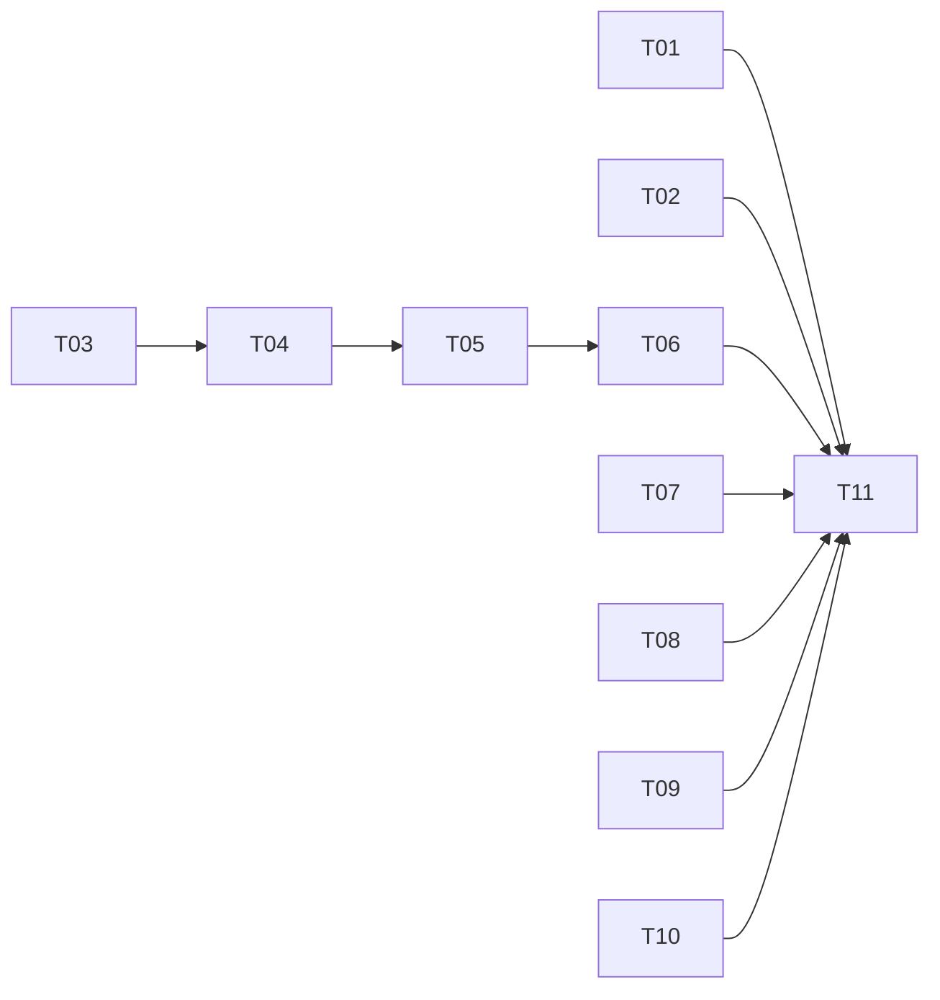

# Tasks: 021-backlog

Spec: [spec.md](spec.md). Every task carries its OWN acceptance criterion; none refers to the cumulative diff. Tests run one file at a time.

**Hard boundary for every task:** the engine's `## How to deliver` footer (`backend/agents/factory.py:727-731`) and its filename derivation are engine-owned and stay untouched — no task edits them, works around them in code, or asserts on them. Prompts define their own documents and still write the footer's step file as a one-line report (spec §9 rule 1).

Executor tags (pre-classified, per the global §7 rule): `[haiku]` mechanical, fully specified · `[sonnet]` needs engineering judgment · `[self]` authoring or review, done by the orchestrating session, never delegated.

## Status (2026-09-25)

| Task | State | Evidence |
|---|---|---|
| T01 | done | `tests/unit/test_upload_html.py` 8 passed; `tests/unit/app/test_file_extract_fix191.py` 21 passed |
| T02 | done | `frontend/src/lib/uploadTypes.test.ts` 8 passed |
| T03 | done | `tests/agents/test_backlog_assemble.py` 21 passed (incl. Reviewer file `stories/review-<epic>.json` discovery); `tests/agents/test_assemble_step.py` 53 passed |
| T04 | done | `compile_for_run("backlog")` → 12 steps, two `assemble_backlog`; `tests/agents/test_mechanical_assemble_backlog.py` 8 passed; `test_compiler.py` 35 passed |
| T05 | superseded | revision 1 manifest (browser scripts in prompts) → reworked by T13 |
| T06 | done | `test_entitlement_parity.py` 57 passed, 1 failed — pre-existing (`sample_subagents_parallel` absent from the frontend enterprise tier at HEAD); `test_entitlement_authority.py` 4 passed |
| T07 | done | `tests/unit/agents/test_registry_capabilities.py` 113 passed (expected-names snapshot gained the new kind) |
| T08, T09 | dropped | spec §12 P0-5, P0-6 |
| T10 | done | review fixed two prompt defects: the Synthesizer's expected-document rule missed single-shard documents; the Planner extracted text uploads into its own context |
| T12 | done | `tests/agents/test_html_extract.py` 14 passed (Chromium available, nothing skipped); `test_file_extract_tools.py` 74 passed + 2 pre-existing (UNIT-TESTS rows 11-12); `test_extract_shards.py` 13, `test_binary_scan.py` 8, `test_tool_grant_invariants.py` 26 passed; `test_run_files_upload_api.py` 25 passed + 4 pre-existing (UNIT-TESTS rows 118-121) |
| T13 | done | `compile_for_run("backlog")` → 11 steps; no prompt holds code or a `playwright_` tool; only the Planner keeps `file_extract` |
| T14 | done | `test_compiler.py` 35, `test_registry_capabilities.py` 113, `test_backlog_assemble.py` 21, `test_mechanical_assemble_backlog.py` 8, `test_upload_html.py` 8 passed; `import app.main` clean |
| T15 | done | `test_backlog_assemble.py` 32 passed (21 prior + 11 new: each document, release plan, Documents links, unknown endpoint, coverage kinds, rules/glossary appendices H and I) |
| T16 | done | manifest compiles to 13 steps (`us-api`, `us-architect` after `us-solution`); Solution Analyst writes nine lists (+ rules, glossary; entity keys/enums/indexes; integration contracts); Backlog Planner covers endpoints and rules; Writers carry `api`; Reviewer fixes `api.unknown_endpoint`; no code in any prompt |
| T17 | done | `test_mechanical_assemble_backlog.py` 8, `test_registry_capabilities.py` 113, `test_compiler.py` 35, `test_html_extract.py` 14 passed; parity 55 + 1 pre-existing; compile 13 steps; `import app.main` clean; :8001 restarted |
| T11 | handover | worktree servers on :8001 / :3001 (user asked, 2026-09-25); first live run is the user's |

`import app.main` clean. `lint-imports`: 4 kept, 1 broken — the broken kernel contract's violations are all `engine -> app.api.*`, none from this work.

## A. Ingestion

- **T01 `[haiku]` — `.html`/`.htm` accepted by the backend upload paths (FR-001, FR-002).**
  Files: `backend/app/api/run_files.py` (`_ALLOWED_EXTS`, line 129), `backend/app/api/file_extract.py` (the extract-text ext check, line 182; return an empty preview for html exactly as for xlsx, lines 198-208).
  Do not add html to `_EXTRACTABLE_EXTS`.
  **Done when:** new `backend/tests/unit/test_upload_html.py` passes: a `.html` and a `.htm` upload return 200 and land under `.uploads/` with a manifest entry `has_text: false`; `/api/files/extract-text` on `.html` returns 200 with empty `text`; a `.exe` still returns 415.

- **T02 `[haiku]` — the wizard accepts `.html`/`.htm` (FR-003).**
  File: `frontend/src/lib/uploadTypes.ts` — `DOCUMENT_EXTS` only (not `TEXT_EXTS`: html uploads server-side). Everything else derives from it (spec §12 P0-10).
  **Done when:** `frontend/src/lib/uploadTypes.test.ts` passes with html/htm in the list and `isBinaryUpload("prototype.html")` true.

## B. The assemble step

- **T03 `[sonnet]` — `assemble_backlog` (FR-050..FR-055).**
  File: new `backend/agents/capabilities/backlog_assemble.py`, modelled on `assemble_step.py`: stdlib only, sandbox reached only through `ctx.runner.sandbox`, no `app.*` import.
  Reads `build/backlog-plan.json`, `build/solution/*.json`, `stories/*.json`; writes `backlog.md`, `backlog.csv`, `backlog.json`, `build/coverage.json` per spec §6-§8.
  Checks: §6.6 schema; EARS (§7.2: pattern word, keyword first, one `shall`, banned modal verbs); Gherkin (§7.3: a `Feature` line, every `Scenario`/`Scenario Outline` has `Given`/`When`/`Then`, every `Scenario Outline` has `Examples`, every scenario has an `@REQ-` tag naming a requirement of its own story); unique story and requirement ids; hierarchy integrity (every story's epic exists; in `feature-epic-story` every epic has a feature; no empty epic or feature).
  Mode: `build/review.json` absent → `draft`, never fails; present → `final`, fails below 85% evidenced coverage after writing all four files. No parsable story file → fail.
  Totals are computed from the lists.
  **Done when:** new `backend/tests/agents/test_backlog_assemble.py` passes, covering: a valid two-level and a valid three-level fixture render all four files; the CSV round-trips through `csv.DictReader` with the §8.2 columns and parent links; each EARS violation, each Gherkin violation, a duplicate id, an orphan epic, an uncovered item and an untagged requirement is recorded in `coverage.json` under the right key; draft mode never raises; final mode raises below threshold and not above; no parsable story raises.

- **T04 `[haiku]` — register the kind.**
  Files: `backend/agents/workflows/compiler.py:201` (`_ALLOWED_MECHANICAL_KINDS`), `backend/agents/capabilities/registry.py:355` (discover's built-in module tuple), `backend/agents/execution_engine/engine.py:6329` (one `elif` beside `assemble_prototype`). The registry stub itself lives in the T03 module.
  **Done when:** a manifest with `mechanical: assemble_backlog` compiles, and new `backend/tests/agents/test_mechanical_assemble_backlog.py` drives it through the scripted-model harness (as `test_mechanical_publish_step.py` does for `publish`) and finds the four files in the sandbox.

## C. The workflow

- **T05 `[self]` — `backend/agents/workflows/backlog/workflow.yaml`.**
  12 steps per spec §5, prompts per spec §6-§9.
  **Done when:** `compile_for_run("backlog")` succeeds in a one-off check, and every prompt passes the §9 checklist (reviewed in T10).

- **T06 `[haiku]` — registration (FR-060).**
  Files: `backend/app/core/entitlements.py` and `frontend/src/lib/entitlements.ts`, beside each `prototype_v2` (hexaware, pro, enterprise). Catalog, routing and labels need nothing (spec §12 P0-10).
  **Done when:** `tests/unit/services/test_entitlement_parity.py` and `test_entitlement_authority.py` pass.

- **T07 `[haiku]` — tests that enumerate manifests or mechanical kinds.**
  Files: `tests/unit/agents/execution_engine/test_compiler.py`, `tests/unit/agents/test_registry_capabilities.py`, `tests/agents/test_assemble_step.py` (spec §12 P0-10).
  **Done when:** each passes with the new folder and kind present; any expectation that snapshots the kind set or the workflow list is updated minimally.

## D. Conditional (decided by Phase 0)

- **T08 — DROPPED.** `.uploads/` is reserved and never listed, served or rendered (spec §12 P0-6); FR-004 holds with no code. T01's test asserts an uploaded `.html` does not appear in the run's sandbox listing.

- **T09 — DROPPED.** `backlog.csv` / `backlog.json` are reachable through per-file download and the run zip (spec §12 P0-5).

- **T10 `[self]` — prompt review.** Every prompt against spec §9, every file path against §6, every step's reads against the previous step's writes.

## F. Revision 2 — HTML through `extract_text`, no code in prompts (spec Clarifications, §6.1, FR-010..FR-014)

- **T12 `[sonnet]` — the HTML route in `extract_text`.**
  Files: new `backend/app/agents/tools/html_extract.py`; `backend/app/agents/tools/file_extract_tools.py` (route `.html`/`.htm` there, outside the pdfium lock, format directory `html` for both); `backend/agents/capabilities/tools/file_extract.py` (the description names `.html`). Browser route: headless Chromium through Playwright's sync API in the tool's worker thread, the page opened from its sandbox file; per screen, show it, extract it, screenshot it; pages and manifest per spec §6.1, shards from the existing `_build_shards`. Static route (no browser): stdlib `html.parser`, same page format, no screenshots, `"rendered_by": "static"`. No new dependency.
  **Done when:** new `backend/tests/agents/test_html_extract.py` passes — a prototype_v2-shell fixture, a generic form page, a page whose screen is built by a script at load (browser route only; skipped when Chromium cannot launch), the static fallback, option values copied exactly, hidden-state messages captured, script/index/handler pages, `.htm`, and an idempotent re-run — and every existing file-extract test file gives the same result as before.

- **T13 `[self]` — rework the manifest.** Drop the Screen Inventory step; the Reading Planner treats `.html` as a paged document; the Readers lose the screen and logic phases and the `playwright` tool set, and gain plain-English rules for screen pages and script pages. No code in any prompt (spec §9 rule 11).
  **Done when:** `compile_for_run("backlog")` gives 11 steps, and no prompt contains a code block or a `playwright_` tool name.

- **T14 `[haiku]` — re-run the affected tests.** `tests/agents/test_mechanical_assemble_backlog.py` (update any expectation that counts 12 steps to 11), `test_compiler.py`, `test_registry_capabilities.py`, `test_entitlement_parity.py`.
  **Done when:** each gives the same result as after T04, bar the step count.

## G. Revision 3 — the full application documents (spec §14)

- **T15 `[sonnet]` — extend `assemble_backlog`.** Spec §14.2-§14.4: `rules`, `endpoints`, `glossary` join the solution kinds (rules and endpoints are coverage items, glossary is not); story `api` ids checked (`api.unknown_endpoint`); render `data-model.md`, `schema.json`, `api.md`, `openapi.json`, `integrations.md`, `screens.md`; `backlog.md` gains the Release plan and Documents sections; all written before any raise, same modes and thresholds.
  **Done when:** `tests/agents/test_backlog_assemble.py` passes with new cases for each document (structure, a real value round-tripped, `openapi.json` and `schema.json` parse and carry the entity and endpoint), the release-plan totals, the Documents links (architecture.md listed only when present), and the unknown-endpoint error — and every existing case still passes.

- **T16 `[self]` — prompts and manifest.** New `us-api` and `us-architect` steps; Solution Analyst, Backlog Planner, Writers and Reviewer updated to §14.2-§14.3. No code in prompts.
  **Done when:** the manifest compiles to 13 steps.

- **T17 `[haiku]` — re-run and restart.** The affected test files one at a time, the compile check, then restart :8001 from this worktree.

## E. Handover

- **T11 `[self]` — hand over for the live run.** Report the changed files, say "needs a backend restart" (`compile_for_run` is cached), and wait. The user runs the first live run on the reference set (spec §13).
