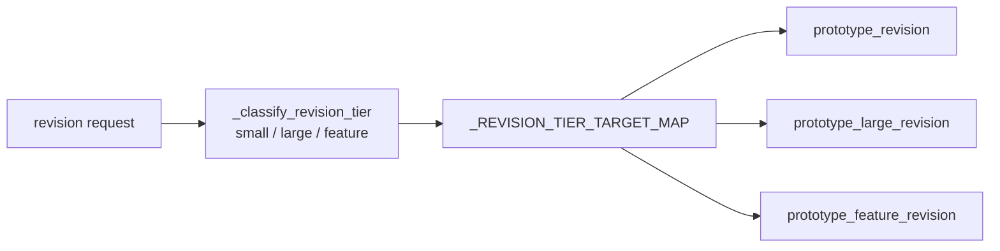
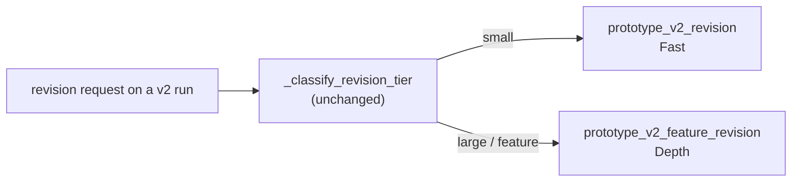

# Feature Specification: prototype_v2 and backlog revisions, on the existing revision structure

**Spec ID**: 022-prototype-v2-revisions
**Created**: 2026-09-30
**Status**: APPROVED (revision 9 — user decision of 2026-10-01 16:02: the assembler keeps rebuilding every code-built document, so a backlog revision again never edits one: its change goes through the source, and a layout change is out of scope; a revision may still create a file. Big generated diagrams are drawn in parts that fit a page, with no arrow lost (§11.7). Revision 8 (built documents superseded by revision 9) — user decisions of 2026-10-01 14:36 and 14:50: a backlog revision may edit any file in the backlog folder, the documents code builds included, and may create a file; no code protects an agent's edit, and the last step stays the existing assembly (§11.3, §9). Revision 7 (its no-new-file rule superseded by revision 8) — user-directed redesign of the backlog revision (§11.2–§11.6) after its first live run: an Analyst's spec the person reviews, a task list, writers in waves, a review, then the existing assembly. A revision edits the finished run's own files in place — never creates a file, never hand-edits a document code builds. One small engine change: a `custom_path` task source for wave steps, §7. Revision 6 — user-directed redesign of the backlog revision (§11.3–§11.6): it works like a repository, its first step gets only the request and writes a spec the person reviews, and two opt-in, user-approved engine changes make that possible (E1, E2 in §7). Decision D5 is superseded. Revision 5 — T01 findings folded in: the analyzer's v1 vocabulary is translated by the v2 steps, `v2-build` declares no `spec_step`, `blr-write` runs on `wave_scheduler`, and `_mint_revision_row` falls back to the compiled plan as roster. Revision 4 aligned with 2026-09-30 changes: Backlog.pdf deliverable, gaps.md, no revision_validation post-step, per-task threads). In progress. See [tasks.md](tasks.md).
**Root**: `backend/agents/workflows/prototype_v2_revision/workflow.yaml` (new), `backend/agents/workflows/prototype_v2_feature_revision/workflow.yaml` (new), `backend/agents/workflows/backlog_revision/workflow.yaml` (new), `backend/app/api/run_commands.py` (additive v2 routing)
**Grounding**: [ADR-0022](../../.knowledge/cards/20260823-ADR-0022.md) — a revision is pre-classified into a tier that selects a revision manifest · [ADR-0030](../../.knowledge/cards/20260826-0124-ADR-0030.md) — every prototype revision manifest runs `prototype-revision-analyzer` as step 0 · [ADR-0040](../../.knowledge/cards/20260907-ADR-0040.md) — one git sandbox per revision family · [FIX-651](../../.knowledge/cards/20260929-1023-FIX-651.md) — how prototype_v2 builds on the design template · [FIX-646](../../.knowledge/cards/20260929-1024-FIX-646.md) / spec [021](../021-backlog/spec.md) — the backlog workflow and its code assembler

---

## 1. Problem

A finished `prototype_v2` run cannot be revised correctly today.

| Entry point | What happens now | Why it is wrong |
|---|---|---|
| Revise panel | `DashboardLayout.handleRevisePrototype` hard-codes `onStartPipeline("prototype_revision")` | Runs the **v1** revision agent, whose prompt assumes v1 wiring (`routes` map, `navigateTo()`). v2 wires screens with transition `data-*` attributes and template sections/tabs. |
| Chat (Concierge, `CHANNEL_REVISION`) | Target derives from the run type: `prototype_v2` → `prototype_v2_output` → `prototype_v2_revision` | That pipeline does not exist: `_mint_revision_row` answers `revision_unsupported` (`run_commands.py:4618`). |

## 2. Approach

**Reuse the v1 revision structure as it is and add v2 pipelines to it.** Nothing is redesigned.

The existing structure (ADR-0022):



v2 plugs into the same classifier with its own two targets:



## 3. Clarifications

### Session 2026-09-30

- **Q: Why not a new design?**
  **A: The tiered revision structure already works for v1.** v2 gets two new manifests and is added to the existing lists and the existing classifier. No new engine code, parser, code step, endpoint or UI.
- **Q: Two pipelines or three?**
  **A: Two.** Fast (a bug or a small change) and Depth (a new feature, a full story or a larger change). The classifier's `large` and `feature` both route to Depth.
- **Q: Who picks Fast or Depth?**
  **A: The existing classifier**, exactly as for v1. The chosen tier is logged (`▶ prototype revision tier selected`). *(Decision 4b — a user choice — is dropped: the existing structure does not have one.)*
- **Q: Plan approval in Depth?**
  **A: None.** v1's feature revision declares `gates: [human]`, but `_handle_revision` runs every revision with `gate_agent_ids=[]`, and the engine skips declared `human`/`before-human` gates for an agent outside that list (`engine.py:11602-11616`). Depth behaves the same. *(Decision 2b is dropped. Recorded as a known v1 gap: v1's feature-revision gates never fire.)*
- **Q: Where do Depth's planning documents go?**
  **A: `revisions/<slug>/` only. The output goes to the real files.** `spec.md`, `design.md`, `synthesis.md` and `build/**` are read, never written. The work lands in `prototype.html`. *(Decision 1a+.)*
- **Q: Fast agent's model?**
  **A: Sonnet 4.6** (`eu.anthropic.claude-sonnet-4-6`). *(Decision 3a.)*
- **Q: Do the v2 edit steps use `post_step: revision_validation`?**
  **A: No.** That post-step's fix-agent path failed the prototype revision of run 0f62f7bc on 2026-09-30 and its fixes were reverted. Both v2 pipelines end with their own `v2-validate` step, which covers the same ground. *(Revision 4.)*
- **Q: Do the v2 steps use the `html_static` / `html_render` validators? (T01, decisions D3 and D4, revision 5)**
  **A: No.** Both are v1 checkers. `static_check` expects `<section data-page>` and a routes map; `render_check` clicks the menu and waits for a v1-style page activation. On the current v2 shell (a `#slot-nav` section menu of `data-goto` links) both report dead links that are not dead — measured on real parents: 0f62f7bc 7 static + 5 render, 9b6f1bfb 4 + 4, 87e02c32 (older shell, no section menu) 0 + 0. `html_static` makes every issue CRITICAL unless the `revision_validation` post-step recorded a baseline (`app/agents/validators/html_static.py:83-99`), a CRITICAL finding blocks the validation gate (`gates/validation.py:124-135`), and with no `fix:` declared the run fails on the first block (`engine.py:7240-7300`). So `v2-fix` declares no validation gate and no validators (D3), and `v2-build` is a `single_shot` step (D4) because `task_loop` always runs the engine's static/render fix loop on `prototype.html` after every task (`engine.py:11135-11192`) and cannot switch it off. `v2-validate`'s browser walk is the check. A v2-aware checker is the proper follow-up (§9).
- **Q: How does a backlog revision avoid the parent's 1 MB `backlog.md` and let the person approve the plan? (revision 6, user-directed)**
  **A: It works like a repository.** `_handle_revision` used to paste the parent's whole deliverable into the revision message, and the first dispatched step receives that message inline — for a backlog parent ~0.86–1.2 million characters (`engine.py:13139-13151`, `16249-16270`). Two opt-in engine changes (E1, E2, §7) let the backlog revision send only the request, have its first step locate the change in the parent's folder with grep/glob and write a spec, and stop at a human gate on that spec. D5 (a mechanical first step to absorb the paste) is superseded. The v2 pipelines keep the pasted message for now; moving them to this pattern is a possible later step.
- **Q: May v1 change?**
  **A: No.** v1 manifests, v1 `AGENT.md` files, the classifier function and its prompt, and the v1 map stay byte-identical. Existing lists only gain v2 names (§7).

### Session 2026-10-01 (revision 7, user-directed)

- **Q: Why redesign the backlog revision again?**
  **A: Its first live run lost the work.** Run 80054fbc (on 78e185fb) wrote a good spec and its writers split `build-order.md`'s dependency graph by hand, then `blr-assemble` re-rendered `build-order.md`, `backlog.md` and `screens.md` from the sources and overwrote the edits (§11.2). A revision therefore edits only files code does not rebuild — the sources and the documents agents wrote — and the existing assembly rebuilds everything else (§11.3).
- **Q: Can the wave step read its tasks from a file that holds the revision number?**
  **A: Not as it was.** `task_source.target` is a fixed manifest string, and a missing target falls back to `build/tasks.json` — in a backlog folder, the finished run's reader task list — then to the producer's reply. The user chose a new, explicit task-source option instead: `kind: custom_path` with a `path`, read from that one file with no fallback; the path may hold `{revision_n}` (§7).
- **Q: Where does the revision number come from?**
  **A: The folder, not the engine.** The engine's ordinal (`ectx.revision_ordinal`) reaches neither a prompt nor `.context/`, so the Analyst takes the highest all-digit `revisions/` folder plus 1, and `{revision_n}` resolves to the highest — the current revision's, under the family lock (§11.4).
- **Q: A selective package step and a task-list validator?**
  **A (superseded by revision 9 below for built documents): Replaced by the user's decisions of 14:36 and 14:50.** 14:36: a revision may edit any file in the backlog folder — `backlog.md`, `build-order.md` (its diagrams included), `screens.md` and every other document code builds — and may create a file a change needs; `## Out of scope` keeps only what lies outside the folder, such as the app's code. 14:50: no code protects an agent's edit — no ownership record, no selective rebuild, no change to the assembly or the export; the agents make the change through their prompts, and the last step stays the existing `assemble_backlog`. The wave step already fails on an unparsable list or a dependency cycle and never runs two tasks on one file in the same wave, so there is still no task-list validator.

### Session 2026-10-01 (revision 9, user decision 16:02)

- **Q: Can a revision fix a diagram the assembler draws, such as `build-order.md`'s dependency graph?**
  **A: No (user decision).** "It is fine assembler will re write it as is." The final step stays the existing `assemble_backlog`, which rebuilds every code-built document from the sources, so the prompts again say an edit to one is lost: a change goes through its source, and a layout change goes under `## Out of scope`. A revision may still create a file (decision 14:36 stands on that point). This replaces the 14:36/14:50 answer above on built documents; its "a revision may create a file" stands.
- **Q: Then how does a reader see a big diagram?**
  **A: The generator draws it in parts (§11.7).** "When we have a big diagram can we break it into something viewable by user." Measured on 78e185fb: the dependency graph was one chart of 44 epics and 89 arrows, and the screens map one chart of 25 screens and 34 arrows; every other diagram was small.

## 4. Facts that shape the prompts

1. **`prototype.html` is the only complete copy.** prototype_v2's assembler builds it from `parts/`, then its Validator and Presenter edit it directly. A revision edits `prototype.html` with `edit_file`; it never re-assembles.
2. **Revisions share the parent's git folder** (ADR-0040). The parent's `spec.md`, `design.md`, `build/screens.json`, `build/bugs.json` and `parts/` are readable; every step is committed; `write_file` refuses to overwrite, so planning files cannot clobber the parent's.
3. **Revision runs get no design context injected** (`od_context=None`). Prompts take their vocabulary from `design.md` and from the classes already used by existing screens in `prototype.html`.
4. **v2 wiring**: every screen is `<section class="screen" id="...">`; a transition is a `data-*` attribute on a control naming a screen id; navigation is the template frame's section/tab bar. v1's `routes`/`navigateTo()` does not exist in a v2 prototype — this is why v1's edit prompts cannot be reused.
5. **The analyzer is reusable, with one caveat (T01).** `prototype-revision-analyzer` reads `prototype.html` itself (`AGENT.md:27,40`) and writes a `## Solution Plan` into its transcript, `.agents/01-prototype-revision-analyzer.md` (the engine's name for step 1's output, `app/agents/sandbox.py:1487`). The plan is not pasted into later prompts (`engine.py:6536-6551` stores it; `:13569-13580` only adds a UI chip), so each later step reads that file, as v1's `prototype-revision-agent` does (`AGENT.md:27`). The caveat: its prompt teaches v1 wiring — "Route paths" (`AGENT.md:48`), a "`#/login` route section" (`:67`), a "routes map" and `navigateTo()` (`:81`) — and a manifest cannot steer a registered agent (`prompt` is custom-agent only, `compiler.py:113`; the v1 `AGENT.md` is not edited). So every v2 step that reads the plan treats its routes and `navigateTo()` as v1 vocabulary and implements the same intent in v2 wiring (§4.4); it never adds a route map or a `navigateTo()` call.

## 5. Fast — `prototype_v2_revision`

Same shape as `prototype_revision`.

```yaml
id: prototype_v2_revision
user_launchable: false
planner: skip
clarify: {mode: skip}
deliverable: {strategy: single_file, name: prototype.html, revises_existing: true}
context_providers: [previous_run, uploaded_files]
steps:
  - agent: prototype-revision-analyzer        # reused as is
    strategy: single_shot
    produces_solution_plan: true
    tools: {read_files: true}
  - agent: custom-agent  instance_id: v2-fix  # inline prompt, Sonnet 4.6
    strategy: single_shot
    tools: {read_files: true, write_files: true, tool_sets: [playwright]}
    # no gates / validators / require_render: v1 checkers, see §3 (D3)
  - agent: custom-agent  instance_id: v2-validate   # inline prompt, Sonnet 4.6
    tools: {read_files: true, write_files: true, tool_sets: [playwright]}
```

**`v2-fix`** — read the analyzer's Solution Plan, the request, `build/bugs.json`, `design.md`; locate with `grep` (never `read_file` the whole 100 KB file); reproduce in the browser; fix with `edit_file` only, keeping v2 wiring (§4.4) and template classes; re-check in the browser that the fix works and the touched screen's transitions still land. Never write `spec.md`, `design.md`, `build/**`, `parts/**`.

**`v2-validate`** — prototype_v2's `pb-validate` prompt, scoped to the screens the fix touched plus a click through every transition in `design.md`'s `## Transition table`. Fix with `edit_file`; record in `build/bugs.json` only by `edit_file` if it exists, else skip recording.

## 6. Depth — `prototype_v2_feature_revision`

Same shape as `prototype_feature_revision`.

| # | Step | Agent | Reads | Writes |
|---|---|---|---|---|
| 0 | Analyze | `prototype-revision-analyzer` (reused) | `prototype.html`, request | its Solution Plan |
| 1 | Specify | custom-agent `v2-specify` (Sonnet) | request, Solution Plan, `spec.md`, `design.md`, `build/screens.json` | `revisions/<slug>/change.md` — new/changed screens, flows and stories in `spec.md`'s own format (EARS `REQ-` lines, per-screen Fields/Actions tables). Picks a new kebab-case `<slug>`. |
| 2 | Plan | custom-agent `v2-plan` (Sonnet) | `change.md`, `design.md`, `prototype.html` (grep) | its REPLY: the task list, one `## Task N: <title>` block per task — one new screen, or one change to an existing screen, or wiring an entry point; new screens first, then wiring. A copy goes to `revisions/<slug>/tasks.md`. |
| 3 | Build | custom-agent `v2-build` (Sonnet 4.6), `strategy: single_shot` (decision D4, §3): works the Plan's `## Task N:` list in order in one run, reading it from the Plan's step transcript `.agents/03-custom-agent_v2-plan.md`, and greps `prototype.html` afresh before each task. No validators, no `post_step: revision_validation` (§3) | the task list, `change.md`, `design.md`, existing screens in `prototype.html` | `prototype.html` via `edit_file`: a new screen is inserted as a `<section class="screen">` after the last one, using classes copied from existing screens; its menu item, tab and `PLACE` entry and its transitions are added. |
| 4 | Validate | custom-agent `v2-validate` (Sonnet + playwright) | `change.md`, `tasks.md`, `prototype.html` | `prototype.html` (fixes), `revisions/<slug>/bugs.json` |

`planner: skip`, `clarify: skip`, `deliverable: {single_file, prototype.html, revises_existing: true}`, `context_providers: [previous_run, uploaded_files]`, no `human` gates (§3).

**How Build gets its tasks (T01, decision D4).**

- A step's typed output is its streamed **reply**, never a file it writes: `latest_typed_content` reads the current run's typed graph (`engine.py:13866-13879`), whose content is the reply (`engine.py:10509`; a revision workflow gets no file read-back, `engine.py:10548-10553`). The engine also writes every step's reply to its transcript, `.agents/<NN>-<agent id, ':' as '_'>.md` with NN the step's 1-based position (`app/agents/sandbox.py:1487`, index = the dispatch cursor, `engine.py:6407`). So `v2-plan` ends with the task list as its reply, and `v2-build` reads it from `.agents/03-custom-agent_v2-plan.md` (verified against `compile_for_run` order in T06).
- A task is a block that starts with exactly `## Task N: <title>` (N = 1, 2, 3 …) and ends at the next line that starts with `## ` — the `heading_tasks` form (`heading_tasks.py:39`, `66-68`), kept so the list reads the same as v1's. Nothing else in the reply starts with `## `.
- Why not `task_loop` (T01): before the loop it writes the root `spec.md` from the `spec_step`'s reply and the root `tasks.md` from the Plan's, overwriting (`task_loop.py:549-560`) — a `spec_step` would clobber the parent's `spec.md` — and after every task it runs the engine's HTML static/render fix loop, which misfires on v2 (§3, D3/D4). Its per-task threads (`engine.py:9795-9799`, `11286`) are what `v2-build` gives up; it greps `prototype.html` afresh before each task instead of trusting an earlier read.

## 7. Routing and lists — additive only

| Place | Change |
|---|---|
| `run_commands.py` — `_REVISION_TIER_TARGET_MAP` | **untouched** |
| `run_commands.py` — new `_V2_REVISION_TIER_TARGET_MAP` | `{"small": "prototype_v2_output", "large": "prototype_v2_feature_output", "feature": "prototype_v2_feature_output"}` |
| `run_commands.py` — `create_revision` (`:5552`) and Concierge disposal (`:1673`) | classify when the target is `prototype_output` **or** `prototype_v2_output`; pick the map by which one it was. The v1 branch's lines are unchanged. |
| `run_commands.py:1640` (base type of a revision parent) | append `prototype_v2_feature_revision` → base `prototype_v2` beside the existing v1 tuple |
| `run_commands.py` Concierge disposal | for a v2 parent, a model-supplied `target` of `prototype_output` is replaced by `prototype_v2_output` — the parent run's type decides, so a v2 run can never reach a v1 pipeline |
| `run_commands.py` — `_mint_revision_row` (T01, decision D1) | the existence gate and `agent_count` fall back to the compiled plan when the `AGENT.md` roster is empty or smaller than the plan — the launch path's own fallback (`run_commands.py:3551-3578`). A v2 revision's roster is only the reused analyzer, so `agent_count` would read 1 for a 3- and 5-step plan; `backlog_revision` (§11.5) has no roster at all. The 7 existing revision pipelines have roster == plan steps, so they are unchanged. |
| `agents/registry.py::REVISION_BASE_MAP` | `prototype_v2_revision` and `prototype_v2_feature_revision` → `prototype_v2` |
| `app/core/entitlements.py`, `frontend/src/lib/entitlements.ts` | both names in every tier that has `prototype_v2` |
| `frontend/src/types/index.ts` `WorkflowType` | both names |
| frontend prototype-type checks (`DashboardLayout` ×3, `page.tsx` ×2, `FilesTab` ×3, `WorkflowHistory`, `PreviewPanel`, `Sidebar`, `IdeaInputPage`) | both names appended beside the v1 revision names |
| `DashboardLayout.handleRevisePrototype` | a v2 branch first: `POST /runs/{id}/revisions` with `target_artifact_type: "prototype_v2_output"` (the endpoint classifies). A v1 run takes today's code. |
| `agents/execution_engine/engine.py` — `_handle_revision` — **E1, user-approved engine change (revision 6)** | Opt-in via `deliverable.revision_context: workspace` (default `artifact` = today). An opted-in revision's message is only `=== REVISION INSTRUCTION === <request> === END REVISION INSTRUCTION ===` plus one line, "The original run's files are in this folder (the run's workspace); find what you need with grep/glob/read_file." — no ORIGINAL ARTIFACT, VERSION HISTORY or PARENT RUN STATUS block. `.context/user-prompt.md` holds the same text (`execute()` writes the message there). The FR-014 lookup and the ownership check still run. Every manifest that does not opt in, v1 included, gets the identical message. |
| same — **E2, user-approved engine change (revision 6)** | For an opted-in manifest, the steps that declare `gates: [human]` are passed as `gate_agent_ids`, so their inline review gate fires on the step's output and "request changes" re-runs the step with the comments through the existing redo path (`_consume_redo`, a fresh `:redo{N}` thread). Every other revision keeps `gate_agent_ids=[]`: v1 `prototype_feature_revision`'s declared gates still never fire (§9). |
| `agents/workflows/plan.py`, `compiler.py`, `agents/execution_engine/engine.py` — **E3, `Step.reply`, user-approved after revision 2 (8d4d2d70)** | A step may declare `reply: all` (default, unchanged) or `reply: last_message`. `_run_agent` remembers where the text after the last `tool_call`/`tool_result` starts; an opted-in step whose final message has text keeps only that text as its output, so the review card, the step transcript and the typed artifact hold the spec, never the notes written between tool calls. The prompt-only attempt did not hold (8d4d2d70's card opened with "Now let me check the revisions folder…"). `blr-analyst` declares it; every other step is byte-identical (`tests/unit/agents/test_step_reply.py`). |
| `agents/workflows/plan.py`, `agents/workflows/compiler.py` — `DeliverableSpec.revision_context` | `artifact` \| `workspace`, default `artifact`; an unknown value fails compilation. Declared in `deliverable:` beside `revises_existing` — one pass-through like `text_name`, rather than a new key on the strict top-level allow-list. |
| `agents/workflows/plan.py`, `agents/workflows/compiler.py`, `agents/capabilities/strategies/wave_scheduler.py`, `app/api/workflows.py` — **the `custom_path` task source, the one engine change of revision 7 (user-directed)** | A new task-source option beside the existing ones: `kind: custom_path` with `path: <file>`. The compiler accepts `path` and fails a `custom_path` source without one; a wave step reads exactly that file (`read_custom_path`) — no fallback to `build/tasks.json` or to the producer step's reply — and a missing or empty file fails the step before any task runs. The path may hold `{revision_n}`: the highest all-digit folder under `revisions/` (`latest_revision_number`, `resolve_revision_path`). `GET` workflow details report the `path` beside `kind`, `parser` and `target`. Every other task source parses exactly as before. |

**Not changed:** the engine and the compiler except the opt-in E1/E2/E3, the `revision_context` pass-through and the `custom_path` task source above; parsers; every other capability (`backlog_prep.py` and `backlog_export.py` included; `backlog_assemble.py` changes only in how it draws big diagrams, §11.7); every v1 manifest and `AGENT.md`; `prototype_v2/workflow.yaml`; `backlog/workflow.yaml`; `_classify_revision_tier`.

## 8. Acceptance

1. `compile_for_run` succeeds: `prototype_v2_revision` → 3 steps, `prototype_v2_feature_revision` → 5 steps, in §5/§6 order.
2. A `prototype_v2` parent: `small` mints `prototype_v2_revision`; `large` and `feature` mint `prototype_v2_feature_revision` — through both `create_revision` and the Concierge disposal.
3. A Concierge proposal on a v2 parent carrying `target: prototype_output` still mints a v2 pipeline.
4. Revising a `prototype_v2_feature_revision` run resolves base `prototype_v2`.
5. The Revise panel on a v2 run calls `POST /runs/{id}/revisions` with `prototype_v2_output`; on a v1 run it still calls `onStartPipeline("prototype_revision", …)`.
6. v1 unchanged: a `prototype` parent's small/large/feature still map to the same three pipelines; the existing v1 revision tests give the same results before and after (T02 baseline).
7. Entitlement parity shows no new failure.

## 9. Known gaps, recorded not fixed

- v1's `prototype_feature_revision` `human` gates never fire in a revision (`gate_agent_ids=[]`).
- `CHANNEL_REVISION` does not classify for any pipeline; a v2 chat revision on that channel runs Fast, as v1 runs small.
- `CHANNEL_REVISION` on a parent that is itself a revision derives `<type>_revision_output` for v1 and v2 alike unless the client supplies a target.
- The v1 HTML checkers misread v2 prototypes (§3, D3/D4). `static_check` expects `<section data-page>` and a routes map; `render_check` waits for a v1-style page activation. On the current v2 shell both report the section menu's working `data-goto` links as dead (0f62f7bc: 7 static + 5 render; 9b6f1bfb: 4 + 4). The v2 revision pipelines therefore declare neither validator and rely on `v2-validate`'s browser walk. A v2-aware checker (the shell's `section.screen` / `data-*` model) is the follow-up; T08 files it as an ISSUE card.
- A backlog revision parked at `blr-analyst`'s review gate (E2) is lost if the backend restarts while it waits: a graceful shutdown cancels runs parked at a gate, as for every gated run today. Restart only when no revision is waiting for review.
- **Gate edits do not reach the later backlog revision steps.** "Approve with edits" stores the edited text as a new typed version of the step's output (`engine.py:10875-10910`), but the step transcript the Planner and Reviewer read (`.agents/01-custom-agent_blr-analyst.md`, written before the gate at `engine.py:10776`) keeps the original. Ask for changes with "request changes", which re-runs the Analyst and rewrites the transcript. The fix is one call in the engine's `_gate_edited` branch (rewrite the transcript with the edited text); not built — it would change every workflow whose later steps read a transcript.
- **The review card showed everything the step streamed** — fixed by E3 (§7): `blr-analyst` declares `reply: last_message`, so its card and transcript hold only its final message. Words written between tool calls still stream live while the step runs.
- **A revision cannot change how a code-built document is laid out** — `build-order.md`'s diagrams, `backlog.md`'s sections, the PDF: the assembly rebuilds those documents from the sources (user decision 16:02), so the Analyst puts such a request under `## Out of scope`. Big diagrams are drawn in parts by the generator (§11.7) instead.
- **The chain payload of every backlog run lacks `backlog.md`** (not revision-specific). Commit b88a0e74d added the text form to `_write_chain_payload` (`engine.py:1103`), which nothing calls; the live writer, `build_flat_payload` (`engine.py:1345`, called at `:2285`), stages exactly `.chain/<deliverable name>`, `.chain/logs.jsonl` and `.chain/summary.md` through the reserved-path allowlist (`app/agents/sandbox.py::payload_allowlist`), and `chain_context` copies only those. Proposed fix, not built: stage the text form as a fourth allowlisted path and copy it in `chain_context`.
- Launching a revision rewrites the parent's `PLANNER.md` and `.context/user-prompt.md` in the shared folder. Recorded only.
- `_classify_revision_tier`'s own log line names the v1 pipeline for the tier it picked (`run_commands.py`, the `classified as … → pipeline=` line) even for a v2 parent; the caller's next line (`▶ prototype revision tier selected`) names the v2 pipeline that actually runs. Cosmetic; the classifier is not edited (§7).

## 10. Out of scope

A user choice between Fast and Depth; plan approval; folding `change.md` into `spec.md`; re-assembling `prototype.html`; live runs (the first one is the user's).

---

## 11. Backlog revision — `backlog_revision`

### 11.1 Problem

A finished `backlog` run cannot be revised. Chat derives `backlog` → `backlog_output` → `backlog_revision`, which does not exist (`revision_unsupported`). The Revise panel has no handler for `backlog` (`DashboardLayout.activeReviseHandler` covers ppt, user_stories, prototype, app_builder and custom only).

### 11.2 Why the backlog is the opposite case from the prototype

`backlog.md` is **not** the source. The code step `assemble_backlog` (`backlog_assemble.py`) renders it — together with `backlog.csv`, `backlog.json`, `build/coverage.json`, the full-application documents (`data-model.md`, `schema.json`, `api.md`, `openapi.json`, `integrations.md`, `screens.md`, `build-order.md`) and, in final mode, `Backlog.pdf` / `Backlog.zip` — from:

- `build/backlog-plan.json` — the hierarchy (features, epics);
- `build/story-tasks.json` — every writer task id, which names `stories/<task id>.json`;
- `stories/<task id>.json` and `stories/review-<epic id>.json` — the stories;
- `build/solution/*.json` — the coverage items.

So a revision changes content **in its source**, and code rebuilds the documents from it. The first live revision (80054fbc on 78e185fb, "fix the diagrams, build order is too small", revision 6's pipeline) shows what the final assembly does to a hand edit of a code-built document: its writers split the epic dependency graph in `build-order.md` correctly (four charts, all 89 edges kept), then `blr-assemble` re-rendered `build-order.md`, `backlog.md` and `screens.md` from the stories and the plan and overwrote every edit — only `ux.md`, which no code builds, survived. Facts the design rests on:

1. `assemble_backlog` picks its job by instance id (`BACKLOG_CODE_JOBS`); any other id assembles.
2. It runs in **final** mode whenever `build/review.json` exists — the parent's Reviewer left one — and then also exports `Backlog.pdf` and `Backlog.zip`. Final mode never fails on coverage: uncovered items are written to a root `gaps.md` (the last PDF chapter), which is removed once nothing is uncovered.
3. It discovers story files only through `build/story-tasks.json` and the plan's epics, so a new story goes into an existing story file of its epic.
4. The revision shares the parent's git folder (ADR-0040): every file is on disk; code overwrites the derived files with `sandbox.write`, while agents change existing files with `edit_file` and create new ones with `write_file`.
5. The deliverable is `Backlog.pdf` with the text form `backlog.md` (`DeliverableSpec.text_name`, commit b88a0e74d); the revision declares the same, so its preview shows the PDF and chat/share keep the markdown text.

### 11.3 Decision: edit the finished run's own files, then re-assemble (revision 7, user-directed)

- A revision edits the finished run's files **in place**, and creates a file a change needs (user decision 14:36).
- It edits the **sources** — `stories/*.json`, `build/backlog-plan.json`, `build/story-tasks.json`, `build/solution/*.json` — and the **documents agents wrote**, which no code rebuilds (`solution.md`, `architecture.md`, `ui.md`, `ux.md`, `synthesis.md`).
- It never edits a **code-built document** — `backlog.md`, `backlog.csv`, `backlog.json`, `build-order.md`, `data-model.md`, `schema.json`, `api.md`, `openapi.json`, `integrations.md`, `screens.md`, `gaps.md`, `Backlog.pdf`, `Backlog.zip`, `build/coverage.json`: the assembly rebuilds them from the sources after the writers, so an edit would be lost (user decision 16:02). A change to what one says goes in its source.
- What only code can change — how a code-built document is laid out, how the PDF looks — goes under `## Out of scope`, said plainly.
- The existing assembly rebuilds every code-built document at the end, from the sources, and draws big diagrams in parts (§11.7).
- Each revision keeps only its own records, in `revisions/<n>/` (n = 1, 2, 3 …): `revision-spec.md`, `tasks.json`, `revision-review.md`.

Revision 6's QUICK/DEPTH scopes and its locate → structure → write → assemble → review → final pipeline are replaced. E1 and E2 (§7) stay.

### 11.4 Pipeline

```yaml
id: backlog_revision
planner: skip
clarify: {mode: skip}
deliverable: {strategy: single_file, name: Backlog.pdf, text_name: backlog.md, revises_existing: true, revision_context: workspace}
context_providers: [previous_run, uploaded_files]
```

| # | Step | Kind | Reads | Writes |
|---|---|---|---|---|
| 1 | **Analyst** `blr-analyst` (Sonnet 4.6), `gates: [human]` | single_shot | ONLY the request (E1); then the folder, by grep/glob and small reads | `revisions/<n>/revision-spec.md` — `Spec: <path>`, `## Request`, `## Findings` (file:line), `## Changes` (`### C<N>: <file> — <what>`, each with File, Location, Current, New, Why), `## Out of scope`, `## Open questions` — and the same spec, verbatim, as its reply: the review card shows the reply. It changes no existing file. |
| 2 | **Planner** `blr-plan` (Sonnet 4.6) | single_shot | the approved spec | `revisions/<n>/tasks.json`, the shape of `build/story-tasks.json`: `{"tasks": [{"id": "T1", "title", "targets": [path], "depends_on": [], "body"}]}`, one task per file; each body starts `Targets: <path>`, then every change to that file copied from the spec. It never writes a `build/` file. |
| 3 | **Writers** `blr-write` (Sonnet 4.6) | `wave_scheduler`; task source `kind: custom_path`, `path: revisions/{revision_n}/tasks.json`, `parser: json_tasks` | its task's body — all a wave worker is given (`"input": t.body`, `wave_scheduler.py`) | its one file: `edit_file`, or `write_file` for a file its task says is new; JSON stays valid; a story keeps the backlog's EARS and Gherkin rules |
| 4 | **Reviewer** `blr-review` (Sonnet 4.6) | single_shot | the spec, the files | closes gaps in the files the spec names; `revisions/<n>/revision-review.md`: `\| Change \| File \| Status \| Evidence \|`, Status `done`, `fixed now` or `not possible` |
| 5 | **Assemble** `blr-assemble` | `mechanical: assemble_backlog` (existing; big diagrams in parts, §11.7) | the sources | every code-built document; final mode, so `Backlog.pdf`, `Backlog.zip`, and `gaps.md` while anything is uncovered |

No `ask_user`.

**Revision number.** The Analyst works out n: the highest all-digit folder under `revisions/` plus 1, or 1 when there is none. `{revision_n}` in the writers' task path resolves to the highest such folder, which is the current revision's because the family lock runs one revision at a time. A REVISE re-run keeps n and writes `revision-spec-<k>.md`. The engine's own ordinal (`ectx.revision_ordinal`, `engine.py:4599`) reaches neither a prompt nor `.context/`, so it is not used.

**How the spec reaches the later steps.** The engine writes every step's reply to the step transcript, `.agents/<NN>-<agent id, ':' as '_'>.md` (`app/agents/sandbox.py:1487`). The Planner and the Reviewer read `.agents/01-custom-agent_blr-analyst.md`; its first line, `Spec: revisions/<n>/…`, gives them n.

**Review and redo.** At the gate the person approves, rejects (cancels the run) or requests changes. "Request changes" re-runs `blr-analyst` on a fresh `:redo{N}` thread with the comments (`=== ADDITIONAL INSTRUCTIONS (REVISE) ===`) and its previous spec (`=== PRIOR ARTIFACT UNDER REVISION ===`) in its message (`engine.py:16447-16470`). The re-run writes `revisions/<n>/revision-spec-<k>.md` (write_file never overwrites) and rewrites the same transcript, so the later steps read the latest approved spec. An edit made in the card is not seen by them (§9).

**How the writers get their tasks.** `blr-write` reads exactly `revisions/{revision_n}/tasks.json` through the `custom_path` task source (§7): never `build/tasks.json`, never the Planner's reply; a missing or empty file fails the step before any writer starts. A wave worker sees only its task's body, so the Planner copies the target and the full changes into it. The wave step fails on an unparsable list or a dependency cycle (`json_tasks`, `build_waves`) and never runs two tasks on one file in the same wave (conflict keys default to the targets).

### 11.5 Routing and lists — additive only

| Place | Change |
|---|---|
| routing (`run_commands.py`) | **none** — `backlog` → `backlog_output` → `backlog_revision` is already the derived name, for chat, the Concierge and `POST /runs/{id}/revisions`; revising a `backlog_revision` run strips back to `backlog` |
| `run_commands.py` — `_mint_revision_row` (T01, decision D1) | the compiled-plan roster fallback of §7 (`agent_count` 5). Every `backlog_revision` step is a `custom-agent` instance, and `custom-agent` is a template (`template: true`, skipped at `agents/registry.py:210-211`), so `get_pipeline_agents("backlog_revision")` is empty and the mint answered `revision_unsupported` (`run_commands.py:4618-4625`) on all three entry points — `create_revision`, the Concierge disposal and `CHANNEL_REVISION`. The engine's own guard is compile-based (`engine.py:13224`) and needs nothing. |
| `REVISION_BASE_MAP` | `backlog_revision` → `backlog` |
| `entitlements.py`, `entitlements.ts` | `backlog_revision` in every tier that has `backlog` |
| `WorkflowType`, `Sidebar` label | `backlog_revision` |
| `DashboardLayout.activeReviseHandler` | `backlog` / `backlog_revision` → a handler that calls `POST /runs/{id}/revisions` with `target_artifact_type: "backlog_output"` — the same shape as the existing `handleReviseCustom` |

### 11.6 Acceptance

1. `compile_for_run("backlog_revision")` → 5 steps in §11.4 order; only `blr-assemble` is mechanical (`assemble_backlog`, not a backlog code job); `blr-analyst` declares `gates: [human]`; no step declares a validator; `blr-write` is `wave_scheduler` with task source `kind: custom_path`, `path: revisions/{revision_n}/tasks.json`, `parser: json_tasks`; the deliverable declares `revision_context: workspace`.
2. A `backlog` parent revised through `POST /runs/{id}/revisions` or the Concierge mints `backlog_revision` with `agent_count` 5 (decision D1).
3. The Revise panel on a `backlog` run calls the revisions endpoint with `backlog_output`.
4. E1: the opted-in revision's message (and `.context/user-prompt.md`) is the instruction block plus the workspace line — no ORIGINAL ARTIFACT; `prototype_revision`'s message is byte-identical to before.
5. E2: the opted-in revision passes `gate_agent_ids == ["custom-agent:blr-analyst"]` and parks at that gate; v1 `prototype_feature_revision` passes `[]` and does not park; the gate offers "request changes", which re-runs the step through the existing redo path.
6. `custom_path`: the wave dispatches the tasks of `revisions/<highest n>/tasks.json` — not `build/tasks.json`, not an older revision's list; with that file missing it raises before dispatching, even when the producer's reply holds a valid list; a `kind: parsed` target still falls back to `build/tasks.json`; a `custom_path` source without a `path` fails compilation.
7. Every `.agents/` path in a prompt is an earlier step's transcript; the Analyst's and the Planner's prompts name every code-built document as never edited, and a change may create a file (user decision 16:02).
8. On a fixture sandbox with `build/review.json` present, an edited story file and a new story in `stories/review-<epic>.json` both appear in the assembled `backlog.md` and `backlog.csv`.
9. `test_backlog_assemble.py` and `test_mechanical_assemble_backlog.py` pass; two existing assertions change: the indentation of an epic box in the dependency graph, and a two-screen map now drawn left to right (§11.7); the `backlog` manifest is not edited by this spec.
10. Big diagrams (§11.7): on a synthetic plan of 60 epics, and on a copy of run 78e185fb, every mermaid block of `build-order.md` and `screens.md` holds at most 15 boxes and 20 arrows in a readable shape (left to right at most 2 columns and 8 rows, or top down a chain at most 2 boxes wide and 7 deep), and the arrows of all its blocks are exactly the arrows of the whole graph. Drawn in the copy's PDF, every generated chart prints at a scale of at least 0.7.

### 11.7 Big diagrams in parts (revision 9, user decision 16:02)

`assemble_backlog` draws every generated graph so a reader can see it: `build-order.md`'s feature, epic and story
dependency graphs and `screens.md`'s navigation map (`backlog_assemble.diagram_parts`).

- **Limit.** At most 15 boxes and 20 arrows in one chart (`_DIAGRAM_MAX_NODES`, `_DIAGRAM_MAX_EDGES`), and a shape the PDF prints at a scale of at least 0.7. Measured on 78e185fb's PDF, where a chart has a ~631 px A4 column and at most 215 mm of height: left to right, a column of boxes is ~300 px wide, so 2 columns print at full size and 3 already shrink to ~0.67; a row is ~110-130 px tall. Top down, a rank is ~110 px tall, and the width is only predictable while the chart is at most 2 boxes wide. So a chart is drawn left to right when it is at most 2 columns and 8 rows (`_LR_MAX_ROWS`), top down when it is a chain at most 2 boxes wide and 7 deep (`_TD_MAX_RANKS`), and split further otherwise. A wave never depends on itself, so one wave always fits: what it needs on the left, the wave on the right.
- **Parts.** The epic graph is drawn per milestone, a big milestone in parts by wave; a story graph per epic, a big
  one by slice; the feature graph and the screens map in reading order. Consecutive groups share a chart while they
  fit; a group too big alone is split box by box; a box with more arrows than a chart holds is drawn over several.
- **No arrow lost.** Each arrow is drawn once, in the part of the box that owns it (an epic or story with what it
  needs, a screen with what it opens). An arrow to a box drawn in another part keeps a dashed copy of that box,
  named with where it lives (`(Milestone 1, wave 4)`, `(part 2)`, its epic).
- **Headings.** Each part has its own `###` heading: `Milestone 2 — First release, waves 2–3`, `… (part 1 of 2)`,
  `Navigation, part 1 of 2`. A graph that fits stays one chart; the screens map then has no heading, as before.
- **Ranks.** A chart's columns are counted as the renderer ranks it: the arrows that close a cycle dropped, each box on its longest path (`_layout`). A screen no arrow touches is named in one line under the map instead of a box.
- **Screens.** A screen that opens nothing is drawn in the first part that opens it; a screen no arrow touches is named in one line under the map; a target that is no screen is a dashed box marked `(no such screen)`; a repeated screen id keeps every arrow. A repeated arrow is drawn once.
- **Unchanged.** Everything outside the charts, and every `##` heading. The intro sentences of the dependency sections now also explain the parts.

Measured on a copy of 78e185fb: `build-order.md` went from 44 charts (the largest 44 boxes, 89 arrows) to 69 (the
largest 14 boxes, 17 arrows; the lowest print scale 0.78, where a first split by boxes and arrows alone left the
Milestone 1 chart at 0.42); `screens.md` from one chart (25 boxes, 34 arrow lines, 24 distinct: 10 repeated a line) to five (the lowest print scale 0.92) plus 9 screens named under the map; the arrow sets are identical (16 feature, 89 epic, 156 story, 24 screen
arrows), and the rebuilt PDF renders every chart.
