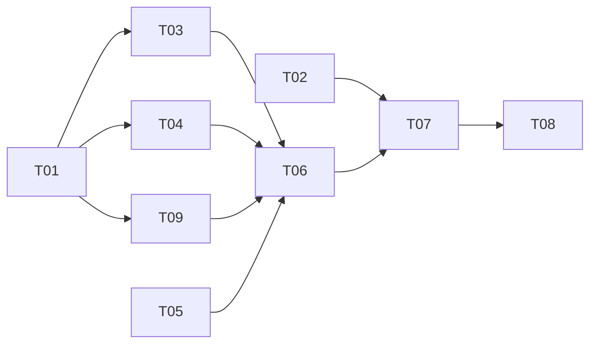

# Tasks: 022-prototype-v2-revisions

Spec: [spec.md](spec.md) (revision 3 — prototype_v2 Fast/Depth, plus backlog §11). Every task carries its OWN acceptance criterion; none refers to the cumulative diff. Tests run one file at a time. No live runs.

**Ownership:** backend tasks (T01 backend items, T02 backend, T03, T04, T09, T05 backend rows, T06 backend tests, T07 backend audit) — backlog-be session; frontend rows of T02/T05/T06/T07 — the frontend session. Each orchestrates its own subagents.

**Hard boundary for every task:** the engine, compiler, parsers, capabilities (incl. `backlog_prep.py`), every v1 manifest and `AGENT.md`, `prototype_v2/workflow.yaml`, `backlog/workflow.yaml` and `_classify_revision_tier` are not edited (spec §7 "Not changed"), except the user-approved changes spec §7 lists: E1/E2, the `revision_context` pass-through, the `custom_path` task source, the D1 mint fallback, and `backlog_assemble.py`'s big-diagram drawing (§11.7). A task that cannot meet its criterion without touching one of them stops and reports.

Executor tags (pre-classified, per the global §7 rule): `[haiku]` mechanical, fully specified · `[sonnet]` needs engineering judgment · `[self]` authoring or review, done by the orchestrating session, never delegated.

## Status (2026-10-01)

| Task | State | Evidence |
|---|---|---|
| T01.1 analyzer reuse | done — yes, with a caveat (spec §4.5) | Reads `prototype.html` itself (`prototype-revision-analyzer/AGENT.md:27,40`); plan lands in `.agents/01-prototype-revision-analyzer.md` (`app/agents/sandbox.py:1487`), not pasted into later prompts (`engine.py:6536-6551`, `13569-13580`). v1 vocabulary: "Route paths" (`AGENT.md:48`), "`#/login` route section" (`:67`), "routes map" + `navigateTo()` (`:81`); a manifest cannot steer it (`compiler.py:113`). The v2 steps translate. |
| T01.2 mint gate + compile | done — v2 yes; backlog no → decision D1 (approved) | Roster = AGENT.md `pipeline_type` + the manifest's own step agents, templates skipped (`agents/registry.py:193-195`, `210-211`). v2: the reused analyzer makes it non-empty, but `agent_count` = 1 (`run_commands.py:4672`). `backlog_revision`: all `custom-agent` → roster `[]` → `revision_unsupported` (`run_commands.py:4618-4625`). The engine guard is compile-based (`engine.py:13224`). D1: the launch path's compiled-plan fallback (`run_commands.py:3551-3578`) in `_mint_revision_row`; the 7 existing revision pipelines measured roster == plan (1/1, 2/2, 1/1, 5/5, 4/4, 3/3, 1/1). |
| T01.3 task source | done — the Plan step's reply (spec §6, §11.4) | `task_loop.py:193` → current-run typed graph (`engine.py:13866-13879`) = streamed reply (`engine.py:10509`; no read-back in a revision, `10548-10553`); `target` ignored (`task_loop.py:209-212`). Blocks = `## Task N:` (`heading_tasks.py:39`) to the next `## ` (`66-68`). Pre-loop writes of root `spec.md`/`tasks.md` (`task_loop.py:549-560`) → `v2-build` has no `spec_step`. `task_loop` validates/fixes `deliverable.name` as HTML after every task (`task_loop.py:184`, `engine.py:11135-11152`) → `blr-write` moves to `wave_scheduler` + `heading_tasks` (decision D2, approved); `json_tasks` would read the parent's `build/tasks.json` first (`json_tasks.py:205,228`). Superseded in revision 7: `json_tasks` with a `custom_path` source, which reads only `revisions/<n>/tasks.json`. |
| T01.4 playwright | done — yes | Trusted cap for file manifests (`permission_caps.py:75,98`); bound whenever a run sandbox exists (`factory.py:1271-1289`); no revision filter (`is_revision_workflow` read only at `engine.py:5028-5031`, `10554`). |
| T01.5 blr-assemble | done — yes | Not a code job (`backlog_prep.py:249-254`) → assembles (`backlog_assemble.py:1837-1839`); final mode on `build/review.json` (`backlog_assemble.py:65,1696`), export (`1853-1856`); the revision shares the parent folder (`engine.py:4357-4365`); markdown goes to `text_name` (`backlog_assemble.py:1737-1738`). `previous_run` on `Backlog.pdf`: strict UTF-8 read (`app/agents/runtime/local.py:344`) raises, caught (`previous_run.py:511`), nothing written. |
| T01.6 per-task threads | done — yes | `{run}:{spec.id}:{task_num}` (`engine.py:9795-9799`; `kernel_services.py:2044` sets it), fix `{run}:{agent}:{task_num}:fix{n}` (`engine.py:11286`), retry `:retry{n}` (`engine.py:10388`). Wave steps: per task since 00d487a8b. Caveat: keyed by position — a resume that re-plans a different list reuses position threads. |
| T02 backend | done | [baseline.md](baseline.md) `## Backend`: 36 files; pre-existing failures named. |
| Decisions D3, D4 | approved | T03/T04 authoring found the v1 HTML checkers misfire on v2 (spec §3): measured 0f62f7bc 7 static + 5 render, 9b6f1bfb 4 + 4, 87e02c32 0 + 0. D3: `v2-fix` has no validation gate/validators. D4: `v2-build` is `single_shot` (Sonnet 4.6). |
| T03 | done | `backend/agents/workflows/prototype_v2_revision/workflow.yaml`: analyzer → `v2-fix` → `v2-validate`. Compiles to 3 steps; roster `[prototype-revision-analyzer]`. |
| T04 | done | `backend/agents/workflows/prototype_v2_feature_revision/workflow.yaml`: analyzer → `v2-specify` → `v2-plan` → `v2-build` → `v2-validate`. Compiles to 5 steps. |
| D5 | superseded (revision 6) | The 1 MB parent paste is solved by E1, not by a mechanical first step. |
| T09 | redone (revision 7) | `backend/agents/workflows/backlog_revision/workflow.yaml`: `blr-analyst` (`gates: [human]`, gets only the request, writes `revisions/<n>/revision-spec.md` and replies with it verbatim) → `blr-plan` (`revisions/<n>/tasks.json`, one task per file) → `blr-write` (`wave_scheduler`, task source `kind: custom_path`, `path: revisions/{revision_n}/tasks.json`) → `blr-review` (`revisions/<n>/revision-review.md`) → `blr-assemble` (existing `mechanical: assemble_backlog`, final mode). A revision edits the sources and the documents agents wrote, never a code-built document, and may create a file (revisions 8-9). Compiles to 5 steps; `blr-assemble` is the leaf. |
| R7 code (user-directed, revision 7) | done | The `custom_path` task source: `plan.py` `TaskSource.path`; `compiler.py` accepts `path` and fails a `custom_path` source without one; `wave_scheduler.py` `read_custom_path` reads exactly that file (no fallback to `build/tasks.json` or the reply; `{revision_n}` = the highest numbered `revisions/` folder); `app/api/workflows.py` reports `path`. The package job and the task-list validator built first were removed at the user's decision (the existing assembly packages). |
| T10 E1/E2 (user-approved engine changes) | done | `plan.py`/`compiler.py`: `DeliverableSpec.revision_context` (`artifact` default, `workspace`; unknown fails compile). `engine.py` `_handle_revision` (5 hunks): a guarded early read of the mode (any error → `artifact`; the later compile/`ValueError` untouched); workspace mode sends only the instruction + workspace line and skips PARENT RUN STATUS (E1); `gate_agent_ids` = the declared-`human` step ids in workspace mode, else `[]` (E2). `backend/tests/unit/test_revision_workspace_mode.py` 6 passed; independent QA V1–V8 PASS (mutations each caught). Gate parking is proven at the decision level (`gate_agent_ids` + `_should_gate` + `_redoable`), not by a full dispatch. |
| T05 backend | done | `run_commands.py` (v2 map, both classify sites, base type, Concierge v2 target rewrite, D1 mint fallback), `agents/registry.py` `REVISION_BASE_MAP`, `app/core/entitlements.py` (hexaware, pro, enterprise). `import app.main` clean; independent QA verify V1–V8 PASS. |
| T06 backend | done (revision 7) | `backend/tests/unit/test_backlog_revision.py` 23 passed (5 steps, gates, no validator, the `custom_path` task source, the existing assembly last, transcript paths, prompt contracts, mint `agent_count` 5); `backend/tests/unit/test_wave_custom_path.py` 16 passed (folder number, `custom_path` reads only its file, `kind: parsed` unchanged, compiler rule); `test_v2_revision_routing.py` 47 passed (step-count pin 6 → 5). |
| T07 audit — `app/api/run_commands.py` | done | 7 hunks. v2-only branches: Concierge base type `elif wr_type == "prototype_v2_feature_revision"`; the `prototype_output` → `prototype_v2_output` rewrite guarded by `base_type == "prototype_v2"`; the Concierge and `create_revision` `elif … == "prototype_v2_output"` classify blocks; the new `_V2_REVISION_TIER_TARGET_MAP`. D1 (generic, approved): new `_compiled_step_count()`, computed before the family lock; the existence gate refuses only when roster AND plan are empty; `agent_count = max(roster, plan steps) or 1`. For v1 the outcome is unchanged — every existing revision pipeline has roster == plan (tested). The v1 classify blocks and `_REVISION_TIER_TARGET_MAP` are byte-identical. |
| T07 audit — `agents/registry.py` | done | 1 hunk: 3 appended `REVISION_BASE_MAP` entries. |
| T07 audit — `app/core/entitlements.py` | done | 4 hunks: appended lines only — `prototype_v2_revision`, `prototype_v2_feature_revision` after `prototype_v2` and `backlog_revision` after `backlog` in hexaware, pro and enterprise; basic untouched. |
| T07 re-run (revision 6) | done (2026-10-01) | The 36 T02 files plus the 4 new ones, one at a time ([baseline.md](baseline.md) "Re-run after spec 022"): 30 files unchanged; 6 changed only by the new manifests' cases (coverage pin, parity, registry helpers, workflows API `UnitIsolationError` ×3, pipeline-workflows skips); entitlement parity 3 failed → 1 (enterprise `sample_subagents_parallel`, left as decided). No new failure. New files 47 / 16 / 6 / 6 passed. |
| R9 big diagrams (user decision 16:02) | done | `backlog_assemble.py` `diagram_parts`: every generated chart of `build-order.md` and `screens.md` holds ≤ 15 boxes and ≤ 20 arrows in a shape the PDF prints at ≥ 0.7 (spec §11.7), with no arrow lost. `test_backlog_assemble.py` 63 passed; a copy of 78e185fb re-assembled: 69 + 5 charts, arrow sets identical, lowest print scale 0.78 (the box/arrow-only split left Milestone 1 at 0.42); the rebuilt PDF renders every chart. The Analyst, Planner and Reviewer prompts name every code-built document as never edited; `test_backlog_revision.py` 25 passed. An independent read-only review (3 reviewers, 3000 random graphs) found no lost arrow or oversized chart; its edge cases are fixed and tested. |

## T01 `[self]` Verify the reuse assumptions
Read code, no runs. Record each answer with file:line evidence in the Status table:
1. `prototype-revision-analyzer`'s prompt has nothing v1-specific that would mislead it on a v2 `prototype.html` (spec §4.5).
2. A revision manifest whose edit steps are `custom-agent` inline prompts passes `_mint_revision_row`'s existence gate (`get_pipeline_agents(<pipeline>)` must be non-empty) and `compile_for_run`.
3. `task_loop` + `heading_tasks` with a `custom-agent:` `source_step` reads the Plan step's output, or a fixed root `tasks.md` (spec §6 note, §11.4 step 2). (For `blr-write`, superseded in revision 7 by `wave_scheduler` with a `custom_path` source.)
4. `playwright` tool set is grantable to a step in a revision run.
5. Backlog: in a revision run, a `mechanical: assemble_backlog` step with a new instance id (`blr-assemble`) assembles (not a `BACKLOG_CODE_JOBS` job), finds the parent's `build/review.json` and runs final mode + export (spec §11.2).
6. `task_loop` (`v2-build`, `blr-write`) gives each task its own conversation thread, as fan-out does since commit 00d487a8b; if tasks share a thread, a cut-off reply on one task poisons the next (the EPIC-08a failure). (`blr-write` is a `wave_scheduler` step since revision 7, keyed per task by 00d487a8b.)
**Done when:** all six have an answer. Any "no" updates the spec before T03/T04/T09 start.

## T02 `[haiku]` Baseline the existing tests
Run, one file at a time, and record pass/fail/skip counts: `backend/tests/integration/agents/test_revision_intelligence.py`, every `backend/tests/**/test_*revision*.py`, `backend/tests/unit/agents/workflows/test_manifest_coverage.py`, `backend/tests/**/test_entitlement_parity.py`, `backend/tests/agents/test_backlog_assemble.py`, `backend/tests/agents/test_mechanical_assemble_backlog.py`, and frontend tests matching `*revis*` and `DashboardLayout*`.
**Done when:** `specs/022-prototype-v2-revisions/baseline.md` lists file → counts, with pre-existing failures named.

## T03 `[self]` prototype_v2 Fast manifest
`backend/agents/workflows/prototype_v2_revision/workflow.yaml` per spec §5: analyzer (reused) → `v2-fix` → `v2-validate`, prompts inline in prototype_v2's prompt style.
**Done when:** the YAML parses; `v2-fix`'s prompt never names `spec.md`, `design.md`, `build/**` or `parts/**` as a write target and uses `edit_file` only on `prototype.html`. (Compilation is checked in T06.)

## T04 `[self]` prototype_v2 Depth manifest
`backend/agents/workflows/prototype_v2_feature_revision/workflow.yaml` per spec §6: analyzer (reused) → `v2-specify` → `v2-plan` → `v2-build` (`single_shot`, decision D4 — spec §3) → `v2-validate`; no `human` gates, no `html_static`/`html_render` (decision D3).
**Done when:** the YAML parses; planning prompts write only under `revisions/<slug>/`; `v2-build` writes only `prototype.html` via `edit_file`.

## T09 `[self]` Backlog revision manifest
`backend/agents/workflows/backlog_revision/workflow.yaml` per spec §11.4 (revision 7): `blr-analyst` (`gates: [human]`) → `blr-plan` → `blr-write` (`wave_scheduler`, task source `kind: custom_path`, `path: revisions/{revision_n}/tasks.json`) → `blr-review` → `blr-assemble` (existing `mechanical: assemble_backlog`). The Analyst's reply is its spec verbatim; the writers' story rules are the backlog's EARS and Gherkin rules.
**Done when:** the YAML compiles to those 5 steps; the Analyst's and the Planner's prompts name every code-built document as never edited (revision 9, user decision 16:02); a change may create a file; every `.agents/` path a prompt reads is an earlier step's transcript.

## T05 `[sonnet]` Routing and lists
Exactly the rows of spec §7 and §11.5, nothing else:
- `run_commands.py`: add `_V2_REVISION_TIER_TARGET_MAP`; extend the classify condition at `create_revision` and the Concierge disposal to `prototype_v2_output`, choosing the map by target; add `prototype_v2_feature_revision` → base `prototype_v2` beside the tuple at `:1640`; replace a model-supplied `prototype_output` target with `prototype_v2_output` when the parent's base family is `prototype_v2`. Decision D1 (T01): `_mint_revision_row`'s existence gate and `agent_count` fall back to the compiled plan when the roster is empty or smaller (spec §7, §11.5). No other backlog change here (§11.5).
- `REVISION_BASE_MAP`, `entitlements.py`, `entitlements.ts`, `WorkflowType`, `Sidebar`: append `prototype_v2_revision`, `prototype_v2_feature_revision`, `backlog_revision`.
- Frontend prototype-type checks listed in spec §7: append the two v2 names.
- `DashboardLayout.handleRevisePrototype`: v2 branch first → `POST /runs/{id}/revisions` with `prototype_v2_output`.
- `DashboardLayout.activeReviseHandler`: `backlog` / `backlog_revision` → a handler posting `backlog_output`, shaped like `handleReviseCustom`.
**Done when:** `tsc --noEmit` is clean, `import app.main` is clean, and every edit to an existing line is an append or a v2/backlog-gated branch (checked in T07).

## T06 `[sonnet]` Tests
- New `backend/tests/unit/test_v2_revision_routing.py`: spec §8 items 1–4 and 6 (both v2 manifests compile to 3 and 5 steps; v2 small/large/feature → v2 pipelines via both call sites, classifier stubbed; Concierge `prototype_output` on a v2 parent → v2 pipeline; nested base `prototype_v2`; a `prototype` parent still maps to the three v1 pipelines).
- In `test_v2_revision_routing.py` (decision D1): the mint's `agent_count` is 3 and 5 for the v2 pipelines, and each of the 7 existing revision pipelines keeps roster == plan steps (their `agent_count` is unchanged).
- New `backend/tests/unit/test_backlog_revision.py`: spec §11.6 items 1, 2 and 4 (compiles to 5 steps; a `backlog` parent mints `backlog_revision`; on a fixture sandbox with `build/review.json`, an edited story and a new `stories/review-<epic>.json` story both appear in the assembled `backlog.md` and `backlog.csv`).
- One frontend test for spec §8 item 5 and §11.6 item 3 (v2 run → revisions endpoint with `prototype_v2_output`; v1 run → `onStartPipeline("prototype_revision", …)`; backlog run → revisions endpoint with `backlog_output`).
**Done when:** all three new test files pass.

## T07 `[self]` Re-run the baseline and audit
Re-run T02's exact file list one file at a time and compare with `baseline.md`. Hand-audit the diff of every existing file: each hunk is an append or a v2/backlog-gated branch.
**Done when:** results equal the baseline (no new failures) and the audit is recorded in the Status table, one line per touched existing file.

## T08 `[self]` Knowledge base and handover
Book-keep FIX cards for the prototype_v2 and backlog revision pipelines and ISSUE cards for spec §9's known gaps — including the v2-aware HTML checker (the v1 `static_check`/`render_check` misread the v2 section menu, §3 D3/D4); cards-only rebuild; restart :8001 / :3001 (this worktree's ports); hand over for the user's first live runs.
**Done when:** cards validate with 0 broken links and both servers answer.
