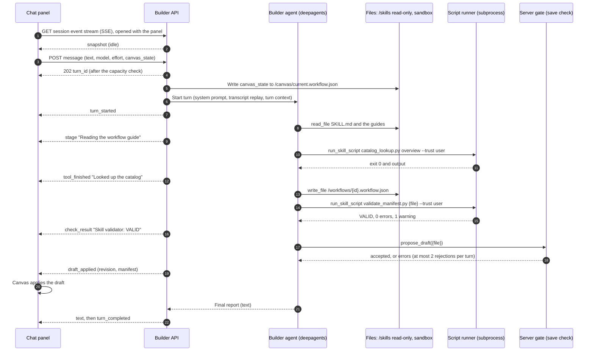

# Requirements: AI Workflow Builder

> **Superseded in part, 2026-11-10.** This is the original v0.4 draft, kept as the record of the questions and answers. Where the skill lives and how it ships has changed. The skill is no longer copied from `.kiro/skills/`. Its only copy is `backend/app/agents/workflow_builder/skills/velocity-workflow-creator/`, edited in place, with no lock file, no sync command and no `BUILDER_SKILLS_ROOT` or `BUILDER_SKILL_IDS` setting. The Skill line below, FR-32, Q-52, Q-61, S-15, S-16 and the copy-related parts of FR-33 describe the earlier plan. The live spec is `.kiro/specs/ai-workflow-builder/` (requirements 32 to 34, design §3.8), and ADR-0057 records the change.

Users build and edit workflows on `/workflows/new` and `/workflows/{id}/edit` by chatting with a dedicated deep agent. The agent follows the `velocity-workflow-creator` skill and runs the skill's scripts through tools. The chat panel shows live progress, the canvas shows each validated result, and the user saves it.

**Spec ID**: 023-ai-workflow-builder
**Created**: 2026-11-05
**Revised**: 2026-11-05 (v0.4). Recorded your answers to Q-53 to Q-58 and checked what they imply in the code: stateless turns, the 900 s turn cap and "continue", the session event stream, the builder model catalog's entries, and how far the skill's catalog has drifted from the code.
**Status**: DRAFT, requirements gathering. Q-01 to Q-58 are decided (§11). New questions Q-59 to Q-61 are in §9. None blocks the design, but Q-59 and Q-60 must be settled before the spike. The tool list (Q-18) and the Q-24 numbers stay open.
**Skill** (as drafted; superseded, see the note above): `.kiro/skills/velocity-workflow-creator/` is the source of truth. The backend runs an identical copy (FR-32). The builder never changes either copy; refreshing the skill's generated catalog is Q-61.
**Expected touch points** (to be confirmed in design):
- Frontend: `components/savedworkflows/SavedWorkflowsPage.tsx` (entry point), `components/workflow/composer/ComposerPage.tsx`, `CanvasView.tsx`, `CanvasConfigRail.tsx`, `store/api/userWorkflows.ts` (manifest to canvas mapping), `app/[...view]/page.tsx` (routing), `lib/entitlements.ts` (access check). A new chat panel, progress view and stream hook live outside `components/workflow`.
- Backend: a new agent package under `backend/app/agents/`, a new router under `backend/app/api/`, three new ORM models with one additive Alembic migration, the script runner tool, a startup step for interrupted turns, builder flags in `backend/agents/capabilities/model_catalog.py`, and the skill copy at `backend/builder_skills/` with its sync command, CI checks, `backend/Dockerfile` and `.dockerignore` lines, and a ruff exclude. It reuses the save validation in `backend/app/api/user_workflows.py`, the capacity check in `backend/app/api/run_commands.py` and `DeepAgentRunner`.

---

## Change log

| Date | Version | Change |
|---|---|---|
| 2026-11-05 | v0.1 | First draft from the requirement statement and a read of the current code. |
| 2026-11-05 | v0.2 | Recorded Q-01 to Q-32. Read the skill and added §2.2, FR-14, FR-15, FR-32 to FR-34, §7.1, Q-33 to Q-52 and R-09 to R-16. |
| 2026-11-05 | v0.3 | Recorded Q-33 to Q-52. Noted where an answer replaces an earlier one (Q-17, Q-20, Q-21, Q-25) and where you quoted only part of a proposal (Q-35, Q-37, Q-40, Q-43, Q-48). Checked the answers against the code and the skill, and ran the skill's scripts to measure them (§2.1, §2.2, S-17). Added FR-16 and FR-35 (live progress over SSE), FR-36 (builder model catalog) and an overview of how the backend uses the skill (§6). Rewrote FR-21 (read-only skill, nothing expires), FR-32 (copy in backend code) and FR-33 (runner for all six scripts). Removed the phase-1 pattern limit and the sandbox expiry. Corrected the skill's size: 1.0 MB of source, not 0.7 MB. Added Q-53 to Q-58 and R-17 to R-22. |
| 2026-11-05 | v0.4 | Recorded Q-53 to Q-58. You quoted part of the proposal for Q-53, Q-55, Q-57 and Q-58, so I recorded the whole proposal. Checking the answers against the code changed three things. (1) Each environment runs one backend process, so live turn state stays in process like run state, and the v0.3 note about a reconnect "served by another host" is withdrawn. (2) The capacity gate refuses new work with a 503 and the existing busy modal and never queues, so the "Waiting for capacity" stage is removed (FR-16.4, FR-35.3). (3) Rebuilding the skill's catalog from today's code finds one difference from the committed snapshot, so the drift check would fail now (S-14, Q-61). Made turns stateless and specified the transcript replay and summary (FR-21, FR-26). Specified the turn cap, the time-out and "continue" path, and turns interrupted by a restart (FR-12, FR-22, FR-24, FR-29, FR-34). Specified the session event stream: endpoint, authentication, revocation checks and other tabs (FR-16, FR-22, FR-35). Filled in the builder model catalog (FR-36). Added J9, Q-59 to Q-61 and R-23 to R-27. |

---

## 1. Goal

A user opens an AI chat panel on the workflow canvas and describes the workflow they want. A dedicated deep agent designs it by following the `velocity-workflow-creator` skill: it reads the skill's guides, runs the skill's lookup and validation scripts through tools, and writes a manifest. The panel shows what the agent is doing while it works. The canvas renders each validated result automatically, and the user saves it. The same panel edits the workflow afterwards. The user picks the LLM and its thinking level in the panel.

### 1.1 Original requirement statement (as given)

User requirements:
1. Add AI support on the `/workflows` URI.
2. Add a popup. Clicking it opens an AI chat panel on the left side.
3. The user creates a workflow through that chat panel.
4. Once a workflow is created, it renders on the canvas automatically. When the user clicks Save, the workflow is saved.
5. The user can also edit a created workflow through the chat panel.

Technical requirements:
1. The frontend supports all user requirements.
2. The backend has a new, separate deep agent (`deepagents`) that creates workflows from the chat panel.
3. "Harness agents as well": decided as configuring the deepagents harness (Q-19).
4. A skill is attached to every session. A new conversation is a new session, and the skill is attached to it.
5. Chat conversations are stored in the database.
6. The agent has many tools and uses them to build the expected workflow.
7. Rendering the workflow on the canvas needs backend and frontend support.
8. The chat panel supports multiple LLMs, each with its own thinking levels, and the user can adjust them.

Follow-up 1 (2026-11-05): the skill is `.kiro/skills/velocity-workflow-creator`. You created it for custom workflows and tested it with other agents. It must not be edited. It includes scripts, examples and docs. It is attached to the builder agent in every session.

Follow-up 2 (2026-11-05): the chat panel needs SSE events so the user knows what is happening. The backend must work out how to use the skill: the skill has scripts for validation, testing, the catalog and catalog lookup, and they must run when the agent calls a tool. The skill folder is copied into the backend code so the deep agent can use it.

---

## 2. What exists today

### 2.1 Platform

Each row was checked against the code on 2026-11-05.

| Area | Current behaviour | Where | What it means for this feature |
|---|---|---|---|
| `/workflows` page | "My Workflows" card grid. There is no canvas on this page. | `SavedWorkflowsPage.tsx`; `app/[...view]/page.tsx` | The builder lives on `/workflows/new` and `/workflows/{id}/edit` (Q-02). |
| Canvas | `ComposerPage` with a Simple/Canvas toggle. Canvas view is an SVG node graph (`CanvasView`, `CanvasNode`, `CanvasConfigRail`), plus `SummaryRail` and the `AgentLibrary` drawer. | `components/workflow/composer/` | The panel docks beside chrome that already exists. |
| Canvas round trip | Step and top-level keys the canvas does not model pass through on save (`captureStepExtra`, `manifestTopLevelExtra`). Per the `agentToManifestStep` comment this covers `strategy`, `fanout`, `task_source`, `produces`, `consumes`, `validators`, `redoable`, `fix` and `depends_on`. `route` and `subagents` are modeled. | `store/api/userWorkflows.ts` | Skill manifests should survive render and save. Verify it per pattern (NFR-09). |
| Save forces `exec: false` | `agentToManifestStep` writes `exec: false` into every step's `tools`, after the passthrough. | `userWorkflows.ts` | A draft that grants `exec` would be saved without it. The server gate rejects such drafts (Q-53). |
| Effort on the canvas | `manifestStepsToGateSelections` copies `model.model` into the step's selection but not `effort`, and the rail reads `sel.effort`. | `userWorkflows.ts`; `CanvasConfigRail.tsx` lines 1063 and 1097 | An effort the agent sets is saved but shows as unset (R-12). |
| Seeding runs once | Three refs make each seed run once per mount. | `ComposerPage.tsx` around lines 351–446 | Applying a draft every turn needs a new path (R-02). |
| Save | `POST /api/user-workflows` takes `name` (unique per user), `description`, `base_pipeline_type`, `agent_ids` (at least 1), and `manifest` or `selections`, not both. It compiles the manifest with the real compiler (`_validated_manifest` calls `_compile_check_manifest`). PATCH cannot change `base_pipeline_type`. | `backend/app/api/user_workflows.py` | The server gate reuses this check. Rows whose base is not `custom` are saved as new (Q-39). |
| Saved-row trust | `_saved_row_trust(tier)` returns `db` when the tier may run `custom`, otherwise `user`. Save, launch by id and resume all use it. Run once of an unsaved canvas sends the manifest inline, which compiles at `user`. | `backend/app/api/run_engine.py` | Every builder user (Q-33) saves at `db`. An unsaved draft that needs `db` cannot use Run once (Q-46). |
| Access to custom workflows | Only the `enterprise` tier has `custom` in `TIER_PIPELINES`. The frontend mirrors the table in `canRunPipeline(tier, type)`, and a parity test keeps the two equal. | `backend/app/core/entitlements.py`; `frontend/src/lib/entitlements.ts` | Builder access is `canRunPipeline(tier, "custom")` (Q-33). |
| After the first save | `ComposerPage` stores the new id (`setUserWorkflowId`, line 959). I found no URL change. | `ComposerPage.tsx` | The URL change in Q-49 is new work. |
| Run once inputs | Run once sends staged uploads (`staged_upload_ids`), images and the design selection (`template_id`, `design_system_id`) from the brief box and `DesignPickerModal`. | `ComposerPage.tsx` lines 1183–1229 | Patterns that need uploads (§14) or a template (§15) can run from the canvas. |
| Unsaved-work guard | ISS-275 compares name and roster against a baseline. | `ComposerPage.tsx` | An applied draft counts as unsaved work. |
| Deep agent runtime | `DeepAgentRunner` wraps `create_deep_agent` with a middleware stack and summarisation, and builds its own file backend from the run sandbox. When skills are staged it removes `task` and `execute`; `execute` is a no-op under `FilesystemBackend` anyway. deepagents 0.6.7 also ships `CompositeBackend`, which routes file paths to different backends by prefix. | `backend/app/agents/deep_agent_runner.py`; `deepagents/backends/composite.py` | Scripts need their own tool (FR-33). A `/skills/` route can serve the skill read-only (FR-21.4); the runner needs a way to accept that backend. |
| Skill staging | `stage_skills` writes a synthesized `SKILL.md` and copies the skill folder into each run sandbox. | `backend/app/agents/skill_staging.py` | Not needed for the builder. It reads the real folder through a read-only route, so the skill's own frontmatter is used and nothing is copied per session. |
| Global skills catalog | Every `<id>/SKILL.md` under the global skills root appears in the Skills library and can be attached to workflow steps. | `backend/app/agents/skills_catalog.py` | The builder skill must not go there (S-16). |
| Backend image | Copies `app/`, `agents/`, `alembic/`, `skills/global/`, `hooks/global/`, `pptx/` and the `opendesign` context. Runtime is Python 3.13. `.dockerignore` drops `*.md` (except `agents/**/*.md` and `skills/global/**`), `skills/`, `tools/` and `__pycache__/`. In the container, `/app/skills` is a volume that hides anything baked under it. | `backend/Dockerfile`; `backend/.dockerignore` | The skill copy needs its own folder, a `COPY` line and an `.md` re-include (FR-32). |
| Deployment | Each environment is one EC2 instance (`aws_instance.app`) with no load balancer, running one uvicorn process: `docker-entrypoint.sh` passes no `--workers`. The run registries (`_PIPELINE_QUEUES`, `_CANCEL_EVENTS`) are module-level dicts, which `run_commands.py` calls "safe for the single-process asyncio runtime". | `infra/terraform/modules/compute/main.tf`; `backend/docker-entrypoint.sh`; `backend/app/api/run_commands.py` | Live turn state can stay in process, as run state does. A restart ends every running turn (FR-22.10). More than one process per environment would need the same rework as runs, and is out of scope. |
| CI scan paths | Ruff lints all of `backend/` (`src = ["."]`) except its exclude list. Pyright, vulture, coverage (`fail_under = 80`) and import-linter cover `app`, `agents` and `tools`. Pytest collects `tests/**/test_*.py`. | `backend/pyproject.toml`; `backend/pyrightconfig.json` | A copy outside `app`, `agents` and `tools` needs only a ruff exclude (FR-32.5). |
| Line endings | `.gitattributes` forces LF for `*.py`, shell, YAML, Terraform and TypeScript files, but not for `*.md` or `*.json`. | `.gitattributes` | A byte comparison of the two skill copies can differ between Windows and Linux checkouts. Compare git blobs instead (FR-32.3). |
| Checkpointer | Postgres `AsyncPostgresSaver` in production. `InMemorySaver` for non-Postgres URLs and on Windows, where the app runs the Proactor loop. | `backend/app/agents/checkpointer.py` | Not used by the builder: turns are stateless (Q-55). |
| Event loop on Windows | `app/main.py` sets the Proactor event loop policy on Windows so that `asyncio.create_subprocess_exec` works. | `backend/app/main.py` | The script runner works in local dev. |
| SSE settings | `sse-starlette` sends a comment ping every `SSE_KEEPALIVE_PING_SECONDS = 15`. The config says the ingress idle timeout must exceed that (nginx `proxy_read_timeout 300s`) and that streams set `X-Accel-Buffering: no`. | `backend/app/core/config.py` | Builder streams reuse these settings, which keep the quiet stretches of a long turn alive. |
| Run stream on attach | The run stream replays the stored tail, sends `stream_attached {live, replayed_through_seq}`, then drains the live queue. It re-checks the caller's token revocation every `SSE_REVOCATION_CHECK_EVERY_N_EVENTS` (5) events and at least every `SSE_REVOCATION_CHECK_INTERVAL_SECONDS` (30), and closes with `session_revoked` when the check fails. | `backend/app/api/run_stream.py`; `config.py` | The builder stream follows the same order and the same revocation checks (FR-35.8). |
| Stream authentication | `useRunStream.ts` reads SSE with `fetch` and a `ReadableStream` reader, because the browser's `EventSource` cannot send the `Authorization: Bearer` header. | `frontend/src/hooks/useRunStream.ts` | The builder's stream hook does the same (FR-35.9). |
| Capacity gate | `HOST_CAPACITY_GATE_ENABLED` is on. A refused request gets a 503 with code `host_capacity_exhausted`, `recoverable: true` and a `Retry-After` header, and the frontend shows its busy modal. Admins are exempt, and the gate lets work through when it has no metrics. It refuses; it does not queue. | `backend/app/api/run_commands.py` (around line 2826); `backend/app/api/handoff.py`; `config.py` | Each builder message goes through the same check and gets the same response (FR-29.6). There is no waiting state. |
| Shutdown | uvicorn runs with `--timeout-graceful-shutdown 5`. On shutdown the platform sets every run's cancel event and drains the run tasks. In production, run rows stay `running` so they can resume on the next boot. | `backend/app/api/run_shutdown.py`; `backend/docker-entrypoint.sh` | A builder turn cannot resume part-way, because turns are stateless. It is marked `interrupted` instead (FR-22.10). |
| LLM call timeout | `LLM_CALL_TIMEOUT_SECONDS = 900`. One full-length generation can take several minutes. | `backend/app/core/config.py` | The turn cap uses the same value (Q-54). |
| Existing chat tables | `chat_sessions` and `messages` have no `owner_id`/`workspace_id` and hold text only. | `backend/app/models/chat.py` | New tables (Q-14). |
| Concierge chat | `POST /api/runs/{id}/messages` returns a streaming `EventSourceResponse`. Its tools only propose actions. | `run_commands.py`, `app/agents/chat/concierge.py` | Its proposal-only tools carry over. Its transport does not (Q-57). |
| Models and thinking | `ModelEntry.reasoning` has `mode`, `levels` and `default_effort`. The frontend shares `effortLevelsFor`, `effortLabel` and `modelChangePatch`. | `backend/agents/capabilities/model_catalog.py`; `AgentsPopup.tsx` | The builder model catalog is a view over this (FR-36). |
| Model limits | Sonnet 5.5 and Haiku 5.5 have a 1,000,000-token context window and `adaptive` reasoning with levels none to max. Opus 4.6 has a 200,000-token window and `budget` reasoning with levels none and on. The Enterprise tier, the only one with `custom` today, may use all three cost classes. | `model_catalog.py`; `entitlements.py` (`TIER_MODEL_COST_CLASSES`) | The transcript replay is sized for the model chosen for each message, and a long session has least room on Opus 4.6 (FR-26.3, R-24). On Opus 4.6 the Thinking picker offers Off and On only. |
| `ModelEntry` readers | The skill's `refresh_catalog.py` copies a fixed set of `ModelEntry` fields. The model-listing endpoints in `capabilities.py` and `settings.py` do not serialise `ModelEntry` whole (no `asdict`). | `refresh_catalog.py` (around line 450); `backend/app/api/` | New builder flags on `ModelEntry` change neither the skill's catalog nor those responses (FR-36.2). |
| Composer and SSE | No component in `components/workflow` opens an SSE connection. Live state arrives as props. | `MOD-frontend-src-components-workflow.md` | The chat stream lives outside `components/workflow`. |

### 2.2 The builder skill: what it needs from the runtime

I read `SKILL.md`, every doc under `docs/`, the command-line interfaces of all six scripts and the catalog metadata, and ran the scripts with bytecode writing off. `git status` shows no change to the skill folder afterwards.

| # | Skill fact | Evidence | Consequence for this feature |
|---|---|---|---|
| S-01 | The skill is an 11-step procedure: Brief, triage and decomposition, functional questions, load context, Step Plan, decisions, prompts, write the file, validate until VALID, checklist, respond. It restarts from step 1 on every turn that creates or changes a manifest. | SKILL.md, "How to work through this skill" and "Procedure" | A turn that changes the workflow makes many tool calls in a row. This drives the turn cap (Q-54), the adherence checks (Q-45) and the budgets (§7.1). |
| S-02 | It runs Python scripts throughout: `catalog_lookup.py` for every name, field rule and example; `validate_manifest.py` until VALID; `export_manifest.py` for payloads. The scripts need only the standard library. `jsonschema` adds full schema validation and PyYAML adds YAML support. Both are already in the backend's production environment: `jsonschema 4.26.0` through `mcp`, PyYAML through `langchain-core` and others. | SKILL.md steps 4, 6 and 9; `scripts/requirements.txt`; `uv tree --no-dev` | The agent needs a tool to run the scripts (FR-33). Full validation works with the backend's interpreter today. |
| S-03 | Some scripts change process-wide state. With `--compiler`, `validate_manifest.py` calls `sys.path.insert(0, backend)` and `os.chdir(backend)` and builds its own `CapabilityRegistry()`. `catalog_lookup.main()` reconfigures `sys.stdout` and `sys.stderr`. The scripts import each other (`catalog_lookup.py` imports `refresh_catalog` and `validate_manifest`; `refresh_catalog.py` imports `schema_sync`), so Python writes `__pycache__` into the skill folder unless bytecode writing is off. The `.kiro` copy already has `__pycache__` for Python 3.13 and 3.14 from earlier runs (gitignored). | `validate_manifest.py` `compiler_findings`; `catalog_lookup.py` lines 53–54 and `main`; `refresh_catalog.py` lines 65–66 | Scripts run only in a subprocess, with bytecode writing off (FR-33.6). |
| S-04 | Some modes write files or reach the network. `refresh_catalog.py --source`, `--api` and `--render` rewrite `references/catalog.json`, `docs/catalog.md` and the schema; `--source` runs `git` and changes directory into the backend; `--api` calls a server with a bearer token. `schema_sync.py` rewrites the schema unless given `--check`. `export_manifest.py` writes wherever its output option points. `selftest.py` works on temp copies ("nothing in the skill folder changes") and with `--compiler` imports the backend. `--catalog` and `--schema` accept any path. | The argparse definitions and docstrings of each script | The per-script policy in FR-33.4 (Q-58). |
| S-05 | Each turn that changes the manifest must read SKILL.md, `problem-decomposition.md`, `quick-reference.md` and `prompt-writing.md` in full: 74,715 characters, about 18.7K tokens. It must also run `overview`, print at least one `example` step, and run searches and field lookups. The skill says each doc "fits in one read". | Measured; SKILL.md steps 1 and 4; `checklist.md` item 9 | Tokens on every turn (R-14). deepagents' `read_file` returns 100 lines by default (`DEFAULT_READ_LIMIT = 100`), and these files are 267–389 lines long (`patterns.md` is 481). A default read silently returns a quarter to a third of a file (R-09). |
| S-06 | The skill's description is 1,097 characters. deepagents truncates descriptions to 1,024 (`MAX_SKILL_DESCRIPTION_LENGTH`). The cut text is "s or changes a workflow, even if it was used earlier in the conversation." | Measured; `deepagents/middleware/skills.py` lines 147 and 427–433 | The instruction to re-activate the skill on every request does not reach the model. The system prompt restates it (FR-20.3, R-10). |
| S-07 | The skill's output is a full manifest, `<id>.workflow.json`: `id`, `planner`, `clarify`, `deliverable`, `steps`, plus presentation keys. Its tested save path is `export_manifest.py --save-payload`: base `custom`, `agent_ids` set to the compiled root ids (`custom-agent:<instance_id>`), and `name` taken from the manifest. | `quick-reference.md` §1; `export_manifest.py` | The draft is this manifest (FR-24.1). Saving an unedited draft must give an equivalent payload (FR-09.7). |
| S-08 | The skill designs for `user` trust unless a requirement needs more, and knows that a saved Composer workflow runs at `db` only for callers entitled to `custom`. | `trust-and-security.md` §1 | Every builder user is entitled (Q-33), so the server tells the agent which trust to target (Q-46, FR-34.3). |
| S-09 | Its patterns include critic loops, branches, parallel specialists, grouped sub-steps, fan-out, waves, task loops, hand-offs, a person choosing the path, OpenDesign, uploads, chaining and integrations. Its default quality check for prose is a critic loop. | `patterns.md` §1–21; `requirements-analysis.md` §5 | All allowed except §19 and §20 (Q-34, Q-53). |
| S-10 | The skill always picks a model and effort for each step and must not ask the user about them. It recommends EU Claude ids and lists GPT-5.6 for non-EU steps. | SKILL.md step 5; `problem-decomposition.md` §6.2; `quick-reference.md` §6; `design-playbook.md` §6 | It picks from the builder model catalog's step list, which excludes GPT (Q-35, Q-36, Q-56). |
| S-11 | It asks functional questions only: at most 5 per round, with options and a recommended default, at most 2 rounds, then proceeds on defaults. | `problem-decomposition.md` §6; `requirements-analysis.md` §4 | Matches Q-22. |
| S-12 | Its validation loop has no bound: "Validate until VALID." | SKILL.md step 9 | Bounded by the tool-call cap and the 900 s turn cap (Q-37, Q-54). |
| S-13 | Its reply is a long Markdown report that ends with "Run it" (export a payload, then call the API with a bearer token) and lists what a launch needs. | SKILL.md step 11 | Shown collapsed; "Run it" becomes canvas instructions; the launch needs stay (Q-44, FR-14). |
| S-14 | The catalog is a snapshot: `references/catalog.json` was generated 2026-11-03 from `feature/ai-workflow` at `e2479f8e9`, 10 commits behind HEAD `c8e0dc9c5`. It holds platform-wide names, not per-user data. On 2026-11-05 I rebuilt it from today's code into a temp folder (`refresh_catalog.py --source` with every output pointed at the temp folder; the skill was not changed). Apart from the timestamp and commit, one value differs: agent `design-ingestor` now lists the `spawn_subagents` tool. The rebuild also rewrites the generation line in `docs/catalog.md` and the schema's top-level `$comment`, because both quote the commit. | `catalog.json` `generated_at` and `source`; git; the rebuild | The server gate stays the authority, and user facts come from read tools (Q-43). The drift check in FR-32.8 would fail today (Q-61). |
| S-15 | The folder holds 1,000,566 bytes of source in 27 tracked files, plus 688,824 bytes of untracked `__pycache__`. | File listing; `git ls-files` | Copy and hash the 27 tracked files only (FR-32). |
| S-16 | The skill lives under `.kiro/skills/`, outside the backend build context. Q-52 copies it into the backend code. The copy cannot go under `backend/skills/` (left out of the image by `.dockerignore`, hidden by the `/app/skills` volume, and its global skills appear in the Skills library) or under `backend/tools/` (left out of the image). | `backend/Dockerfile`; `backend/.dockerignore`; `skills_catalog.py` | Its own folder: `backend/builder_skills/` (FR-32.2). |
| S-17 | Measured on this Windows dev machine with the backend interpreter (Python 3.13.15, bytecode off): 8 `catalog_lookup.py` calls took 457–519 ms and printed 271–5,536 characters; 2 `validate_manifest.py` calls took 499–594 ms and printed up to 14,935 characters; `selftest.py` took 1,128 ms (70/70 checks passed); `refresh_catalog.py --check` took 486 ms ("catalog, catalog.md and schema are in sync"). | Run 2026-11-05 | Script calls are cheap: a turn with about 10 calls spends about 5 s in scripts. The script limits in §7.1 leave plenty of room. |
| S-18 | "Reads and lookups from earlier turns in the conversation do not count": every manifest-changing turn re-reads the docs and re-runs the lookups. | SKILL.md, "How to work through this skill" | Replaying earlier turns' tool calls would cost tokens the skill does not use. Turns are stateless (Q-55, FR-26). |

---

## 3. Scope

### 3.1 In scope (phase 1)

- Entry points: "Build with AI" on `/workflows`, and an AI button in the composer header on both composer routes. Both open the popup (Q-01, Q-48).
- Access: users who may create custom workflows (`custom` entitlement), behind a feature flag, through the capacity gate (Q-33, Q-25).
- A left-side chat panel on `/workflows/new` and `/workflows/{id}/edit`, about 380 px wide and collapsible (Q-02, Q-03).
- Live progress in the panel over SSE: stages, tool activity, check results, in every open tab (FR-16, FR-35, Q-57).
- Creating, refining and editing workflows, including any user-saved workflow; rows whose base is not `custom` are saved as new (Q-09, Q-39).
- Every skill pattern that passes the server gate: `patterns.md` §1–18 and §21 (Q-34, Q-53).
- Applying each validated draft straight to the canvas, with undo of the last AI change (Q-04, Q-10).
- Manual canvas edits between turns (Q-05).
- Saving through the existing flow. Later saves update the same row, and "Save as new" stays (Q-07, Q-08).
- Sessions, history, resume and delete (Q-11, Q-12).
- Three new tables. Nothing expires; only the user deletes (Q-14, Q-41).
- Stateless turns with a stored transcript summary (Q-55).
- A 900 s cap on every turn, with "continue" after a time-out or a restart (Q-54).
- A model and thinking-level picker over the builder model catalog (Q-15, Q-16, Q-36, Q-50, Q-56).
- The builder deep agent with the skill, and harness configuration (Q-19, Q-47).
- The skill copy in backend code, and a script runner for all of the skill's scripts (Q-42, Q-52, Q-58).
- English only (Q-31).

### 3.2 Out of scope (phase 1)

- Any change to the skill made by the builder, in either copy. How the skill's generated catalog is refreshed is Q-61.
- Built-in workflows and spec-016 overrides (Q-09).
- Patterns §19 (code that is compiled and tested, needs `exec`) and §20 (revision workflows, need `previous_run`) (Q-53).
- Attachments and voice input in the chat (Q-23).
- Restoring arbitrary earlier revisions (Q-10).
- Showing builder spend on the Analytics page (Q-26). Usage is stored from day one.
- Replaying a turn's text after a reconnect (Q-28). Activity so far is shown (FR-16.6).
- Resuming a turn part-way after a restart. The turn is marked interrupted and the user continues it (FR-22.10).
- Drafts sent as patches (Q-06).
- Running a workflow from the chat. The canvas's Run once stays.
- Tools that change data outside the session (Q-18).
- Automatic deletion or expiry of anything the user created (Q-41).
- More than one backend process per environment. The run transport has the same limit (§2.1, Deployment).
- Multi-user collaboration on one session.

---

## 4. Users and journeys

| ID | Journey |
|---|---|
| J1 | **Create.** On `/workflows`, the user clicks Build with AI. The popup shows a prompt box, example prompts, the model and thinking picker, and recent conversations. Sending the first message creates a session and opens `/workflows/new?ai=<sessionId>` with the panel. The agent asks at most 2 rounds of questions, then produces a draft. The canvas shows it, and the user saves it with the AI's name pre-filled. The URL becomes `/workflows/{id}/edit?ai=<sessionId>`. |
| J2 | **Refine before saving.** The user asks for changes, and the canvas updates after each turn. |
| J3 | **Edit after saving, same session.** Save updates the same row. |
| J4 | **Edit an existing saved workflow.** On `/workflows/{id}/edit`, the AI button starts a new session seeded with that workflow. For a row whose base is not `custom`, Save becomes "Save as new". |
| J5 | **New conversation.** From the panel. After an unsaved-work prompt, a new session starts with an empty canvas on `/workflows/new`. |
| J6 | **Resume.** From the popup or the panel dropdown. The transcript and canvas load. |
| J7 | **Undo.** The user clicks Undo on the latest AI message, and the canvas returns to its state before that change. |
| J8 | **Watch progress.** While a turn runs, the panel shows what the agent is doing (reading the guide, looking up agents and models, writing the workflow, checking it, updating the canvas), how long it has taken, and each check result. The user can stop the turn. Another tab, or the same tab after a reload, shows the activity so far and picks up the result. |
| J9 | **Continue.** A turn reaches the 15-minute cap, or a restart interrupts it. The panel says so and keeps the work so far. The user clicks Continue, or types "continue", and the agent picks up the manifest it was writing. |

---

## 5. Functional requirements: frontend

Each requirement has acceptance criteria. A tag like `[Q-61]` marks a criterion that still depends on an open question in §9. Decided items cite the answer they come from.

### FR-01 Entry points and popup

1. The `/workflows` page SHALL show "Build with AI" next to the existing create control (Q-48).
2. The composer on `/workflows/new` and `/workflows/{id}/edit` SHALL show an AI button in its header (Q-48). When the canvas already has a session, the button SHALL reopen the panel instead of the popup.
3. Either control SHALL open the popup: a prompt box, 3–4 example prompts, the Model and Thinking-level picker (FR-05), and the user's recent builder conversations (FR-11) (Q-01, option c).
4. Sending the first message from the popup SHALL create a session and open the builder with the panel. From `/workflows`, it opens `/workflows/new?ai=<sessionId>`. From `/workflows/{id}/edit`, the session is seeded with that workflow and the URL becomes `/workflows/{id}/edit?ai=<sessionId>` (Q-12, Q-49). The message itself SHALL be sent by the builder page once its stream is open (FR-16.8).
5. Selecting a recent conversation SHALL open it (FR-11.3).
6. The controls SHALL be shown only to users who may create custom workflows (`canRunPipeline(tier, "custom")`) and only while the feature flag is on (Q-33, Q-25). The check SHALL read the entitlement table, so a change to that table changes access without a code change.

### FR-02 Builder layout

1. The chat panel SHALL dock on the left, about 380 px wide, with the canvas to its right (Q-03).
2. The user SHALL be able to collapse the panel. Collapsing SHALL NOT end the session, cancel a running turn or close the session stream.
3. Below 1024 px, the panel SHALL overlay the canvas (Q-03).
4. While the panel is open, the composer SHALL show Canvas view by default. Simple view SHALL show the same draft (Q-03).
5. The existing composer chrome SHALL stay available: header, Save, Run once, config rail, summary rail, agent library.
6. The URL SHALL carry the session as `?ai=<sessionId>` on both routes. After the first save on `/workflows/new`, the URL SHALL become `/workflows/{id}/edit?ai=<sessionId>`. Reloading or opening such a URL SHALL restore the transcript and the canvas (Q-49).
7. Opening `/workflows/{id}/edit` without `ai` and clicking the AI button SHALL start a new session (Q-12, Q-49).

### FR-03 Transcript and message input

1. The panel SHALL show user and assistant messages in order.
2. The input SHALL accept multiple lines. Enter sends, and Shift+Enter inserts a newline.
3. Send SHALL be disabled when the input is empty and while a turn is running.
4. Messages SHALL be at most 12,000 characters, enforced by both the client and the server (Q-24, placeholder).
5. Assistant messages SHALL render Markdown safely: no raw HTML, and no `dangerouslySetInnerHTML` without sanitising first.
6. UI text SHALL be in English (Q-31).

### FR-04 Streaming text, thinking and stop

1. Assistant text SHALL stream in as it is generated.
2. Progress (stages, tool activity, check results) SHALL be shown as described in FR-16.
3. Where the model emits reasoning, it SHALL appear in a collapsed "Thinking" block, using summarised display where the model supports it (Q-16). Because it is shown, it is stored (Q-13).
4. A Stop control SHALL cancel the running turn (FR-30).

### FR-05 Model and thinking-level picker

1. The panel and the popup SHALL show a Model select and a Thinking-level select.
2. The model options SHALL be the chat entries of the builder model catalog (FR-36) that the user is entitled to: Sonnet 5.5 and Opus 4.6, plus Haiku 5.5 once it passes the spike (Q-56) `[Q-59]`. GPT models are excluded until spec 020's compliance sign-off (Q-29). The frontend SHALL NOT hardcode a model list (INV-12).
3. The thinking levels SHALL be the selected model's `reasoning_levels`, labelled with `effortLabel`. The select SHALL be hidden for a model with `reasoning_mode: none`. On Opus 4.6 it offers Off and On.
4. When the user changes model, the effort SHALL follow the existing `modelChangePatch` rules.
5. The current choice SHALL be sent with every message, and the session SHALL remember the last one (Q-15).
6. The default SHALL be the user's Settings preference when it is in the list, and otherwise Sonnet 5.5, the builder default (Q-50, Q-56).
7. The selected model SHALL drive only the builder agent, never the steps of the generated workflow (Q-17, Q-35).

### FR-06 Render the draft on the canvas

1. A turn SHALL produce at most one draft: a full manifest that passed the server gate (FR-24.2) (Q-06).
2. When a `draft_applied` event arrives, the canvas SHALL apply it directly, without a reload (Q-04), within 300 ms (Q-30).
3. The canvas SHALL render a draft with the same mapping it uses to reopen a saved workflow (`manifestStepsToAgents`, `manifestStepsToGateSelections`). The draft SHALL become the passthrough source for Save (`buildWorkflowManifest(..., sourceManifest)`), so keys the canvas does not model survive.
4. The canvas SHALL never show a draft that failed the server gate, and SHALL never show an unproposed revision (FR-24.8).
5. Each applied draft SHALL come with a chat summary of what changed (steps added, removed or reordered; gates, validators or models changed), computed by the server from the previous revision.
6. An applied draft SHALL count as unsaved work for the ISS-275 guard.
7. The config rail SHALL show the model and the effort that the draft set on each step (R-12).
8. A turn that only asks questions or answers without changing the workflow SHALL leave the canvas unchanged.
9. Each draft SHALL carry the trust it was checked at (Q-46). When that is `db`, Run once SHALL be disabled while the canvas has unsaved changes, with a note saying why: an unsaved canvas runs at `user` trust.
10. When a draft needs inputs at launch (uploads, a template or design system, configured connectors, or a source run), the chat summary SHALL say so. The server derives this list from the manifest (FR-24.7).

### FR-07 Edit through chat, and undo

1. The agent SHALL change the current canvas state sent with the message, and SHALL rebuild from scratch only when the user asks for that.
2. The latest AI message that changed the canvas SHALL offer "Undo this change" (Q-04). Older AI messages SHALL NOT offer it in phase 1 (Q-10).
3. Undo SHALL restore the canvas state that was sent with that turn's message, and SHALL be stored as a new draft revision (Q-10).
4. IF the user edited the canvas by hand after that AI change, THEN Undo SHALL ask before discarding those edits.

### FR-08 Manual canvas edits

1. The user MAY edit the canvas between turns. Every message SHALL carry the full current canvas state as a manifest (Q-05).
2. While a turn is running, the canvas SHALL be read-only, and so SHALL Save and Run once (Q-05). This holds in every tab that has the session open (FR-16.7).

### FR-09 Save

1. Save SHALL use the existing endpoints (`POST /api/user-workflows`, `PATCH /api/user-workflows/{id}`), with their validation unchanged.
2. The name modal SHALL be pre-filled from the draft's `name` (falling back to `id`) and `description`, and the user confirms (Q-07).
3. The agent SHALL NOT save on its own.
4. After the first save, Save SHALL update the same row with PATCH. "Save as new" SHALL stay available (Q-08).
5. On save, the session SHALL be linked to the workflow's id (Q-12), and the URL SHALL follow FR-02.6.
6. Save errors (422 compile failure, 409 duplicate name) SHALL appear in the existing UI, and the user can ask the chat to fix them.
7. For a draft the user has not edited, the Save payload SHALL be equivalent to `export_manifest.py --save-payload` on the same manifest: the same base (`custom`), the same `agent_ids`, and a manifest that is equal after canonical JSON serialisation (S-07).
8. For a row whose base is not `custom`, Save SHALL become "Save as new" and the original row SHALL stay unchanged (Q-39). The session then links to the new row, and the URL moves to the new row's edit route.

### FR-10 New conversation

1. "New conversation" in the panel header SHALL start a new session with an empty canvas (Q-12). On `/workflows/{id}/edit`, it navigates to `/workflows/new`.
2. IF the canvas has unsaved changes, THEN the system SHALL ask before discarding them (Q-12).

### FR-11 Conversation history

1. The user's builder conversations SHALL be listed newest first, in the popup and in a dropdown in the panel header (Q-11).
2. Each title SHALL be generated from the conversation's first message (Q-11).
3. Reopening a conversation SHALL load its transcript and canvas. If the session is linked to a saved workflow, the saved row SHALL load, and the chat SHALL note when the row has changed since the session's last draft (Q-49).
4. The user SHALL be able to delete a conversation after confirming. Deleting is the only way a conversation goes away; nothing expires (Q-11, Q-41).

### FR-12 Errors and recovery

1. WHEN the LLM fails, THEN the transcript SHALL show an error with a Retry that resends the last user message without duplicating it.
2. WHEN the stream drops, THEN the turn SHALL keep running on the server. After a reload, the client SHALL show the activity so far and get the final message and any draft when the turn ends (Q-28, FR-16.6).
3. A 401 SHALL go through the existing `authedFetch` session-expiry handling.
4. A 404 on a session SHALL show a not-found state.
5. Sending while a turn runs in another tab SHALL get a 409, and the panel SHALL show that a reply is being written (Q-27).
6. WHEN a turn reaches the 900 s cap, THEN its message SHALL say that the turn stopped at the time limit and that the work so far is kept, and SHALL offer a Continue action that sends "continue" as the next message (Q-54).
7. WHEN a restart interrupts a turn, THEN its message SHALL show the same notice and Continue action, with the status `interrupted` (FR-22.10).
8. WHEN the capacity gate refuses a message (503 `host_capacity_exhausted`), THEN the panel SHALL show the existing busy modal, nothing SHALL be stored, and the text SHALL stay in the input so the user can send it again (FR-29.6).

### FR-13 Accessibility and responsiveness

1. Every control SHALL be reachable by keyboard and have a visible focus state.
2. A polite live region SHALL announce stage changes, an applied draft and the end of a turn. It SHALL NOT announce individual chunks of streamed text.
3. The Model and Thinking selects SHALL have labels.
4. Colours SHALL come from the design tokens in `frontend/src/styles/globals.css`.
5. The panel SHALL follow FR-02.3 below 1024 px.

### FR-14 Showing the skill's report

1. An assistant reply that carries the skill's report SHALL show a short summary first, with the full report in an expandable section (Q-44).
2. Tables SHALL scroll horizontally inside the message, and the message SHALL open in a wider reading view.
3. The system prompt SHALL replace the skill's "Run it" section with canvas instructions (Save, Run once) (Q-44). The list of what a launch needs (uploads, a template, connectors, a source run) SHALL stay.
4. The panel SHALL NOT show instructions to export files or call the API with a bearer token (S-13).

### FR-15 Clarifying questions

1. The agent's questions SHALL appear as normal assistant messages: numbered, with options and a recommended default, as the skill writes them (S-11).
2. The user SHALL answer in free text (Q-22).
3. After 2 turns without a draft, the next turn SHALL produce a draft from defaults and list the unanswered questions as risks (Q-22, S-11). The server counts these turns (FR-34.6).

### FR-16 Live progress in the panel

The user asked for SSE events so they can see what is happening. The events are specified in FR-35.

1. While a turn runs, the in-progress assistant message SHALL show the current stage (FR-35.3) and the elapsed time, for example "Checking the workflow · 1 min 12 s".
2. It SHALL show a collapsible activity list, one line per tool call, with a readable label, a status (running, done, failed, refused) and a duration. A line MAY expand to show the command the agent ran (script calls only) and a short result summary. The list SHALL NOT show file contents, environment values or raw tool payloads.
3. Check results SHALL appear as they arrive, for example "Skill validator: VALID, 1 warning" or "Platform check: 2 problems, fixing (attempt 1 of 2)".
4. When the turn nears a limit (time, tool calls or tokens), the panel SHALL show a quiet notice, for example "About 3 minutes left in this turn" (FR-35, `limit_warning`).
5. When the turn ends, the activity list SHALL collapse to a one-line summary (for example "14 actions, 2 checks, 1 min 40 s") that can be expanded again. The list SHALL survive a reload, because tool activity is stored (FR-25.2).
6. A tab that opens or reloads while a turn runs SHALL show the activity so far and "Still working", then the result when the turn ends. Text written before the reload is not replayed (Q-28).
7. Other open tabs of the same session SHALL receive the same events through the session stream and show the running turn, with their canvas read-only (Q-27, Q-57). When the turn ends, they SHALL load the new transcript and draft, after an unsaved-work prompt if they have unsaved edits.
8. The panel SHALL open the session stream when it opens and keep it open while it is mounted, including when collapsed, so the tab that sends a message receives every event of its turn.

---

## 6. Functional requirements: backend

### How the backend uses the skill (overview)

FR-20 to FR-36 state this as requirements.

1. **Shipping.** `.kiro/skills/velocity-workflow-creator/` is the source of truth. A sync command copies it to `backend/builder_skills/velocity-workflow-creator/`, and CI fails if the two copies differ (FR-32). The image carries the copy at `/app/builder_skills/`.
2. **What the agent sees.** Each turn builds a fresh deepagents graph: turns are stateless, and the agent's input is the system prompt, a replay of the stored transcript and the turn context (FR-26, Q-55). Its file backend routes `/skills/` to a read-only view of the deployed skill folder, and every other path to the session's sandbox on disk. `SkillsMiddleware` scans `/skills`, so the model sees the skill's name, description and path, and reads `SKILL.md` and the guides with `read_file`. Nothing is copied per session (FR-21.4).
3. **The canvas and the agent's files.** At the start of every turn the server writes the canvas state to `/canvas/current.workflow.json`. The agent works in its own files under `/workflows/`, which the server never overwrites, so work from a turn that timed out is still there for "continue" (FR-34.1, Q-54).
4. **Running a script.** The agent calls `run_skill_script` with the command exactly as the skill writes it, for example `python /skills/velocity-workflow-creator/scripts/catalog_lookup.py overview --trust user`. The runner checks the command against the policy (FR-33.4), maps the paths, runs the script in a subprocess with the backend's interpreter, and returns the exit code and output as the tool result. The panel gets an event before and after each call (FR-35).
5. **Writing and checking.** The agent writes the manifest to `/workflows/<id>.workflow.json`, then runs `validate_manifest.py` until it reports VALID, within the turn's limits.
6. **Proposing.** The agent calls `propose_draft` with the file path. The server runs the server gate: the same check save runs, at the target trust, plus the builder rules (FR-24.2). A rejection goes back to the agent as the tool result. An accepted draft is stored as a revision and sent to every open tab in a `draft_applied` event.
7. **Replying.** The agent's report streams to the panel. When the turn ends, the server stores the assistant message, the token usage and the skill hash. Tool activity was already stored as each call finished.

The flow of one turn:

### FR-20 The builder deep agent

1. A new agent SHALL build and edit workflows. It SHALL be separate from workflow step agents and from the concierge, and SHALL be built with the real `deepagents` library through `DeepAgentRunner` (INV-13).
2. The agent's method SHALL be the `velocity-workflow-creator` skill, used unmodified (FR-21, FR-32). Its skill list is data, so another builder skill can be added later without code changes (Q-47).
3. Its system prompt SHALL live in a versioned file and SHALL hold only what the skill cannot know:
   1. Product context: the user works in a chat panel next to a canvas, and saves and runs from the canvas. No file is handed to the user.
   2. How to run scripts: pass each command line to `run_skill_script` (FR-33). `<skill>` is `/skills/velocity-workflow-creator`. The platform compiler check is available through `--compiler`.
   3. The re-activation rule that truncation cut from the description (S-06): follow the skill from step 1 on every message that creates or changes a workflow.
   4. The read rule: read each skill file in full with one `read_file` call whose limit exceeds the file's length; the longest doc is `patterns.md` at 481 lines (Q-45 a).
   5. How to deliver: write the manifest under `/workflows/`, then call `propose_draft`. Replace "Run it" with canvas instructions, but keep the list of launch needs (Q-44).
   6. The builder rules: step models come from the builder model catalog's step list (FR-36); the features in FR-24.2 must not be used; the target trust follows Q-46.
4. The agent SHALL run outside the ExecutionEngine. The feature SHALL NOT edit the kernel or add an `if pipeline_type == ...` branch (SC-001, INV-1).
5. The agent SHALL NOT save, launch or delete anything. It SHALL write only inside its sandbox and through the session store.

### FR-21 Sessions and the skill

1. Creating a session SHALL record the owner, the mode (create or edit), the linked workflow id (nullable), the model, the effort, the target trust and the hash of the deployed skill (Q-20, Q-40).
2. Turns SHALL be stateless: no checkpointer and no agent state carried between turns (Q-55). Each turn's input is built as in FR-26. The session id SHALL be the trace id for logs and traces.
3. Each session SHALL get a sandbox on disk for its working files: `/canvas/` (written by the server), `/workflows/` (the agent's manifests), exported payloads, and each script call's temp folder. The sandbox SHALL NOT be a git repository. It must be on disk, not in agent state, because files in agent state would be lost at the end of each stateless turn and the script runner reads files from disk.
4. The skill SHALL be served read-only from the deployed folder through the `/skills/` route. Writes under `/skills/` SHALL be refused. Nothing from the skill is copied into the session.
5. Each turn SHALL use the skill version deployed at that time, and each message SHALL record the skill hash it used (Q-40). When the hash differs from the session's previous message, the chat SHALL show one line saying the builder was updated.
6. The sandbox SHALL persist until the user deletes the session (Q-41). If it is lost, it SHALL be rebuilt on the next turn from the database: the latest accepted draft and the latest unproposed revision (FR-24.8).
7. A new conversation SHALL always be a new session. A session SHALL never be reused (Q-12).
8. An edit session SHALL be seeded with the row's effective manifest as draft revision 0 (Q-12). For a row whose base is not `custom`, the base pipeline's own top-level settings (deliverable, planner, clarify) SHALL be filled in, so the agent sees what the workflow does today. The design decides how.
9. A session SHALL keep a nullable link to its workflow. Deleting the workflow SHALL unlink it and keep the session (Q-12).

### FR-22 Session and turn endpoints

1. The API SHALL offer, under one prefix such as `/api/workflow-builder` (names to be settled in design): create, list, get and delete a session; send a message; the session event stream; cancel a turn; undo the last AI change; link the session to a saved workflow; list the chat models.
2. Sending a message SHALL accept `{content, model_id, effort, canvas_state, client_message_id}`. It SHALL run the capacity check first (FR-29.6), then store the user message and return 202 with the turn id and message id (Q-57). The turn's events reach the client through the session stream (FR-35), not through this response.
3. The turn SHALL run as a background task, not inside the request, so it continues after a disconnect and its result is stored (Q-28).
4. A session SHALL have at most one turn running. A second message during that turn SHALL get a 409 (Q-27). The check SHALL be made against the stored session, so a restart cannot leave two turns running.
5. The assistant message SHALL be stored when the turn ends, with its status (`completed`, `failed`, `cancelled`, `timed_out` or `interrupted`), including the partial text.
6. A repeated `client_message_id` SHALL NOT start a second turn.
7. `canvas_state` SHALL be the composer's full manifest, capped in size (§7.1), and treated as untrusted input.
8. The feature SHALL NOT add a WebSocket (LOCK-B).
9. Linking a session to a workflow SHALL check that the user owns that workflow.
10. On shutdown, the server SHALL stop running turns and mark them `interrupted`. On startup, it SHALL mark any turn still recorded as running as `interrupted`, because the process that ran it is gone. In both cases the working files SHALL be kept and the unproposed revision stored (FR-24.8), so the session unlocks and "continue" works (Q-54). Unlike pipeline runs, builder turns are not resumed on boot, because they are stateless.

### FR-23 Tool set

You will provide the tool list (Q-18). Whatever the tools are called, the skill's procedure needs these capabilities. `run_skill_script` and `propose_draft` are specified here because the skill depends on their exact behaviour.

| # | Capability | Used in skill step | Provided by |
|---|---|---|---|
| SR-01 | Read skill files in full | 1, 4 | deepagents `read_file`, `ls`, `glob`, `grep`, over the read-only `/skills/` view |
| SR-02 | Write and edit the manifest in the sandbox | 8, 9 | deepagents `write_file`, `edit_file`, under `/workflows/` only |
| SR-03 | Run the lookup script (`catalog_lookup.py`) | 4, 6, ground rule 1 | `run_skill_script` (FR-33) |
| SR-04 | Run the check scripts (`validate_manifest.py`, `selftest.py`, the `--check` modes) | 9 | `run_skill_script` (FR-33) |
| SR-05 | Get the platform compiler's verdict | 9.4 | `--compiler`, answered by a server gate dry run (FR-33.5), and `propose_draft` |
| SR-06 | Hand the validated manifest to the canvas | Replaces step 8's file hand-off and "Run it" | `propose_draft` (FR-24) |
| SR-07 | Look up facts the snapshot lacks: the user's own agents, the user's skills, existing workflow names (to pick a unique name), configured connectors, workflows the user may hand off to | 4, ground rule 1 | Read tools (Q-43) |
| SR-08 | Nothing else: no shell, no `execute`, no network access, no writes outside `/workflows/` and the call's temp folder; `task` stays off | | |
| SR-09 | Read the builder model catalog | 5, 6 | Read tool (FR-36) |

### FR-24 Draft contract and the server gate

1. The draft SHALL be the skill's full manifest. The server reads it from the sandbox file named in `propose_draft`, so the model does not resend the JSON.
2. Before any `draft_applied` event, the server SHALL check the draft with the same code save uses (`_validated_manifest` calling `_compile_check_manifest`), at the target trust (Q-46). It SHALL also apply the builder rules: the agent-id allow-list; model entitlement; step models from the builder model catalog's step list (FR-36); and no feature the product cannot run or supply (Q-53): `exec`, `network` or `secrets` grants, the `filesystem` and `postgres` MCP servers, and the `previous_run` context provider. A rejection SHALL name the feature and say why it cannot be used. The list SHALL live in one place. If design finds another capability that compiles at `db` but that a Composer launch cannot run or supply, it SHALL be added to the list after your approval. The gate SHALL NOT add any other validator. This check is the server gate.
3. The skill's own validator SHALL serve as the agent's lint. Its findings SHALL appear as tool activity, and it SHALL NOT replace the server gate.
4. WHEN the gate rejects a draft, THEN the errors SHALL go back to the agent as the tool result. Each turn allows 2 rejections of `propose_draft`; dry runs through `--compiler` do not count (Q-24, Q-37). After the second rejection, the turn SHALL end with an explanation and the canvas SHALL NOT change. The skill's own validate loop is bounded by the tool-call cap and the turn cap (§7.1).
5. Every accepted draft and every undo SHALL be stored as a numbered revision (Q-10).
6. A draft SHALL be a full replacement, not a patch (Q-06).
7. The server SHALL derive from the accepted manifest the change summary (FR-06.5) and the launch needs (FR-06.10), and SHALL send both in `draft_applied`.
8. WHEN a turn ends without an accepted draft (`timed_out`, `interrupted`, `cancelled` or `failed`) and the agent changed a file under `/workflows/` during the turn, THEN the server SHALL store the most recently changed one as an unproposed revision. An unproposed revision is never shown on the canvas. It lets "continue" pick up the work even if the sandbox is rebuilt (Q-54, FR-21.6).

### FR-25 Conversation persistence

1. The system SHALL store sessions, messages and drafts in three new tables: `workflow_builder_sessions`, `workflow_builder_messages` and `workflow_builder_drafts` (Q-14). The drafts table holds four kinds of revision: the seed of an edit session, accepted drafts, undos and unproposed revisions.
2. It SHALL store user and assistant messages with status, model, effort, skill hash and token usage; thinking, because it is shown (Q-13, Q-16); draft revisions; and the transcript summary (FR-26.4). Tool activity (tool, label, command for script calls, status, duration, truncated result) SHALL be stored as each call finishes, not only at the end of the turn, so a reload mid-turn shows the activity so far (FR-16.6).
3. Every new table SHALL carry `owner_id` and `workspace_id`. The migration SHALL be additive and leave exactly one Alembic head.
4. `user_id` SHALL be the authorisation key.
5. Nothing SHALL expire: sessions, messages, tool activity, drafts, summaries and sandboxes stay until the user deletes the session or the account (Q-41).

### FR-26 Resume and the turn input

1. `GET` on a session SHALL return its metadata, transcript, latest draft, the latest unproposed revision when it is newer than the latest draft, and a snapshot of a running turn (stage, activity so far, start time).
2. Each turn's input SHALL be the system prompt, a replay of the stored transcript, and the turn context (FR-34). Earlier turns' tool calls, tool results and thinking SHALL NOT be replayed: the skill re-reads its files every turn (S-18, Q-55).
3. The replay SHALL contain user and assistant messages verbatim, newest first, until it reaches its budget: a share of the context window of the model chosen for this message (§7.1). Because the model can change per message (Q-15), the budget is worked out again at the start of every turn. Older turns SHALL be represented by the stored summary.
4. The summary SHALL keep every answer the user gave to the agent's questions, every requirement or constraint the user stated, and the Workflow Brief and Decisions from the latest report. It SHALL be written when the transcript first outgrows the replay budget, updated when it outgrows it again, and stored. Its token usage SHALL count toward the session.
5. The latest few turns SHALL always be replayed verbatim, whatever their size (§7.1).

### FR-27 Model and effort per message

1. The server SHALL check `model_id` against the builder model catalog's chat list, the user's entitlement (`_model_entitlement_error`) and the GPT exclusion (Q-29, Q-50, Q-56).
2. `effort` SHALL be one of the selected model's levels. Anything else gets a 422.
3. Every message SHALL record the model and effort it used, and the session SHALL keep the last choice as its default (Q-15).

### FR-28 Authorisation

1. Every endpoint SHALL use `Depends(get_current_user)` and SHALL require the `custom` entitlement and the feature flag (Q-33).
2. A session lookup SHALL filter on `id` AND `user_id`. A missing session, or one owned by someone else, SHALL return 404, never 403. This includes the event stream.

### FR-29 Agent harness

Decided in Q-19: configure the deepagents harness (middleware, summarisation, limits).

1. The agent SHALL reuse the `DeepAgentRunner` middleware stack.
2. `task` (library sub-agents) and `execute` SHALL stay off. Scripts run only through `run_skill_script`.
3. deepagents' own summarisation SHALL stay on inside a turn, as a backstop for long turns. It SHALL keep the user's message and the turn context verbatim, and MAY drop old tool results.
4. The limits in §7.1 SHALL apply: tool calls per turn, token budgets, `propose_draft` rejections and the existing recursion limit. Every turn SHALL stop at 900 s, counted from when the turn starts after the capacity check, and SHALL send `limit_warning` at 80 % (720 s) (Q-54). The cap SHALL be replaced after the spike (Q-38, Q-60).
5. For each turn, the harness SHALL record procedure adherence: which mandatory skill files were read in full, whether `overview` and `example` ran, and whether the skill validator ran and what it returned (Q-45 a).
6. Every message SHALL go through the same capacity check as launches, with the same response (503, code `host_capacity_exhausted`, `Retry-After`), so the existing busy modal appears (Q-25). Admins are exempt, as they are for launches. A refused message SHALL NOT be stored.
7. When a turn reaches 80 % of its time or tool-call limit, the harness SHOULD tell the agent how much is left, so it can finish checking and call `propose_draft` before the cap.

### FR-30 Cancel

1. The user SHALL be able to cancel the running turn from any tab that has the session open.
2. Cancelling SHALL stop the agent and any running script, and store the partial assistant message with status `cancelled`.
3. No draft SHALL be emitted after a cancel.
4. The working files SHALL be kept and the unproposed revision stored, as after a time-out (FR-24.8).

### FR-31 List and delete

1. Listing SHALL return the user's sessions, paginated, newest first (Q-11).
2. Deleting a session SHALL first cancel its running turn, if any, then remove its messages, tool activity, drafts, summary and sandbox (Q-11). Open streams of that session SHALL receive `session_deleted` and close.
3. There SHALL be no automatic cleanup, expiry or deletion (Q-41). The only files removed without the user's action are each script call's temp folder, when the call ends.
4. Deleting the account, which is also the user's own action, SHALL delete the user's builder data along with the rest of their data.

### FR-32 The skill copy in backend code

1. `.kiro/skills/velocity-workflow-creator/` SHALL be the source of truth (Q-52).
2. The backend copy SHALL live at `backend/builder_skills/velocity-workflow-creator/`. Other locations fail: `backend/skills/` is left out of the image and hidden by the `/app/skills` volume, and its global skills appear in the Skills library; `backend/tools/` is left out of the image; under `backend/agents/`, the scripts would count toward coverage (`fail_under = 80`) and be scanned by vulture and import-linter.
3. A sync command SHALL copy the source to the backend copy, leaving out `__pycache__`. CI SHALL fail when the two differ, comparing git blob hashes of the tracked files, because `.gitattributes` does not normalise line endings for `.md` and `.json` files.
4. The image SHALL include the copy: a `COPY` line in `backend/Dockerfile`, and a `.dockerignore` re-include, because `*.md` is left out by default. The image build SHALL fail when a file is missing from the copy.
5. Ruff SHALL exclude the copy (it lints all of `backend/`). Pyright, vulture, coverage, import-linter and pytest already ignore that location.
6. The backend SHALL read the copy from a `BUILDER_SKILLS_ROOT` setting that defaults to the backend copy, the same pattern as `GLOBAL_SKILLS_ROOT`. Local dev and the image both use the backend copy.
7. The skill hash SHALL be computed from the tracked files of the copy, in path order.
8. CI SHALL run `selftest.py` on the backend copy, both plain and with `--compiler` against the backend. It SHALL also check the catalog for drift: rebuild it with `refresh_catalog.py --source` into a temp folder, and compare `catalog.json` with the committed one, ignoring `generated_at`, `source` and `warnings`. The committed `catalog.md` and schema are checked against the committed `catalog.json` with `refresh_catalog.py --check`. Run today, the comparison finds one difference (S-14). What a failure blocks, and who refreshes the skill, follows `[Q-61]`.
9. CI SHOULD warn when the installed `jsonschema` or PyYAML version drifts from the skill's `scripts/requirements.txt` (S-02).

### FR-33 Skill script runner

The user asked for the skill's scripts (validation, testing, catalog and catalog lookup) to run when the agent calls a tool. This is that tool.

1. The tool SHALL be `run_skill_script(command)`, taking the command line as the skill writes it. The runner SHALL split it into arguments without a shell. One script runs per call. Chaining (`&&`, `;`, `|`), redirects and inline code (`python -c`) SHALL be refused.
2. The launchers `python`, `py -3`, `python3` and `uv run python` SHALL be accepted and ignored: the runner always uses the backend's own interpreter, with bytecode writing off.
3. These forms SHALL map to the deployed skill folder, with either slash: `/skills/velocity-workflow-creator/`, `<skill>/`, `.kiro/skills/velocity-workflow-creator/` and `../.kiro/skills/velocity-workflow-creator/`. Every other path SHALL resolve inside the session sandbox. A path that escapes the sandbox SHALL be refused.
4. Only these calls SHALL be allowed (Q-58):

| Script | What it does | The agent may run | Constraints |
|---|---|---|---|
| `catalog_lookup.py` | Prints names, field rules, examples and trust rules from the skill's catalog snapshot and schema. Read-only. | Every subcommand (overview, models, icons, kind, agents, agent, skills, workflows, mcp, trust, field, search, example) | `--catalog` and `--schema` refused: the script always reads the skill's own files. |
| `validate_manifest.py` | Checks a manifest (schema, names, trust, graph, hand-offs, prompts) and prints findings and VALID or INVALID. Exit 0 or 1. Read-only. | Yes | The manifest must be in the sandbox. `--trust`, `--summary`, `--json`, `--strict` and `--quiet-info` allowed. `--compiler` is answered by a server gate dry run (FR-33.5). `--catalog` and `--schema` refused. |
| `selftest.py` | Checks the skill's own consistency on temp copies: 70 checks, 1.1 s measured (S-17). | Yes | `--compiler` refused, because CI runs it (FR-32.8). `--catalog` refused. Temp copies go into the call's temp folder. |
| `refresh_catalog.py` | `--check` reports drift between the skill's three generated files. `--source`, `--api` and `--render` rewrite them; `--api` uses a token and the network. | `--check` only | The rewriting modes are refused: the skill never changes at run time (Q-52). Catalog drift is a CI check (FR-32.8). Live and user facts come from read tools (SR-07). |
| `schema_sync.py` | Rewrites the schema's enum lists from the catalog. `--check` only reports. | `--check` only | The default mode is refused, for the same reason. |
| `export_manifest.py` | Writes a save payload, a run payload or a `workflow.yaml` from a manifest. | Yes | Input and output paths inside the sandbox. The output is never used: the canvas saves and runs (FR-09). |
| `-h` or `--help` on any of the above | Prints usage | Yes | |
| Anything else | | No | Refused with a reason and the allowed alternative. |

5. `validate_manifest.py --compiler <path>` SHALL run the validator without `--compiler` in the subprocess, then run the server gate on the same file as a dry run inside the server, and append that result to the output. The exit code SHALL reflect both. A dry run SHALL NOT emit a draft or count as a rejection.
6. The subprocess SHALL run with the session sandbox as its working directory and a minimal environment: `PYTHONDONTWRITEBYTECODE=1`, `PYTHONIOENCODING=utf-8`, and `TMP`, `TEMP` and `TMPDIR` set to a temp folder for that call, which is removed when the call ends. It SHALL NOT inherit the database URL, AWS credentials, tokens or signing keys (R-16).
7. Each call SHALL have a timeout and an output cap, and the host SHALL cap concurrent script processes (§7.1). Output over the cap SHALL be cut, with a note saying so.
8. The tool result SHALL be the exit code and the combined output, like a terminal, so the skill's "read each tool result before the next step" works. A refusal SHALL return the reason and the allowed alternative, for example "The catalog is refreshed in CI. Use catalog_lookup.py to read it."
9. Each call SHALL emit `tool_started` and `tool_finished` events (FR-35) with a readable label. For `validate_manifest.py`, the runner SHALL parse the verdict from the last line ("VALID: 0 error(s), 1 warning(s)") or from the `valid` field of `--json`, and emit `check_result`.
10. Scripts SHALL never run inside the API process (S-03). The subprocess SHALL be started without blocking the event loop.
11. Every call SHALL be stored as tool activity (FR-25.2): command, exit code, duration and truncated output.

### FR-34 Turn context

At the start of every turn, the server SHALL give the agent:

1. The mode (create or edit) and the canvas file. The server SHALL write the canvas state to `/canvas/current.workflow.json` and SHALL NOT overwrite the agent's files under `/workflows/`. The context SHALL say whether the canvas changed since the last applied draft (manual edits).
2. Unfinished work: WHEN an unproposed revision is newer than the last applied draft, THEN the context SHALL say so and name its file, so a "continue" message picks it up (Q-54).
3. The target trust (Q-46): `user`, unless a requirement needs a `db` feature, which every builder user is entitled to (Q-33). Also the facts the skill would otherwise ask about: the workflow is saved from the Composer and run with Run once, and whether the user may use premium models.
4. The builder model catalog's step list: ids and cost classes (FR-36).
5. The features a draft must not use (FR-24.2, Q-53).
6. How many completed turns this session has had without a draft before the first draft (Q-22).
7. The turn's limits: time and tool calls (§7.1).
8. The skill path, how to run its scripts, and that replies are in English (Q-31).

### FR-35 Session event stream

1. Every session SHALL have one event stream, `GET …/sessions/{id}/events` (SSE), that carries its turns' progress to every open tab (Q-57, FR-16):

| Event | Sent when | Main fields |
|---|---|---|
| `snapshot` | A client connects | idle, or the running turn's stage, activity so far and start time; the latest message and revision ids |
| `turn_started` | A turn starts | turn_id, message_id, model_id, effort, skill_hash |
| `stage` | The stage changes | stage, label |
| `thinking` | Reasoning text arrives (shown, per Q-16) | text |
| `tool_started` | A tool call starts | call_id, tool, kind (read, write, script, lookup, propose), label, command (script calls only) |
| `tool_finished` | A tool call ends | call_id, status (ok, error, refused, timed_out), duration_ms, summary |
| `check_result` | The skill validator, a dry run or the server gate returns | source (skill_validator, platform_dry_run, server_gate), verdict, error count, warning count, attempt, attempts left |
| `draft_applied` | The server gate accepts a draft | revision, target trust, change summary, launch needs, manifest |
| `text` | Assistant text arrives | text |
| `limit_warning` | The turn reaches 80 % of a limit | kind (time, tool_calls, tokens), used, limit |
| `turn_completed` | The turn ends | status (completed, failed, cancelled, timed_out, interrupted), outcome (draft, reply or unfinished), message_id, revision, token usage |
| `error` | A failure the user should see | code, generic message, retryable |
| `session_deleted` | The session is deleted in another tab | none; the stream then closes |

2. Each event SHALL carry the turn id (except `snapshot` and `session_deleted`), a sequence number that increases within the turn, and a timestamp.
3. The server SHALL derive the stage from what the agent does, without asking the model to report it:

| Stage | Label | Derived from |
|---|---|---|
| `starting` | Starting | The turn is accepted, before the first model output |
| `thinking` | Thinking | Reasoning arrives with no tool call running |
| `reading` | Reading the workflow guide | `read_file` under `/skills/` |
| `looking_up` | Looking up agents, models and examples | `catalog_lookup.py` calls and the builder read tools |
| `writing` | Writing the workflow | `write_file` or `edit_file` on a `*.workflow.json` file |
| `checking` | Checking the workflow | `validate_manifest.py`, `selftest.py` and `--check` calls |
| `platform_check` | Checking with the platform | `propose_draft`, or a `--compiler` dry run |
| `applying` | Updating the canvas | The server gate accepted a draft |
| `responding` | Writing the reply | Assistant text after the last tool call |

4. The stream SHALL send the existing keep-alive ping every `SSE_KEEPALIVE_PING_SECONDS` (15 s), so the quiet stretches of a long turn, and the time between turns, do not close the connection.
5. Events SHALL carry labels and summaries only. The manifest goes only in `draft_applied`. Events SHALL NOT carry file contents, raw tool arguments other than a script's command line, environment values or stack traces.
6. The event schema SHALL have a contract test (NFR-09).
7. The stream SHALL stay open between turns, so other tabs learn when a turn starts. On connect it SHALL send `snapshot` first, then live events. Live events come from an in-process fan-out, as for runs (§2.1, Deployment). The snapshot is built from the running turn's in-process state and the stored tool activity.
8. The stream SHALL re-check the caller's token revocation on the same cadence as run streams (`SSE_REVOCATION_CHECK_EVERY_N_EVENTS`, `SSE_REVOCATION_CHECK_INTERVAL_SECONDS`), and SHALL close with the same `session_revoked` event when the check fails.
9. The client SHALL read the stream the way `useRunStream.ts` does: `fetch` with a `ReadableStream` reader and the `Authorization: Bearer` header, because `EventSource` cannot send that header.

### FR-36 Builder model catalog

Decided in Q-36 and Q-56: one model catalog is given to the builder agent.

1. The builder model catalog SHALL have two lists:
   1. **Chat list**, the models the panel offers for the builder agent: Sonnet 5.5 (`eu.anthropic.claude-sonnet-5-5`, the default) and Opus 4.6 (`eu.anthropic.claude-opus-4-6-v1`). Haiku 5.5 (`eu.anthropic.claude-haiku-5-5`) joins only if it passes the spike's 3 reference requests (Q-56) `[Q-59]`.
   2. **Step list**, the models the builder may assign to workflow steps: Haiku 5.5, Sonnet 5.5 and Opus 4.6, the 3 EU models the skill's `quick-reference.md` §6 recommends (Q-56).
2. The lists SHALL be opt-in fields on `ModelEntry` in `backend/agents/capabilities/model_catalog.py`, off by default, plus one marker for the default chat model (Q-56). Labels, levels, cost class, context window and limits come from the existing entry (INV-12). The skill's catalog refresh and the existing model-listing endpoints read fixed fields, so the new flags change neither (§2.1, `ModelEntry` readers).
3. A startup check SHALL fail when there is not exactly one default, or when the default is not on the chat list.
4. GPT models SHALL carry no builder flag until spec 020's sign-off (Q-29). A unit test SHALL check this.
5. Every step-list model SHALL exist in the skill's catalog snapshot, or the skill's validator rejects it as unknown and the agent loops between the validator and the server gate. CI SHALL check this (R-18). All three are in the snapshot today.
6. The skill picks each step's effort by its own rules (`quick-reference.md` §6). The server gate checks the effort against that model's levels. The builder catalog adds no effort data of its own.
7. The agent SHALL get the step list through a read tool (SR-09) and in the turn context (FR-34.4). The server gate SHALL reject step models outside it, and the error SHALL name the allowed ids.
8. Both lists SHALL be filtered by the user's entitlement (`TIER_MODEL_COST_CLASSES`).
9. The chat list SHALL reach the frontend in the same shape as the existing capability model entries, so `effortLevelsFor`, `effortLabel` and `modelChangePatch` work unchanged.

---

## 7. Non-functional requirements

| ID | Requirement |
|---|---|
| NFR-01 Security | Model output is untrusted. Every draft passes the server gate before the canvas sees it. User content stays separate from system instructions. User messages, tool results, library descriptions and `canvas_state` are treated as data, not instructions. Prompts and messages are never logged by value. The skill is read-only to the agent (FR-21.4). Scripts run only through the allow-listed runner, in a subprocess with a minimal environment (FR-33). Events carry summaries only (FR-35.5). The stream re-checks token revocation (FR-35.8). The limits in §7.1 apply. |
| NFR-02 Performance | Time to first token ≤ 3 s at p50 (Q-30), measured to the first model-driven event (thinking, a tool call or text), not to the server's own `turn_started`. Canvas render ≤ 300 ms after `draft_applied` (Q-30). Proposed: a progress event reaches the panel within 1 s of the action it reports. |
| NFR-03 Cost | Budgets per §7.1. Token usage, including transcript summaries, is stored per message from day one. The Analytics view comes in phase 2 (Q-26). |
| NFR-04 Reliability | Submissions are idempotent (`client_message_id`). One turn runs per session, checked against the stored session (Q-27). A turn runs as a background task and continues after a disconnect (Q-28). A restart marks running turns `interrupted`, keeps their work and unlocks the session (FR-22.10). The sandbox can be rebuilt from the database (FR-21.6). Keep-alive pings hold streams open (FR-35.4). |
| NFR-05 Observability | Structured logs carry the session id and turn id. Metrics: latency, time per stage, tokens, script calls (count, duration, exit code, refusals), server-gate rejections, procedure adherence (FR-29.5), turn outcomes (including time-outs and interruptions) and the skill hash per message. |
| NFR-06 Success metrics | From Q-32: percentage of sessions that end in a save; percentage of turns whose first `propose_draft` passes the server gate; median turns to the first save. |
| NFR-07 Privacy and residency | GPT models are excluded from the chat list and from generated steps until spec 020's sign-off (Q-29, Q-36). Nothing expires (Q-41). Account deletion removes builder data (FR-31.4). |
| NFR-08 Rollout | Behind a feature flag, for users with the `custom` entitlement (Q-33), through the capacity gate (Q-25). Launch needs the spike to pass with the default model (NFR-12). |
| NFR-09 Testing | Follows the `tests/` layout rules. **unit:** draft mapping; gate rules, including the Q-53 list; the builder model catalog flags and startup check; the runner's command parsing, allow-list, path mapping and refusals; stage derivation; the change summary and launch needs; the transcript replay budget and summary rules. **property:** no generated command or path escapes the sandbox or reaches a refused script mode. **integration:** session endpoints on real Postgres with the LLM faked, including the 202 and stream flow, 409 on a second turn, cancel, time-out with an unproposed revision, and the startup sweep of interrupted turns; the runner running the real scripts against `tmp_path` (environment scrubbed, no `__pycache__` written into the skill folder, timeout and output cap). **contract:** OpenAPI snapshot and the SSE event schema. **security:** IDOR returns 404, on the stream too; refused scripts and modes; path escapes; environment leaks; writes under `/skills/`; injection through `canvas_state`; revocation closes the stream. **patterns:** a render-and-save test for each of the 19 allowed patterns (`patterns.md` §1–18 and §21), checking a lossless round trip (Q-34). **CI:** the copy's hash check, `selftest.py`, the catalog drift check and the model snapshot check (FR-32, FR-36.5). **Playwright mocked:** create, see progress, render, save; continue after a time-out. **Frontend Vitest:** the panel, the progress view, other-tab behaviour and the apply-draft path. |
| NFR-10 Accessibility | See FR-13. |
| NFR-11 Language | English only (Q-31). |
| NFR-12 Spike | Operator-run, because it costs money. The 3 reference requests (Simple, Standard, Complex) run end to end through the built builder: deepagents, the script runner and the server gate. It records time, tokens, cost, tool calls, gate rejections and adherence for each request and model. It decides the turn cap that replaces 900 s (Q-38, Q-54), whether Haiku 5.5 joins the chat list (Q-56), the token budgets (§7.1) and whether to pre-load the mandatory files (Q-45 b). The requests, the models it runs and the pass criteria follow `[Q-59, Q-60]`. |

### 7.1 Limits

| Limit | Value | Status |
|---|---|---|
| Message length | 12,000 characters | Q-24, placeholder |
| Turns per session | 100 | Q-24, placeholder |
| `propose_draft` rejections per turn | 2 | Q-24, placeholder. Meaning decided in Q-37 |
| Turn time | 900 s cap for every turn, `limit_warning` at 80 % (720 s). 180 s stays the target for Simple turns | Q-54 and Q-38, decided until the spike |
| Messages per user per minute | 5 | Q-24, placeholder |
| Turns without a draft before the first draft | 2 | Q-22, decided |
| Tool calls per turn | 60 | Q-51, placeholder |
| Tokens per turn, per session and per user per day | Set after the spike | Q-51 |
| Concurrent turns per user | 2 | Q-51, placeholder |
| `canvas_state` size | 512 KB | Q-51, placeholder |
| Transcript replay budget | 25 % of the context window of the model chosen for the message: 250,000 tokens on Sonnet 5.5 and Haiku 5.5, 50,000 on Opus 4.6 | Proposed (FR-26.3), set after the spike |
| Turns always replayed verbatim | The latest 4 | Proposed (FR-26.5) |
| Script call timeout and output cap | 30 s and 80,000 characters | Q-51, placeholder. Measured calls took 0.46–1.1 s and printed at most 14,935 characters (S-17) |
| Concurrent script processes per host | 8 | Proposed (FR-33.7) |
| Retention | None. Kept until the user deletes the session or the account | Q-41, decided |

---

## 8. Architecture constraints the design must respect

1. **SC-001 / INV-1.** The kernel stays workflow-agnostic. The builder is not a branch in the engine.
2. **INV-13.** The builder uses the real `deepagents` library, with no hand-rolled runtime.
3. **Transport (LOCK-B).** SSE carries events down and REST carries commands up. No new WebSocket.
4. **INV-12.** The platform model catalog is the single model list. The builder model catalog and every picker are views of it.
5. **Save validation equals launch validation.** The server gate reuses `user_workflows.py`'s checks, plus the explicit builder rules in FR-24.2, and nothing else.
6. **Ports and adapters.** The builder calls `_compile_check_manifest` rather than adding a second place where `app.*` imports the engine.
7. **Migrations** are additive. Every new table carries `owner_id` and `workspace_id`. There is exactly one Alembic head.
8. **INV-3.** Characterization goldens must not change. Changes to the shared `DeepAgentRunner` (for example accepting a composite backend, or building a graph with no checkpointer) must leave existing agents' behaviour identical.
9. **The composer does not subscribe to streams.** Drafts reach the composer as props.
10. **`RunConnectionProvider`** owns run streams. A builder session is not a run and gets its own hook.
11. **The skill is used as it is.** The builder never changes either copy. Every adaptation lives in the builder's system prompt, turn context and tools.
12. **No general exec for the model.** The script runner is an allow-listed subprocess tool, not the `execute` tool. Anything broader is an "Ask first" change (CONTEXT §2).
13. **The server gate decides validity**, not the skill's catalog snapshot.
14. **Nothing the user creates is deleted or expires automatically.** Only the user deletes: a session, or the whole account (Q-41).
15. **Scripts never run inside the API process** (S-03).
16. **One backend process per environment**, as for runs (§2.1, Deployment). Live turn state may stay in process. Anything that must survive a restart (turn status, tool activity, drafts, unproposed work) is stored.

---

## 9. Open questions

Each item has the default I propose. Nothing becomes a decision until you confirm it and it moves to §11. None of these blocks the design; Q-59 and Q-60 must be settled before the spike.

### 9.1 New in v0.4

| ID | Gap or conflict | Options | Proposed |
|---|---|---|---|
| Q-59 | **Which models has the skill been tested with?** You tested it with Sonnet and Haiku, in other agent hosts. The catalog has several versions of each: Sonnet 5.5, 5, 4.6, 4.5 and 4; Haiku 5.5 and 4.5. Q-56 puts Opus 4.6 on the chat list, although it is untested, and holds Haiku 5.5 back until the spike. Opus 4.6 also differs from the other two: a 200,000-token context window against 1,000,000, and only Off and On for thinking. | (a) Keep Q-56 as decided. (b) Opus 4.6 also joins only after it passes the spike, like Haiku 5.5. (c) Drop Opus 4.6 from the chat list. | (b). Please also tell me which Sonnet and Haiku versions you tested. If they were Sonnet 5.5 and Haiku 5.5, the spike re-checks them in this harness, which differs from other hosts (S-05, S-06). If they were older versions, the default model has not been tested with the skill yet. |
| Q-60 | **The spike's requests and pass criteria.** Q-38, Q-54 and Q-56 all wait on the spike, but which 3 requests it runs and what counts as passing are not defined. | (a) You write the 3 requests. (b) I draft them for your review. Simple: a launch email from a brief (a 2–3 step paste chain). Standard: review uploaded contracts and produce a risk summary, with an intake step and a critic loop. Complex: plan an app's modules, run one worker per module, then combine the results. | (b), with these pass criteria for each request and model, within 900 s and 60 tool calls: an accepted draft after at most 2 gate rejections; the skill validator's last run VALID; the adherence record shows the 4 mandatory files read in full and `overview` and `example` run; the saved workflow survives a lossless round trip; and you judge the design right for the request. Models: Sonnet 5.5 and Haiku 5.5, plus Opus 4.6 if Q-59 is (b). |
| Q-61 | **Refreshing the skill's catalog.** The drift check (FR-32.8, from Q-43) fails today: agent `design-ingestor` gained the `spawn_subagents` tool after the snapshot was taken (S-14). The catalog covers 96 agents, 92 capabilities, 13 models, 190 skills and 39 workflows, so most platform changes cause drift. Fixing it means running `refresh_catalog.py --source` against the source of truth, which rewrites `references/catalog.json`, `docs/catalog.md` and the schema's enum lists and `$comment`, then syncing the backend copy. Is that an allowed change to a skill that must not be edited? | (a) Yes: the skill owner regenerates the 3 generated files in a reviewed pull request and runs the sync. Hand-written docs change only if the owner chooses to describe new names (the skill's `docs/extending.md` §5). CI warns about drift on pull requests and blocks a deploy to stage or prod while drift remains. (b) As (a), but CI blocks every pull request with drift, so a platform change and its skill refresh land together. (c) No refresh: the snapshot stays as it is, and the check only reports. | (a). Drift lowers draft quality but cannot put an invalid draft on the canvas, because the server gate decides validity. (b) would block unrelated pull requests, since adding any agent or global skill changes the catalog. |

### 9.2 Still open from earlier rounds

- **Q-18, tool list.** You will provide it. FR-23 lists what the tools must cover. `run_skill_script` (FR-33) and `propose_draft` (FR-24) are specified here because the skill depends on them.
- **Q-24, numbers.** Placeholders until the spike (§7.1).

---

## 10. Risks

| ID | Risk | Mitigation |
|---|---|---|
| R-01 | Drafts fail the server gate too often. | The skill validates first, then the server gate checks, with bounded repairs (FR-24.4). Track the first-pass rate (NFR-06). |
| R-02 | The composer seeds its state once per mount, so it cannot take a new draft every turn through today's props. `ComposerPage.tsx` is over 1,700 lines with many seeding fixes (ISS-275, ISS-875, ISS-876). | An explicit apply-draft path or a keyed remount, with tests for gates, capabilities, the passthrough source and the unsaved-work baseline. |
| R-03 | On Windows local dev and non-Postgres URLs, the checkpointer is in memory and is lost on restart. | Closed by Q-55: turns are stateless and use no checkpointer, so local dev behaves like production. |
| R-04 | Storage grows without limit, because nothing expires (Q-41). | No per-session skill copy (FR-21.4). Sandboxes hold only manifest files (a few KB to a few hundred KB) and no git repository. Script temp folders are removed after each call. No checkpoints (Q-55). Monitor storage per user. |
| R-05 | Prompt injection through user messages, tool results or `canvas_state` makes the agent propose disallowed features or try to change its skill. | The server gate at the target trust, the Q-53 rules, the read-only skill view, the allow-listed runner, and no tools that change data. |
| R-06 | GPT prompt caching breaks requests (spec 020 RISK-08). | GPT is excluded (Q-29, Q-36). Re-check before it is enabled. |
| R-07 | A second place where `app.*` imports the engine's compiler breaks the layer rule further. | Reuse `_compile_check_manifest` (§8.6). |
| R-08 | Long sessions get expensive. | Budgets (§7.1), the transcript replay budget and summary (FR-26), usage per message. |
| R-09 | deepagents' `read_file` returns 100 lines by default, while the skill's mandatory files are 267–389 lines and the skill says each fits in one read. The agent may follow a third of the procedure without noticing. | The read rule in the system prompt (FR-20.3.4) and the adherence record (FR-29.5). Pre-loading is Q-45 (b). |
| R-10 | deepagents truncates the skill description to 1,024 characters and cuts the "activate it again" sentence. | The system prompt restates it (FR-20.3.3). |
| R-11 | Running scripts inside the API process changes its working directory, `sys.path` and stdio for every concurrent request (S-03). | Subprocess only (FR-33.10). |
| R-12 | The rail shows an AI-set effort as unset. Switching the model in the rail keeps the old effort, which can fail compile when the new model does not accept it. The bug exists today; AI drafts make it common, because the skill sets an effort on most steps. | FR-06.7: copy the effort into the selection. Test a model change with an inherited effort. |
| R-13 | The skill's catalog snapshot already differs from the code (S-14), and most platform changes add to the drift. | The server gate is the authority. CI checks drift (FR-32.8), and Q-61 decides who refreshes the skill. |
| R-14 | Per-turn cost and latency: about 18.7K tokens of mandatory reads, plus lookups and examples, with every model call resending the context. | Measure in the spike, then set budgets (NFR-12, §7.1). Prompt caching on Claude. Pre-loading is Q-45 (b). |
| R-15 | Packaging the skill under the global skills root would offer it to every user as a step skill. | Its own folder (FR-32.2). |
| R-16 | A subprocess inherits the server's environment: database URL, AWS credentials, signing keys. | A minimal environment for every script call (FR-33.6). |
| R-17 | A draft that grants `exec` renders on the canvas but is saved without it, because save forces `exec: false`. The saved workflow silently differs from what the user saw. | The server gate rejects it (Q-53). |
| R-18 | The builder model catalog and the skill's snapshot disagree. A step model allowed by one is unknown to the other, and the agent loops between the validator and the gate. | CI check that step models are in the snapshot (FR-36.5). The gate's error names the allowed ids (FR-36.7). |
| R-19 | The backend copy breaks CI or the image: ruff lints its scripts, or `.dockerignore` drops its `.md` files and the agent reads an almost empty skill. | Ruff exclude, `.md` re-include, and an image build that fails when files are missing (FR-32.4, FR-32.5). |
| R-20 | Running the scripts writes `__pycache__` into the skill folder, as already happened in the `.kiro` copy. | Bytecode writing off for every call (FR-33.2, FR-33.6). |
| R-21 | A saved row whose base is not `custom` uses agents that the `custom` allow-list rejects, so its first draft fails the gate. | The agent rebuilds those steps as `custom-agent` steps and the chat says so. Save becomes "Save as new" (Q-39). |
| R-22 | Long quiet stretches of a turn (thinking, writing long prompts) let a proxy close the stream. | The existing 15 s keep-alive and ingress timeout rule (FR-35.4), and `limit_warning` events. |
| R-23 | A deploy or restart ends every running turn. uvicorn's graceful shutdown waits only 5 s, so a turn cannot finish. | Running turns are marked `interrupted`, keep their work and unlock the session, and the user continues (FR-22.10, FR-24.8). |
| R-24 | Opus 4.6 has a 200,000-token window. A Complex turn needs a large share of it: about 18.7K tokens of mandatory reads, examples and lookups, and a manifest of up to about 112,000 characters (8–16 steps of 3,000–7,000 characters) that is written, validated and edited. Its replay budget is only 50,000 tokens. deepagents' in-turn summarisation may then drop the skill's guides part-way through the procedure. | The spike measures it (Q-59, Q-60). The adherence record shows when it happens. |
| R-25 | Stateless turns lose detail from older turns once they are summarised, for example a constraint the user stated early on. | The summary keeps every answer, requirement and constraint (FR-26.4), and the latest 4 turns are always replayed verbatim (FR-26.5). |
| R-26 | The skill was tested in other agent hosts, not in this harness, which reads 100 lines by default, truncates the description and runs scripts through a tool rather than a shell. | The system prompt rules (FR-20.3), the adherence record (FR-29.5) and the spike before launch (NFR-12). |
| R-27 | Other tabs apply the turn's draft when it ends, so a tab with unsaved manual edits could lose them. | Every tab's canvas is read-only during a turn, and a tab with unsaved edits asks before loading the new draft (FR-16.7). |

---

## 11. Decision log

Where you quoted only part of a proposal, I recorded the whole proposal and said so in the notes. Tell me if you meant something else.

| Date | Question | Decision | Notes |
|---|---|---|---|
| 2026-11-05 | Q-01 | Option (c): a modal with a prompt box, 3–4 example prompts, the model and thinking picker, and recent conversations. | Trigger placement: Q-48. |
| 2026-11-05 | Q-02 | The builder lives on the composer routes: `/workflows/new` for creating with AI, `/workflows/{id}/edit` for editing with AI. | URL: Q-49. |
| 2026-11-05 | Q-03 | Fixed panel of about 380 px, collapsible. Canvas view by default, and Simple view shows the same draft. Below 1024 px the panel overlays the canvas. | |
| 2026-11-05 | Q-04 | Apply directly, with "Undo this change" on each AI message. | With Q-10: only the latest AI change can be undone in phase 1. |
| 2026-11-05 | Q-05 | Manual edits are allowed between turns, and the current canvas state goes with every message. The canvas is read-only while a turn runs. | In every tab that has the session open (FR-08.2). |
| 2026-11-05 | Q-06 | One full validated draft per turn. Revisit patches only if drafts get large. | |
| 2026-11-05 | Q-07 | The AI proposes the name and description. They pre-fill the existing name modal, and the user confirms. | |
| 2026-11-05 | Q-08 | Later saves update the same row. "Save as new" stays available. | There is no PUT endpoint, so PATCH. |
| 2026-11-05 | Q-09 | AI-created workflows plus any user-saved workflow. Built-ins and overrides are out of scope. | Rows whose base is not `custom`: Q-39. |
| 2026-11-05 | Q-10 | Undo the last AI change in phase 1. Restoring any revision comes later. Revisions are always stored. | |
| 2026-11-05 | Q-11 | Conversations can be listed and resumed, in the popup and in a panel-header dropdown. The title comes from the first message. Delete is supported. | |
| 2026-11-05 | Q-12 | One session targets one draft at a time. Opening a saved workflow with AI starts a new session seeded with its manifest. "New conversation" starts an empty canvas after an unsaved-work prompt. Sessions keep a nullable `workflow_id`; deleting the workflow unlinks it and keeps the session. | |
| 2026-11-05 | Q-13 | Store everything. Tool results are truncated. Thinking is stored only if it is shown. | Thinking is shown (Q-16), so it is stored. |
| 2026-11-05 | Q-14 | New tables: `workflow_builder_sessions`, `workflow_builder_messages`, `workflow_builder_drafts`. | |
| 2026-11-05 | Q-15 | The model is chosen per message, and the session remembers the last choice. The default is the user's Settings preference. The entitlement filter applies. | List and fallback: Q-50, Q-56. |
| 2026-11-05 | Q-16 | A collapsed "Thinking" block, with summarised display where the model supports it. | |
| 2026-11-05 | Q-17 | The chat-panel model is only for the builder agent. | The second part ("per-step models only when the user asks") is replaced by Q-35. |
| 2026-11-05 | Q-18 | The tools will be built, and you will supply the list. | FR-23 lists what they must cover. The script runner is specified in FR-33. |
| 2026-11-05 | Q-19 | "Harness agents" means configuring the deepagents harness: middleware, summarisation, limits. | FR-29. |
| 2026-11-05 | Q-20 | A per-session sandbox. The skill version is recorded when the session is created. | "Pinned" became "recorded per message" (Q-40), and expiry was removed (Q-41). |
| 2026-11-05 | Q-21 | Base type `custom`. | The pattern limit is replaced by Q-34. "I will attach skills" is explained by Q-47. |
| 2026-11-05 | Q-22 | Free-text answers. At most 2 clarifying turns before the first draft. | Matches the skill (S-11). Counted by the server (FR-34.6). |
| 2026-11-05 | Q-23 | Attachments and voice are not supported. | |
| 2026-11-05 | Q-24 | Placeholders: 12,000 characters, 100 turns, 2 repair attempts, 180 s per turn, 5 messages per minute per user. | Repair attempts: Q-37. Turn time: Q-38, Q-54. |
| 2026-11-05 | Q-25 | Behind a flag. The capacity gate applies. | The tier list ("all paid tiers") is replaced by Q-33. The gate refuses with a 503 and the busy modal; it does not queue (FR-29.6). |
| 2026-11-05 | Q-26 | Analytics in phase 2. Usage is stored from day one. | |
| 2026-11-05 | Q-27 | One turn per session; a second message gets a 409. Other tabs reload the transcript when the turn ends. | With Q-57, other tabs also see the turn live (FR-16.7). |
| 2026-11-05 | Q-28 | The turn keeps running and its result is stored. A reload gets the final message. Replaying a turn mid-stream comes later. | The activity so far is shown after a reload (FR-16.6). |
| 2026-11-05 | Q-29 | Conversations are kept until the user deletes them. GPT models are excluded until spec 020's sign-off. | Also excluded from generated steps (Q-36). |
| 2026-11-05 | Q-30 | Time to first token ≤ 3 s at p50. Canvas render ≤ 300 ms after the draft event. | Measurement point: NFR-02. |
| 2026-11-05 | Q-31 | English only. | |
| 2026-11-05 | Q-32 | Success metrics: sessions that end in a save; drafts that pass validation the first time; median turns to the first save. | NFR-06. |
| 2026-11-05 | Q-33 | Everyone who may create custom workflows can build and save with AI. | Checked as `canRunPipeline(tier, "custom")`, today the Enterprise tier only. These users save at `db` trust (`_saved_row_trust`). |
| 2026-11-05 | Q-34 | Option (b): allow every pattern that passes the server gate at the target trust, with a render-and-save test per pattern (`patterns.md` §1–18 and §21). | Exceptions the compiler accepts but the product cannot use: Q-53. |
| 2026-11-05 | Q-35 | The chat-panel model drives only the builder agent. | You quoted the second half of option (a), so I recorded (a): the skill sets each step's model and effort, from the builder model catalog (Q-36). |
| 2026-11-05 | Q-36 | Create one model catalog for the builder agent. | FR-36: a view over the platform catalog, with a chat list and a step list, GPT excluded from both. Entries: Q-56. |
| 2026-11-05 | Q-37 | The skill's own validate loop is bounded by the tool-call cap and the turn cap. | Recorded as (a): the "2 repair attempts" count `propose_draft` rejections per turn. |
| 2026-11-05 | Q-38 | Measure on 3 reference requests (Simple, Standard, Complex) with the default model. Until then, 180 s is a target for Simple turns only. | Cap for every turn until then: Q-54. Spike plan: NFR-12, Q-60. |
| 2026-11-05 | Q-39 | Offer Edit with AI on every row. For a row whose base is not `custom`, Save becomes "Save as new" and the original stays. | FR-09.8, FR-21.8, R-21. |
| 2026-11-05 | Q-40 | Record the skill hash on each message. | Recorded as (a): each turn uses the deployed version, and a version change between turns gets a one-line note in the chat. |
| 2026-11-05 | Q-41 | Nothing is deleted or expires automatically. Only the user deletes. | Account deletion, also the user's action, removes builder data too (FR-31.4). Storage: R-04. |
| 2026-11-05 | Q-42 | Option (a): allow-listed subprocess tools. | Covers all six scripts (FR-33), per your request to run the validation, testing, catalog and catalog-lookup scripts. |
| 2026-11-05 | Q-43 | User-specific facts come from new read tools (SR-07). | You quoted the second half of option (a), so I recorded (a): CI also checks the catalog for drift (FR-32.8). That check fails today: Q-61. |
| 2026-11-05 | Q-44 | Option (a): the full report, collapsed under a short summary. The system prompt replaces "Run it" with canvas instructions. | The list of launch needs stays (FR-14.3). |
| 2026-11-05 | Q-45 | (a) now; (b) if the spike shows the reads cost too much time; (c) only if the metric shows skipped reads. | |
| 2026-11-05 | Q-46 | Target `user`. Use `db` only when the request needs a feature that requires it and the user is entitled; Run once is then disabled until the workflow is saved. | Every builder user is entitled (Q-33). Run once stays disabled while there are unsaved changes (FR-06.9). |
| 2026-11-05 | Q-47 | The skill you attach is for the builder agent itself, so it generates workflows properly and in a structured way, with full context on how to create them. | That skill is `velocity-workflow-creator`. The builder's skill list is data (FR-20.2). |
| 2026-11-05 | Q-48 | `/workflows`, plus an AI button in the composer header on both composer routes. | Recorded with the rest of the proposal: the button reopens the panel when the canvas already has a session. |
| 2026-11-05 | Q-49 | `?ai=<sessionId>` on both routes. After the first save on `/workflows/new`, the URL becomes `/workflows/{id}/edit?ai=<sessionId>`. Opening `/workflows/{id}/edit` without `ai` and clicking Edit with AI starts a new session. Reopening an old session linked to a workflow loads the saved row, and the chat notes if the row changed since. | |
| 2026-11-05 | Q-50 | Option (b): an allow-list of tested models, intersected with the catalog and the user's entitlement, minus GPT. The default is the Settings preference when it is on the list, otherwise Sonnet 5.5. | The allow-list is the builder model catalog's chat list (FR-36). Entries: Q-56. |
| 2026-11-05 | Q-51 | The §7.1 placeholders, without any expiry. | |
| 2026-11-05 | Q-52 | `.kiro/skills/velocity-workflow-creator` is the source of truth. Copy it into the backend code so the deep agent can use it. | FR-32. |
| 2026-11-05 | Q-53 | Option (a): the server gate rejects `exec`, `network` and `secrets` grants, the `filesystem` and `postgres` MCP servers and the `previous_run` context provider, with an explanation, and the turn context lists them. This is why patterns §19 and §20 are out of scope. | You quoted the last sentence of the proposal, so I recorded (a). FR-24.2. |
| 2026-11-05 | Q-54 | Option (a): a 900 s cap on every turn, the platform's per-call LLM timeout (`LLM_CALL_TIMEOUT_SECONDS`), with `limit_warning` at 80 %. A timed-out turn keeps its sandbox files, so a "continue" message can pick up the manifest. Replace the cap after the spike. | The server writes the canvas to its own file so it never overwrites the agent's work (FR-34.1), and stores unfinished work in the database (FR-24.8). A restart is handled the same way (FR-22.10). |
| 2026-11-05 | Q-55 | Option (b): stateless turns. Each turn starts from the system prompt, the stored transcript, the current files and the turn context. Older turns are summarised once the transcript passes a size threshold. | You quoted the reasons, so I recorded (b). FR-21.2, FR-26. The sandbox must be on disk (FR-21.3). |
| 2026-11-05 | Q-56 | Chat list: Sonnet 5.5 (`eu.anthropic.claude-sonnet-5-5`, default) and Opus 4.6 (`eu.anthropic.claude-opus-4-6-v1`). Haiku 5.5 joins only if it passes the spike's 3 reference requests. Step list: Haiku 5.5, Sonnet 5.5 and Opus 4.6. Flags: opt-in fields on `ModelEntry` in `model_catalog.py`, off by default. | You tested the skill with Sonnet and Haiku, so Opus 4.6 is untested. Versions and Opus: Q-59. FR-36. |
| 2026-11-05 | Q-57 | Option (b): POST returns 202 with a turn id, and any tab opens the session's SSE stream, gets a snapshot, then live events. It matches the run transport and covers every tab and reloads. | You quoted the reason, so I recorded (b). The v0.3 note about a reconnect "served by another host" is withdrawn: each environment runs one backend process (§2.1). FR-35. |
| 2026-11-05 | Q-58 | Option (a): the script policy in FR-33.4. The refusals follow from Q-52: the skill never changes at run time. | Refreshing the catalog outside run time is Q-61. |

---

## 12. Glossary

| Term | Meaning |
|---|---|
| Builder | The AI workflow builder: the chat panel plus the canvas. |
| Builder agent | The new deep agent, separate from workflow step agents and the concierge. |
| Skill | `velocity-workflow-creator`, the builder agent's method. Source of truth under `.kiro/skills/`; used unmodified. |
| Backend copy | The identical copy at `backend/builder_skills/velocity-workflow-creator/` that the backend runs (FR-32). |
| Skill view | The read-only `/skills/` route through which the agent reads the deployed skill (FR-21.4). |
| Catalog snapshot | The skill's `references/catalog.json`: platform names as of one commit (S-14). |
| Builder model catalog | The chat list and step list, kept as flags on the platform's model entries (FR-36). |
| Session | One conversation, with one sandbox. A new conversation is always a new session. |
| Session stream | The SSE stream that carries a session's turn events to every open tab (FR-35). |
| Turn | One user message and the agent's full response to it. Turns are stateless (Q-55). |
| Transcript replay | The stored user and assistant messages, plus the summary of older turns, given to the agent at the start of each turn (FR-26). |
| Stage | What the agent is doing right now, derived by the server from its actions (FR-35.3). |
| Canvas file | `/canvas/current.workflow.json`, the canvas state the server writes into the sandbox at the start of each turn (FR-34.1). |
| Draft | The full manifest the agent proposes (S-07). |
| Draft revision | A numbered snapshot of the draft: an edit session's seed, an accepted draft, an undo, or an unproposed revision. |
| Unproposed revision | The agent's working manifest, stored when a turn ends without an accepted draft. Never shown on the canvas; used by "continue" (FR-24.8). |
| Interrupted turn | A turn ended by a restart. Its work is kept and the user can continue it (FR-22.10). |
| Server gate | The server's check on a draft before the canvas sees it: the save check at the target trust plus the builder rules (FR-24.2). |
| Dry run | A server gate check requested through `--compiler`. It emits no draft and does not count as a rejection (FR-33.5). |
| Skill validator | The skill's `validate_manifest.py`, used by the agent as its lint. Advisory only (FR-24.3). |
| Script runner | The `run_skill_script` tool, which runs allow-listed skill scripts in a subprocess (FR-33). |
| Target trust | The trust level (`user` or `db`) a draft is designed and checked for (Q-46). |
| Pattern | One of the 21 workflow shapes in the skill's `docs/patterns.md`. |
| Spike | The operator-run measurement of the built builder on 3 reference requests (NFR-12). |
| Canvas | `ComposerPage` in Canvas view (`CanvasView`, `CanvasNode`, `CanvasConfigRail`). |
